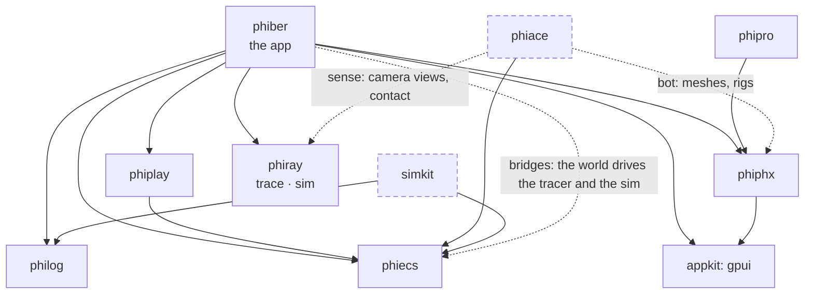
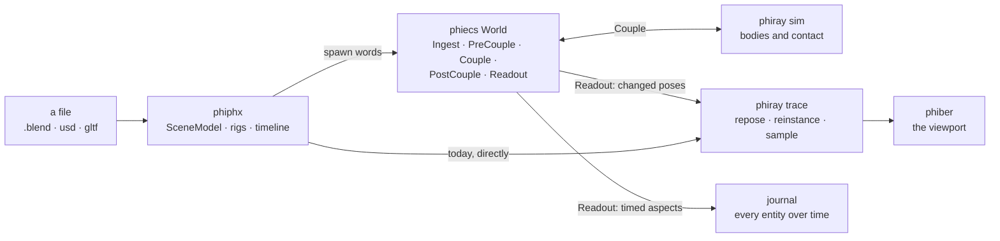
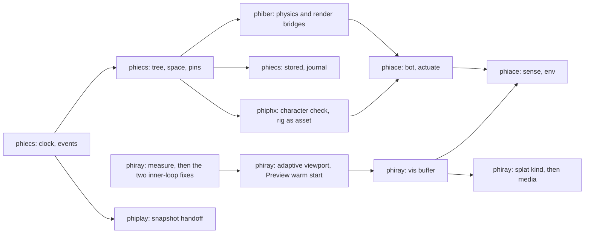

# phikit — plan

phikit is the reality kit. This page says which crate is which part of it,
how the crates stand on each other, and the folders every crate keeps. Each
crate's own `PLAN.md` gives its folder tree and order of work, and its
`SPECS.md` says what each part must do, with the Apple source it answers.

Everything marked "suggested" is a proposal to accept or strike, not a
decision already taken.

## The crates

| Crate | Repo | What it is | Apple's counterpart | Stands on | Pages |
|---|---|---|---|---|---|
| `phicore/phiecs` | phikit | the world: words, relations, aspects, staged systems | RealityFoundation: Entity, Component, System, Scene | nothing | [architecture](crates/phicore/phiecs/ARCHITECTURE.md) · [plan](crates/phicore/phiecs/PLAN.md) · [specs](crates/phicore/phiecs/SPECS.md) |
| `phiray` | phiray | the renderer: a compute path tracer, and a rigid-body `sim` | Metal ray tracing, MetalFX, Metal Performance Shaders | nothing in phikit | in its own repo: [architecture](https://github.com/gemphi/phiray/blob/main/ARCHITECTURE.md) · [plan](https://github.com/gemphi/phiray/blob/main/PLAN.md) · [specs](https://github.com/gemphi/phiray/blob/main/SPECS.md) |
| `phiphx` | phikit | the asset core: `.blend`, USD, glTF, PLY in, one scene out | Model I/O; `Entity(named:)` loading | gpui (feature `bui`) | [architecture](crates/phiphx/ARCHITECTURE.md) · [plan](crates/phiphx/PLAN.md) · [specs](crates/phiphx/SPECS.md) |
| `phiace` | phikit | robotics: a robot as words in the world. Not implemented | RealityFoundation joints, pins, IK, in part | phiecs | [architecture](crates/phiace/ARCHITECTURE.md) · [plan](crates/phiace/PLAN.md) · [specs](crates/phiace/SPECS.md) |
| `phiplay` | phikit | the game: sports, teams, kits, the play | none read | phiecs | - |
| `phiber` | phiber | the app: views, Project Browser, the rendered viewport | none read | phiecs, phiphx, phiray, phiplay, philog, gpui | - |
| `appkit` | phikit | the common app layer: GPU, pui, glass | AppKit | - | - |
| `phipro` | phikit | a project bundle from any asset phiphx reads | none read | phiphx | - |
| `philog` | phikit | the session journal for the `log` facade | none read | nothing | - |
| `simkit` | phikit | vehicles, sensors, controllers after AirSim. Not a workspace member | none | phiecs, philog | - |
| `apple` | phikit | Rust transcriptions of Apple frameworks: shapes, nothing runs | - | - | - |
| `phient` | phinet | learning: the orchestrator and the learner | Core ML, Create ML, ML Compute | phical, phiecs (phinet's) | in phinet: [plan](https://github.com/gemphi/phinet/blob/main/docs/phient/plan.md) · [specs](https://github.com/gemphi/phinet/blob/main/docs/phient/specs.md) |

## How they stand on each other

## A frame through the crates

## The folders every crate keeps

| Path | Holds | Rule |
|---|---|---|
| `README.md` | what the crate is and where to start | short |
| `ARCHITECTURE.md` | diagrams: modules, flows, links to pages | diagrams, not prose; under 200 lines |
| `PLAN.md` | the folder tree, today and suggested, and the order of work | tables and flow diagrams |
| `SPECS.md` | what each part must do, with its Apple source and reference | one row a requirement |
| `TODO.md` | the checklist, by module | ticked as work lands |
| `docs/` | one page a subject, lowercase; longer studies in capitals (`APPLE.md`) | a page is diagrams first |
| `reference/` | the repositories that guide the crate, as shallow submodules, and a `README.md` index | never built, never in the workspace |
| `src/` | code | no file over 250 lines; a folder is `mod.rs` plus named parts; tables live in data files |

## Suggested moves between crates

| Suggested | From | To | Why | When |
|---|---|---|---|---|
| One phiecs, not two | the hand copy in `phicore/phiecs` | a feature gate in the phiecs repo that phikit takes with no phinet path | the two have already drifted: relation numbering, `relate` | before the journal, which persists relation ids |
| Physics out of the renderer | `phiray/src/sim` | its own crate | phiace and the phiecs bridge need bodies and contact, not a tracer | after the physics bridge; `sim` uses `bvh`, so the CPU tree moves with it or is shared |
| simkit joins or folds | `crates/simkit`, outside the workspace | a member, or its sensors and controllers into phiace | it is the nearest code to phiace and is not compiled today | when phiace's `sense` starts |
| `fairo` follows the others | `phiace/ext/fairo` | `phiace/reference/fairo` | one place a crate | when the folder is free |
| Old reference trees fold in | `gemphi/ext/phiber-refs`, `phinet/crates/phiano/refs` | each crate's `reference/` | one place a crate | when the sessions using those paths are done |
| The transcriptions stay an index | `crates/apple` | - | the SDK headers under `gemphi/phi/apple-source` are the specification; the Rust shapes run nothing | now |

## Order across crates

