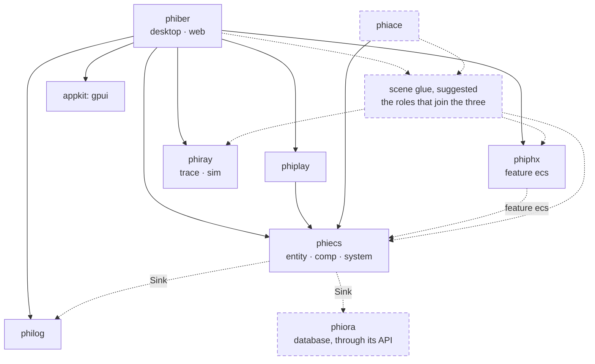
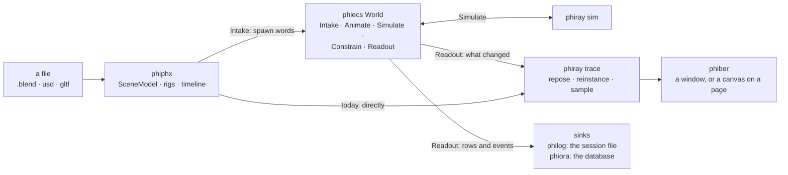
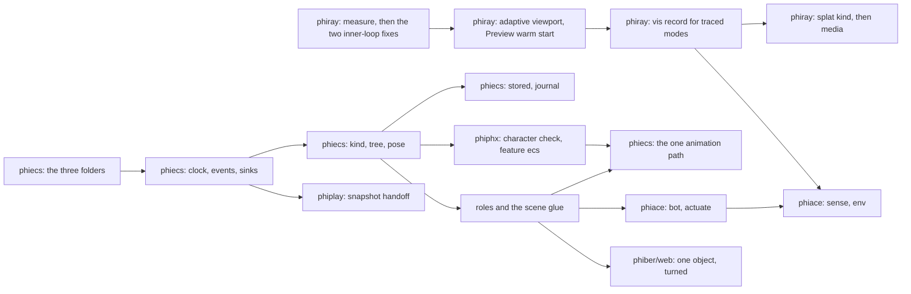

# phikit — plan

phikit is the reality kit. This page says which crate is which part of it,
who owns each concept, how the crates stand on each other, and the folders
every crate keeps. Each crate's own `PLAN.md` gives its folder tree and
order of work, and its `SPECS.md` says what each part must do, with the
Apple source it answers.

Everything marked "suggested" is a proposal to accept or strike, not a
decision already taken. Everything is planned from what exists first.

## The crates

| Crate | Repo | What it is | Apple's counterpart | Stands on | Pages |
|---|---|---|---|---|---|
| `phicore/phiecs` | phikit | the world: words, relations, aspects, staged systems | RealityFoundation: Entity, Component, System, Scene | nothing | [architecture](crates/phicore/phiecs/ARCHITECTURE.md) · [plan](crates/phicore/phiecs/PLAN.md) · [specs](crates/phicore/phiecs/SPECS.md) |
| `phiray` | phiray | the renderer: a compute path tracer, and a rigid-body `sim` | Metal ray tracing, MetalFX, Metal Performance Shaders | nothing in phikit | in its own repo: [architecture](https://github.com/gemphi/phiray/blob/main/ARCHITECTURE.md) · [plan](https://github.com/gemphi/phiray/blob/main/PLAN.md) · [specs](https://github.com/gemphi/phiray/blob/main/SPECS.md) |
| `phiphx` | phikit | the asset core: `.blend`, USD, glTF, PLY in, one scene out | Model I/O; `Entity(named:)` loading | gpui (feature `bui`) | [architecture](crates/phiphx/ARCHITECTURE.md) · [plan](crates/phiphx/PLAN.md) · [specs](crates/phiphx/SPECS.md) |
| `phiace` | phikit | robotics: a robot as words in the world. Not implemented | RealityFoundation joints, pins, IK, in part | phiecs | [architecture](crates/phiace/ARCHITECTURE.md) · [plan](crates/phiace/PLAN.md) · [specs](crates/phiace/SPECS.md) |
| `phiplay` | phikit | the game: sports, teams, kits, the play | none read | phiecs | - |
| `phiber` | phiber | the app, on the desktop and on the web (`web/`) | none read | phiecs, phiphx, phiray, phiplay, philog, gpui | [the web target](docs/web.md) |
| `appkit` | phikit | the common app layer: GPU, pui, glass | AppKit | - | - |
| `phipro` | phikit | a project bundle from any asset phiphx reads | none read | phiphx | - |
| `philog` | phikit | the session journal: one readable file a run | none read | nothing | [connect](crates/phicore/phiecs/docs/connect.md) |
| `simkit` | phikit | vehicles, sensors, controllers after AirSim. Not a workspace member | none | phiecs, philog | - |
| `apple` | phikit | Rust transcriptions of Apple frameworks: shapes, nothing runs | - | - | - |
| `phient` | phinet | learning: the orchestrator and the learner | Core ML, Create ML, ML Compute | phical, phiecs (phinet's) | in phinet: [plan](https://github.com/gemphi/phinet/blob/main/docs/phient/plan.md) · [specs](https://github.com/gemphi/phinet/blob/main/docs/phient/specs.md) |

## One owner a concept

A concept is defined once, in the crate that owns it. Every other crate
uses it through a handle or a trait and never defines it again.

| Concept | Owner | Others reach it by |
|---|---|---|
| identity, kinds, the tree, relations, queries | phiecs `entity/` | - |
| aspect storage, change ticks, saving | phiecs `comp/` | - |
| a place: `Pose`, `WorldMatrix`, and its propagation | phiecs `comp/space`, `system/space` | objects, bones, robot links, sensors and pins are all words with a `Pose` |
| time: the clock, the journal | phiecs `comp/time`, `system/time` | sinks: the session file, the database |
| playback: bind, playing, handoff, blending | phiecs `comp/anim`, `system/anim` | supplying a source and binds |
| what a clip is and how its curves evaluate | phiphx `blend/anim` | phiecs's `Sample` trait |
| a mesh, a rig, a material: the abstract asset | phiphx `scene`, `blend` | an `Asset` handle on the word |
| the pose solve: constraints, IK | phiphx `blend/rig` | a `Constrain` role |
| drawing, skinning on the GPU, the trees | phiray `trace`, `kernels`, `bvh` | a `Readout` role |
| bodies and contact | phiray `sim` | a `Simulate` role |
| a robot's description, controllers, sensors | phiace | roles on the kinds it declares |
| sports, teams, moves | phiplay | a move is a source on the one animation path |
| records on disk | philog | a sink |
| stored items | phiora, through the existing API | a sink; kinds named once |
| data files | `phistd::lexfile` | read by the app crate, passed in |

## What exists more than once today, to fold

| Concept | Copies today | Becomes |
|---|---|---|
| a skeleton | phinet kit's 67-joint enum, phiplay `BSkeleton`, phiphx `BRig` | phiphx's rig, its bones spawned as words |
| a placement | phiplay `BBody`, simkit `Placement`, a 4x4 in phinet kit | phiecs `Pose` |
| a recorded motion | phiplay `BTape`, `BBaked` | readers of the journal |
| the world of a scene | phiber's project world and a second, read-only world of assets | one world |
| the bridge from world to tracer and to physics | written in the app | roles plugged in once, by the scene glue |
| phiecs itself | a hand copy in phikit, the full crate in phinet | one source behind a feature gate |

## How they stand on each other

## A frame through the crates

## The folders every crate keeps

| Path | Holds | Rule |
|---|---|---|
| `README.md` | what the crate is and where to start | short |
| `ARCHITECTURE.md` | diagrams: modules, flows, links to pages | diagrams, not prose; under 200 lines |
| `PLAN.md` | the folder tree, today and suggested, and the order of work | tables and flow diagrams |
| `SPECS.md` | what each part must do, with its Apple source and reference | one row a requirement |
| `TODO.md` | the checklist, by module | ticked as work lands |
| `docs/` | one page a subject, lowercase; longer studies in capitals (`APPLE.md`) | a page is diagrams first |
| `reference/` | the repositories that guide the crate, as shallow submodules, and a `README.md` index | never built, never in the workspace |
| `src/` | code | no file over 250 lines; a folder is `mod.rs` plus named parts; tables live in data files |
| `src/entity/`, `src/comp/`, `src/system/` | in phiecs and every crate shaped by it: the three main folders, each unit a subfolder under the one it belongs to | a unit's data under `comp/`, its logic under `system/`, by the same name |
| names | files, folders and types | singular, always. A set takes a collective noun: `ChannelSet`, `EventQueue`, `LineSet` |

## Suggested moves between crates

| Suggested | From | To | Why | When |
|---|---|---|---|---|
| One phiecs, not two | the hand copy in `phicore/phiecs` | a feature gate in the phiecs repo that phikit takes with no phinet path | the two have already drifted: relation numbering, `relate` | before the journal, which persists relation ids |
| The scene glue, once | bridges inside phiber | one crate that depends on phiecs, phiphx and phiray and holds the roles joining them | phiber, phiace and a web viewer need the same glue; phiray, in its own repo, cannot take a phikit path | with phiecs order 8 |
| phiphx's own plugin | - | `phiphx/src/ecs/`, behind a feature | curves, rigs and the pose solve stay where they are checked against Blender | with phiecs order 9 |
| Physics out of the renderer | `phiray/src/sim` | its own crate | phiace needs bodies and contact, not a tracer | after the Simulate role; `sim` uses `bvh`, so the CPU tree moves with it or is shared |
| simkit joins or folds | `crates/simkit`, outside the workspace | a member, or its sensors and controllers into phiace | it is the nearest code to phiace and is not compiled today | when phiace's `sense` starts |
| `fairo` follows the others | `phiace/ext/fairo` | `phiace/reference/fairo` | one place a crate | when the folder is free |
| Old reference trees fold in | `gemphi/ext/phiber-refs`, `phinet/crates/phiano/refs` | each crate's `reference/` | one place a crate | when the sessions using those paths are done |

## Order across crates

