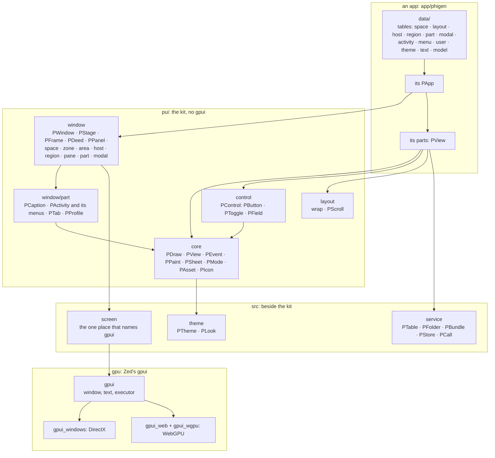
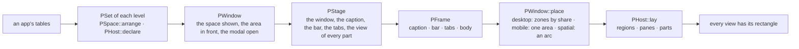
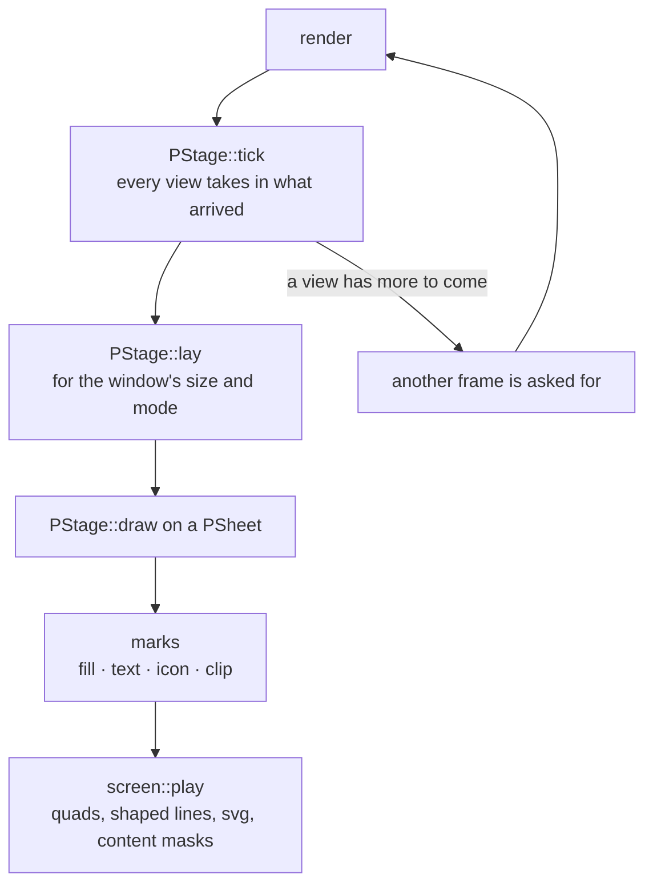
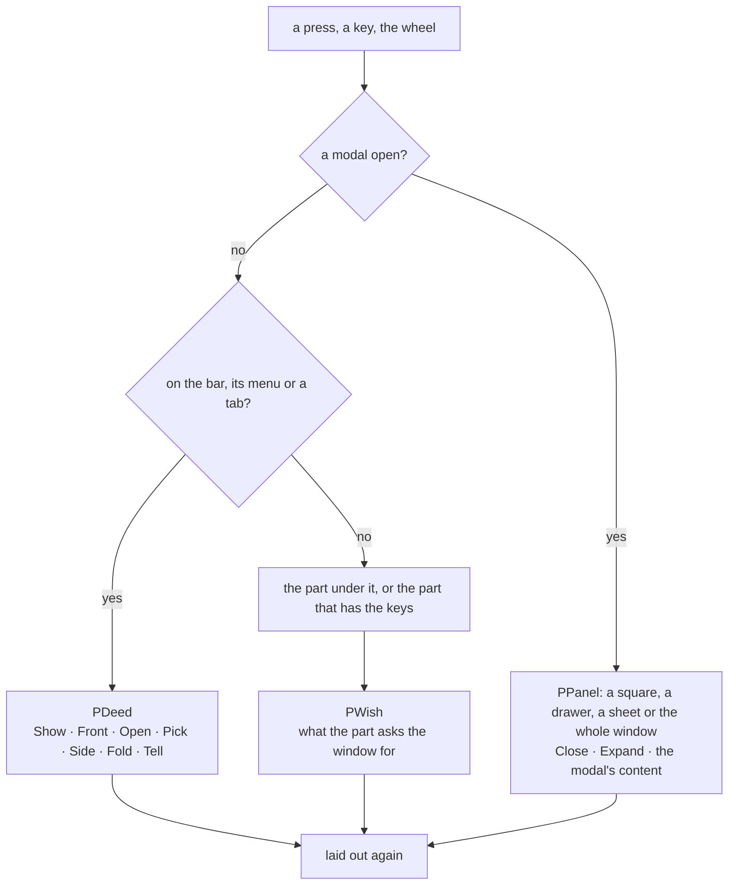
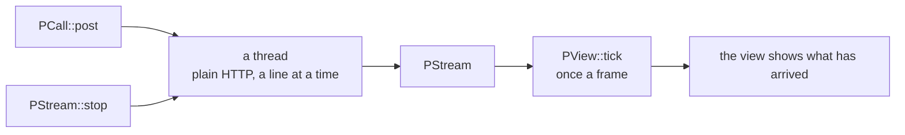
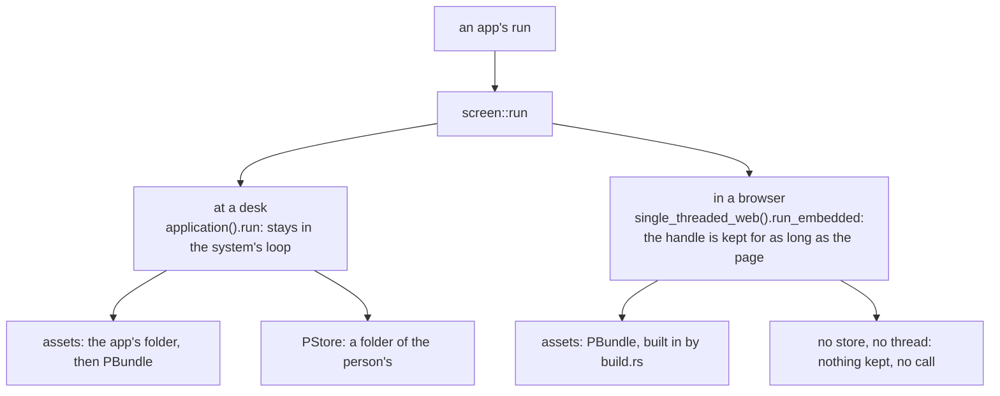

# appkit - architecture

Diagrams only. The words are in [`PLAN.md`](PLAN.md) and [`SPECS.md`](SPECS.md).

## The layers

## From tables to a window

## A frame

## An event

## An answer over time

## At a desk and in a browser

