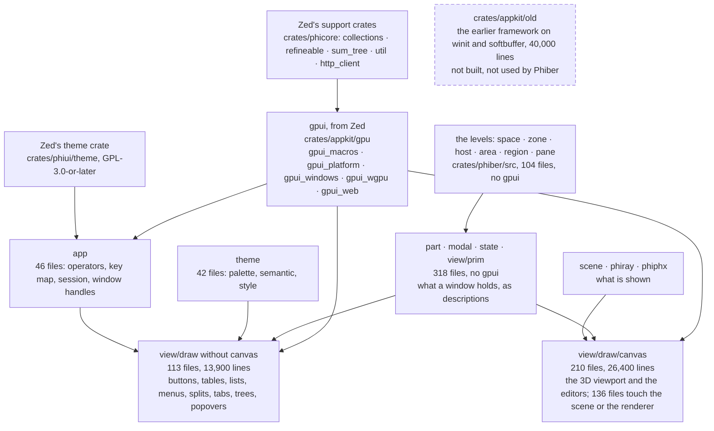
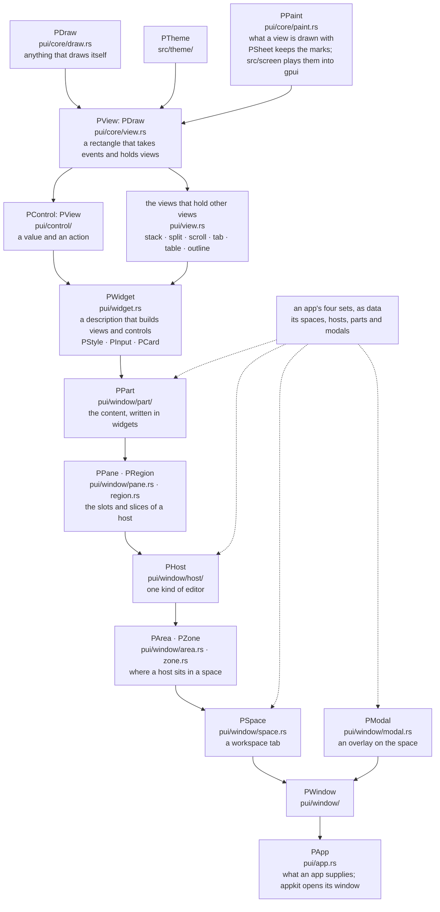

# appkit — plan

What appkit is to become: the one UI layer every app stands on. Phiber is
the first app on it, Phiace (robots and simulation) the second. This page
says what the UI is made of today, how the common layer is named and
arranged, in what order it is built, and what is still to decide.

The numbers were counted on 12 November 2026 from files and imports, not
from reading every module: the line between "general" and "Phiber's own"
will shift once code is copied.

## Decided

- The common UI is `pui/`, with no `src` folder inside it. `appkit` is one
  crate: `src/` holds the theme, the services, the data and the tests,
  `pui/` the kit, `asset/` the icons every app shares. Each app under
  `app/` has an `asset/` and a `data/` of its own.
- One app runs at a desk, in a hand and in space (`PMode`), and its
  window is laid out for each from the same spaces, zones and hosts.
- One owner a concern. Animation, the GPU, the system window and files
  belong to their own crates, not to `pui`. One GPU layer, wgpu. The web
  build is the default, not an extra.
- Every file, folder and type has a singular name of one word. Things that
  belong together share a folder.
- The hierarchy and the names are those of the earlier appkit and puikit
  (a view, a control, a widget, a window), not those
  of Phiber's folders.
- Every type of `pui` has the prefix `P`: `PView`, `PControl`, `PWidget`.
  The earlier `NS…` and Phiber's `B…` names are not carried over.
- Zed's gpui is not kept as it came: its interface half (elements, views,
  input, style) is transformed into `pui`, and its other half (the system
  window, the renderer, the text, the executor) stays in the crate that
  owns it.
- appkit creates the window. A space, a zone, an area, a host, a region,
  a pane, a part and a modal are appkit's own, with the meanings they have
  in Phiber. An app supplies its entries and their content; it builds no
  window structure of its own. Phiace gets its window the same way.
- The earlier Apple-style framework is reference: it lives in `old/`.
- Phiber's code is not touched until appkit works and is ready. The
  common layer is built beside it, from copies.
- The apps come to live under appkit, in `app/`.
- Nothing of Phiber's standpoint is given up: every part sits in a pane
  of a region of a host, a host in an area of a zone of a space, in
  appkit's own furniture too. The bar's room holds a host, not a bare
  part, and what an area shows changes by the area holding another host.
- Glass is one crate, `gpu/gpui_glass`, and every renderer draws from its
  plan. It goes on windows and panes only.
- The window's own furniture is appkit's and the same in every app: the
  caption (the row at the window's top, in the system's title bar's
  place: the app's mark, its name, the pin that puts the bar's menu
  away, and on Windows the window's three buttons), the
  activity bar (a column of icons: its rows at the top,
  the middle and the foot, the user; a row shows its menu beside the
  bar in groups, each on its own ground, with room for a part of the
  app's; the bar lies at the bottom in a hand, its menu drawn out over
  the space), the tabs of the spaces, the profile, and the panel a modal is
  shown in (a square in the middle of
  the window, which grows to the window and back). An app changes their
  data and nothing else. Everything drawn asks the theme.
- Every app has a `FLOW.md`: the steps a person takes, each one a test
  that passes, and the flow charts of what the code does for them.

## Where it stands

Phiber's UI is Zed's gpui underneath and two layers of Phiber's own on top:
a description of the interface that names no gpui type, and a drawing
layer that does.



| In `crates/phiber/src` | Files | Lines | Files that use gpui | Holds |
|---|---|---|---|---|
| `space`, `zone`, `host`, `area`, `region`, `pane` | 104 | 5,500 | 0 | the levels of a window, each a catalog |
| `part` | 208 | 23,200 | 0 | menubar, sidebar, file browser, outliner, properties, status bar and the rest, as descriptions |
| `modal` | 53 | 3,400 | 0 | dialogs |
| `state` | 40 | 3,700 | 0 | the keys UI state is kept under, and its log |
| `view/prim` | 17 | 1,600 | 0 | the primitives a part is drawn from |
| `view/draw` | 323 | 40,200 | 178 | everything drawn |
| `theme` | 42 | 5,800 | 7 | palette, semantic colours, styles |
| `app` | 46 | 6,400 | 22 | operators, key map, session, window handles |
| `scene` | 161 | 23,600 | 2 | Phiber's scene: not UI |

`crates/appkit` today:

| Path | What it is | Built |
|---|---|---|
| `gpu/` | Zed's gpui, vendored: what Phiber runs on | yes |
| `gpu/gpui_glass/` | the glass crate, moved beside the renderers on 12 November 2026 | yes |
| `old/` | the earlier AppKit-style framework on winit, softbuffer and fontdue (335 files, 40,000 lines) with its puikit, tests, documents, icons and manifest, moved here on 12 November 2026 | no |
| `pui/` | the common UI: its traits, three controls and the window's levels | yes |
| `src/` | the crate's root, with the theme, the services, the data and the tests | yes |
| `asset/icon/` | the 79 icons every app shares | - |
| `app/phigen/` | the first app: a chat | yes |

## The hierarchy

There are two halves. What a thing on screen is, in the earlier appkit's
and puikit's words: a view, a control, a widget. And how a
window is built, in the words Phiber already works by: a space, a zone, an
area, a host, a region, a pane, a part. Each word means one thing.

What a thing is:

| Word | What it is | Its trait | Examples |
|---|---|---|---|
| draw | the root: anything that draws itself | `PDraw` | every view; a mark or a border |
| paint | what a thing draws with; it knows the theme, so nothing drawn names a colour | `PPaint` | the window's painter; a test's board |
| view | something drawn that has a rectangle, takes events and holds other views. An event goes to the innermost view under the pointer and is passed up until handled | `PView: PDraw` | a stack, a split, a scroll, a table |
| control | a view a hand operates: it holds a value and sends an action when the value changes | `PControl: PView` | a button, a slider, a field, a toggle |
| widget | a description, not an object: what an app writes to say "a button here, labelled so". It builds views and controls | `PWidget`, with `PStyle`, `PInput`, `PCard` | a label, a row, a form, a section |
| app | what an app supplies: its name and its four sets. appkit opens its window | `PApp` | Phiber, Phiace, Phigen |
| mode | how the app is being used: at a desk, in a hand, in space. The window is laid out for each from the same levels | `PMode` | a window narrowed below 720 becomes a mobile one |
| asset | an app's files, by path | `PAsset` | an icon, a font, a picture |
| film | an app's pictures that move, by name: the latest frame of each | `PFilm` | a caller's camera in Phiogy |
| figure | a number on a ground of its own: an amount, a count, a price | `figure::end`, `figure::start` | the wallet and the rail's counts in Phiogy |
| block | the shared parts a page is made of: pill, group, table, face, fit (`pui/block.rs`); a section on a ground (`pui/layout/section.rs`) | `block::group`, `block::table`, `layout::section` | Phiogy's profile pane, title tools, rooms' tabs, a thing's facts |
| icon | a drawing by name, tinted by the theme | `PIcon` | `asset/icon/send.svg` |
| theme | what everything looks like: tokens resolved to an appearance | `PTheme` | a palette, a font, an icon set |

How a window is built. appkit creates every one of these; an app supplies
the entries, as data, and the content of its parts:

| Word | What it is | Its type | An app supplies |
|---|---|---|---|
| window | a top-level surface; it shows one space at a time | `PWindow` | nothing: appkit opens it |
| space | a workspace tab: one arrangement of the window | `PSpace` | its spaces, and which zones each has |
| zone | a grid slot inside a space | `PZone` | - |
| area | a slot inside a zone that holds one host at a time | `PArea` | which host an area starts with |
| host | one kind of editor; it declares its regions | `PHost` | its hosts |
| region | a slice of a host: header, centre, footer | `PRegion` | the regions of each host |
| pane | a left, centre or right slot inside a region | `PPane` | - |
| part | the leaf: the content, written in widgets | `PPart` | its parts |
| modal | an overlay on top of the space, a small app of its own | `PModal` | its modals |

All of them share one trait, `PLevel`: a set (`PSet`, in `set.rs`) of
entries, each with a stable name, a label and an icon. appkit ships the entries every app
needs (a menubar, a status bar, a sidebar, a file browser, preferences);
Phiber adds Blender's editors, Phiace its robot and simulation ones.



## Where it goes

```
crates/appkit/
  Cargo.toml      the appkit crate: src/ and pui/ together
  README.md · ARCHITECTURE.md · PLAN.md · SPECS.md · TODO.md    the crate's documents
  build.rs        builds asset/ into the program
  src/            what is not the UI kit itself
    lib.rs
    theme/          trait PTheme, PLook, a theme read from a table, and PShade, several looks of which one is shown; to come: appearance · style · variant
    service/        what a part asks for that is not drawn: PTable (names from a file), PFolder (assets on disk),
                    PStore (the folder an app keeps a person's own files in),
                    PBundle (the shared assets built into the program by build.rs),
                    PCall and PStream (a call to a server that answers over time);
                    to come: dialog · project · command · keymap · session
    screen/         a stage in a real window, at a desk or in a browser: the one place that names gpui;
                    album (the pictures, decoded once, and the film's latest frames) and errand (what only the system can do:
                    copy, open a file, keep a copy where the person says)
    data/           what would otherwise be typed into code: mode.tsv
    test/           the tests, in the same folders as the code
  pui/            the UI kit
    app             trait PApp: what an app supplies (four sets, a theme, the bar's rows,
                    a user, the part shown in the bar, the view of each part);
                    appkit opens its window
    core/           what everything is
      draw            trait PDraw
      view            trait PView: a rectangle, events, and a tick once a frame
      mode            PMode: desktop · mobile · spatial
      event           key, pointer, scroll; the keys that write nothing as Apple's function-key characters
      paint           trait PPaint, and its geometry and colour
      sheet           PSheet and PMark: what was drawn (fill · blend · glass · text · icon · picture · clip), for a screen to play
      asset           trait PAsset: an app's files, by path, and its film
      figure          a number on a ground of its own, drawn the same in every app
      film            PFilm and PStill: the pictures that move, shown a frame at a time from any thread
      icon            PIcon
    control/        trait PControl: button · toggle · field, and to come
                    secure · search · slider · stepper · segment · popup · combo · date · well · progress
    view            the views that hold or arrange other views; a folder once it holds
                    stack · split · scroll · group · tab · table · outline · grid · image · text · menu · toolbar · sidebar · surface
    widget          trait PWidget, PStyle, PInput, PCard
    layout/         where views go: wrap · scroll; to come: constraint · spacing · metric
    window/         PWindow, and PLevel, the trait the levels share
      set             PSet and PEntry: the entries of a level an app supplies
      place           where the areas go in each mode
      frame           PFrame: where the bar, the tabs and the space go
      deed            PDeed: what a press on the bar, a tab or a panel does (show a space,
                      bring a host in front, have an area hold another host, open a modal),
                      and PWish, where an app's part asks the window for one
      panel           PPanel: what an open modal is shown in: a square, a drawer, a sheet, the whole window;
                      with a head, or bare
      stage           PStage: the window with its parts built; it lays out, draws and sends events
      space · zone · area · region · pane · modal    a file each
      host/           PHost, and lay: where a host's parts go in its rectangle
      part/           PPart, and the parts every app has, trait PBar:
                      caption (the mark, the name, the pin, the
                      window's buttons) · activity (with the user's
                      button) · menu (what a row of it shows beside it)
                      · tab · profile
  asset/          what every app shares
    icon/           every svg
    font/           the interface face, Phi-Pill Open Light
  gpu/            Zed's gpui: the window on each system, the renderer, the text;
                  and gpui_glass, the glass a window is made of
  app/            the apps, each with its own asset/ and data/
    phigen/         the first: a chat
    phiber/
    phiace/
  old/            the earlier framework, kept as reference
```

## Who owns what

One owner a concern, as Apple has one framework a concern. `pui` is the
interface and nothing else: it does not animate, open a system window,
talk to a GPU or read a file. It asks the crate that owns that.

| Concern | Apple's framework | Owner here | Today |
|---|---|---|---|
| views, controls, windows, events | AppKit, UIKit | `appkit/pui` | the traits, three controls, the window's levels, the stage; drawn in a real window by Phigen |
| a declarative description of the interface | SwiftUI | `pui/widget` | the four traits |
| the look | NSAppearance | `appkit/src/theme` | the trait |
| 2D drawing and geometry | Core Graphics | `pui/core/paint` and `sheet` as the seam; `appkit/gpu` behind it, reached from `src/screen` | fills, rounded fills, lines of text, icons |
| text layout | Core Text | `appkit/gpu` (gpui's text system) | Zed's, as it came |
| compositing a frame, the system window | Core Animation, the window server | `appkit/gpu` | Zed's, as it came |
| the GPU | Metal | one layer, wgpu 29, for the interface (`gpu/gpui_wgpu`) and the tracer (`phiray/src/gpu`) | two on Windows and macOS: gpui draws with DirectX and Metal renderers of its own there, with wgpu only on Linux and the web, so a traced frame crosses through the CPU |
| what an animation is made of: keys, curves, easing, layers | Core Animation's timing; Model I/O | `phiphx` (`blend/anim`) | written: f-curves, easing, the NLA stack, drivers |
| playing it onto a field of anything: a bone, a lamp, a view | Core Animation, SceneKit | `phiecs` | drawn in `docs/anim.md`; not written |
| reading a scene from a file | Model I/O | `phiphx` | written |
| a 3D scene traced or rasterised | SceneKit's renderer, RealityKit | `phiray` | written |
| collections, tasks, paths | Foundation | `phicore` | Zed's support crates |
| the journal | os_log | `philog` | written |

Animation has two owners because it is two things. `phiphx` owns what an
animation is: the curves, their easing and their layers. `phiecs` owns
playing one onto a field, and its plan (`docs/anim.md`) names phiphx as a
source. `phiber/src/scene` has keyframes, actions and playback of its own
beside them, which is the copy to let go. `pui` adds none: a view has
fields, and an interface that moves is phiphx's curve played by phiecs
onto one of them.

Two rules follow for every crate of appkit:

- **One GPU layer, wgpu.** Nothing in `pui` names a GPU. The interface
  and the tracer are to share one wgpu device, which is also the only
  way the web build can run.
- **The web by default.** Every crate of appkit builds for
  `wasm32-unknown-unknown` with no feature switched on, and that build is
  part of its check, beside the tests. gpui picks the system from the
  target, so an app is the same code at a desk and in a browser.

Rules inside `pui/`:

- A folder is one of the words above; a file is one thing of that kind:
  `control/button.rs`. A thing of one file is a file: `window/zone.rs`. It
  gets a folder of its own name when it needs a second file, and not
  before: `window/host/`, `view/table/`. No folder holds a lone `mod.rs`.
- No folder is named as one above it on the same path is: no `gpu` in
  `gpu`, no `src` in `src`.
- Each folder's `mod.rs` holds its trait and nothing else. The entries of
  a level are in `set.rs`. The logic is in traits: what is the same for
  every control, every level and every app is a provided method of its
  trait (`PControl::change`, `PLevel::slug`, `PApp::open`), written once.
- A name is one word and singular. The earlier long and plural names are
  cut to their noun: `segmented_control` is `segment`, `progress_indicator`
  is `progress`, `outline_view` is `outline`, `widgets` is `widget`.
- Every type starts with `P`, then its word: `PButton`, `PSplit`, `PHost`.
- Drawing is in `core/paint` and the `draw` of a view or control; a
  widget and everything under `window/` describe and do not draw.
- An entry of a level (a space, a host, a part) is data in `data/`, not an
  arm of an enum: an app adds one without changing `pui`.
- A file transformed from Zed's gpui names the gpui file it came from and
  keeps its Apache-2.0 notice.
- No file passes 250 lines. Tables, labels and defaults are read from
  `data/`.

| Folder | Where the earlier code is (reference) | What of Phiber's lands here later |
|---|---|---|
| `core/` | `old/core` (105 files); Zed's gpui, below | `app` (launch) |
| `control/` | `old/controls` (49 files) | `view/draw/ctrl`, `button.rs`, `field.rs`, `search.rs`, `progress.rs` |
| `view/` | `old/views` (59 files) | `view/draw` without `canvas`: `flex`, `split`, `scroller`, `tab`, `table`, `tree`, `list`, `menu`, `popover`, `sidebar`, `surface` |
| `widget` | `old/pui/src/widgets` (8 files), `phi-old/apple/src/puikit` | `view/prim` and the `BView` tree |
| `layout/` | `old/layout`, `old/core/layout_engine` | `view/layout.rs`, `size.rs`, `resize.rs` |
| `window/` | `old/core/window`, `old/workspace` (6 files); buikit's `structure`, `screen` | `level.rs`, `spec.rs`, `app` (window handles) |
| `window/space`, `zone`, `area`, `region`, `pane` | buikit's `spaces`, `structure/area` | `space`, `zone`, `area`, `region`, `pane` (42 files): the mechanism, with Phiber's entries left in Phiber |
| `window/host/` | `old/panels` (44 files) | `host` (62 files): the mechanism, and `file`, `pref` |
| `window/part/` | `old/views` (toolbar, sidebar, activity bar) | `part` (208 files): the mechanism, and `menubar`, `statusbar`, `sidebar`, `toolbar`, `navbar`, `switcher`, `search`, `filter`, `activity` |
| `window/modal` | `old/controls/alert`, `old/services/dialog` | `modal` (53 files): the mechanism, and `about`, `command`, `pref` |
| `src/theme/` | `old/theme` (25 files) | `theme` (42 files) |
| `src/service/` | `old/services` (11 files) | `state`, `app/op`, `app/keymap`, `app/session` |
| `view/surface` | `old/gpu` (32 files) | `view/draw/surface`, `backend.rs` |

### Zed's gpui, transformed

gpui is 185 files and 118,000 lines in ten crates under `gpu/`; 61 of the
86 files of its core pass 250 lines. Its interface half is taken apart
into `pui`'s folders, renamed to `P…`, and cut to files of one thing each.
Its other half is not interface and does not come into `pui`: the system
window, the renderer, the text and the executor stay with their owner.

| gpui | Files | Lines | Becomes |
|---|---|---|---|
| `src/app`, `app.rs`, `global.rs`, `subscription.rs` | part of 86 | part of 65,600 | `pui/core/app` |
| `src/window`, `window.rs` | | | `pui/core/window` |
| `src/element.rs`, `elements`, `view.rs`, `interactive.rs` | | | `pui/core/view`, `pui/view`, `pui/control` |
| `src/input.rs`, `gestures.rs`, `action.rs`, `key_dispatch.rs`, `keymap` | | | `pui/core/event`, `src/service/keymap`, `src/service/command` |
| `src/scene.rs`, `color.rs`, `geometry.rs`, `path_builder.rs`, `svg_renderer.rs`, `text_system` | | | `pui/core/paint` |
| `src/style.rs`, `styled.rs`, `taffy.rs` | | | `pui/layout`, `pui/widget` (`PStyle`) |
| `src/executor.rs`, `platform_scheduler.rs`, `queue.rs` | | | not `pui`: `phicore/scheduler` owns running work |
| `src/platform`, `gpui_platform` | | | not `pui`: stays in `gpu/`, the system window |
| `gpui_windows` | 20 | 12,300 | stays in `gpu/`; its DirectX renderer gives way to `gpui_wgpu` |
| `gpui_macos` | 17 | 12,700 | stays in `gpu/`; its Metal renderer gives way to `gpui_wgpu` |
| `gpui_linux` | 27 | 15,100 | stays in `gpu/`; draws with `gpui_wgpu` already |
| `gpui_web` | 10 | 3,200 | stays in `gpu/`; draws with `gpui_wgpu` already |
| `gpui_wgpu` | 6 | 4,500 | stays in `gpu/`: the one renderer, on the device it shares with phiray |
| `gpui_macros` | 15 | 3,500 | `pui/macro` crate, or written out by hand |

The earlier code gives the names of what a thing is; Phiber gives the way
a window is built and the behaviour that works; Zed's gives the drawing.
What stays in an app: its sets (which spaces, hosts, parts and modals
it has), its canvas, its scene, and the content of the parts only it
needs. For Phiber those are the Blender editors; for Phiace, its robot and
simulation views.

## Steps

Phiber is not changed before step 8. Until then the common layer is built
beside it, and what is copied can drift from Phiber's own: the shorter that
time, the better.

| Step | What | Done when |
|---|---|---|
| 0 | The rest of the earlier framework into `old/`; the open questions below answered | `appkit` holds `src`, `pui`, `asset`, `gpu`, `app`, `old` and nothing else |
| 1 | The `appkit` crate: a manifest, `src/lib.rs`, the folders above, each with its trait | it builds, for the desktop and for the web |
| 2 | `app/phigen`, the first app: a chat, from configuration files, drawn in a real window through a painter over gpui | its window opens and is captured |
| 3 | `control`, `view`, `layout` | `app/phigen` shows every control and every view it needs, in the three modes |
| 4 | `widget` | `app/phigen` is written in widgets alone |
| 5 | `service`, and the interface half of gpui transformed into `pui` | no `use gpui` in an app; keys go to the focused view |
| 6 | One GPU layer: `gpui_wgpu` on every system, on the device phiray traces with; `view/surface` | `app/phigen` runs in a browser; a traced frame is shown without crossing the CPU |
| 7 | Phiace's first window | Phiace supplies its spaces, hosts and parts; appkit creates the window, with the same menubar and status bar as every app |
| 8 | Phiber takes each piece from `pui` and lets its own copy go | Phiber builds, its tests pass, a pose renders as before |
| 9 | Phiber and Phiace under `appkit/app` | the workspace builds from the new paths |

As of 12 November 2026: step 0 is done but for the open questions, and
step 1 is done. `pui` has `PDraw`, `PView` (with `show` and `send`),
`PEvent`, `PPaint` and its geometry, and `PApp` in `core`; `PControl` and
the first three controls, `PButton`, `PToggle` and `PField`; `PWidget`,
`PStyle`, `PInput`, `PCard`; `PTheme`; `PMode`, `PAsset` and `PIcon`; and in
`window` `PLevel`, `PEntry`, `PSet`, `PWindow`, the eight levels, their
arrangement read from configuration, and `place`, which lays a window out
for a desk, a hand or space; the stage, which lays an app's window out,
draws it and sends it what a hand does; and the furniture every window
has: the caption, the activity bar with its menus and the user's button, the tabs,
the profile and a modal's panel. It has 174 tests. The first app, `app/phigen`, is a chat
built from configuration files, answered by a model on this computer and
drawn in a real window, with 68 tests;
its thirty-three steps and its flow charts are in `app/phigen/FLOW.md`. Both
build for `wasm32-unknown-unknown` with no feature switched on, gpui
included, and Phigen runs in a browser, drawn through WebGPU
(`app/phigen/FLOW.md`, "In a browser").

## What makes it hard

- **gpui is the largest piece by far.** 118,000 lines, most of them in
  files several times the size allowed here. Once transformed it is a
  fork: what Zed fixes upstream no longer arrives by updating a folder.
  Phiber goes on using `gpu/` as it is until step 8, so both exist for a
  while.
- **Two models have to meet.** The earlier appkit keeps objects (a view
  that lives and is told to redraw); gpui, which Phiber draws with, builds
  the picture again from a description every frame. `Widget` is where they
  meet: a description on top, gpui underneath. `View` and `Control` have
  to be defined so that gpui can draw them, not as the earlier `NSView`.
- **Phiber's levels are closed lists.** `BSpaceType`, `BHostType` and
  `BPartType` are enums of Blender's workspaces and editors, and the view
  tree names them. In `pui` the same eight levels are open: an entry is
  data an app supplies. `BLevelType` (`phiber/src/level.rs`) is already
  the seam, the one trait every level implements.
- **Phiber's draw code reaches into Phiber's state.** What is taken from
  it must be given what it draws.
- **Phiber is its own repository.** It is a git submodule of phikit. Step 8
  crosses that boundary and step 9 changes the submodule's path.

## Open questions

1. **Zed's `theme` crate is GPL-3.0-or-later**, and code transformed from
   it stays under that licence. gpui is Apache-2.0, which only asks that
   its notice is kept. Suggested: `src/theme` is written from Phiber's own
   theme and the earlier appkit's, and takes nothing from Zed's `theme`.
2. **gpui's macros** (`gpui_macros`): a second small crate, or the code
   they write is written out by hand.
3. **phiphx names gpui** as an optional dependency. A file reader should
   not need the UI toolkit; find what uses it.
4. **Where the one wgpu device lives.** Today `phiray/src/gpu` makes one
   and `gpui_wgpu` another. Apple puts Metal beneath both Core Animation
   and SceneKit. Suggested: a small crate beneath both (`phigpu`, in
   `phicore`), made from `phiray/src/gpu`'s adapter and shared device,
   which `gpui_wgpu` and phiray both take theirs from.
5. **Interface animation.** `phiecs/docs/anim.md` has one path for every
   animated field: a source gives values at a time (`Sample`; phiphx's
   f-curves and easing are one source), and phiecs plays it onto a field.
   A view's rectangle or opacity is then one more field. This needs
   `phiecs` to have the path written, and `appkit` to depend on `phiecs`.
