# Phigen - flow

What a person does in Phigen, step by step, and what the code does for
each step. Every step is a test that passes; the test is named beside it.
The chats are kept in `history.tsv` in a folder named `phigen` where the
system keeps such things (`%APPDATA%` on Windows); `phigen --forget`
opens without them and keeps none.
Run them with `cargo test -p phigen`.

Pictures of the window as it is drawn today: [the welcome](doc/welcome.png),
[a new chat](doc/start.png), [a new chat on a wide screen](doc/start-wide.png),
[a chat the model answered](doc/model.png),
[the models to choose among](doc/roster.png), [the settings](doc/setting.png),
[the Search window](doc/search.png), [the Search window on a wide screen](doc/search-wide.png),
[the profile](doc/profile.png).
The bar: [what Home holds](doc/home.png), [what Menu holds](doc/menu.png),
[the bar alone, its menu put away](doc/bar.png),
[Phigen's mark, both ways](doc/logo.html). The settings are the drawer
at the right and the models the sheet at the foot.
In the other looks: [a new chat, dark](doc/start-dark.png), [glass](doc/start-glass.png)
and [glass light](doc/start-frost.png); [the profile, dark](doc/profile-dark.png) and
[glass](doc/profile-glass.png); [the settings, dark](doc/setting-dark.png);
[the Search window, dark](doc/search-dark.png) and [glass](doc/search-glass.png);
[the Menu, dark](doc/menu-dark.png) and [glass](doc/menu-glass.png).
In a hand: [a new chat](doc/hand.png), [Chat's menu drawn out](doc/hand-menu.png),
[the profile](doc/hand-profile.png), [the settings](doc/hand-setting.png).

## The journey

As a user I would like to:

| Step | I would like to | What happens | Test (`src/test/`) |
|---|---|---|---|
| 1 | open Phigen and see who I am talking to | the window opens on the Chat space; Phigen greets me | `app::it_opens_greeting_the_person_and_asking_what_they_want` |
| 2 | start typing at once | the field has the keys from the start; nothing needs a press first | `flow::step_2_i_can_type_at_once_without_pressing_anything` |
| 3 | see what I type as I type it | each key is added to the field, and the hint goes | `part::ask::what_is_typed_shows_in_the_field_and_enter_says_it_and_empties_the_field` |
| 4 | take back a letter | backspace takes the last one away | `part::ask::backspace_takes_the_last_letter_away` |
| 5 | send with Enter | what the field holds is said in the chat and the field is emptied; a blank is not said | `part::ask::what_is_typed_shows_...`, `part::ask::nothing_is_said_when_the_field_is_blank` |
| 6 | send with the button | a press on Send does what Enter does | `part::ask::a_press_on_send_says_what_the_field_holds` |
| 7 | tell my words from Phigen's | mine are on the right, Phigen's on the left, the newest lowest | `part::talk::the_person_s_turn_is_on_the_right_and_phigen_s_on_the_left` |
| 8 | be told the truth about who answers | the pill over the chat names the model that answers; where none is connected the greeting and every answer say so, and a model that cannot be reached says why | `reply::the_stand_in_says_what_it_heard_in_the_words_the_text_table_gives`, `model::a_model_that_cannot_answer_says_why_in_the_words_the_text_table_gives`, `app::whoever_stands_behind_reply_answers` |
| 9 | read a long answer | text is broken into lines that fit its bubble | `part::talk::a_turn_too_long_for_a_line_is_set_in_several` |
| 10 | find a chat by what it was about | a chat is called by my first question, over the talk and in the list | `flow::step_10_the_chat_is_called_by_my_first_question_over_the_talk_and_in_the_list` |
| 11 | begin another chat | New chat, the first row of the menu beside the bar, begins one above the others; an unused chat is not doubled | `part::thread::the_menu_s_row_begins_a_chat_above_the_others_once_the_open_one_is_used` |
| 12 | go back to an earlier chat | my chats are in the menu beside the bar; a press on a title opens it, and I can go on typing without pressing the field | `part::thread::a_press_on_a_title_opens_that_chat` |
| 13 | find a chat I had | Search, a row of the menu beside the bar, opens the Search window: a heading, a field, and every chat with the day it began and how much was said. What I type searches the titles, whatever its case; a pill narrows the list to today or earlier and the last one turns the order; a press on a chat opens it in the Chat space | `part::find::step_13_the_search_window_lists_my_chats_with_the_day_each_began`, `part::find::step_13_what_i_type_searches_the_titles_and_a_press_opens_the_chat`, `part::find::step_13_a_pill_narrows_the_list_to_a_day_and_the_last_turns_the_order` |
| 14 | get around from one bar, the same in every app | the bar is a column of icons, and the menu of its Chat row stands beside it: New chat, Search, and my chats. The pin, in the caption over the bar and its menu, puts the menu away and brings it back. In a hand the bar lies under my thumb, and Chat draws its menu out over the chat | `flow::bar::step_14_the_bar_shows_my_chats_beside_it_and_puts_them_away`, `flow::bar::step_14_in_a_hand_the_bar_lies_under_my_thumb_and_draws_my_chats_out` |
| 15 | see who I am signed in as | my mark, at the foot of the bar, opens my profile: a square in the middle of the room under the caption that fills half of it (step 30). It grows to the whole window and back, and closes by its button, by Escape or by a press beside it | `flow::step_15_my_row_opens_my_profile_as_a_square_in_the_middle_of_the_window`, `flow::step_15_the_profile_grows_to_the_window_and_back_and_closes_three_ways` |
| 16 | use it narrow, or on a phone | below 720 wide the same window is a mobile app: the chat alone, the bar under it. What I said is still there, and wide again it is as it was | `flow::step_16_made_narrow_the_same_window_is_a_mobile_app_with_my_chat_still_in_it`, `app::narrowed_it_is_a_mobile_app_and_shows_the_chat_alone` |
| 17 | read back through a long chat | the wheel scrolls the talk back to the first turn and forward to the newest, and no further; saying something comes back to the newest. A turn is cut at the talk's edge, never drawn over the title or the field | `part::talk::step_17_a_long_chat_is_scrolled_back_with_the_wheel_and_comes_back_when_i_say_something`, `part::talk::step_17_a_chat_that_fits_does_not_scroll` |
| 18 | see where I am typing, and paste | a caret stands after what I have typed; Control and V (Command and V on a Mac) types the clipboard's text on one line | `part::ask::step_18_a_caret_stands_after_what_i_have_typed`; paste is appkit's `screen::key::the_paste_chord_types_the_clipboard_s_text_on_one_line` |
| 19 | find my chats again tomorrow | every time something is said the chats are written to a file of my own; when Phigen opens again a new chat is open and the earlier ones are in the list | `keep::step_19_what_i_said_is_there_when_phigen_opens_again`, `keep::a_history_is_written_a_turn_a_line_and_read_again_as_it_was` |
| 20 | be answered by a model, and watch it write | the model `data/model.tsv` names answers, on this computer; its answer arrives a piece at a time and the window draws each piece; three dots stand for it until its first word, and nothing more can be said until its last | `model::step_20_a_model_answers_me_and_its_answer_arrives_as_it_is_written`, `model::the_model_s_answer_is_its_pieces_in_order_and_it_is_sent_the_chat_without_the_greeting` |
| 21 | stop an answer I do not need | while an answer is being written the button says Stop; a press on it, or Escape, stops it. What had been written stays, the model is let go, and I can say something again | `model::step_21_i_can_stop_an_answer_while_it_is_being_written` |
| 22 | mend what I typed without starting again | the arrows, Home and End move the caret; a key writes where it stands; Backspace takes the letter before it and Delete the one after | `part::ask::step_22_i_can_go_back_in_what_i_typed_and_mend_it` |
| 23 | reach a chat however many I have | the list beside the bar and the Search window's list scroll with the wheel when there are more chats than fit; a press on a title that was scrolled to opens it | `flow::step_23_more_chats_than_fit_are_scrolled_in_the_bar_and_in_the_search_window` |
| 24 | begin a chat without hunting for where | a chat nothing was said in shows the field halfway down what the header leaves, a heading over it and three ways to begin under it; a press on one says what it stands for; New chat brings this back | `flow::step_24_a_new_chat_has_the_field_in_the_middle_and_ways_to_begin_under_it` |
| 25 | be welcomed the first time | with nothing said in any chat Phigen opens on a welcome: a square in the middle with the same three ways and a button that closes it | `flow::step_25_my_first_time_i_am_welcomed_in_a_square_with_the_ways_to_begin` |
| 26 | see everything centred and whole, on any screen | the heading, the field, the ways to begin, the turns and the Search window keep to one column down the middle of the window, 744 wide where there is room and a gap from the sides where there is not. A button's label is in its middle; every card's words begin at the same height and a long line takes two; in a hand the cards share the room so none is cut off; a title too long ends with three dots | `part::everything_in_the_body_keeps_to_one_column_down_its_middle`, `part::every_card_s_words_begin_at_the_same_height_and_a_long_line_takes_two`, `part::in_a_hand_the_cards_are_stacked_and_none_runs_past_its_part`, `part::a_text_cut_short_ends_with_the_theme_s_mark` |
| 27 | see which model answers, and choose another | a pill over the chat names the model that answers, on a new chat and on one with a name. A press on it lists the models the server on this computer has; a press on one has it answer from now on and takes the list away. With no model connected the pill says so, and there is nothing to choose | `part::pick::step_27_a_pill_over_the_chat_names_the_model_that_answers_and_lists_the_others`, `part::pick::with_no_model_connected_the_pill_says_so_and_there_is_nothing_to_choose`, `part::roster::the_model_that_answers_is_marked_once_and_more_than_fit_are_scrolled`, `model::the_server_says_which_models_it_has_the_first_time_anyone_asks`, `model::the_model_that_was_chosen_is_the_one_the_server_is_asked_for` |
| 28 | set Phigen up the way I like it | Settings, a row of the bar's Menu, opens the settings, a square as every modal is: the look, one of four, which the next frame is drawn in; and the model that answers, the same list. In a hand the Menu is drawn out over the chat, and is put away as the settings open | `part::setting::step_28_the_menu_opens_the_settings_where_i_choose_the_look_and_the_model`, `part::setting::a_look_changes_every_colour_of_the_theme_or_none`, `part::setting::the_user_at_the_bar_s_foot_opens_the_profile` |
| 29 | find Phigen the way I left it | the look and the model I chose are written to a file of my own each time I choose, and chosen again when Phigen opens; `phigen --forget` opens as it ships | `choice::step_29_phigen_opens_the_way_i_left_it`, `choice::a_choice_is_kept_a_line_and_the_last_under_a_name_stands` |
| 30 | see what is known of me, and choose how Phigen appears | my profile is a square that fills half of the window. Under my name it says what is true now: the model that answers and its server, the look, how many chats I have, where they are kept, which Phigen this is. Under that, Appearance: a pill for each look, Light, Dark, Glass and Glass Light. A press on one turns the window to it and keeps it. In Glass the window lets the desktop show, blurred, and its bar and the panel that floats are panes of glass; buttons, rows and icons are not. A profile longer than its square is scrolled | `fact::step_30_my_profile_says_what_is_true_now_and_lets_me_choose_glass`, `fact::what_is_true_of_me_is_said_as_it_is_now`, `app::nothing_phigen_draws_has_a_fill_of_its_own` |
| 31 | find everything from the bar, a press away | the bar has Home and Chat at its top, Menu at its middle and me at its foot, under Phigen's mark in the caption. A press on one of the three shows what it holds beside the bar, in groups, each on a ground of its own: Home the ways to begin, Chat my chats, Menu the Search window, the model, the four looks, the settings and my profile. Home and Chat go somewhere as well: Home to the start, a new chat, and Chat to the chat. The groups stand at the top, round the middle and at the foot, as the bar's own rows do. A press on the row whose menu is shown puts it away | `flow::bar::step_31_home_and_chat_are_at_the_top_menu_in_the_middle_and_i_am_at_the_foot`, `flow::bar::step_31_in_a_hand_home_goes_to_the_start_and_draws_what_it_holds_out` |
| 32 | know Phigen by its mark, at the top of the window | the window's top row, where Windows had its title bar, is Phigen's: its mark over the bar, its name, the pin, and at the right the window's three buttons. A press on the mark goes to the start; the row between is what the window is moved by. The mark is the o of its own face as a chat bubble, a beak under its left corner, and two lines in it, the upper twice the lower, which make a p of it. It is drawn on the font's measures by `script/logo.py`, with a second mark of the two bars alone | `flow::bar::step_32_phigen_s_mark_is_in_the_caption_over_the_bar_and_its_upper_line_is_twice_its_lower`; the row itself is appkit's `window::part::caption` and `window::stage::bar::under_a_caption_the_pin_and_the_mark_are_at_the_top_and_a_modal_is_laid_under_it` |
| 33 | do one thing beside another | what I do beside the page comes at the side of it, and what I pick from comes up from the foot: the settings are a drawer at the right edge, the models a sheet at the foot, and my profile and the welcome stay squares in the middle. The bar, a drawer and a sheet all stand clear of the window's edges and under the caption, their corners round. Each grows to all that is under the caption and closes as a square does | `flow::step_33_the_settings_come_as_a_drawer_at_the_right_and_the_models_as_a_sheet_at_the_foot`, `flow::bar::step_14_the_bar_shows_my_chats_beside_it_and_puts_them_away` |

```mermaid
graph LR
    s1["1 open"] --> s2["2 type at once"] --> s3["3 see it"] --> s4["4 take back"]
    s4 --> s5["5 Enter"]
    s4 --> s6["6 Send"]
    s5 --> s7["7 mine right, Phigen's left"]
    s6 --> s7
    s7 --> s8["8 told who answers"] --> s9["9 long answer wraps"] --> s10["10 chat has a name"]
    s10 --> s11["11 new chat"] --> s12["12 back to an earlier one"]
    s12 --> s13["13 Search window"] --> s14["14 the bar: its menu, chats"] --> s15["15 profile"] --> s16["16 narrow: mobile"]
    s16 --> s17["17 scroll back"] --> s18["18 caret, paste"] --> s19["19 chats kept"] --> s20["20 a model answers"]
    s20 --> s21["21 stop it"] --> s22["22 mend what I typed"] --> s23["23 scroll my chats"]
    s25["25 welcomed, the first time"] --> s24["24 a new chat: the field in the middle"] --> s2
    s23 --> s24
    s24 --> s26["26 one column, centred"]
    s20 --> s27["27 the pill: which model"]
    s14 --> s31["31 Home, Chat, Menu, me"] --> s28["28 Menu: settings"] --> s29["29 opens as I left it"]
    s31 --> s32["32 Phigen's mark"]
    s28 --> s33["33 a drawer at the right, a sheet at the foot"]
    s27 --> s33
    s27 --> s29
    s15 --> s30["30 profile: about me, appearance, glass"] --> s29
```

## What is shared and what is Phigen's

The window's own furniture is appkit's and the same in every app. An app
changes its data and nothing else.

| On screen | Whose code | Phigen's data |
|---|---|---|
| the caption: the mark, the name, the pin, the window's three buttons | appkit: `pui/window/part/caption.rs` | `data/activity.tsv`: the row seated `head` is the mark, whose icon is the logo, and what a press on it does; `data/theme.tsv`: `caption.height` |
| the activity bar: its icons at the top, the middle and the foot | appkit: `pui/window/part/activity/` | `data/activity.tsv`: the rows, the seat of each and what a press does |
| the menu a row of the bar shows beside it: its groups, each on its own ground, and the room for my chats | appkit: `pui/window/part/menu.rs` | `data/menu.tsv`: each row's groups, their seats, headings and rows; `data/app.tsv`: `side`, the host a `side` group holds |
| the user's mark | appkit: `pui/window/part/activity/` | `data/user.tsv`: `name`, and `modal`, the modal a press opens |
| the tabs, in an app that has them | appkit: `pui/window/part/tab.rs` | `data/space.tsv`: the spaces; `data/app.tsv`: `tab`, which Phigen sets to `no`, its spaces being rows of the bar |
| the profile: who I am, what is known of me, how the app appears | appkit: `pui/window/part/profile.rs` | `data/user.tsv`: every row, and the headings `about` and `appearance` |
| a modal's panel: the square, the veil, expand and close | appkit: `pui/window/panel.rs` | `data/modal.tsv`: the modals |
| where everything goes, at a desk and in a hand | appkit: `frame.rs`, `place.rs`, `host/lay.rs` | `data/layout.tsv`, `data/region.tsv` |
| every colour, size and face | appkit asks the theme | `data/theme.tsv` |
| the looks (light, dark, glass, glass light) and turning from one to another | appkit: `src/theme/shade.rs`, `PShade` | `data/look.tsv`: each look and the rows it changes; `data/text.tsv`: `look.<name>` |
| how every surface is lit: the surface, the label, a pane | appkit: `pui/core/light.rs` | `data/theme.tsv`: `shade.*`, `surface.turn`, `label.turn` |
| glass: the window itself, and its panes | appkit: `pui/core/glass.rs`, `src/screen`; the renderer's backdrop pass, `gpu/gpui_glass` | `data/look.tsv`: `window.glass`, `glass.*` |
| what is true of me now, in the profile | appkit: `PProfile` asks an app's `PFact` once a frame | Phigen: `src/fact.rs`; `data/text.tsv`: `fact.<name>` |
| what I chose, kept for the next time | appkit: `src/service/store.rs`; Phigen: `src/choice.rs` | `data/app.tsv`: `setting`, the file |
| every word a person reads | - | `data/text.tsv`, and the labels in the tables above |
| the chat itself: thread, title, talk, ask; its start: hello, card; the Search window: find; the pill in the title: pick; what two modals show: roster, setting | Phigen: `src/part/` | `data/card.tsv`: the ways to begin; `data/find.tsv`: the Search window's pills; `data/app.tsv`: `pick`, the modal the pill opens |
| which host an area holds: the start of a chat, or the chat | appkit: `PDeed::Hold`, an area holding one host at a time | `data/app.tsv`: `empty`, `front`; `data/region.tsv`: each host's regions and panes |
| where the chats are kept | appkit: `src/service/store.rs`; the format is Phigen's, `src/keep.rs` | `data/app.tsv`: `folder`, `keep` |
| who answers | appkit: `src/service/call.rs`, the call; Phigen: `src/model.rs`, what is said to the model and which models there are | `data/model.tsv`: the server, the model, and `list`, where the server says which it has; `data/text.tsv`: `model.system`, `reply.fail` |

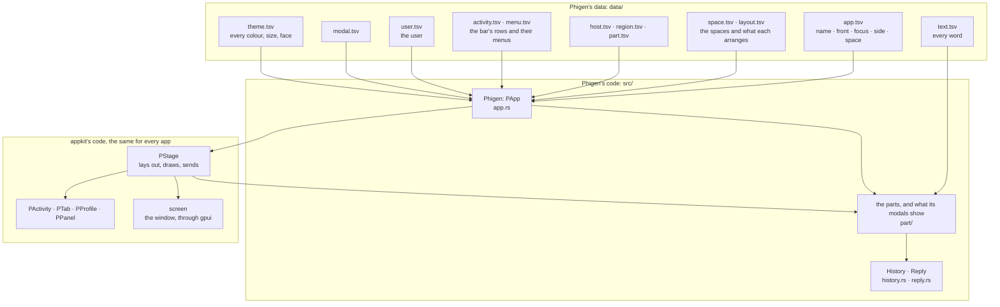

## Opening

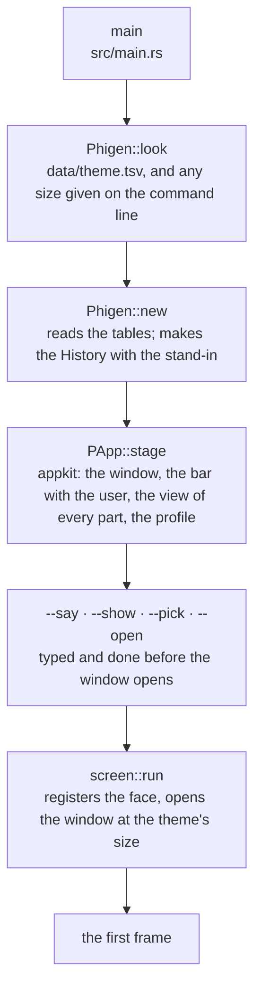

## A frame

Every frame is drawn from nothing: the stage is laid out for the window's
size, every view draws on a sheet, and the screen plays the sheet's marks.

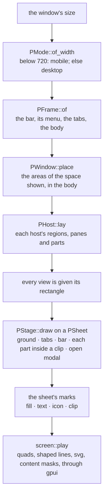

## A press

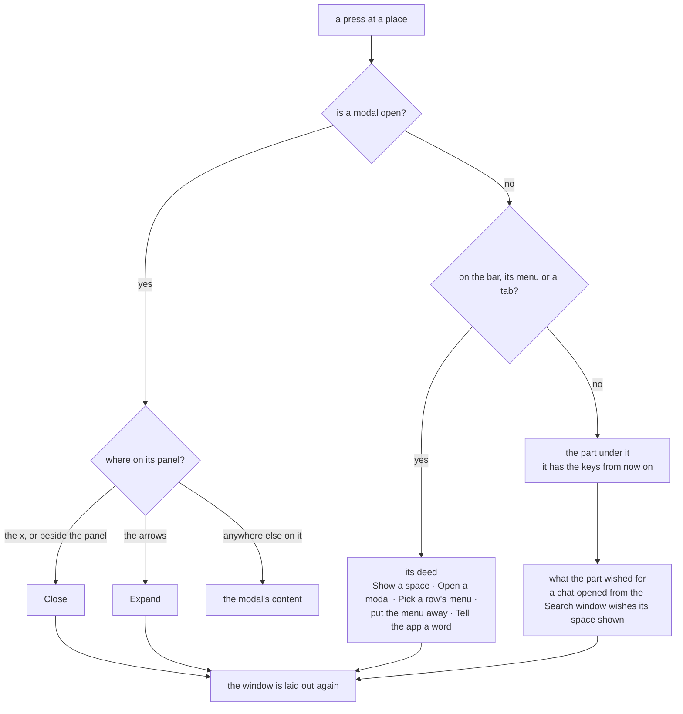

## A key

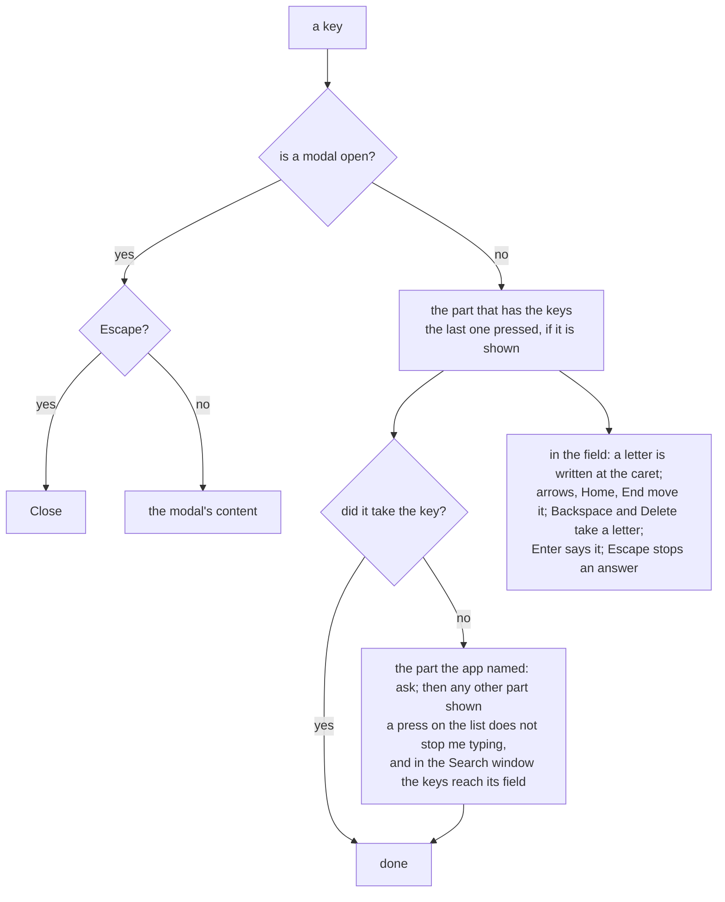

## Saying something

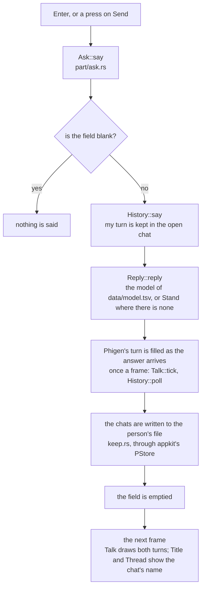

## A model's answer

The model is a server on this computer, as Ollama is: nothing of a chat
leaves it. Which server and which model are `data/model.tsv`; what the
model is told it is, and what is said when it cannot be reached, are
`data/text.tsv`. With `kind` set to `stand`, nobody answers but the
stand-in.

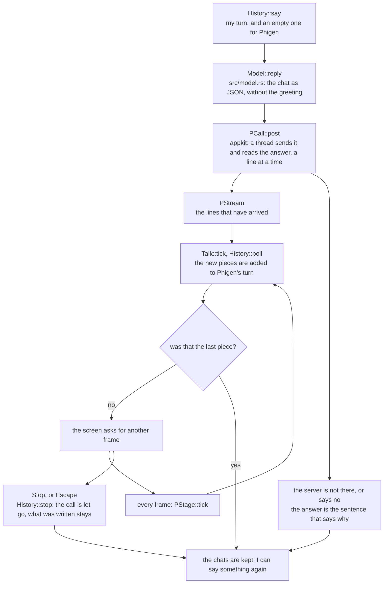

Tried on 12 November 2026 with `phi4-builder` on Ollama 0.40: asked for
one sentence on what a ray tracer is, it wrote one. The first answer
waits for the model to be loaded, about a minute on this machine.

## The profile

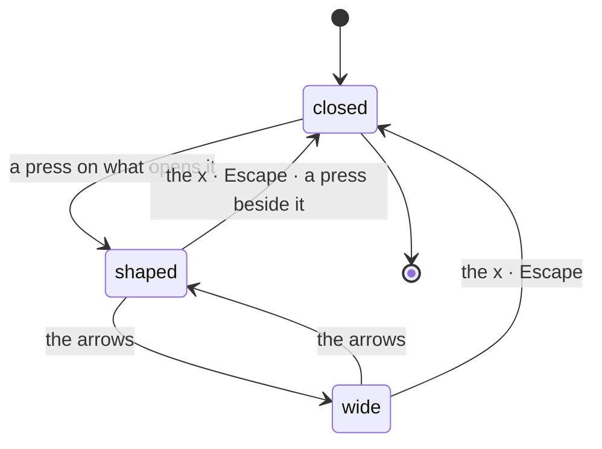

A modal opens in the shape `data/modal.tsv` gives it, and closed large
it opens in that shape the next time.

| Shape | Where | How large | Phigen's |
|---|---|---|---|
| a square (said or not) | the middle of the window | half of the window's space (`modal.area`), and never more of its shorter side than `modal.share`, or `modal.hand` in a hand | the profile, the welcome |
| a drawer | the right edge | `drawer.width` wide, as high as the window | the settings |
| a sheet | the foot, in the middle of the width | `sheet.share` of the window's height, no wider than `sheet.width` | the models to choose among |

A drawer and a sheet stay `modal.margin` clear of the window's edges,
as the bar stays `activity.margin` clear of them, and neither is ever
wider than the window leaves. All three have the same head, grow and
close the same way, and are appkit's: `pui/window/panel.rs`.

## A desk, a hand

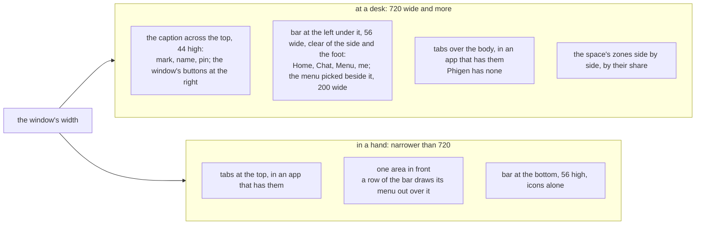

## How the theme works

Nothing drawn names a colour, a size or a face. It names a token, and the
theme, which is `data/theme.tsv`, says what the token is. Change a row
and the app looks different; no code changes.

A look is the theme with some rows changed: `data/look.tsv` names each
look, and after its name a row written as the theme writes one. `light`
changes nothing; `dark` changes the ground, the inks and how much
light there is; `glass` and `frost` make the window glass as well. The looks are
one `PShade`, which is the theme the window is drawn with and shows one
of them; the settings turn it to another, and since everything asks the
theme each time it is drawn, the next frame is in that look.

### The light

Nothing in Phigen has a fill of its own. There is one light
(`shade.light`), in three strengths: the strongest is `shade.share` of
it, a shade at rest `shade.rest` of that, a soft one `shade.soft`. It is
laid two ways, and these are puikit's (`puikit/src/tokens/tokens.scss`:
`--phi-surface` and `--phi-label`, with the same shares: 58, and 72 and
48 of that; 12 in the dark look):

| Laid | How | Who wears it |
|---|---|---|
| the surface | light at the foot, nothing at the head, so a heading at the top stands free | a card, the field, the Search window's field, the block of rows in the profile, the user's mark, a modal's panel, and the bar where it lies in a hand |
| the edge | a pane at the window's side: nothing at that side, light toward the page, so what stands on it runs the other way and the two cross | the bar and its menu, as one pane |
| the label | light from the left, gone before the right; mirrored for what sits at the right | a button, a pill (the one chosen the strongest, the others the faintest), a chip round each icon of the bar (the strongest for the row whose menu is shown), each group of a menu, and against its group the row that is open, a turn of the chat: Phigen's from its left, mine from my right |

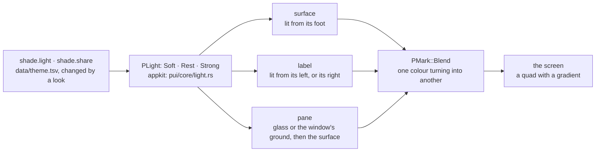

### Glass

A look is glass when it gives `window.glass` and `glass.blur`. Then the
window's ground is translucent and the system blurs the desktop behind
it; and the window's panes, the bar and a panel that floats, blur what
is drawn behind them inside the window (`PMark::Glass`, which the
DirectX renderer draws from `gpu/gpui_glass`'s plan). The numbers are
the ones Phiber wears (`phiber/src/theme/style/glass.rs`). Glass has no
colour of its own, and a button, a row and an icon are never glass.

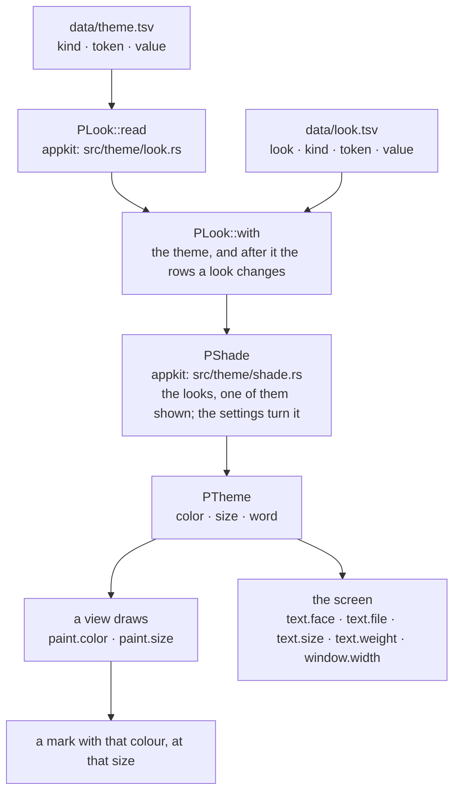

| Tokens | Who asks for them | What they are |
|---|---|---|
| `window.*` | appkit: the stage and the screen | the window's ground and its size when it opens |
| `text.*` | the screen, and every view | the face, its file, its size, weight and line height; the ink and the dim ink |
| `shade.*`, `surface.turn`, `label.turn` | appkit: `pui/core/light.rs`, for everything lit | the light's colour, how much of it the strongest shade is and the share of that the two others have; where a surface's light and a label's fade to |
| `window.glass`, `glass.*` | appkit: the screen and a pane | whether the window lets the desktop show; a pane's blur, tint, lens and rim |
| `activity.*` | appkit: the activity bar | the bar's ink and its sizes |
| `tab.*` | appkit: the tabs | the bar, a tab, the tab of the space shown |
| `modal.*`, `profile.*` | appkit: the panel and the profile | the veil; how much of the window's space the square fills and the most of its shorter side it takes, at a desk and in a hand; the head; the mark, a block's corner and how much of a row its name has |
| `region.*` | appkit: a host's layout | how high the header and the footer are |
| `control.*`, `button.*` | appkit: the field and the button | their ink, inset, radius and width |
| `gap`, `icon.*`, `line.*` | appkit and Phigen | the room between things, an icon's size, a rule |
| `column.width`, `text.cut` | Phigen's parts | how wide the column down the middle of the body is, which every part there keeps to; the word that ends a text cut short |
| `head.*` | the screen, and a part that sets a heading | a heading's size and line height |
| `row.*`, `turn.*`, `card.*`, `find.*` | Phigen's parts | a title's row, a turn's bubble, a way to begin, the Search window's heading, field and rows |

`app::every_colour_and_size_phigen_is_drawn_with_is_in_its_theme` draws
the whole window, the chat with each modal open in turn and the Search window, at a
desk and in a hand, through
a theme that writes down every token it is asked for and does not have.
It passes when none is missing.

## In a browser

The same app runs in a browser, drawn through WebGPU: nothing of Phigen
is written twice. `src/web.rs` is its start there, `web/index.html` its
page, and the page says how it is built. The icons and the typeface are
built into the program, since a browser has no disk to read them from.

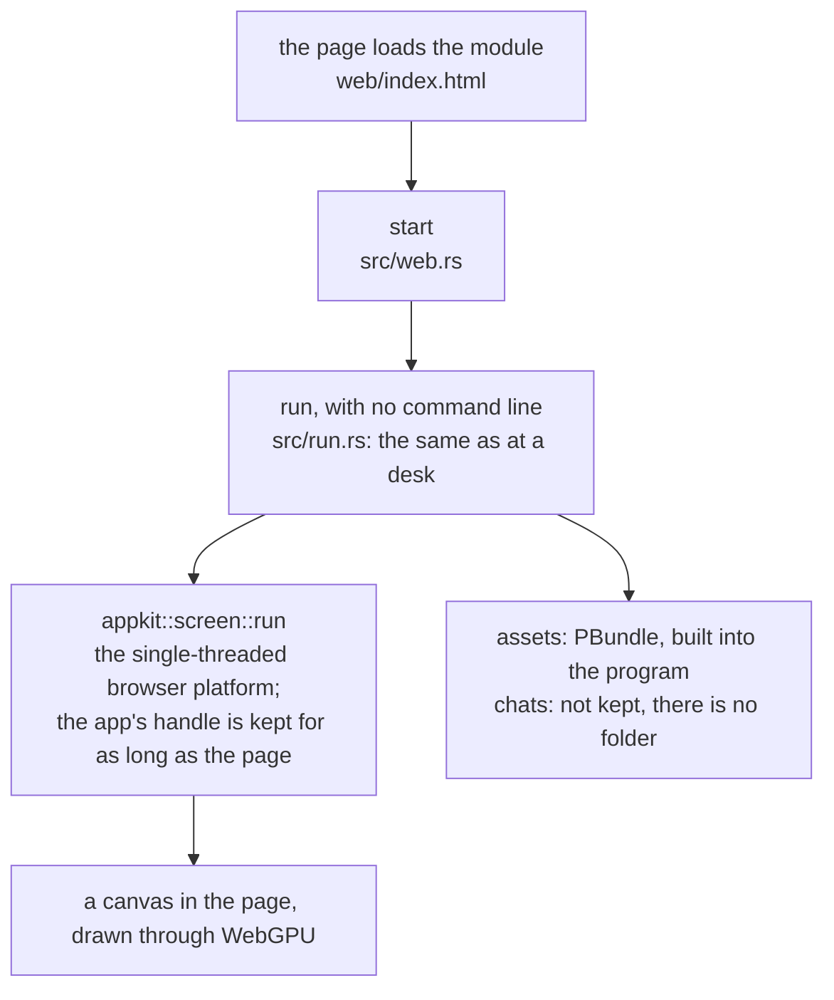

This was tried by hand on 13 November 2026, on the build made that day,
in a Chromium pane with WebGPU, at a desk's size, with no error on the
console: it opens on the welcome and its button closes it; the pick
says no model is connected, since the stand-in answers in a browser; the
gear opens the settings, a press on Dark draws everything in the dark
look, and Escape closes them; a press on the pick opens the list of
models, which says there is none; keys type into the field and Enter
says the line, which is answered, with the chat's name beside the pick
and in the bar. Text put in all at once, as a paste from the browser's
menu is, was not taken: keys are what type. No test runs the browser
build: the tests above run the same stage without a window.

## What of the reference is not there

The layout follows the one-sidebar chat app shown on 12 November 2026,
in Phigen's own name, icons and look. Of what those two pictures show,
these are not built:

- an account's plan beside the user
- Library and Notebooks, the bar's other rows; the Search window
  lists chats alone, so its pills narrow by day and not by kind
- a microphone in the field

## Not yet

These are not steps of the journey because they do not work yet:

- a model in a browser: a browser has no thread to wait on a server
  with, so the stand-in answers there
- glass in a browser and on Linux: the pass that blurs what is behind a
  pane is DirectX's so far; elsewhere a pane shows its tint alone
- Reduce Transparency: a way to have the glass looks solid
- a look that follows the system's light or dark; the look is the one
  chosen in the settings
- the look and the model kept in a browser, where there is no folder
- Phigen's mark in a browser: its own assets are read from disk, and
  a browser has only the ones built into the program
- a drawer or a sheet that slides in: each is there on the next frame
- a menu inside a menu: a row of the bar shows one menu and its rows
  do not open another
- an answer to the pointer: nothing is lit while it is only under it
- a selection, copy and cut in the field; placing the caret with a press
- dragging a finger to scroll; the wheel is what scrolls
- chats kept in a browser, where there is no folder to keep them in
- the narrow layout in a browser: the pane's phone setting gave a pixel
  ratio of 2 with a canvas of 1, so everything was drawn twice its size;
  it has not been seen on a phone
- text put in by an input method or pasted from the browser's menu;
  keys and Control with V are what type
- signing in; the user is the rows of `data/user.tsv`
- running in a headset
