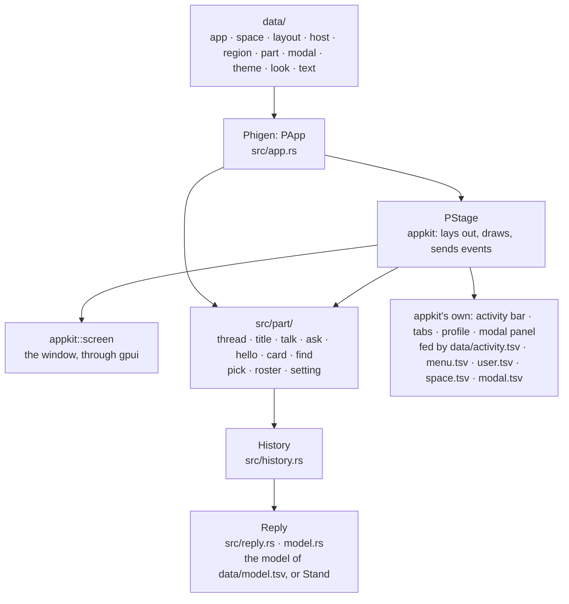

# Phigen

A chat, and the first app on appkit. It exists to show how an app is made
on `pui`: it builds no window of its own.

```bash
cargo run -p phigen
```

```bash
cargo run -p phigen -- --width 420 --height 760 --say "what is phikit?"
```

In a browser, from `phikit` (the page, `web/index.html`, says the same):

```bash
cargo build -p phigen --lib --profile quick --target wasm32-unknown-unknown
```

```bash
wasm-bindgen --target web --out-dir crates/appkit/app/phigen/web/pkg target/wasm32-unknown-unknown/quick/phigen.wasm
```

```bash
python -m http.server -d crates/appkit/app/phigen/web
```

## What it is made of

| Folder | Holds |
|---|---|
| `data/` | everything that is not code: its name, its spaces, hosts, regions and parts, the rows of its activity bar and their menus, its user, its look, its words |
| `asset/` | files only Phigen has: its mark, two ways; its other icons and its face are the ones every app shares |
| `script/logo.py` | draws the mark on the measures of Phigen's face, from `data/logo.tsv`, into `asset/icon/` and `doc/logo.html` |
| `src/run.rs`, `main.rs`, `web.rs` | opening it: the one way, and its two starts, at a desk and in a browser |
| `web/` | the page a browser loads it into; `pkg/` is built, not kept |
| `src/app.rs` | `Phigen`, which is `PApp`: the four sets read from `data/`, and the view of each part |
| `src/chat.rs`, `history.rs`, `keep.rs` | what was said, every chat, and how the chats are written to a file and read again |
| `src/reply.rs`, `model.rs` | `Reply`, whoever answers; `Model`, a model on this computer (Ollama), which also says which models there are; `Stand`, which answers where there is none |
| `src/choice.rs` | what a person chose, the look and the model, kept in a file of their own |
| `src/fact.rs` | what is true of them now, as the profile shows it |
| `src/part/` | the parts: `thread` (the history host, in the bar), the chat's `title`, `talk`, `ask`, its start's `hello` and `card`, the Search window's `find`, the title's `pick`, and what two modals show: `roster` and `setting` |
| `src/test/` | the tests, in the same folders |



## What it does

- Opens a window whose top row is its own, in the place of the
  system's title bar: Phigen's mark, its name, the pin that puts the
  bar's menu away, and the window's three buttons. Under it, one bar
  at the left, a column of icons: Home and Chat at its top, Menu at its middle, the
  user at its foot (`data/activity.tsv`). A press on Home, Chat or
  Menu shows what it holds in a second column beside the bar, in
  groups, each on a ground of its own (`data/menu.tsv`), and Home
  goes to the start as well, Chat to the chat: the ways to
  begin, the chats, and the Search window, the model, the looks, the
  settings and the profile. There are no tabs: the menus' rows are
  what change the space. Narrowed below 720 (the width in appkit's
  `src/data/mode.tsv`) the same window is a mobile app: the chat
  alone, the bar under it, a menu drawn out over the chat.
- A chat nothing was said in shows the field in the middle with three
  ways to begin under it; the first time, a welcome with the same three.
- The Search window has every chat under the day it began, a field
  that searches their titles, pills that narrow the list to a day and
  one that turns the order.
- Everything in the body keeps to one column down the middle of the
  window (`column.width` in `data/theme.tsv`), on any screen.
- A pill over the chat names the model that answers; a press on it
  lists the models the server on this computer has, and a press on one
  has it answer from now on.
- Nothing has a fill of its own: every surface wears one light, as
  puikit's do. A card and the field are lit from the foot; a button, a
  pill, a chosen row and a turn of the chat from the left.
- The bar stands clear of the window's top and foot. At its head is
  Phigen's mark, drawn on its own font by `script/logo.py`
  (`data/logo.tsv`; both marks are on `doc/logo.html`).
- A modal lies in the shape `data/modal.tsv` gives it: the profile and
  the welcome are squares in the middle, the settings a drawer at the
  right edge, the models a sheet that comes up from the foot.
- Settings, in the bar's Menu, opens the settings: the look, one of four
  (`data/look.tsv`: light, dark, glass, glass light), and the model. What is chosen is kept, and Phigen
  opens that way the next time. `phigen --look dark` opens in a look
  without keeping it.
- The user's row opens the profile: a square that fills half of the
  window, which grows to the window and back. It says what is true now
  (the model, its server, the look, the chats and where they are kept)
  and has a pill for each look under Appearance.
- In a glass look the window lets the desktop show, blurred, and its
  bar and a floating panel are panes of glass.
- The steps a person takes, each with its test, and the flow charts are
  in [`FLOW.md`](FLOW.md).
- What is typed goes to the field; Enter or the button says it, and the
  model `data/model.tsv` names answers, a piece at a time. The model is
  a server on this computer (Ollama); nothing of a chat leaves it.
- New chat, in the bar, begins a chat; a press on a title opens that
  chat.

## What it does not do yet

- The model is chosen in `data/model.tsv`, not in the window. In a browser no model
  is called: `Stand` answers and says so.
- Nothing can be selected, copied or cut in the field, and a press does
  not place the caret; the arrows, Home, End, Delete and paste work.
- It has not been run in a headset. The spatial mode is placed
  (`PWindow::place`) but nothing shows it. In a browser it runs at a
  desk's size; its narrow layout there has not been seen on a phone.
- Chats are kept in a file on disk; in a browser there is nowhere to
  keep them yet.
