# Phiogy - architecture

Diagrams only. The words are in [`PLAN.md`](PLAN.md) and [`SPECS.md`](SPECS.md).
Solid boxes exist and are tested. Dashed boxes are not built: they are
what [`TODO.md`](TODO.md) lists.

## The layers

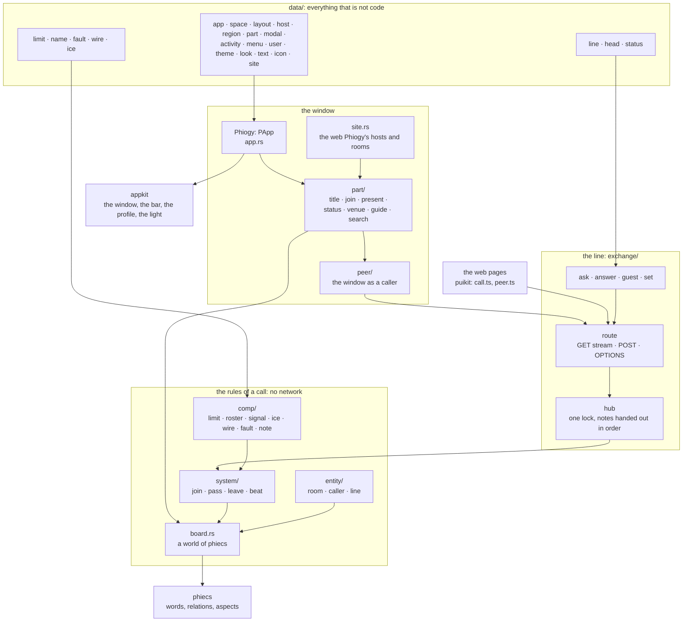

## The rules: entity, comp, system

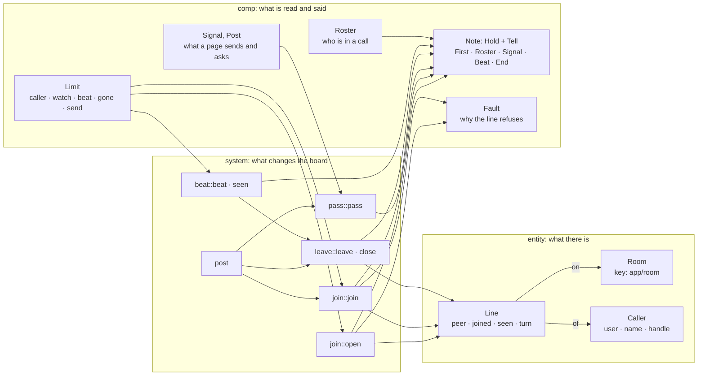

## The board as a world

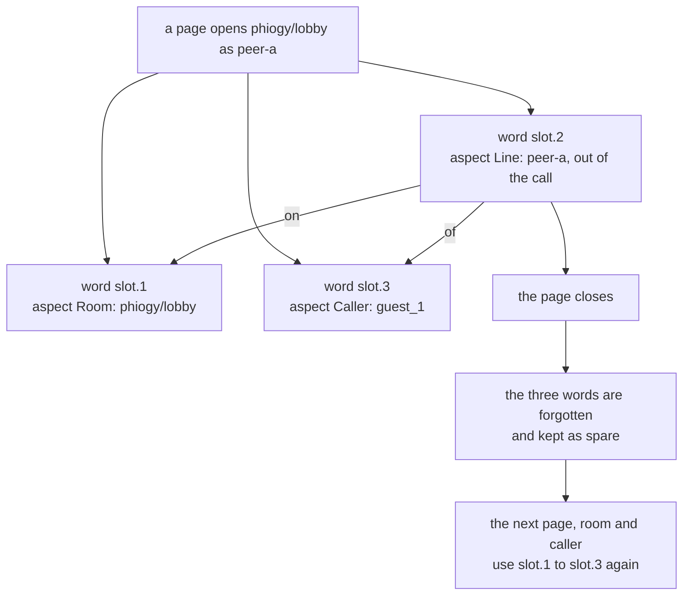

## A call on the line

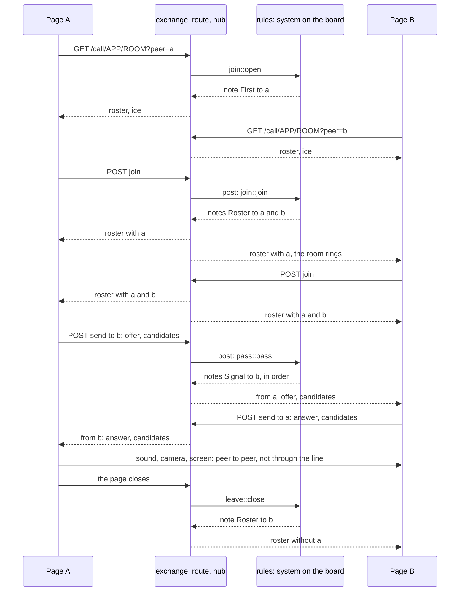

## One wire

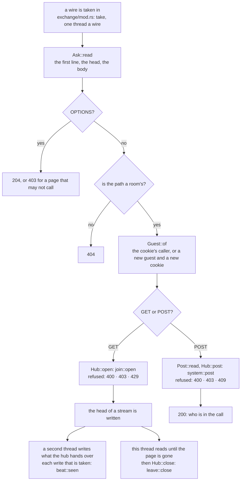

## A page that went away

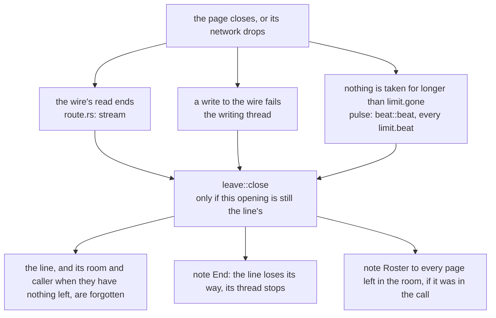

## The window

What it reads:

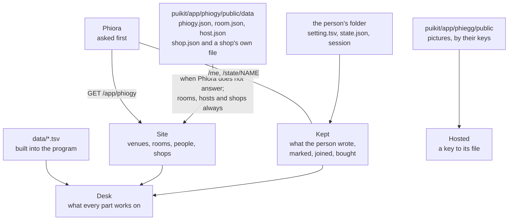

What draws it:

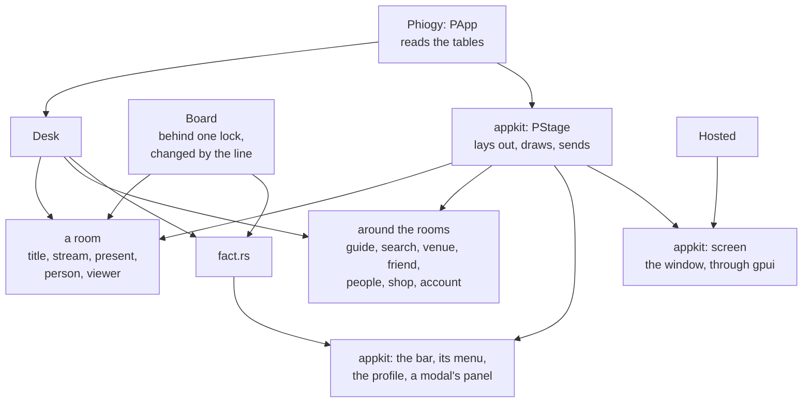

## The window as a caller

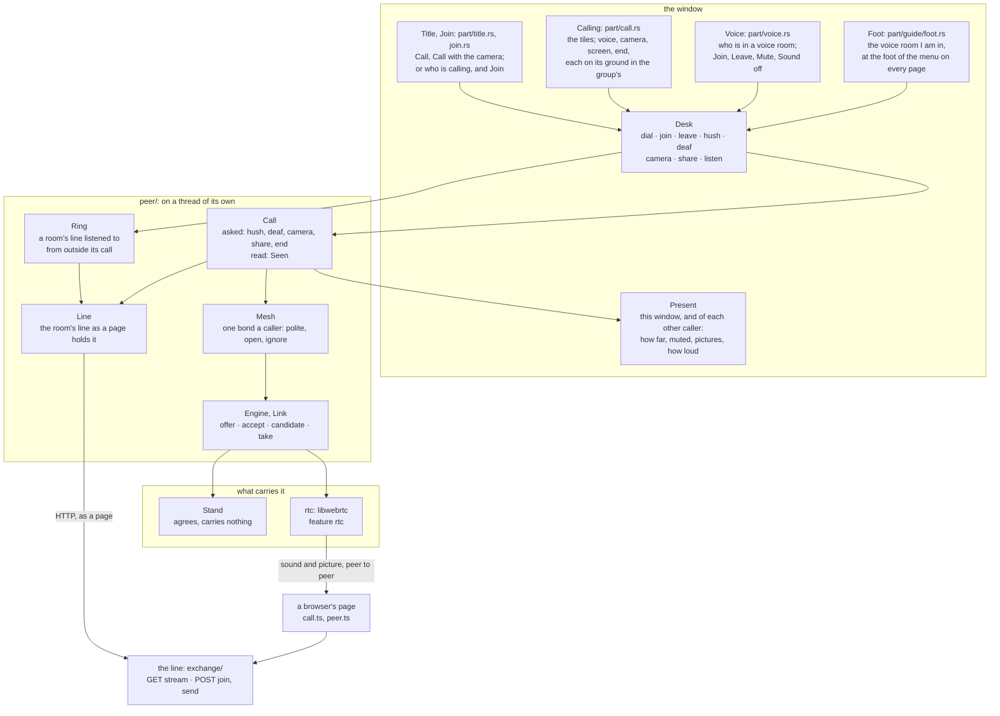

What the real library carries, and where it comes from and goes:

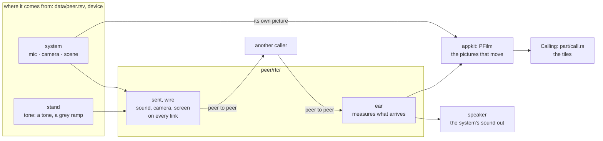

## Who gives way

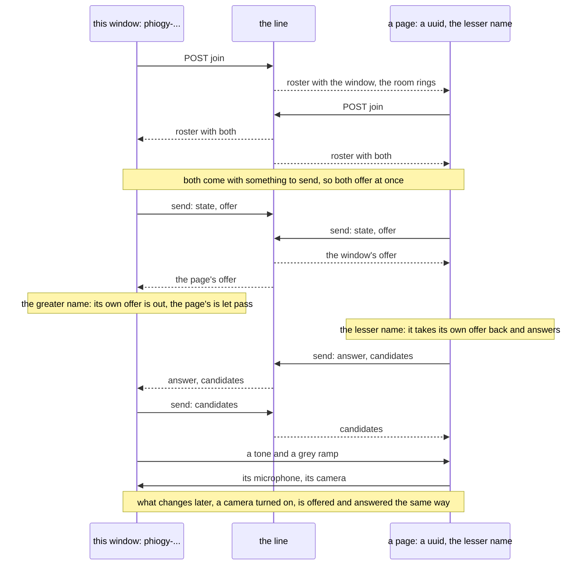

## Data: one source, three words

What a person makes and others read (a club, a host, a message, a request,
a like) is a **record** on Phiora, and the window asks for it by **kind**
and **name key** with a **payload**. Nothing in a part knows a path, a
header or a table: the part says what it wants to the desk, the desk says
it to `Records`, and one function answers.

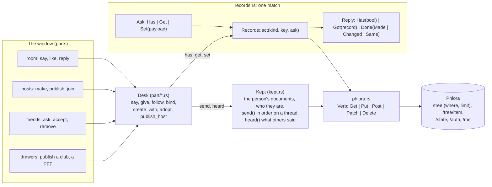

The three words and what they do:

| Word | Asks | Answers | Used for |
|---|---|---|---|
| `has(kind, key)` | does Phiora have it | true or false (not knowing is false) | a host that is already there |
| `get(kind, key)` | the record | its payload with its id, or none | reading one record |
| `set(kind, key, payload)` | make it, or change it to match | `Made(id)`, `Changed(fields)` or `Same` | every write |

`set` sends only the fields that differ, so the same payload again is
`Same` and nothing is sent. Who may change a record is Phiora's to say (its
maker, the person it names in `userId`, an editor); a guest is refused, and
`Kept::records()` says so before it asks. Where what is said or liked must
not hold the window up, `Kept::send(kind, key, payload)` does the same `set`
on the thread that keeps the person's changes in order.

The kinds now, each by its name key:

| Kind | Name key | Payload | Written by | Read by |
|---|---|---|---|---|
| `club` | `club_<name>` | name, ticker, supply, tagline | the publish drawer, `--make` | Phiegg's web |
| `profilePft` | `pft_<club>_<number>` | name, number, `clubId`, traits | the publish drawer, `--make` | Phiegg's web |
| `host` | the host's id (`m...`) | name, genre, icon, rooms | Create a host | the Hosts page of others (Join) |
| `message` | the message's id (`m<moment>`) | room, text, reply, author's name | Send | everyone in the room, every 4 seconds |
| `bond` | `<from>><to>` | from, to, `userId` (the one asked), state | Add friend, Accept, Remove | both of them |
| `mark` | `mk:<me>:<room>:<message>:<icon>` | room, message, icon, on or off | Like | everyone in the room |
| `follow` | `fl:<me>><them>` | from, to, on or off | Follow | nobody yet |

What the window asks of Phiora is narrowed there: `GET /tree?kind=...&where=
field:value&limit=N` returns the last N rows that match (a room, the
requests that name the person, one record by its key), not every record.

Where the window finds Phiora, today: the place is `--phiora`, else the
system's `PHI_API`, else the app's own row (`data/app.tsv`, `server.phiora`);
who is asking is the session Phiora gives a person (`/me`), kept in their
own folder. The records code (`records.rs`, `phiora.rs`, `net.rs`) is in
Phiogy; the wire (`Verb`) and the three words are not Phiogy's alone, and
want to move into appkit for every app to use. That is **not built**: see
the next section.

## One data source for every app: not built

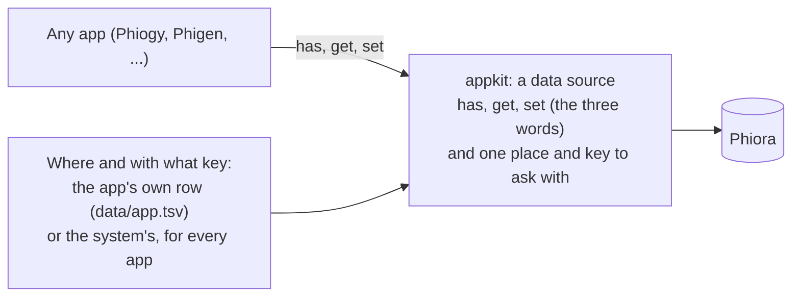

An app would say only `has`, `get` and `set` on a kind and a key. The place
of Phiora and the key an app asks with would be set in the app's own table
or once for all the apps; the app never sees a path, a verb or a header.
Phiora's server (`puikit/app/phiora-server`) already narrows what it is
asked (`where`, `limit`); what a record may hold, and who may change it, is
its own to keep. Today nothing in Phiogy has a key of its own: a person is
who Phiora says their session is, and the call line shares one word with
Phiora (`PHI_CALL_KEY`).

## What is next: not built

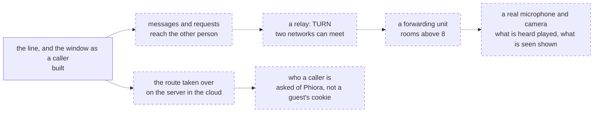

## Tasks, planned

Not built: asked for on 23 November 2026, as Microsoft To Do stands in
the user's picture. A task is a person's own, or a host's; it can come
from a message and be given to somebody in the host.

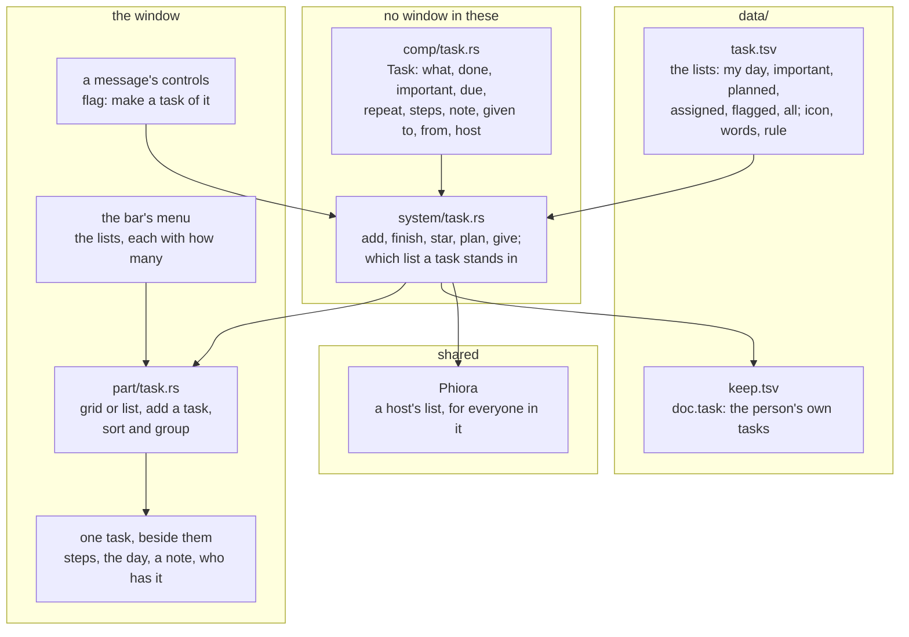
