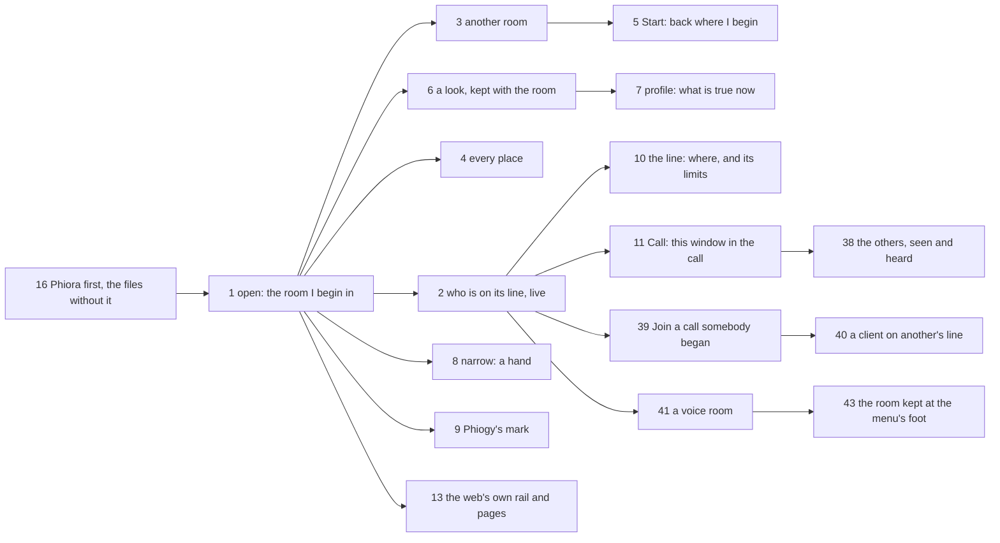
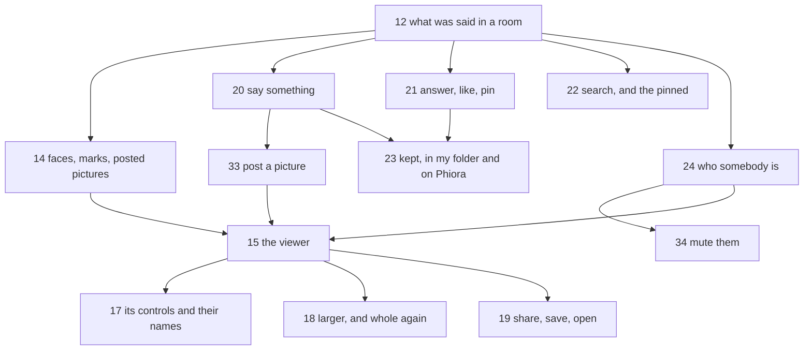
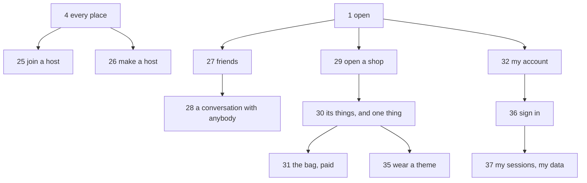
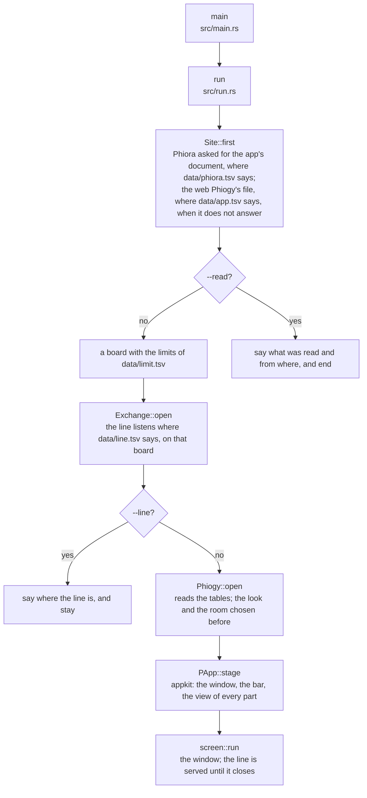
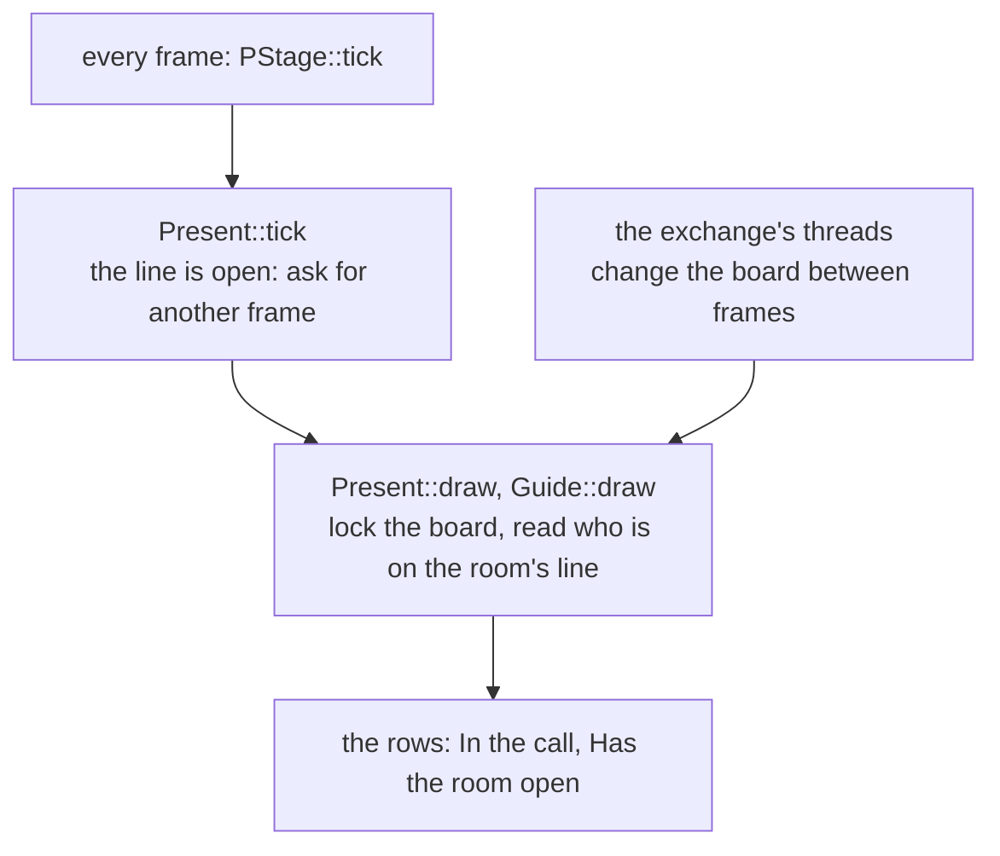

# Phiogy - flow

What a person does in Phiogy, step by step, and what the code does for
each step. Every step is a test that passes; the test is named beside it.
What a person chose is kept in `setting.tsv` in a folder named `phiogy`
where the system keeps such things (`%APPDATA%` on Windows);
`phiogy --forget` opens without it and keeps nothing.
Run them with `cargo test -p phiogy`.

Pictures of the window as it is drawn today: [a room](doc/room.png),
[a room with two pages on its line](doc/call.png),
[a room with its own people](doc/lobby.png), [the hosts](doc/venue.png),
[this window in a call with another caller](doc/call-rtc.png),
[a call's tiles, a page's camera among them](doc/call-tile.png) ([in a hand](doc/call-tile-hand.png), [just joined](doc/call-joined.png), [my camera on, muted](doc/call-camera.png), [where the system has no camera](doc/call-no-camera.png)),
every screen of a call, by who sees it and what they do, in [`doc/scene/`](doc/scene) (`node script/scene.mjs` takes them: [the host receives all](doc/scene/host-receive-all.png), [a client hears the ring](doc/scene/client-hear-ring.png), [a voice room](doc/scene/host-enter-voice.png), [a voice room kept while another room is open](doc/scene/host-keep-voice.png)),
[a look's page](doc/thing.png),
[a posted picture in the viewer](doc/view.png) ([dark](doc/view-dark.png), [in a hand](doc/hand-view.png), [shown larger](doc/view-large.png)),
[a message written in a room](doc/written.png), [a room searched](doc/find.png),
[friends](doc/friends.png), [finding somebody](doc/people.png),
[the shops](doc/shops.png), [a shop's landing](doc/shop.png), [a page of its menu](doc/shelf.png),
[the bag](doc/bag.png) ([after paying](doc/bag-paid.png)), [themes](doc/themes.png)
([one worn](doc/worn.png)), [the account](doc/account.png)
([with Phiora answering](doc/account-phiora.png), [signed in](doc/account-signed.png)),
[a picture posted](doc/posted.png), [somebody muted](doc/muted.png),
[the path of a picture copied](doc/view-shared.png),
[its pinned messages](doc/pins.png), [a person beside a room](doc/person.png)
([in a hand](doc/hand-person.png)),
[the Menu](doc/menu.png), [the profile](doc/profile.png)
([read from Phiora](doc/profile-phiora.png)),
[opened with no line](doc/quiet.png), [Phiogy's mark](doc/logo.html).
In the other looks: [a room, dark](doc/room-dark.png) and
[glass](doc/room-glass.png); [the hosts, dark](doc/venue-dark.png).
In a hand: [a room](doc/hand.png), [my rooms drawn out](doc/hand-guide.png),
[the hosts](doc/hand-venue.png).

## The journey

As a user I would like to:

| Step | I would like to | What happens | Test (`src/test/`) |
|---|---|---|---|
| 1 | open Phiogy and see where I am | the window opens on the room I begin in, as the web Phiogy's own file says; beside the bar are the places I joined, each with its rooms | `flow::step_1_it_opens_on_the_room_i_begin_in_with_my_rooms_beside_it`, `site::the_site_is_read_from_files_written_as_the_web_phiogy_writes_its_own` |
| 2 | see who is on a room's line, as it happens | the window serves the line; a page that opens the room over it is in the window at once, under Has the room open; when it joins the call it is under In the call; when the page goes away it is gone | `flow::step_2_a_page_that_opens_a_room_over_the_line_is_in_the_window_at_once`, `part::who_is_on_the_line_is_shown_as_the_board_has_them_now` |
| 3 | go to another room | a press on a room beside the bar opens it: its name and topic over the body, its own line, its own people under who is on it | `flow::step_3_a_press_on_a_room_in_the_bar_opens_it`, `part::the_guide_lists_the_places_i_joined_with_their_rooms_and_opens_one`, `part::a_room_s_own_people_are_named_under_who_is_on_its_line` |
| 4 | see every place there is | Hosts, a row of the bar, lists every place the site has, with its members, how many are here and its rooms, the ones I joined marked; a press on one opens its first room; more than fit are scrolled | `flow::step_4_the_hosts_row_lists_every_place_and_a_press_on_one_opens_its_first_room`, `part::the_venues_are_every_place_and_a_press_on_one_opens_its_first_room`, `part::more_places_than_fit_are_scrolled_with_the_wheel` |
| 5 | get back to where I begin | Start, the first row of each menu, opens the room I begin in | `flow::step_5_start_brings_me_back_to_the_room_i_begin_in` |
| 6 | find Phiogy the way I left it | the Menu row holds the four looks; the look I choose and the room I had open are kept, and chosen again when Phiogy opens | `flow::step_6_a_look_is_chosen_in_the_menu_and_phiogy_opens_the_way_i_left_it` |
| 7 | see what is true now | my profile, a row of the Menu, says where the line is, how many rooms have a page on it, how many people are in calls, how many hosts there are, my look and where it is kept | `flow::step_7_my_profile_says_where_the_line_is_and_how_many_are_on_it` |
| 8 | use it narrow, or on a phone | below 720 wide the room is alone and the bar lies under it; Rooms draws my rooms out over it, and a press on one opens it | `flow::step_8_in_a_hand_the_room_is_alone_and_the_rooms_row_draws_my_rooms_out`, `app::narrowed_it_is_a_mobile_app_and_shows_the_room_alone` |
| 9 | know Phiogy by its mark, at the top of the window | the window's top row, where Windows had its title bar, is Phiogy's: its mark over the bar, on a ground as large as the ground of every icon under it, and its name beside it in one case (`phiogy`) while a menu is shown. The mark is the pin: the pointer over it shows the pin in its place, and a press puts the bar's menu away and brings it back | `flow::step_9_phiogy_s_mark_is_in_the_caption_over_the_bar_and_is_the_pin` |
| 10 | know where the line is and what it holds | at the foot of a room: that the line is open and where, or why it is not; and its limits, which are the table's | `part::the_status_says_where_the_line_is_and_what_it_holds`, `part::a_room_with_nobody_on_its_line_says_so_and_where_a_page_reaches_it` |
| 11 | begin a call in a room, and be in it | Call and Call with the camera, two tools at the right of the room's title, put this window in the room's call over the line, as a page is, the second with my camera on; the room then lists this window among the callers, says what carries the call, and the call over its stream has its own buttons, as the web's has: Mute, which reads Unmute while I am muted, Camera on, Share a screen and End the call. In another room I am not in that room's call. End the call, or closing the window, lets the line go. Where the call is full or the line is not there, the room says why | `pill::step_11_i_begin_a_call_from_a_room_s_title_mute_and_end_it`, `ring::a_call_begun_with_the_camera_has_it_on_from_the_start`, `pill::with_no_line_there_is_no_call_to_join`, `peer::a_call_that_is_full_refuses_this_window_and_says_so` |

| 12 | read what was said in a room | the room shows its messages as the site has them, each day named, who said each and when, the words broken to fit, whom a message answers, its marks with their counts, its pictures by name; it opens at its foot, where the newest is, and is scrolled with the wheel. At a desk the room's people stand beside it, in a hand over it | `room::step_12_a_room_shows_what_was_said_in_it_the_newest_at_its_foot`, `room::at_a_desk_the_people_stand_beside_what_was_said_and_in_a_hand_over_it`, `room::a_long_room_is_scrolled_with_the_wheel_from_its_foot` |
| 13 | find my way as on the web | the bar's menu is the web's own: each place, its Text and Voice headings, its rooms. A page is its blocks: one that is not a room of its own opens the room its block names, and a block of a kind not drawn yet is named | `room::step_13_the_rail_is_the_web_s_own_with_its_headings_and_a_page_is_its_blocks`, `room::the_site_reads_what_was_said_the_headings_and_the_pages` |
| 14 | know people and places by their pictures | a person's face stands beside what they said, in a direct room's title and in the rail; a place's mark stands in the hosts; a picture posted in a room is drawn under its words. All are the web's own files | `picture::step_14_faces_marks_and_posted_pictures_are_drawn_from_the_web_s_files`, `picture::a_picture_s_key_names_a_file_of_the_web_s_own`, `picture::the_site_reads_faces_and_marks_as_cells_of_a_sheet` |
| 15 | look at a posted picture alone | a press on it opens the viewer over the whole window: who posted it and when at the top left, the picture whole in the middle and never larger than it is, the one before and the one after by an arrow or an arrow key and none past either end, a strip of every picture of the room at the foot with the one shown marked; a press on one of the strip shows it; Escape, its close, or a press beside the picture puts it away | `picture::step_15_a_press_on_a_posted_picture_opens_it_in_the_viewer`, `picture::in_a_hand_who_and_when_stand_over_the_strip` |
| 16 | see what Phiora has now, and still open without it | the hosts and rooms are asked of Phiora first, as a page asks; a room called otherwise in Phiora is called so in the rail. Where Phiora does not answer, or answers with what is no document, the app's own file is read, and the window opens the same. The profile says which it was: Phiora and where, its own files, or its own files because Phiora did not answer | `phiora::step_16_the_site_is_phiora_s_when_it_answers_and_the_app_s_file_when_not`, `phiora::phiora_is_asked_as_a_page_asks_it_and_read_whole_or_in_pieces`, `phiora::where_phiora_is_comes_from_the_command_line_first`; against the real Node Phiora: `node script/phiora.mjs` |
| 17 | know the viewer's controls | it has no head of a panel's: one row, who posted it and when at the left, the tools and the way out at the right. The pointer over a control shows what it is called, and a tool that is on is called by what a press does now. In a hand the picture has the width, the arrows lie over its edges, and who and when stand under it | `viewer::step_17_the_viewer_has_no_head_and_one_row_of_who_and_when_its_tools_and_its_way_out`, `viewer::what_a_control_is_called_is_shown_by_it_while_the_pointer_is_over_it`, `viewer::in_a_hand_the_picture_has_the_width_and_the_arrows_lie_over_its_edges` |
| 18 | see a picture larger | the first tool, or a press on the picture, shows it twice as wide as its room, from its top left, and the wheel moves it as far as it goes; the tool or another press shows it whole again. Another picture is seen whole first, and so is one opened again | `viewer::step_18_a_picture_is_shown_larger_moved_with_the_wheel_and_whole_again`, `viewer::put_away_and_opened_again_a_picture_is_whole_and_was_not_shared` |
| 19 | share, keep and open a picture | share copies where the picture's own file is, and says so by the tool; save asks, in the system's own dialog, where a copy is to be kept; open opens the file in the system's own program. The viewer stays open | `viewer::step_19_share_save_and_open_ask_the_system_for_the_picture_s_own_file`; appkit: `stage/bar::what_only_the_system_can_do_is_kept_for_the_screen_and_taken_once` |
| 20 | say something in a room | the field at the stream's foot says what it is for; what I write there and send with Enter, or with the control beside it, is in the stream at once, by me, today, at the hour of my clock; the field is empty again | `tools::step_20_what_i_write_in_a_room_is_said_in_it_at_once`, `talk::what_a_person_writes_joins_the_room_s_talk_spelled_as_the_web_spells_it` |
| 21 | answer, like and pin a message | the message under the pointer, or the one pressed last, has three controls, each named under the pointer: answer it (the field says whom, and what I write answers it; its way out and Escape answer nobody), like it (its heart counts me; a press on any mark gives it or takes it back), pin it (and unpin it) | `tools::step_21_a_message_under_the_pointer_is_answered_liked_and_pinned`, `talk::marks_pins_and_a_search_are_the_site_s_with_the_person_s_own_over_them` |
| 22 | search a room, and see what is pinned in it | two tools in the title: the pinned messages listed over the stream, a press on one bringing it into sight; and a field over the stream, where only the messages that hold what I type show, by their words or by who said them, until Escape | `tools::step_22_a_room_is_searched_and_its_pinned_messages_listed_from_its_title` |
| 23 | find what I wrote the next time, and in the web Phiogy | what I wrote, marked and pinned is kept in my folder and, with Phiora answering, on Phiora under a session it gave this window, in the documents the web's pages use | `talk::what_a_person_keeps_is_in_their_folder_and_there_the_next_time`, `talk::step_23_with_phiora_answering_what_a_person_keeps_is_kept_there_under_their_session`; against the real Node Phiora: steps 5 and 6 of `node script/phiora.mjs` |
| 24 | see who somebody is | a press on a face, in the stream or in a direct room's title, puts that person where the room's people stood (in a hand, where the room was): the picture over their profile, their face, name, handle, what they are and whether they are about, what they say of themself, their tags; write to them, follow them; since when they are a member; and their panes: who they are linked to (a press opens them), their spaces, their pictures, which open in the viewer among their own. The way back is at their head | `beside::step_24_a_press_on_a_face_puts_that_person_beside_the_room`, `beside::the_way_back_from_a_person_is_at_their_head_and_in_a_hand_they_have_the_room` |
| 25 | join a host | the hosts' page lists every host there is, the first that match what I type, each with its mark and how many people it has; Join puts it in my rail and Leave takes it out; a press on its line opens its first room | `hosts::step_25_the_hosts_are_listed_to_join_and_one_that_is_joined_stands_in_my_rail` |
| 26 | make a host of my own | I name it and pick how it starts, one of the templates; it stands in my rail with its rooms under their headings, its first room open, and can be written in; Remove takes it away | `hosts::step_26_i_make_a_host_of_my_own_from_a_template_and_remove_it` |
| 27 | keep friends | Friends, at the head of the direct list with how many asked: who of them is here now, all of them, the requests that wait (accept, decline, take mine back) and a search of everyone to ask somebody new; a press on a friend's line writes to them | `hosts::step_27_friends_are_who_i_am_with_who_asked_and_whom_i_asked` |
| 28 | begin a conversation with anybody | Find or start a conversation searches everyone by name or handle; a press on one opens a room named after them, which stays in my rail and can be written in | `hosts::step_28_finding_somebody_begins_a_conversation_that_stays_in_my_rail` |
| 29 | open a shop | Shops, in the bar, lists every shop, searched by name; Open puts it in my rail with its landing, its own menu and the bag, and shows its landing; Close takes it out | `shop::step_29_a_shop_is_picked_and_an_open_one_stands_in_my_rail_with_its_own_menu` |
| 30 | look at what a shop has | a page of its menu is its things in a grid: picture, name, price, and how each stands, a press on which adds it to the bag or takes it out; a press on a thing opens its own page: its views, what is said of it, its facts, more like it, and the way back. A thing's page is two equal columns, as the web's: its picture with its views two across; beside them its kind, name, price, how it stands and a like that is kept, what is said of it, and its facts a row each. Under them the same thing in its other colours, every one, a press going to it; and more like it | `shop::step_30_a_page_of_a_shop_is_its_things_and_a_thing_has_a_page_of_its_own` |
| 31 | pay for my bag | the bag lists what I picked with the subtotal, the total and what my wallet holds, each sum on a ground of its own at its line's end; Pay from wallet takes the whole total, empties the bag and puts the things under Yours; a bag the wallet cannot pay is not paid; a line is taken out at its end | `shop::step_31_the_bag_is_paid_from_the_wallet_and_what_was_bought_stays_mine` |
| 32 | see my account | Account, in the Menu, is a drawer at the right: who I am, my wallet coin by coin and in all, each amount on a ground of its own at its line's end, the look, my profile; where Phiora lets anyone be one of its members to try things, being one and being nobody again | `account::step_32_the_account_is_who_i_am_my_wallet_and_the_look`, `account::where_phiora_answers_the_account_says_who_it_says_i_am`; against the real Node Phiora: step 7 of `node script/phiora.mjs` |
| 33 | post a picture | the control before Send asks the system which file of this disk; the picture is said in the room as a message of mine, drawn in the stream, and the last of the room's pictures in the viewer. A file that is no picture is not posted | `left::step_33_a_picture_of_this_disk_is_posted_in_a_room_and_opens_in_the_viewer` |
| 34 | mute somebody | Mute, on their profile, keeps what they said out of the stream: a line says they are muted where a row of theirs begins; Unmute brings it back | `left::step_34_what_a_muted_person_said_is_not_shown_until_they_are_unmuted` |
| 35 | wear a theme | a theme's card shows its own colours; once bought, the press that stood for the bag puts it on, and the window's light takes its colour; the same press takes it off | `left::step_35_a_theme_shows_its_swatch_and_once_bought_is_worn_and_taken_off` |
| 36 | sign in | in the account, where Phiora answers: a handle and a password, which is drawn as marks and gone from the field after; what Phiora refuses is said in Phiora's words | `signin::step_36_a_password_is_never_drawn_and_what_phiora_refuses_is_said_in_its_words`; against the real Node Phiora: step 8 of `node script/phiora.mjs` |
| 37 | see where I am signed in, and take my data out | signed in, the account lists the sessions signed in as me, signs the others out, and writes everything Phiora keeps about me to a file the system asks where to keep | `signin::step_37_signed_in_i_see_my_sessions_sign_the_others_out_and_take_my_data_out`; against the real Node Phiora: step 7 |
| 38 | see and hear the others in a call, and be seen and heard | in a call the room shows, over its stream, the room called and for how long; my own tile, my camera as a mirror shows it or my face; the screen I share; each other caller's camera while it arrives or their face, with their name and whether they are muted, and a light around one who is heard; a screen they share; and the room's person ringing until they join. Camera on and Share a screen turn mine on and off, and the other end sees them come and go. What the others say is played on the system's sound out. My microphone is the system's, and is closed while I am muted. Where the system gives no microphone, camera, screen or sound out the call says which and why, and goes on. In a hand the tiles take the place of the list of who is on the line, and the call's buttons fold into rows | `call::step_38_in_a_call_i_see_its_tiles_and_turn_my_camera_and_a_screen_on_and_off`, `call::the_tiles_of_a_call_fold_where_the_room_is_narrow`, `call::a_caller_s_pictures_are_kept_by_the_stream_each_comes_under`, `call::a_stream_that_brings_no_more_pictures_is_over`, `call::a_picture_of_a_call_is_named_by_whose_it_is_and_its_stream`; with the real library, `node script/peer.mjs` |
| 39 | join a call somebody else began | while somebody is in a call in the room I have open and I am not, the title says who is calling after the room's name, and has Join where the two tools that begin a call were. Join puts me in it, and each other caller has a tile by the name the line knows them by | `ring::step_39_a_call_somebody_began_is_said_in_the_title_and_joined_there` |
| 40 | be a client on somebody else's line | a window started with `--at` and where a line is serves none: it reaches that one as a page does. It listens to the open room's line while I am not in its call, so a call begun there is seen and joined the same way, and lets go of that once I am in the call | `ring::step_40_a_window_on_another_s_line_sees_a_call_there_and_joins_it`, `ring::a_room_s_line_is_listened_to_from_outside_its_call` |
| 41 | be in a voice room | a voice room shows, where another room has what was said, who is in it, each a card with their face, their name and how they are: the people its file names, whoever is in it on its line, and me once I joined. Join, and then Leave, Mute and Sound off, which plays nothing of the others until Sound on; how loud I am; and what the room does with my sound. Nobody is rung into it, and it has no camera. It goes on while I look at other rooms, and ends when I leave it or begin or join a call somewhere else. With no line it says that no sound is carried | `voice::step_41_i_am_in_a_voice_room_mute_turn_the_sound_off_and_leave`, `voice::a_voice_room_with_no_line_says_no_sound_is_carried` |
| 42 | tell a number from the words around it | a number that stands by itself is on a ground of its own, drawn by appkit's figure in every place: a coin's amount and the total in my wallet, the bag's sums, how many wait in a room at the end of its row of the rail. A number inside a sentence stays in its sentence | `account::step_32_the_account_is_who_i_am_my_wallet_and_the_look`, `shop::step_31_the_bag_is_paid_from_the_wallet_and_what_was_bought_stays_mine`, `room::how_many_wait_in_a_room_stands_on_a_ground_of_its_own_in_the_rail` |
| 43 | keep hold of a voice room while I look elsewhere | while I am in a voice room it stands at the foot of the menu beside the bar, on every page that menu is on (rooms, hosts, the shop): its mark and its name, which a press goes back to; the microphone; the others' sound; and the way out. Each control shows what is so (muted, the sound off) and says what it is called while the pointer is over it. In no voice room there is no foot, and the rooms have its place | `voice::step_43_the_voice_room_i_am_in_stays_at_the_foot_of_the_menu_on_every_page` |
| 44 | see the hosts I am in at the left | after the bar's own rows there is one for each place I am in, as the web's rail has them: the site's own places with their icons, then the hosts I joined with their marks, then the ones I made; the one whose room is open is lit; a press goes to its first room; one I leave is gone from the bar. As many stand as the bar has room for | `flow::step_44_the_hosts_i_am_in_stand_in_the_bar_each_with_its_mark` |
| 45 | see what can be pressed | every icon, row, message, card and part stands on a ground in every look; what the pointer is over is lit more (a row of the bar or its menu, a room of the guide, a card or a view of a shop), and the pointer is a hand wherever a press does something on the bar, its menu, the guide and the shops' pages | `flow::step_9_...`, `flow::step_44_...`, appkit's `window::stage::bar::under_a_caption_the_pin_and_the_mark_are_at_the_top_and_a_modal_is_laid_under_it` |
| 46 | sift my rooms | over the rooms are three tabs: Recent (a room I opened within the hours the app's data gives, or one where something waits), Favorites (a room I starred from its title, and the room of a person I follow), Older (every other room than the recent ones). With none chosen every room is listed; the chosen one again lets them all back. What I chose, when I opened a room and what I starred are kept | `tab::step_46_the_guide_s_tabs_keep_the_recent_the_starred_and_the_older_rooms` |
| 47 | reach every host from the bar | where I am in more hosts than the bar has room for, the wheel over the bar rolls them, a row a notch, to the last and back. A host I made has no mark of its own and stands by the first letters of its name | `tab::step_47_more_hosts_than_the_bar_has_room_for_are_rolled_to_with_the_wheel` |
| 48 | see what is in my places | the Library, a row of the bar, has my places as tabs: Phiogy's own shapes, my Phiegg space, and my own Downloads, Videos, Pictures, Documents and Desktop. Under them, what to show (all, models, Blender and more, pictures, videos, sounds) and in what order (name, newest, largest), what the place holds counted, and its files as tiles: a model in 3D, a picture as itself, anything else by its icon. A file the library does not know, and a hidden one, is not listed | `library::step_48_the_library_lists_a_place_by_kind_and_order_and_leaves_out_what_it_does_not_know`, `library::step_49_the_places_are_the_shapes_the_phiegg_space_and_the_person_s_own_folders` |
| 49 | start from the ordinary shapes | the Shapes place holds a cube, a dice with its pips, a sphere, a cylinder, a cone, a torus, a plane, a capsule, a pyramid and the three regular solids, each a USD file phiphx made from its table | `library::step_50_every_shape_is_a_model_with_parts_and_the_dice_has_its_pips` |
| 50 | look at a model and dress it | a press on a model opens it in 3D, at the top of its part: a drag turns it, the wheel brings it nearer. Beside it its dress: its parts as tabs over the chosen part's colour, its finish (matte, satin, gloss, metal), and what it is (its file, parts, triangles, size). What I chose is kept. Any other file opens in the system's own program for it | `library::step_51_a_model_is_opened_from_the_library_and_dressed_part_by_part` |
| 51 | bring a file in | Import, at the top right of the library, asks the system for a file and puts a copy in my Phiegg space under a name of its own (nothing of mine is written over); a Blender file and the like is then turned into USD beside it by the converter `data/convert.tsv` names, and the library says so | `library::step_52_a_file_brought_in_lands_in_the_phiegg_space_under_a_name_of_its_own` |
| 52 | see a thing as Phiegg shows it | a thing's page has its variants in a bar at the left of its picture, itself first, each its picture and its colour's name, a press going to it; the picture stands at the top of its frame with its views as tabs on a ground under it; every section stands at the right | `shop::step_30_a_page_of_a_shop_is_its_things_and_a_thing_has_a_page_of_its_own` |
| 53 | know what can be pressed, everywhere | the pointer is a hand over every pill, tab, swatch, card and choice of a form, in every app: the kit's blocks say so as they are drawn, inside what is in sight | `library::every_block_a_press_acts_on_says_so_as_it_is_drawn_inside_what_is_in_sight` |
| 54 | choose among eight looks | the Menu has eight looks: Light, Dark, Glass, Glass Light, Liquid Glass, Liquid Glass Dark, and the plain ones, Plain and Plain Dark, which draw a faint line down the sidebar's edge as Apple's apps do | `library::eight_looks_and_the_plain_ones_draw_a_faint_line_down_the_sidebar` |

Opening, and finding a room:

In a room:

Around the rooms:

## What a page does on the line

A page is not a person in this window: it is a browser's page of the web
Phiogy, or anything that speaks as one. These are tested twice: with no
network (`system::`), and over a real socket (`exchange::`).

| Step | A page would like to | What happens | Test (`src/test/`) |
|---|---|---|---|
| a | find who is in a room's call | it opens the room's line and is told who is in the call and which ICE servers to use | `system::two_pages_in_a_room_find_each_other_and_trade_signals`, `exchange::two_pages_in_a_room_find_each_other_and_trade_signals` |
| b | start or join the call | it posts join; every page of the room is told the new roster, so a page that only has the room open hears it ring | the same two |
| c | reach another caller | it posts signals; each goes to the page it names, in the order sent, only when both are in the call | the same two |
| d | leave | it posts join false, or goes away; those left are told | the same two |
| e | be the only one who speaks for itself | a page belongs to whoever opened its line; nobody else joins or sends for it, or takes its name | `system::a_peer_belongs_to_whoever_opened_its_line`, `exchange::a_peer_belongs_to_whoever_opened_its_line` |
| f | not be crowded out | a call holds eight; a room's line holds 256 pages | `system::a_call_holds_as_many_as_the_limit_says_which_is_eight`, `exchange::a_call_holds_eight`, `system::a_room_s_line_holds_as_many_pages_as_the_limit_says` |
| g | come back after the network dropped | it opens its line again and takes the place of its old one, where it stood | `system::a_page_that_opens_its_line_again_takes_the_place_of_its_old_one` |
| h | not be kept when it is gone | its wire closing drops it at once; and a page that took nothing for a minute is dropped by the beat | `system::the_beat_drops_a_page_that_went_away`, `flow::step_2_...` |
| i | call from a browser on another port | it is answered what a browser asks first, with its origin named and its cookie kept; a page from elsewhere is refused | `exchange::a_browser_is_answered_what_it_needs_to_call_from_another_port`, `exchange::the_line_listens_on_every_address_its_name_stands_for` |

The same routes were also asked by the web side itself, on 22 November
2026:

- `node script/line.mjs` runs the Node line's own test file
  (`puikit/app/phiora-server/test/call.test.mjs`) against this line with
  one import changed: its three cases pass.
- Two Chrome pages of the web Phiogy, pointed at this line
  (`VITE_PHI_API=http://localhost:4311`, the launch entry `phiogy-line`),
  walked a whole call with real presses: one rings, the other joins,
  each sees and hears the other, mutes, shares a screen, leaves. Every
  step passed. The page opens although nothing but `/call` answers: its
  other requests (`/me`, `/state/...`, `/app/phiogy`) get 404 and it
  falls back to what it keeps itself.

What Phiora answers beside a call was asked the same way, on 22
November 2026: `TEST=.../test/server.test.mjs ONLY='serves app
content|CORS: allowed origin|each visitor gets|rejects bad names' node
script/line.mjs` runs four cases of the Node server's own tests against
this line, unchanged, and they pass. Its other cases need the wallet,
the shop, accounts or the model, which this line does not have.

This window as a caller was asked the same way, on 22 November 2026,
built with the real WebRTC (`-Rtc`):

- `node script/peer.mjs`: this program as a caller with no window
  (`phiogy --caller phiogy/lora --port 4311`) and one Chrome page of
  the web Phiogy pointed at its line. The page showed "Guest is
  calling", Join was pressed with a real click, and both connected.
  The page saw this program's picture moving (320 x 180) and heard it
  at 0.203 of full, which is the tone `data/peer.tsv` sets at 0.2.
  This program heard the page at 0.901 and, once the page's camera was
  on, counted its pictures (320 x 240). The page muted: this program
  was told and heard nothing. The page left: this program was alone.
  Every step passed, with nothing on the page's console. Both sides
  sent stand-ins: this program a tone and a grey ramp; Chrome its
  stand-in camera and a sound file as its microphone.
- The same script was then made to follow the web's own two-Chrome
  check (`phiogy-call-check.mjs`, by the session that built the web's
  calls) with one Chrome replaced by this program, and passed all 19
  steps: besides the above, this program muted (the page's tile read
  Muted and the page heard 0, then 0.202 again), the page shared a
  screen (this program got a second picture, 480 x 360), the page left
  and was shown "Guest is calling" again, joined again and was
  connected again, and this program left (its tile was gone from the
  page). Nothing in the web's files was changed for it.
- With `WINDOW=1` the script has the real window be the caller
  (`--join --say`): the steps that need no hand in the window passed
  (ring, join, sound both ways, the page's camera and shared screen,
  the page's mute, the page leaving).
- Two of this program, both with WebRTC, called each other: each heard
  the other at 0.202 and counted its pictures, the one that gave way
  included.
- The window joined a call from its title ([`doc/call-rtc.png`](doc/call-rtc.png),
  opened with `--join`) while a second caller measured it: 0.202, and
  its pictures at 640 x 360.

## What is shared and what is Phiogy's

The window's own furniture is appkit's and the same in every app. An app
changes its data and nothing else.

| On screen | Whose code | Phiogy's data |
|---|---|---|
| the caption: the mark, the name, the pin, the window's three buttons | appkit: `pui/window/part/caption.rs` | `data/activity.tsv` (the row seated `head`), `data/theme.tsv` (`caption.height`) |
| the activity bar: its icons, the user | appkit: `pui/window/part/activity/` | `data/activity.tsv` |
| the menu a row of the bar shows beside it, and the room for my rooms | appkit: `pui/window/part/menu.rs` | `data/menu.tsv`; `data/app.tsv`: `side` |
| the profile: who I am, what is known of me, how the app appears | appkit: `pui/window/part/profile.rs` | `data/user.tsv`; Phiogy says what is true now: `src/fact.rs`, `data/text.tsv`: `fact.<name>` |
| a modal's panel | appkit: `pui/window/panel.rs` | `data/modal.tsv` |
| where everything goes, at a desk and in a hand | appkit: `frame.rs`, `place.rs`, `host/lay.rs` | `data/space.tsv`, `data/layout.tsv`, `data/host.tsv`, `data/region.tsv`, `data/part.tsv` |
| every colour, size and face; the four looks | appkit asks the theme; `PShade` | `data/theme.tsv`, `data/look.tsv` |
| how every surface is lit | appkit: `pui/core/light.rs` | `data/theme.tsv`: `shade.*` |
| what I chose, kept for the next time | appkit: `src/service/store.rs`; Phiogy: `src/choice.rs` | `data/app.tsv`: `folder`, `setting` |
| every word a person reads | - | `data/text.tsv`, and the labels in the tables above |
| the room: `title`, `present`, `status`; the hosts: `venue`; my rooms: `guide` | Phiogy: `src/part/` | `data/icon.tsv`: which shared icon each of the web's is |
| the hosts and the rooms themselves | Phiogy reads them: `src/site.rs` | the web Phiogy's own files, where `data/app.tsv` says (`site`); `data/site.tsv`: the names in them |
| who is on a line | Phiogy: `src/board.rs`, `src/system/` | `data/limit.tsv`, `data/name.tsv` |
| this window as a caller: the pills of a room's call, what is said of each caller | Phiogy: `src/part/join.rs`, `src/peer/` | `data/peer.tsv`, `data/dial.tsv`, `data/signal.tsv`; `data/text.tsv`: `call.<name>` |
| the line | Phiogy: `src/exchange/` | `data/line.tsv`, `data/head.tsv`, `data/status.tsv`, `data/fault.tsv`, `data/wire.tsv`, `data/ice.tsv` |

## Opening

## A frame

## Not yet

These are not steps of the journey because they do not work yet:

- the system's camera seen working: it is built on Windows' Media
  Foundation and was never run, since the machine this was made on has
  none; on a system that is not Windows no camera is opened
- more of sharing a screen, which the user put off to a second phase
  (22 November 2026): several screens shared at once, a window shared
  in a screen's place, and choosing the screen in the window (it is
  `scene.pick` in `data/peer.tsv`). One screen shared is built
- who is in a voice room listed live under its row of the rail
- the voice room at the menu's foot on the pages whose menu has no
  rooms (the bar's Menu row, which holds the looks and the account)
- in a window on another's line (`--at`): who has the room open is not
  listed, since that is the board of whoever serves the line
- the call's buttons pressed by a hand in the real window: the tests
  press them on the window's own stage
- a microphone, camera or sound out that is not the system's default;
  taking my own voice out of what the microphone hears of the others
- a message reaching the other people of a room: what I write is in
  my stream and in my own document, as on the web, where nobody else
  receives it either; the board holds calls only
- a mark that is not a like on a message with none; adding a friend
  from their profile (friends have their own page); a picture posted
  from this disk seen by the web, which cannot open a file of a disk
- in a direct room the web shows the other person's profile beside it
  from the start; here who is on its line stands there until their
  face is pressed
- in the viewer: sharing a web address (what is copied is where the
  file is on this disk, since the window knows no address the picture
  is served at); a strip longer than the window moved by hand (it keeps
  the picture shown in sight); its strip named to what reads a window
  aloud
- a Phiora reached only over a secured line: it is asked over plain
  HTTP, so one on this machine or beside it answers and one behind
  HTTPS does not, and the files are read
- the rest of a person's own documents (what they joined, their
  wallet): what they wrote, marked, pinned, opened and follow are kept
- in the shops: offers and selling, which no page of the web kit uses
  either; Phiora's answer to a payment read back at once (the wallet
  is taken from here and read from Phiora the next time)
- in the account: making an account, an email, changing a password,
  deleting; the colour, the font, and a mode that follows the system.
  Signing in was tried only as far as a refusal: the seed's members
  have no passwords, and no account was made to try one
- signing in: everyone on the line is a guest
- a wake from the line: while the line is open the window draws every
  frame to see who came
- the browser build: it compiles for a browser, where there is no line
  and no disk to read the site from; it has not been built or opened
