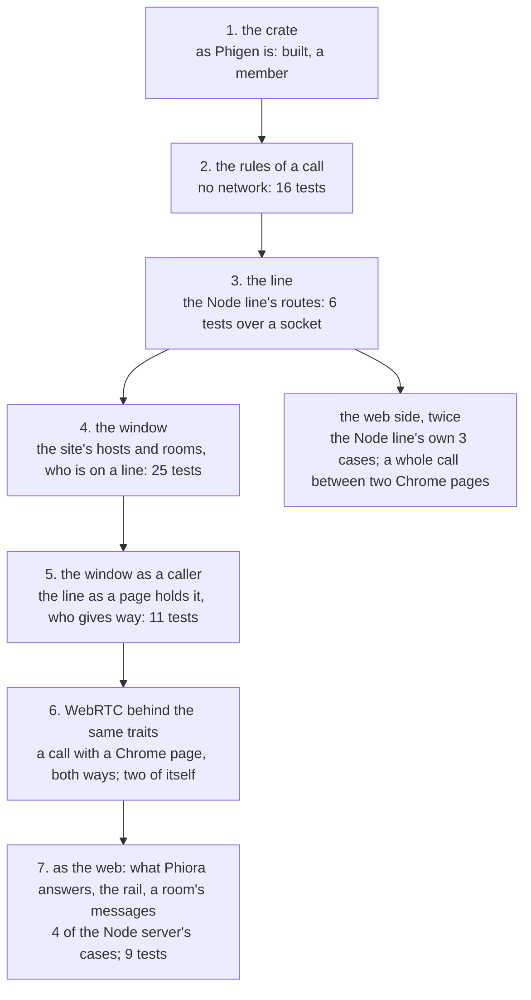
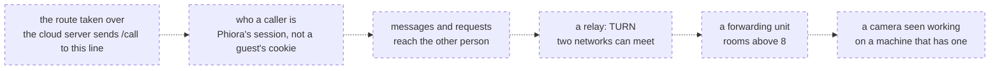

# Phiogy - plan

Where Phiogy in Rust stands after its second round (22 November 2026),
how its folders are arranged and why, and the order of what comes next.
What is suggested is marked so; the rest is built and tested.

## Decided

- Phiogy is an app on appkit, made the way Phigen is: a crate of its own
  at `crates/appkit/app/phiogy` (`cdylib`, `rlib` and a program), a
  member of the workspace beside Phigen, everything that is not code in
  `data/*.tsv`. (The user, 22 November 2026.)
- Config based: nothing a person reads, no limit, no name on the wire,
  no status, no address is in code. Each is a row of a table, and a test
  changes a table to show the code follows it. What the code keeps are
  the names of rows, as it keeps the names of the theme's tokens.
- The rules of a call have no network in them and the shape of entity,
  comp and system. They change a board and write notes; whoever carries
  the line delivers the notes.
- The board is a world of `phiecs`: a room, a caller and a line are
  words, a line is `on` its room and `of` its caller.
- The line serves the Node line's routes with its words, so the web
  pages do not change.
- The window's furniture is appkit's; Phiogy changes data only. Its
  look is appkit's light: no fill of its own, no colour in code.
- The window is a caller the way a page is: over the line's own routes,
  with the browser's rule of who gives way. What carries a call is
  behind two traits, so the rules are tested with a stand-in and run on
  WebRTC unchanged. (Round two; the user's yes, 22 November 2026.)
- WebRTC is `libwebrtc`, behind a feature that is off by default, since
  it needs the prebuilt library on disk.

## The folders

| Folder or file | Holds | Lines |
|---|---|---|
| `Cargo.toml` | the crate: on `appkit`, `phiecs`, `serde_json`; `rand` at a desk, `wasm-bindgen` in a browser | |
| `data/` | 37 tables | |
| `src/entity/` | `room.rs`, `caller.rs`, `line.rs` | 75 |
| `src/comp/` | `limit.rs`, `fault.rs`, `wire.rs`, `roster.rs`, `signal.rs`, `ice.rs`, `note.rs` | 390 |
| `src/system/` | `join.rs`, `pass.rs`, `leave.rs`, `beat.rs`, and `post` in `mod.rs` | 168 |
| `src/board.rs` | the world, and how it is read | 214 |
| `src/exchange/` | `set.rs`, `ask.rs`, `answer.rs`, `guest.rs`, `told.rs`, `hub.rs`, `route.rs`, `person.rs`, and `Exchange` in `mod.rs` | 894 |
| `src/peer/` | `line.rs`, `mesh.rs`, `engine.rs`, `stand.rs`, `call.rs`; `rtc/`: `mod.rs`, `link.rs`, `wire.rs`, `sent.rs`, `ear.rs`, `tone.rs`, `mic.rs`, `speaker.rs`, `camera.rs`, `scene.rs` | 2,178 |
| `src/site.rs`, `src/site/` (`read.rs`, `member.rs`, `extra.rs`, `shop.rs`) | the web Phiogy's hosts, rooms, people and pages; its templates, friends and shops; a shop's own file | 571 |
| `src/phiora.rs` | Phiora asked: an app's document, who is asking, their own documents | 150 |
| `src/kept.rs` (`kept/who.rs`), `src/hour.rs` | a person's own documents; who they are to Phiora, signing in, sessions, export; the hour on their clock | 291 |
| `src/hosted.rs` | a picture's key to its file; the film of a call's pictures | 68 |
| `src/app.rs`, `fact.rs`, `choice.rs`, `data.rs`, `run.rs` (`run/caller.rs`, `run/read.rs`), `main.rs`, `web.rs`, `lib.rs` | the app, and opening it | 857 |
| `src/part/` | a room: `title.rs`, `join.rs`, `call.rs` (`call/`), `room.rs`, `stream.rs` (`stream/`), `talk.rs`, `present.rs`, `person.rs` (`person/`), `status.rs`, `viewer.rs` (`viewer/`); around the rooms: `page.rs`, `guide.rs`, `venue.rs`, `host.rs`, `friend.rs`, `bond.rs`, `shop.rs` (`shop/`), `store.rs`, `account.rs` (`account/`); shared: `list.rs`, `tool.rs`, `now.rs`, and `Desk` in `mod.rs` | 4,961 |
| `src/test/` | the tests, in the same folders; `site/` is a small site written as the web writes its own, with a shop | 3,267 |
| `asset/icon/phiogy.svg` | the mark | |
| `script/logo.py`, `script/icon.mjs`, `script/line.mjs`, `script/peer.mjs`, `script/phiora.mjs` | draws the mark; writes lucide's icons; runs the Node line's tests against this line; a call between this program and a Chrome page; what the program reads of and keeps on the real Phiora | |
| `doc/` | pictures of the window, and the mark's sheet | |
| `web/index.html` | the page a browser loads it into | |

No file is over 250 lines.

### The tables

| Table | Read by | Says |
|---|---|---|
| `limit.tsv` | `comp/limit.rs` | 8 in a call, 256 pages a line, a beat every 20 s, gone after 60 s, 64 signals a post, the largest request, the most wires and guests |
| `name.tsv` | `comp/limit.rs` | what an app's, a room's and a peer's name may be |
| `fault.tsv` | `comp/fault.rs` | each refusal's status, word and sentence |
| `wire.tsv` | `comp/wire.rs` | the words a page and the line say to each other |
| `ice.tsv` | `comp/ice.rs` | the ICE servers; none |
| `line.tsv` | `exchange/set.rs` | where the line listens, the path, the cookie, the guest, the origins |
| `head.tsv`, `status.tsv` | `exchange/set.rs` | the head of each kind of answer; what each status is called |
| `app.tsv` | `app.rs`, `run.rs` | the name, the hosts in front and in the bar, the folder, where the site is |
| `site.tsv`, `icon.tsv` | `site.rs`, `part/mod.rs` | the names in the web's files; which shared icon each of the web's is |
| `space`, `layout`, `host`, `region`, `part`, `modal` | `app.rs`, for appkit | the window |
| `activity.tsv`, `menu.tsv`, `user.tsv` | `app.rs`, for appkit | the bar, its menus, the user |
| `theme.tsv`, `look.tsv` | `app.rs`, for appkit | every colour and size; the four looks |
| `text.tsv` | every part | every word a person reads |
| `say.tsv` | `run.rs`, `run/read.rs`, `run/caller.rs` | what the command line says and what a caller with no window says and is told; read as part of the text table |
| `logo.tsv` | `script/logo.py` | the mark's measures, in the font's own |
| `dial.tsv` | `peer/line.rs` | the head of what a caller asks of the line |
| `signal.tsv` | `peer/mesh.rs`, `peer/rtc/` | the words two callers say to each other |
| `peer.tsv` | `peer/call.rs`, `peer/mesh.rs`, `peer/rtc/`, `part/call.rs` | the caller's name, its pace, what it sends and how it measures; where sound and pictures come from (`device`: the system's, or the stand-ins), a shared screen, what is played, what a call's pictures are named in the film, and why a device was not given |
| `phiora.tsv` | `phiora.rs` | where Phiora is, how long it is waited for, what it is asked and how its answer is read |
| `keep.tsv` | `kept.rs` | the person's own documents: what the code calls each, the name Phiora keeps it under, the files of their folder |
| `page.tsv` | `part/page.rs` | the pages that are no room: the web's id of each, the space it is shown in, what the rail calls it, its icon |
| `wear.tsv` | `part/shop/swatch.rs` | what a theme that is worn changes of the window: a colour of the theme's, and which colour of the swatch takes its place |
| `wallet.tsv` | `part/store.rs`, `part/account.rs` | the coins a person starts with, what each is called and worth, and the names in the bag's and the wallet's documents |
| `act.tsv` | `part/stream.rs`, `part/title.rs`, `part/person.rs`, `part/friend.rs`, `part/shop.rs` | a room's controls: what each does, its icon, the row of `text.tsv` that names it |
| `tool.tsv` | `part/viewer.rs` | the viewer's controls: what each does, its icon, the row of `text.tsv` that names it |
| `asset.tsv` | `hosted.rs` | where each app's public folder is: a picture's key is `app:path` |
| `serve.tsv` | `exchange/person.rs` | the paths of an app's document, `me` and a person's documents; where the apps' files are; the names in `me` |

## Where it stands

## What comes next - suggested

The order is the web Phiogy's own (`puikit/app/phiogy/ARCHITECTURE.md`,
section 9), from its second step on.

### Suggested folders for what comes next

| Folder | Would hold | Stands on |
|---|---|---|
| `src/relay/` | TURN first, then a forwarding unit | to choose |
| `src/entity/message.rs`, `src/system/say.rs` | a message as a word of the board, and the rule that delivers it | the board, as a call is |
| `src/phiora.rs`, more of it | asking Phiora who the person is and for their own documents (what they joined, their wallet) | `phiora.rs` asks for the app's document today; a session of Phiora's, which needs signing in |

## Open, for the user's word

- Which of the two `philog` crates keeps the record of joins and leaves
  (phikit's is the session journal). The line keeps no record today.
- Whether the line should take `/call` over on the cloud server before a
  native peer is begun, or after.
- Where the prebuilt WebRTC is kept: it lies in a build folder that
  `cargo clean` empties ([`TODO.md`](TODO.md), "The native peer").
