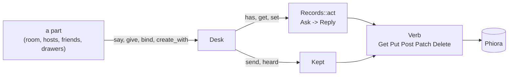
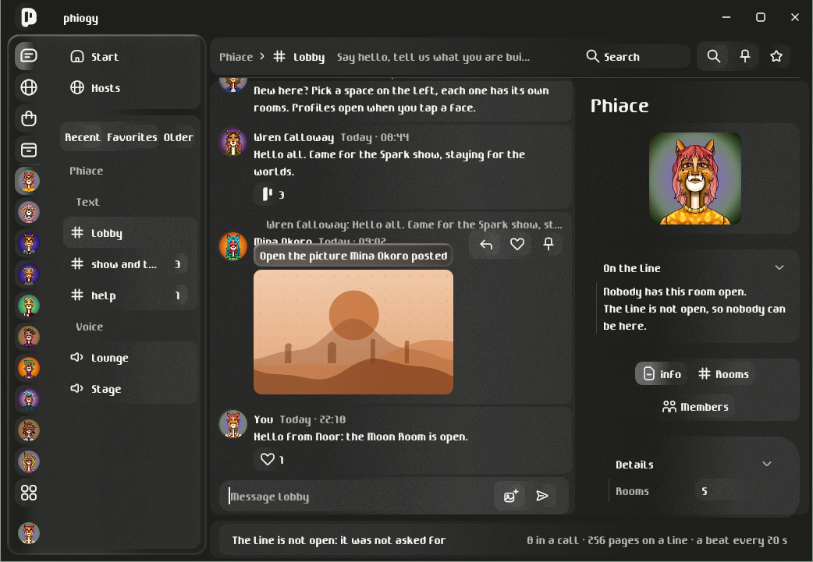
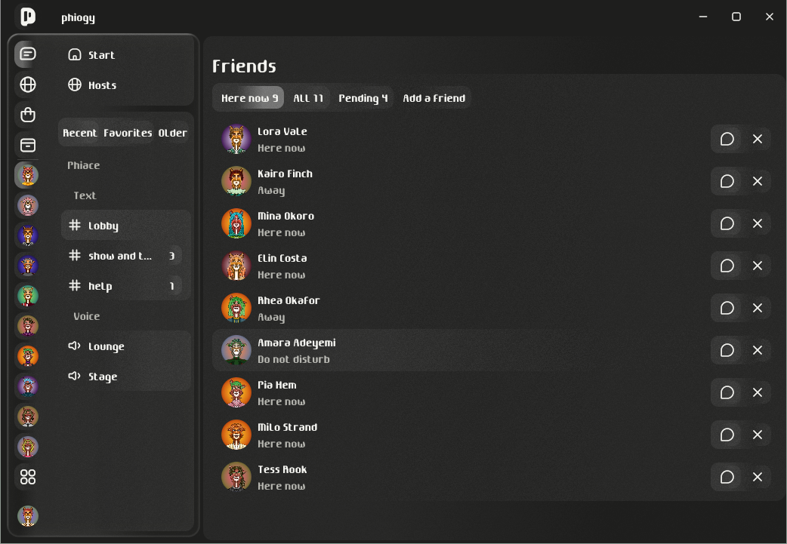
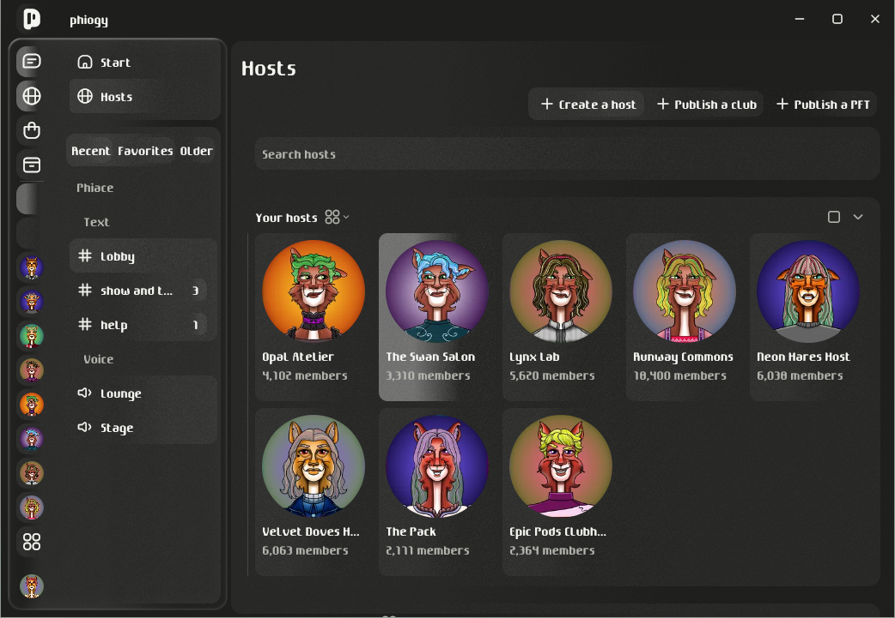
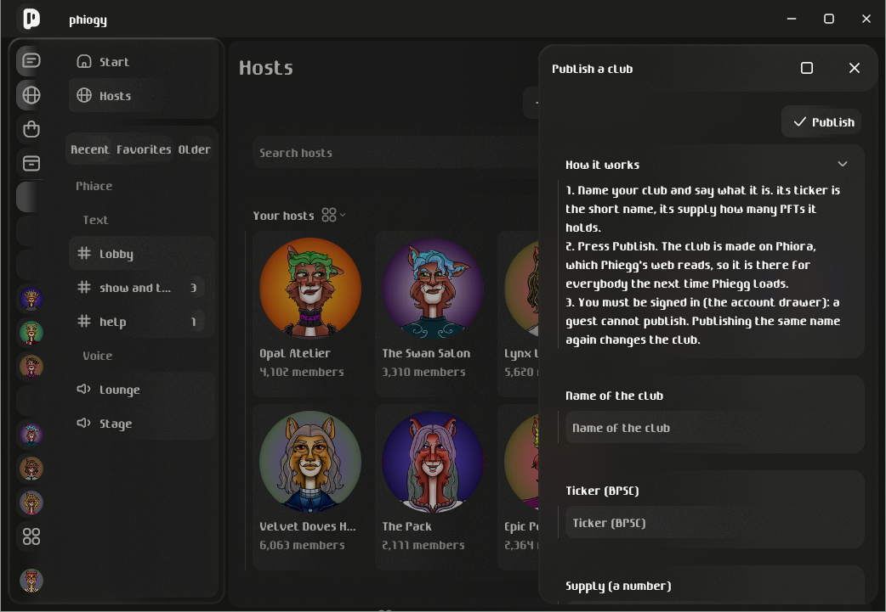

# Phiogy: the user flow of each module, checked

Checked on 26 November 2026 against the local Phiora (`localhost:4300`)
and the Phiegg site it feeds (`localhost:3101`). Nothing here touched
`phiegg.com`.

## How it was checked

| Check | What it covers | Result |
|---|---|---|
| `cargo test -p phiogy --lib` | 169 tests, one or more per module (the module counts are in each section) | 167 pass, 2 ignored on purpose |
| `node script/phiora.mjs` | the window against a real Node Phiora: reading hosts and rooms, an edit in Phiora, writing in a room, a demo member, a refused sign-in | 8 steps pass |
| `node script/make.mjs` | clubs and PFTs published from a sheet and from the two drawers; a host made by one member and joined by another, a message read by another member, a friend request asked, accepted and removed, and a like counted by another member, on a real Phiora | 11 steps pass |
| Pictures of 15 views, `doc/flow/sheet-1.png` to `sheet-3.png` (taken 26 November, against a scratch Phiora with a club, a host, a message with a like and a friend request in it) | each view opened with its own flags (`--show`, `--open`, `--who`, `--find`, `--width`) and looked at | listed below |
| Discord, side by side | one Discord window (a direct message) against one Phiogy room, layout only | gaps listed in "Against Discord" |
| `tsc --noEmit`, `check-relations.mjs`, `/tree` of Phiora | the Phiegg data and types after the changes to shops and activity | 0 errors, 0 dangling links |

Not checked: nobody clicked through the Phiegg website in a browser,
and no call between two real machines was made. A flow marked "pictured"
was opened and looked at; it was not worked by hand.

Status words, as in `CONTROLS.md`: **WORKS** does the whole job.
**OWN DOC** is kept in the person's own record (their folder, and Phiora
when it answered at launch) and nobody else sees it. **NAV** only moves
between views. **PARTIAL** and **MISSING** are what they say.

## Structure: how the window talks to the data

Every record the window makes or reads on Phiora (a club, a host, a
message, a friend request, a like) goes through one small piece,
`records.rs`: a kind, a name key and a payload, asked as `has`, `get` or
`set`, which are three words of one `match` over an `Ask` enum. A part never
sees a path, a header or a table. The diagram, the list of kinds with their
keys and payloads, and what is not built (the same three words in appkit, for
every app, with the place and the key set in each app or once for all) are in
[`ARCHITECTURE.md`](ARCHITECTURE.md), "Data: one source, three words".

## Screens

Each picture is a module as it is now, taken in the real window against a
scratch Phiora that has a club, a host, a message with a like and a friend
request made by two demo members (the person's own folder and Phiora were not
touched). The old pictures were replaced.

| | |
|---|---|
|  |  |
| A room. The message under "You" was written by one member and liked by another, and is read from Phiora. | Friends. Pending reads 4: the three it began with and the request one member made of another. |
|  |  |
| Hosts. The bar has Create a host, Publish a club and Publish a PFT. | Publish a club: the steps, then its fields; it is the kit's form. |

All fifteen are in the three sheets: [`sheet-1`](doc/flow/sheet-1.png)
(room, a person beside it, hosts, make a host, publish a club, publish a
PFT), [`sheet-2`](doc/flow/sheet-2.png) (friends, people, shops, library,
search, account) and [`sheet-3`](doc/flow/sheet-3.png) (profile, a room
searched, a phone-sized window).

Not pictured: the "Published by people" section of the Hosts page, which sits
below the first screen of the page. A published host was found and joined
from the command line (`make.mjs` step 8), but its section was not seen on
screen.

## Modules

### 1. Bar and rail
Flow: pick a space in the rail (Rooms, Hosts, Shops, Library), pick a
host's face, pick a room under its heading, Start for the direct list.

- Evidence: pictured (`01-room-shared`, `03-hosts`); tests `app`, `left`, `tab`.
- Status: **NAV**, works.
- Gap: the rail shows no unread or mention badges. A room row shows a
  count (`3`, `1`), a host's face shows none.
- Gap: the person's own panel at the bottom left is an avatar only. Mute,
  sound off and status live elsewhere (the guide's foot, in a voice room).

### 2. Room: title, stream, composer
Flow: open a room, read the stream (names, times, pictures, replies), write
a message, send, reply, like, pin, search the room, list the pinned.

- Evidence: pictured (`01-room-shared`: a message from another member with a like on it; `14-room-find`); tests `room` (6),
  `talk` (4), `told`, `once`; `phiora.mjs` step 5 (a message written by
  the program is in Phiora's `room` document of its session, and read
  back when the folder's copy is lost).
- Status: **WORKS through Phiora (new, 26 November)** for words. What a
  signed-in person writes is also made a `message` record on Phiora, and
  the window asks Phiora for everybody's messages every 4 seconds, so
  another member of the room reads it with the sender's name, in order,
  once. `make.mjs` step 9 checks it on a real Phiora: Noor writes in the
  lobby, Ines reads it, Noor sees it once, not twice.
- Likes (new): a like on a message is a `mark` record on Phiora, one per
  person and message (taking it back sets it off, it does not make another),
  and the others in the room count it with the site's own count. `make.mjs`
  step 11: Ines likes Noor's message, Noor sees "heart 1", Ines takes it
  back, Noor sees none.
- Follows (new, half): following someone also makes a `follow` record on
  Phiora (who, whom, on or off). Nothing reads it yet: a profile's follower
  count is still the site's number, so nobody can see who follows them.
- Not shared: a guest's messages and likes (Phiora refuses them, they stay
  with the guest), pictures (a posted picture is a path on the sender's
  disk), pins, and replies' targets from other people's messages (the id
  is kept, the quoted line shows only where the message is in the room).
- Asking is narrowed (26 November): Phiora's `GET /tree` now takes
  `where=field:value` (more than one: all must hold) and `limit=N` (the
  last N rows), and the window asks for the room it is in
  (`where=room:...&limit=200`) and for the requests that name the person
  (`where=from:ID`, `where=to:ID`), not for every record. A room the
  person goes to is asked for at once; the room they stay in every 4
  seconds. An older Phiora that ignores the filters still works: the window
  narrows what comes back itself, only the download is bigger.
  The server change is in `puikit/app/phiora-server` (`src/tree.mjs`,
  `src/server.mjs`, one new test) and is **not deployed**: `phiegg.com`
  still has the old server.
- Still to do on the server: a change log to ask "since" (the window still
  takes the latest 200 of a room each time), and Phiora allows 30 writes a
  minute per person.
- Gap: the composer has one picture button and Send. No emoji, sticker
  or attachment menu.
- Gap: a posted picture keeps a `file:///` path. It is not uploaded.

### 3. A person beside the room
Flow: press a face, see their profile beside the room (links, spaces,
pictures), Message, Follow, Mute, Back.

- Evidence: pictured (`02-room-person`); tests `beside` (2), `person` (4).
- Status: **OWN DOC**. Follow and mute reach nobody.

### 4. The column beside a room (the host's page)
Flow: read the host's name and face, who is on the line, tabs Info, Rooms,
Members, Rules, each with folding sections; Join or Leave.

- Evidence: pictured (`01-room-shared`); tests `beside`, `site`.
- Status: works. It is on the kit's form.
- Defect, seen in `15-mobile`: at phone width this column stands over the
  stream and its picture covers the top messages. Not fixed.

### 5. Calls and voice rooms
Flow: Call or Call with camera in a room's title, Join a voice room, Mute,
Sound off, End, the room's Calls tab of kept calls.

- Evidence: tests `call` (5), `voice` (3), `peer` (7), `ring` (4),
  `pill` (2), `exchange` (7), `board`, `system`, `comp`; one call between
  this window and a Chrome page was measured both ways on 24 November.
- Status: works on one machine and one network. The normal build carries
  no sound or picture (the `rtc` build does). Nothing has run on a second
  computer.
- Gap: across networks a call needs the relay ports opened on the server.

### 6. Hosts
Flow: open Hosts, search by name, switch grid and list, open a host's
drawer, Join, Leave, Open, Remove one of your own; Create a host, name it,
pick how it starts, Create.

- Evidence: pictured (`03-hosts`, `04-host-make`); tests `hosts` (5);
  `make.mjs` step 8 on a real Phiora.
- Status: **WORKS through Phiora (new, 26 November)**. A host you make is
  also published on Phiora as a `host` record (its name, its template,
  its rooms), where Phiegg's web reads hosts. The Hosts page lists the
  hosts other people published under "Published by people"; Join copies
  it into your rail with its rooms. A guest's host is kept for them only,
  and the page says so. The same name made twice is one host.
- Still not shared: what is said in a room. Joining gives you the rooms,
  not the other members' messages (they are OWN DOC, module 2). The
  member count of a published host is 1; joining does not raise it.
- On the kit's form (page and drawers).

### 7. Publish a club, publish a PFT (new)
Flow: Hosts, Publish a club (name, ticker, supply, one line), Publish;
Publish a PFT (name, number, the club it is in), Publish. The same name
again changes the record. A guest is told to sign in.

- Evidence: pictured (`05-club-drawer`, `06-pft-drawer`); test `hosts`
  (`step_26b`); `make.mjs` steps 1 to 7 on a real Phiora, including the
  drawers' own code (`--fill`, `--publish`).
- Status: **WORKS** against a real Phiora. Records are made on Phiora, which
  Phiegg's web reads.
- Gap: the person must be signed in (account drawer, or `--signin`). A
  sign-in with a real password has not been tried against the live server.
- Gap: the call waits for Phiora, so a slow server holds the window for a
  moment.
- Gap: no way to edit or remove a club from the window (the command line
  `--make` changes one; nothing removes one).
- Gap: pictures of the PFTs are not uploaded.

### 8. Friends and People
Flow: Friends (Here now, All, Pending, Add a friend); Accept, Decline,
Cancel, Remove; People: Find or start a conversation, search, open a
direct room.

- Evidence: pictured (`07-friends-asked`: Pending went from 3 to 4 with the request Ines made; `08-people`); tests `person`, `talk`.
- Status: **WORKS through Phiora (new, 26 November)** between a signed-in
  person and a member who is one of Phiora's persons (the seeded people,
  whose ids have an underscore: `u_ines`). Add friend makes a `bond`
  record naming the one asked; they see it under Pending (within 4
  seconds), Accept or Decline changes it, Remove or Cancel ends it, and
  each side reads how they stand from Phiora. `make.mjs` step 10 checks
  it with two members: stranger, asked, asked-on-another-run, accepted,
  friends on both sides, removed, strangers again.
- Still OWN DOC: requests to the people who exist only in the site's own
  file (Lora, Kairo, Mina and the like have no account to answer), and
  from a guest. Follows and mutes are still the person's own.
- A person who signed up on their own is not in the People list, so
  nobody can ask them yet; People lists the site's members, not Phiora's
  accounts.
- Not on the kit's form (Phiogy's own list, `part/list.rs`).

### 9. Search
Flow: open Search, type, tabs All, Rooms, People, Hosts, Worlds, Clubs,
Shows, Popular, See all, press a card.

- Evidence: pictured (`11-search`); test `search` (2).
- Status: reads Phiora's `/tree` or the files. **NAV**.
- Gap: a world, club or show opens a read-only record page. No edit.
- Not on the kit's form.

### 10. Shops, the bag, a thing's page
Flow: Shops list, Open or Close a shop, a shop's shelf, a thing's page
(picture, tabs, sections), Like, Add to bag, Pay from wallet, Put on a theme.

- Evidence: pictured (`09-shops`); tests `shop` (4).
- Status: **OWN DOC**. Paying is play money, asked of Phiora; the answer is
  read at the next launch. A worn theme never reaches Phiora's theme route.
- The thing's page is on the kit's form. The index and the bag are not.

### 11. Account and profile
Flow: Account drawer (who you are, wallet, look, sign in, demo sign in,
sign out, sessions, export); Profile (mode, surface, grounds).

- Evidence: pictured (`12-account`: Noor Hale, wallet $1,684, the eight looks; `13-profile`: Guest, not signed in);
  tests `account` (5), `signin` (2); `phiora.mjs` steps 7 and 8.
- Status: **WORKS** when Phiora is up. Create account, email, password
  reset or change, delete account and revoke one session are missing.
- Defect: with `--open account --demo u_noor` (that order) the drawer did
  not open; with `--demo u_noor --open account` it does (`12-account`). Only
  the command line is affected, a person signing in by hand is not; not fixed.
- Gap: the profile's head always says "Guest, not signed in", even after
  signing in (the picture shows it with nobody signed in).

### 12. Library and model view
Flow: browse the drives and folders, Back, Forward, Up, crumbs, layout,
Show, Order; open an item, change colours, comment, make a set; the model
view's four views, wireframe, drag, wheel.

- Evidence: pictured (`10-library`); tests `library` (14), `tree` (4).
- Status: **LOCAL ONLY**. Import copies to a local folder.
- Gap: its text is much smaller than every other view in the same window.
- Gap: the Team place that lists Phiora's assets is not built.
- On the kit's form.

### 13. Picture viewer
Flow: press a posted picture, zoom, previous, next, Sketch, Text, Undo,
Redo, save marks, share, open in the system.

- Evidence: tests `viewer` (9), `picture` (5).
- Status: **LOCAL ONLY**. Share copies a local path.

### 14. Small screens
Flow: the window below the width in `appkit`'s `data/mode.tsv` is laid
out as a phone app with a bottom bar.

- Evidence: pictured (`15-mobile`, 420 by 760); test `pace`.
- Status: works, with the overlap noted in module 4.

## Against Discord

What Phiogy has the same way: a rail of hosts, rooms under a host, a
header with the room's name, a stream with hover actions (reply, like,
pin), a right-hand panel for the host or person, calls from the header.

What Discord's flow has that Phiogy does not show:

| Discord | Phiogy now |
|---|---|
| Unread and mention badges on every rail icon | none |
| "Find or start a conversation" always at the top of the list | on the People page only |
| Friends, Message Requests, Quests as the first rows of the direct list | Friends and People are pages; no quests |
| A user panel at the bottom left: mute, deafen, settings, status | an avatar |
| Attachment, emoji and sticker buttons in the composer | one picture button |
| What you write, a request, a follow: the other person gets it | what you write in words, the hosts you make, friend requests to Phiora's people and likes on messages reach others; mutes, pins and pictures still only you (OWN DOC); a follow is told to Phiora but nothing shows it yet |

The main difference is the last row. The layout is close to Discord's.
The behaviour is that of a single-user app until the writes go through
Phiora.

## What is on the kit's form

| Module | On the kit's form |
|---|---|
| Library, person's tabs, host's column, shop thing, hosts, the two publish drawers | yes |
| Account, Friends and People, Shops index and bag, Search, Record | no, Phiogy's own list |
| Title, status, stream, calls, voice, guide, viewer, model | no, drawn by hand |

## Content: shops, variants and activity (Phiegg data, seeded in Phiora)

Done in `puikit/app/phiegg`, then written into Phiora (`npm run seed`) and
into Phiogy's 142 shops (`python app/phiogy/shop.py`). All of it is local.

**What was asked and what it became**

| Asked | Done |
|---|---|
| At least 16 records on the shop relations | every shop holds at least 18 looks (it was 6 to 12), every pool at least 9, every look and every piece at least 16 events |
| At least 8 variants to each item | a look's variants are the other looks of its pool (Phiegg's "Variants" section): every one of the 289 pools now has at least 9 looks, so every look has at least 8 variants. In Phiogy, "More like this" always shows 8 |
| Empty trails | every look, piece, egg, SUM, profile PFT, ride and jewel has a trail of at least 16 events (1,403 pieces had none; Phiora had no trail at all for eggs, SUMs, PFTs, rides and jewels) |
| Sold, swapped and the other OpenSea events | nine kinds: mint, list, offer, sale, transfer and the new swap, bid, cancel (listing taken down), price (listing price changed) |

**Numbers now (checked in the files and in Phiora's `/tree`)**

- Looks: 2,608 (the flagship store included). Shops: 142, each with at
  least 18 things in Phiogy. Pools: 289, the smallest with 9 looks.
- Events: 97,488 in Phiora (the sales ledger 68,992 and the assets' ledger
  28,496): sold 36,482, offers 17,277, listed 13,815, cancelled 6,972,
  price changes 6,073, bids 5,881, mints 5,932, swaps 3,019, transfers
  2,037.
- The minimum events of any look, piece, profile PFT or egg in Phiora: 16.
- `tsc` passes and `check-relations.mjs` finds 0 dangling links in
  108,867 items.

**How the old data was kept**

All 41,648 events that existed before this round are byte for byte the
same. The ledger writes the new events from a run of its own
(`scripts/ledger.mjs`), and the added looks carry `depth: true`, so the
people the ledger draws from do not grow and the old stories do not
re-roll. A swap names the item the new holder gave for it (`forItemId`).

**Two mistakes on the way, both put right**

1. Running `items.mjs` on a file that already has the ledger drops the
   first ledgers (`ia_`) of the old looks, and the ledger then re-rolled
   their stories. The Phiogy test of a thing's trail caught it. The data
   was restored from the saved copy and redone. `npm run data:shop` now
   runs only the steps that are safe to repeat.
2. 24 of the added flagship looks had no render (colours nothing was
   rendered in). They now carry a render of an existing look. Because
   `items.mjs` counts the nearest render again, some older looks may have
   been given a closer render than before: not checked against the saved
   copy.

**In Phiogy**

- A thing's trail names the new events (Swapped, Bid, Listing cancelled,
  Price changed); its figures have a Swaps count.
- "More like this" fills a short page of the menu (Shoes has 4) with the
  shop's other things, so it always shows 8. A test reads every shop file
  and checks it sells more than 8.
- The trail of a profile PFT, egg, SUM, ride or jewel is now in Phiora as
  `sale` records, so Phiogy's shops can show it. I did not open a PFT's
  thing page in the window to see it.

**Not done**

- Pools per shop (2) and per club (13) are far under 16. A pool is a drop;
  16 looks in each of them would be about 9,000 more looks.
- The Phiegg website was not opened in a browser, so the new Variants
  section and Activity table were not looked at.
- The 306 looks added in the second step take the nearest existing render,
  not their own picture.
## Defects found while checking

1. Phone width: the host's column covers the first messages (module 4).
2. `--open account --demo u_noor` (that order only): no drawer (module 11).
3. The profile's head ignores who is signed in (module 11).
4. The Library's text is smaller than the rest (module 12).
5. `--quiet` says "The Line is not open: it was not asked for" in the
   status bar even where that is what was asked. Harmless, but it reads
   as an error.

## Order of work from here

1. Writes through Phiora so others see them: hosts are done (module 6);
   messages in words (module 2), friend requests (module 8) and likes (module 2) are done; showing who follows whom, pins, mutes and picture uploads are next (the remaining "OWN DOC" rows above).
2. Account, Friends and People, Shops index, Search and Record onto the
   kit's form.
3. Unread badges on the rail, a user panel at the bottom left.
4. Fix defects 1 to 4.
5. Upload (`POST /file`), then PFT pictures and the Library's Team place.
