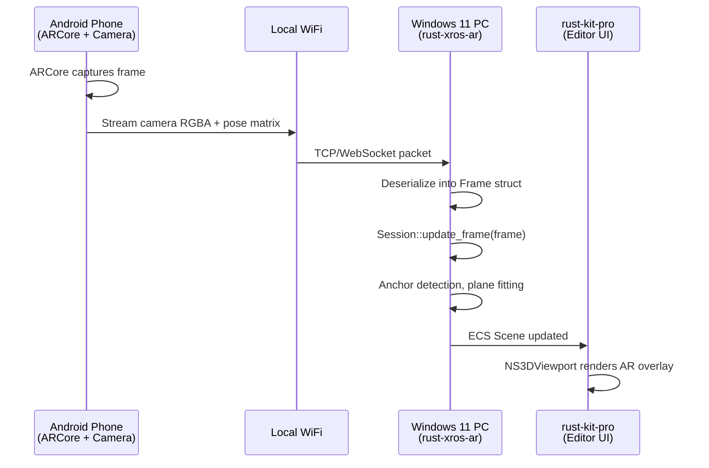

# Evaluation: Using rust-macos & rust-xros-ar on Windows 11 + Android

## Your Setup

```
┌─────────────────────────────────────────────────────┐
│ YOUR ROOM                                           │
│                                                     │
│   ┌──────────────────┐    ┌───────────────────┐    │
│   │ Windows 11 PC    │    │ Android Phone     │    │
│   │ ┌──────────────┐ │    │ ┌───────────────┐ │    │
│   │ │rust-kit-pro  │ │    │ │ Camera        │ │    │
│   │ │(editor)      │ │    │ │ IMU/Gyro      │ │    │
│   │ │              │ │    │ │ ARCore        │ │    │
│   │ │rust-macos    │ │    │ │ Depth sensor  │ │    │
│   │ │(logic layer) │ │    │ └───────────────┘ │    │
│   │ │              │ │    │                   │    │
│   │ │rust-xros-ar  │ │    │ Streams data     │    │
│   │ │(AR runtime)  │ │    │ over WiFi ────────┤───→│
│   │ └──────────────┘ │    └───────────────────┘    │
│   │                  │                              │
│   │ rust-windows-    │                              │
│   │ appkit (UI)      │                              │
│   └──────────────────┘                              │
└─────────────────────────────────────────────────────┘
```

---

## The Core Problem

Both `rust-macos` and `rust-xros-ar` are **pure Rust data structure libraries**. They define Apple's ARKit, Metal, Vision, SceneKit, and RoomPlan APIs as Rust structs and traits. They compile and test fine on Windows.

**But they have zero actual sensor backends.** On a real iPhone/Vision Pro, Apple's OS provides:
- Camera frames (RGB + depth via LiDAR)
- IMU data (accelerometer, gyroscope)
- SLAM tracking (Visual Inertial Odometry)
- Plane detection (ML model)
- Face/body mesh (TrueDepth neural engine)

On your Windows 11 PC, none of these hardware APIs exist. The crates are **headless logic shells** — they manage state, anchors, and transforms, but nothing feeds them real data.

---

## How You CAN Use Them (3 Strategies)

### Strategy 1: Android Phone as Wireless AR Sensor

Your Android phone has everything Apple's hardware does (camera, IMU, depth on some models). The phone becomes the "eyes" while the PC runs the brain.



**What needs to be built:**

| Component | Where | What |
|---|---|---|
| **Android streaming app** | Phone (Kotlin/Java) | Capture ARCore frames, serialize `CameraFrame { pixels, width, height }` + `camera.transform` as JSON, stream over TCP |
| **Network receiver** | `rust-xros-ar/src/providers/android_bridge.rs` | TCP listener that deserializes incoming packets into `Frame` structs |
| **Provider trait** | `rust-xros-ar/src/providers/mod.rs` | `trait ARProvider { fn next_frame() -> Frame }` — abstraction over real hardware |
| **Integration** | `rust-kit-pro/src/main.rs` | Poll `ARProvider` each tick, feed frames to `Session::update_frame()` |

**Android app data format** (what the phone sends per frame):
```json
{
  "timestamp": 1713645120.5,
  "camera": {
    "transform": [1,0,0,0, 0,1,0,0, 0,0,1,0, 0,1.5,0,1],
    "intrinsics": [500,0,320, 0,500,240, 0,0,1],
    "tracking_state": "Normal"
  },
  "image": "<base64 JPEG 640x480>",
  "depth": "<base64 float32 array>",
  "planes": [
    {"id": "abc", "center": [0,0,0], "extent": [2,0,3], "alignment": "horizontal"}
  ]
}
```

**Latency target:** < 50ms per frame over local WiFi (achievable at 640x480 JPEG @ 30fps)

---

### Strategy 2: Webcam as Desktop AR Sensor

Your PC's webcam (or a USB camera) replaces the phone entirely. OpenCV handles tracking on the PC side.

```
┌──────────────┐     ┌─────────────────────┐     ┌──────────────────┐
│ USB Webcam   │────>│ OpenCV (via          │────>│ rust-xros-ar     │
│ 1080p@30fps  │     │ opencv-rust crate)   │     │ Session::update  │
└──────────────┘     │ • Camera calibration │     │ Frame            │
                     │ • ArUco markers      │     └──────────────────┘
                     │ • ORB-SLAM2          │
                     │ • Plane estimation   │
                     └─────────────────────┘
```

**Dependencies to add to Cargo.toml:**
```toml
opencv = { version = "0.92", features = ["aruco", "calib3d"] }
nokhwa = "0.10"  # Webcam capture
```

**Pros:** No phone needed, everything runs on one machine.
**Cons:** Desktop webcam has no depth sensor, no IMU. Tracking quality is significantly worse than ARCore/ARKit. You'd need printed ArUco markers taped to your walls for reliable pose estimation.

---

### Strategy 3: Simulated/Recorded Sessions (Works Today, No Hardware)

This is the strategy you can use **right now** without any additional hardware or apps. Load pre-recorded AR session data from JSON files.

```
┌──────────────────────────────────────────┐
│ recorded_session.json                     │
│ (100 frames captured on a real device)    │
│                                           │
│ Frame 0: camera at [0,1.5,0], 3 planes   │
│ Frame 1: camera at [0.01,1.5,0], 3 planes│
│ Frame 2: camera at [0.03,1.5,0.01], ...  │
│ ...                                       │
└──────────┬───────────────────────────────┘
           │
           ▼
┌──────────────────────────────────────────┐
│ rust-xros-ar SimulatedProvider           │
│ • Reads frames from JSON                 │
│ • Replays at 30fps                       │
│ • Session processes anchors/planes       │
└──────────┬───────────────────────────────┘
           │
           ▼
┌──────────────────────────────────────────┐
│ rust-kit-pro Editor                      │
│ • 3D Viewport shows camera path          │
│ • Hierarchy shows detected planes        │
│ • Inspector shows anchor transforms      │
│ • Timeline scrubs through recording      │
└──────────────────────────────────────────┘
```

**What needs to be built:**

```rust
// rust-xros-ar/src/providers/simulated.rs
pub struct SimulatedProvider {
    frames: Vec<Frame>,
    current_index: usize,
    playback_speed: f32,
}

impl SimulatedProvider {
    pub fn from_json(path: &str) -> Self { /* load frames */ }
    pub fn next_frame(&mut self) -> Option<&Frame> {
        let frame = self.frames.get(self.current_index)?;
        self.current_index += 1;
        Some(frame)
    }
}
```

This is **immediately useful** — you can design, test, and validate your entire AR pipeline without touching a camera.

---

## How rust-macos Fits In

`rust-macos` is the **larger framework umbrella** — it contains not just ARKit, but also:

| Framework | What It Does | Windows Use Case |
|---|---|---|
| **ARKit** (27 modules) | AR session, anchors, tracking | Feed from Android/webcam/simulated data |
| **Metal** (20 modules) | GPU compute/rendering types | **Map to WGPU** — Metal types become wgpu types on Windows |
| **SceneKit** (13 modules) | 3D scene graph, physics, materials | Drive the NS3DViewport in the editor |
| **ModelIO** | 3D model import/export | Load GLTF/USD files via PHX crate |
| **Vision** (7 modules) | Computer vision, body/face detection | Feed from OpenCV or Android ML Kit results |
| **MetalFX** | Upscaling (FSR/DLSS equivalent) | Not applicable unless WGPU pipeline is live |
| **QuartzCore** | Animation layers and timing | Drive `SCNAnimation` and timeline system |
| **RealityKit** | High-level AR placement | Entity anchoring in the editor |
| **RoomPlan** | Room scanning | Feed from Android LiDAR or manual room modeling |
| **CoreML** | ML inference | Could use ONNX Runtime as backend |

The mapping path on Windows:

```
Apple Framework     → rust-macos type      → Windows backend
─────────────────────────────────────────────────────────────
Metal               → MTLDevice, Pipeline  → wgpu::Device, wgpu::RenderPipeline
ARKit               → ARSession, ARFrame   → Android bridge / webcam / simulated
SceneKit            → SCNNode, SCNScene    → Our ECS (ecs.rs / reality-foundation)
Vision              → VNRequest            → OpenCV / ONNX Runtime
CoreML              → MLModel              → ONNX Runtime / TensorRT
MetalFX             → Upscaler             → FSR 2.0 / DLSS (stretch)
QuartzCore          → CAAnimation          → Our SCNAnimation runtime
ModelIO             → MDLMesh              → PHX / glTF crate
```

---

## What rust-macos and rust-xros-ar Modules Look Like on Windows

### Currently Working (compiles and tests pass)

| Module | Lines | Tests | Notes |
|---|---|---|---|
| `rust-macos::arkit` | ~16,000 | 9 passing | All struct/trait definitions, no hardware |
| `rust-macos::metal` | ~6,000 | compiles | Type definitions only |
| `rust-macos::vision` | ~1,500 | compiles | Request/observation types |
| `rust-macos::scenekit` | ~7,000 | compiles | Scene graph types |
| `rust-macos::quartzcore` | ~8,000 | compiles | Animation layer types |
| `rust-macos::modelio` | ~6,000 | compiles | 3D model I/O types |
| `rust-xros-ar::session` | 290 lines | compiles | Session state machine |
| `rust-xros-ar::frame` | 244 lines | compiles | Frame data container |
| `rust-xros-ar::room_plan` | ~4 files | compiles | Room capture types |

### Missing (what must be built for Windows use)

| Missing Piece | Priority | Effort |
|---|---|---|
| `ARProvider` trait (abstraction over sensors) | Critical | 1 day |
| `SimulatedProvider` (JSON replay) | Critical | 1 day |
| `AndroidBridgeProvider` (TCP from phone) | High | 2-3 days |
| `WebcamProvider` (OpenCV) | Medium | 3-5 days |
| Metal → WGPU type bridge | High | 2-3 days |
| SceneKit → ECS bridge | High | 1-2 days |
| CoreML → ONNX bridge | Low | 3-5 days |

---

## Recommended Implementation Order

### Week 1: Simulated AR (no hardware needed)
1. Create `rust-xros-ar/src/providers/mod.rs` with `ARProvider` trait
2. Create `SimulatedProvider` that replays frames from JSON
3. Create a sample `test_session.json` with 60 frames of a simulated room walkthrough
4. Wire `Session::update_frame()` to the provider in `rust-kit-pro/main.rs`
5. Show detected planes in the NSOutlineView hierarchy

### Week 2: Android Phone Bridge
1. Build a minimal Android app (Kotlin) that captures ARCore frames
2. Serialize frames as compact MessagePack/JSON over TCP
3. Create `AndroidBridgeProvider` in rust-xros-ar
4. Test with phone on same WiFi — point phone around your room, see planes appear in the editor on your PC

### Week 3: Live 3D in the Editor
1. Bridge `rust-macos::metal::MTLDevice` → `wgpu::Device`
2. Mount WGPU surface in `NS3DViewport`
3. Render plane anchors as semi-transparent rectangles in 3D
4. Show camera frustum from phone's perspective
5. Overlay camera feed as background texture

### Week 4: Room Scanning
1. Wire `RoomCaptureSession` to the Android bridge
2. Accumulate surfaces, objects, and openings from phone scanning
3. Display `CapturedRoom` in the 3D viewport
4. Export to USD via `RoomBuilder::export_to_usd()`

---

## Bottom Line

| Question | Answer |
|---|---|
| Can you compile rust-macos on Windows? | **Yes** — it's pure Rust, all tests pass |
| Can you compile rust-xros-ar on Windows? | **Yes** — same, pure Rust |
| Can you use them with real sensors today? | **No** — there's no sensor provider layer yet |
| What's the fastest path to a working demo? | **SimulatedProvider** — replay recorded AR data from JSON, no hardware needed |
| Can your Android phone be the AR sensor? | **Yes** — stream ARCore frames over WiFi to the PC |
| Can your webcam work? | **Partially** — needs OpenCV, no depth, needs ArUco markers |
| What about Apple Vision Pro features (hand/eye tracking)? | **Not on Windows** — these require Apple Neural Engine. You could simulate hand tracking via MediaPipe on Android |
