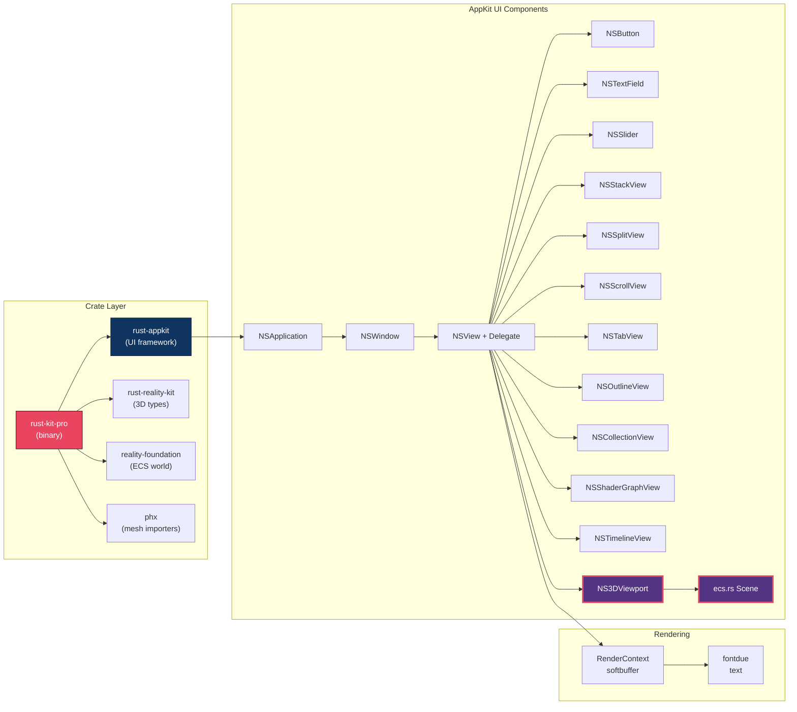

# SceneKit Gap Analysis & Updated Roadmap

## Architecture — Where We Are Now

---

## SceneKit Header Parity Matrix

### 1. SceneKitTypes.h — Math Primitives

| Apple API | Our Equivalent | Status |
|---|---|---|
| SCNVector3 (x,y,z) | NSPoint (x,y only), [f32;3] in ECS | Partial — no proper 3D vector type |
| SCNVector4 (x,y,z,w) | None | Missing |
| SCNQuaternion | None | Missing |
| SCNMatrix4 (4x4 transform) | Transform with position, rotation, scale | Partial — decomposed, not a real matrix |
| SCNMatrix4MakeTranslation | None | Missing |
| SCNMatrix4MakeRotation | None | Missing |
| SCNMatrix4MakeScale | None | Missing |
| SCNMatrix4Mult | None | Missing |
| SCNMatrix4Invert | None | Missing |
| SCNActionTimingMode (Linear/EaseIn/Out) | None | Missing |
| SCNColorMask (RGBA bitfield) | NSColor has RGBA fields | Done |
| SIMD bridge (simd_float3, simd_float4x4) | glam in rust-reality-kit | Available but not wired |

### 2. SCNAnimation.h — Animation System

| Apple API | Our Equivalent | Status |
|---|---|---|
| SCNAnimatable protocol (add/remove animations) | None | Missing |
| SCNAnimation class (duration, keyPath, timing) | TimelineState has playhead_time | Stub only |
| SCNAnimationPlayer (play/pause/stop/speed/blend) | is_playing bool in timeline | Stub only |
| SCNTimingFunction (ease curves) | None | Missing |
| SCNAnimationEvent (trigger at keyTime) | Keyframe diamonds are visual only | Missing (no evaluation) |
| animationDidStart / animationDidStop blocks | None | Missing |
| blendInDuration / blendOutDuration | None | Missing |
| repeatCount / autoreverses | None | Missing |
| usesSceneTimeBase | None | Missing |

### 3. SCNBoundingVolume.h — Spatial Bounds

| Apple API | Our Equivalent | Status |
|---|---|---|
| getBoundingBoxMin:max: (AABB) | Viewport draws a hardcoded box | Fake — not computed from geometry |
| setBoundingBoxMin:max: (override) | None | Missing |
| getBoundingSphereCenter:radius: | None | Missing |

### 4. SCNShadable.h — Shader System

| Apple API | Our Equivalent | Status |
|---|---|---|
| SCNProgram (vertex/fragment shader source) | compile_wgsl generates text | Partial — no GPU pipeline |
| SCNProgram.vertexShader | None | Missing |
| SCNProgram.fragmentShader | compile_wgsl emits @fragment | Text only |
| SCNProgram.vertexFunctionName (Metal) | None | Missing |
| SCNShadable.shaderModifiers (4 entry points) | None | Missing |
| SCNShaderModifierEntryPointGeometry | None | Missing |
| SCNShaderModifierEntryPointSurface | None | Missing |
| SCNShaderModifierEntryPointLightingModel | None | Missing |
| SCNShaderModifierEntryPointFragment | None | Missing |
| SCNBufferFrequency (perFrame/perNode/perShadable) | None | Missing |
| handleBindingOfSymbol:usingBlock: | None | Missing |
| Built-in uniforms (u_time, u_modelTransform, etc.) | None | Missing |

---

## Summary Scorecard

| Header | APIs Defined | Implemented | Partial | Missing |
|---|---|---|---|---|
| SceneKitTypes.h | 12 | 2 | 1 | 9 |
| SCNAnimation.h | 9 | 0 | 2 | 7 |
| SCNBoundingVolume.h | 3 | 0 | 1 | 2 |
| SCNShadable.h | 12 | 0 | 2 | 10 |
| **TOTAL** | **36** | **2 (6%)** | **6 (17%)** | **28 (78%)** |

> [!WARNING]
> 78% of the SceneKit APIs from those 4 headers have zero implementation. The biggest gaps are the animation runtime, proper 3D math types, and the shader pipeline. What we have today is a UI shell.

---

## What Blocks Us From Using The Program

### Blocker 1: No Keyboard Input
You cannot type into any text field. Without this, the Inspector is decoration.
- **Fix**: Handle `winit::WindowEvent::KeyboardInput` + character events in `application.rs`
- **Files**: `application.rs`, `text_field.rs`

### Blocker 2: No Click-to-Select in Hierarchy
Clicking "Camera" or "Robot_Asset" in the outline does nothing.
- **Fix**: Add `mouse_down` hit-testing to `NSOutlineView` rows, update `scene.selected_entity`
- **File**: `outline_view.rs`

### Blocker 3: No Menu Bar (File Open/Save)
Cannot create, open, or save projects. No undo.
- **Fix**: Implement `NSMenu` + `NSMenuItem`, wire to `Project::load/save`
- **New file**: `menu.rs`

### Blocker 4: Fake 3D Viewport
The center screen draws flat 2D lines. Cannot orbit, zoom, or see actual geometry.
- **Fix**: Mount `wgpu::Surface`, implement camera orbit, feed meshes from PHX
- **File**: `viewport_view.rs`

### Blocker 5: Two Disconnected ECS Systems
`ecs.rs` has 5 hardcoded entities. `reality-foundation::World` is a separate ECS. They don't talk.
- **Fix**: Make `ecs::Scene` wrap or bridge from `reality-foundation::World`
- **Files**: `ecs.rs`, `reality-foundation/src/lib.rs`

### Blocker 6: No SCNVector3/SCNMatrix4 Math Types
Without proper 3D math, nothing can compute bounding volumes, camera projections, or transform hierarchies.
- **Fix**: Create `scenekit_types.rs` bridged to `glam`
- **New file**: `scenekit_types.rs`

---

## Updated Task Roadmap

### Phase 1: Make It Interactive — START HERE
- [ ] Keyboard input handling in `application.rs` (character events to focused NSTextField)
- [ ] NSTextField cursor, caret rendering, backspace/enter
- [ ] NSOutlineView click-to-select (mouse_down row hit test, update selected_entity)
- [ ] Inspector auto-refresh when selection changes

### Phase 2: Menu and File I/O
- [ ] NSMenu / NSMenuItem widget
- [ ] File New / Open / Save (via rfd::FileDialog)
- [ ] Wire Project::load and Project::save to menu actions
- [ ] Edit Undo / Redo (basic command stack)

### Phase 3: SceneKit Math Foundation
- [ ] SCNVector3, SCNVector4, SCNQuaternion types
- [ ] SCNMatrix4 with MakeTranslation, MakeRotation, MakeScale, Mult, Invert
- [ ] SCNBoundingVolume trait (getBoundingBox/getBoundingSphere)
- [ ] Bridge to glam for actual computation
- [ ] SCNActionTimingMode enum for easing

### Phase 4: Animation Runtime
- [ ] SCNAnimatable trait (add/remove/query animations by key)
- [ ] SCNAnimation struct (duration, keyPath, timing, repeat, autoreverses)
- [ ] SCNAnimationPlayer (play/pause/stop, speed, blendFactor)
- [ ] SCNTimingFunction (easing curves)
- [ ] SCNAnimationEvent (trigger callbacks at normalized keyTime)
- [ ] Wire timeline UI keyframes to actual evaluation

### Phase 5: Real 3D Viewport with WGPU
- [ ] Mount wgpu::Surface inside NS3DViewport
- [ ] Camera orbit controller (mouse drag arcball rotation)
- [ ] Grid rendering via GPU draw calls
- [ ] Mesh loading from PHX/GLTF to GPU vertex buffers
- [ ] Unify ecs::Scene with reality-foundation::World

### Phase 6: Shader Pipeline
- [ ] SCNProgram struct (vertexShader, fragmentShader, vertexFunctionName)
- [ ] SCNShadable trait with shaderModifiers dictionary
- [ ] 4 entry points (Geometry, Surface, LightingModel, Fragment)
- [ ] SCNBufferFrequency enum
- [ ] Compile node graph to WGSL to wgpu::ShaderModule
- [ ] Built-in uniforms (u_time, u_modelTransform, etc.)
