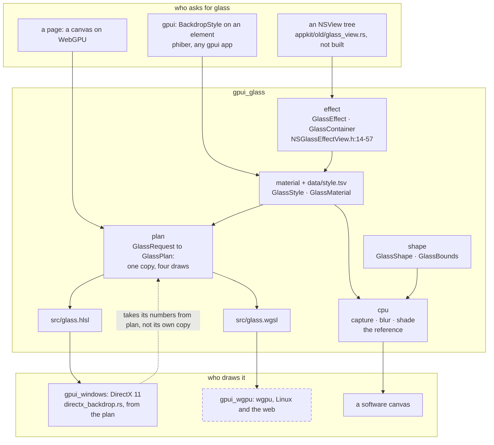
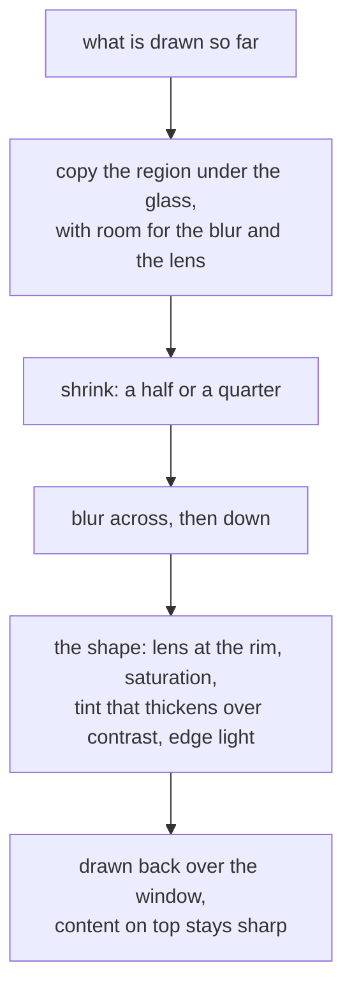
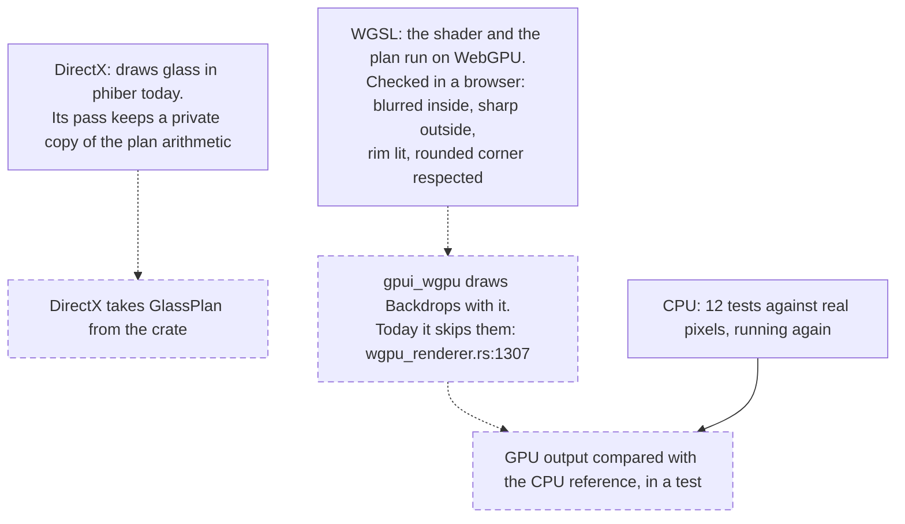

# glass — architecture

Solid boxes are in the code today. Dashed boxes are to build.

## One crate, every renderer

## The stages, the same on the CPU and on a GPU

## Where each backend stands

