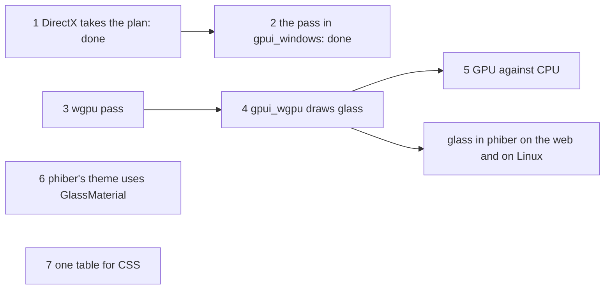

# glass — plan

What moved to make this a crate, and what is left. Diagrams are in
[ARCHITECTURE.md](ARCHITECTURE.md), requirements in [SPECS.md](SPECS.md).

## What moved (2026-11-10, into a crate)

| From | To | Change |
|---|---|---|
| `appkit/src/glass/mod.rs` | `src/lib.rs` | the crate root |
| `appkit/src/glass/{shape,material}.rs`, `cpu/` | `src/` | `material` no longer reads a theme: colours are passed in; style numbers moved to `data/style.tsv` |
| `appkit/src/glass/view.rs` | `appkit/src/glass_view.rs` | the `NSView` glue stays with `rust-appkit` and calls the crate |
| `appkit/tests/glass.rs` | `tests/pipeline.rs`, `tests/cost.rs`; view tests to `appkit/tests/glass_view.rs` | the 12 stage tests run again: `rust-appkit` does not build, so they had stopped |
| the pure arithmetic in `gpui_windows/src/directx_backdrop.rs` | also in `src/plan.rs` | one definition for every backend; DirectX still uses its own copy |
| - | `src/glass.wgsl`, `src/effect.rs`, `examples/plan.rs` | new |

Names are singular: `GlassStat` (was `GlassStats`), field `shape` (was
`shapes`), `capture`, `texel`.

## What moved since (2026-11-12 and 13)

| From | To | Change |
|---|---|---|
| `appkit/src/glass/` | `appkit/gpu/gpui_glass/` | the crate lives with the renderers; its package is named as its folder, `gpui_glass` |
| `gpu/directx.rs`, `gpu/directx_tests.rs` | `gpui_windows/src/directx_backdrop.rs`, `directx_backdrop_tests.rs` | the DirectX pass is the renderer's own, an ordinary module of it (step 2) |
| `gpu/glass.hlsl`, `gpu/glass.wgsl` | `src/glass.hlsl`, `src/glass.wgsl` | the shaders are beside the code; there is no `gpu` folder inside the crate |
| the private copy of the arithmetic in the DirectX pass | gone | the pass makes a `GlassRequest` and draws `GlassPlan`'s four stages (step 1); `gpui_windows` depends on this crate |
| the pass's two tests of that arithmetic | `src/tests/plan.rs`, where they already were | the three tests that draw on a real device stay with the pass, and pass |
| `appkit/src/glass_view.rs` | `appkit/old/glass_view.rs` | the `NSView` glue went to `old/` with the framework it belongs to |

Glass looks as it did: the same numbers go to the same shader. Checked
by `cargo test -p gpui_windows backdrop` before and after.

## The steps

| # | Step | Where | Needs |
|---|---|---|---|
| 1 | done: DirectX takes `GlassPlan`, `GlassParam` and the constants from the crate; its private copies are gone | `gpui_windows/src/directx_backdrop.rs`, `gpui_windows/Cargo.toml` | - |
| 2 | done: the DirectX pass is an ordinary module of `gpui_windows`; the two shader paths point at `gpui_glass/src/glass.hlsl` | `gpui_windows/src/gpui_windows.rs`, `build.rs`, `directx_renderer.rs` | - |
| 3 | A wgpu pass: two half-size layers, the copy, the four draws from a plan | `src/wgpu/`, behind a feature | wgpu in the crate's features |
| 4 | `gpui_wgpu` draws `PrimitiveBatch::Backdrops` with that pass: end the render pass, copy, draw, resume | `gpui_wgpu/src/wgpu_renderer.rs:1307` | a surface that allows copying from it |
| 5 | A test that draws one panel on a GPU and compares it with the CPU stages | `tests/` | 3 |
| 6 | phiber's theme hands the crate its numbers through `GlassMaterial`, in place of its own `BFrost` | `phiber/src/theme/style/glass.rs` | phiber free of other edits |
| 7 | The React apps read the same table for CSS `backdrop-filter` | `puikit` | a build step that emits the table |

## Not checked by eye

The device tests draw glass through the consolidated pass and read the
pixels back; Phiber builds with it. Phiber's glass mode has not been
looked at on screen since.
