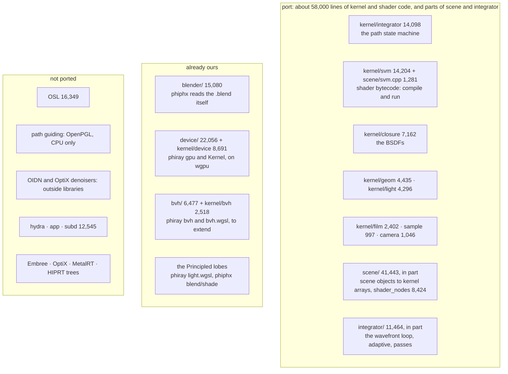
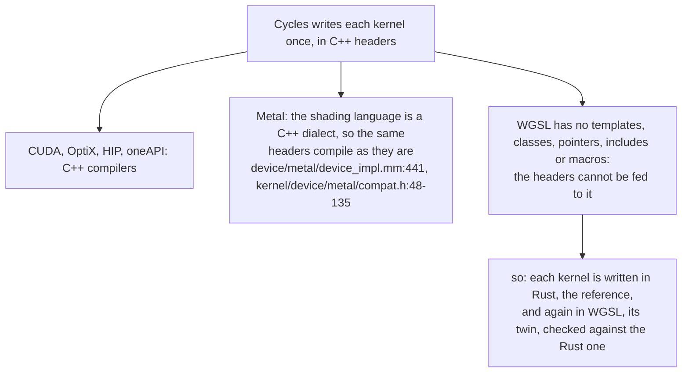
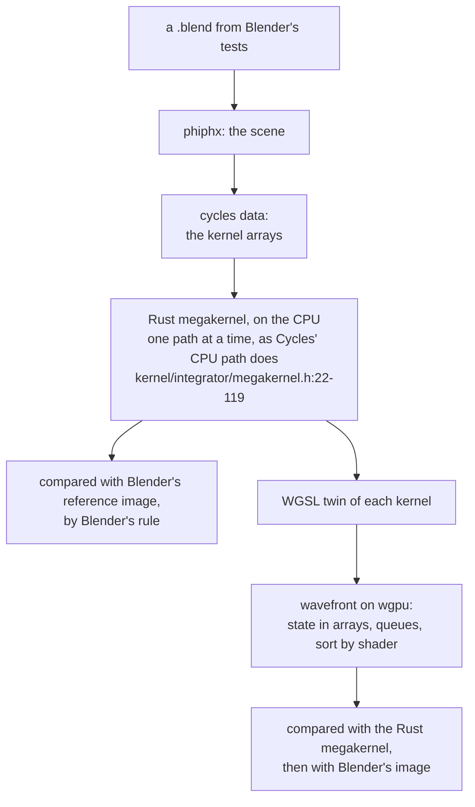
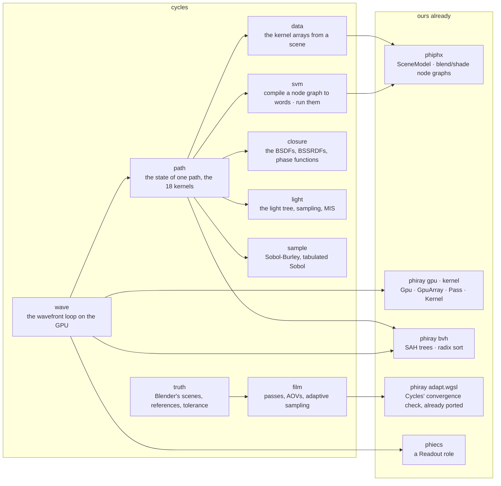
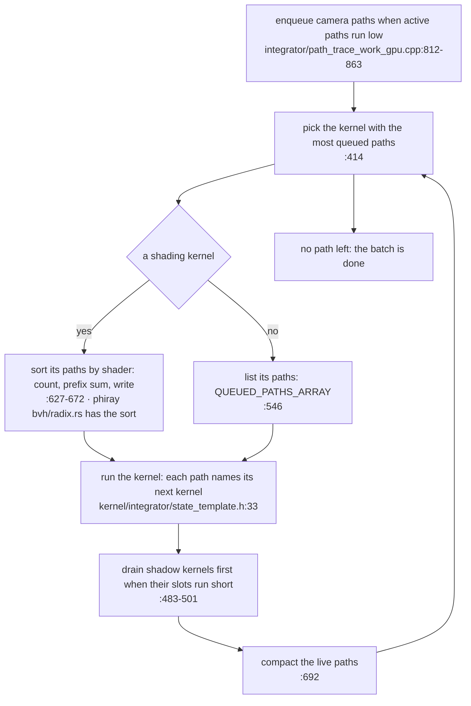

# cycles — architecture

Cycles in Rust. Nothing is implemented: this is the architecture another
session builds from. Every figure is from Blender's source on disk
(`gemphi/ext/phiber-refs/blender/blender/intern/cycles`, read 2026-11-10,
nothing built or run). The crate is `cycles`; Cycles with a capital is
Blender's.

Three rules shape it. **Blender is the specification and the judge**: a
part is done when Blender's own test scenes render within Blender's own
tolerance. **Nothing phiray or phiphx owns is written again.** **Rust
first, GPU second**: each kernel exists in Rust, where it is tested, before
it exists in WGSL.

## Cycles by size, and what becomes of each part

221,440 lines in 872 files.

## Why Metal's road is closed to WGSL

## Rust first, GPU second

The CPU path comes first because it can be judged against Blender before
any GPU code exists, and it then judges every WGSL kernel on small inputs.

## The modules, and what each stands on

## One sample batch on the GPU, as Cycles runs it

Cycles runs a million paths or more at once on a GPU
(`device/cuda/queue.cpp:34`); on the CPU it runs one, through a switch on
the same `queued_kernel` field. The state is one definition that expands
both ways (`kernel/integrator/state.h:69, 140`), and that is the shape to
keep: one Rust definition, an array of structs on the CPU, a struct of
arrays on the GPU.

## Device and truth

`device/` is Cycles' `device/` as a contract: `Device` (memory by handle:
alloc, zero, copy to and from, free), `DeviceQueue` (enqueue a `DeviceKernel`
over a work size with `KernelArgument`s, synchronize) and `DeviceVector<T>`.
`CpuDevice` runs a kernel as a Rust function from a table, and a kernel with
no body returns `NotPorted`. phiray's gpu layer will implement the same trait
as a `WgpuDevice`, so one kernel is run on both and the buffers compared; the
recipe is in [src/device/README.md](src/device/README.md).

`truth/` is gate 0: a scene and its reference found by Blender's layout, a
render through the session, `oiiotool --diff` reproduced from
`render_report.py:125-205` (a pixel fails past T, a render fails when more than
P per cent of pixels do, T and P from `cycles_render_tests.py:337-357`), and a
verdict with its diff images. `blender/` is the join: phiphx's `SceneModel`,
through one file (`blender/model.rs`), into a `Scene`.
## Pages

The render as the Rust types run it: [FLOW.md](FLOW.md) · Folders, order and gates: [PLAN.md](PLAN.md) · What each part must do, with
Cycles' file and line: [SPECS.md](SPECS.md) · Where the source, the tests
and the other references are: [reference/README.md](reference/README.md)
