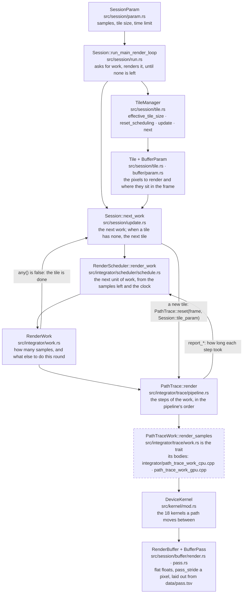
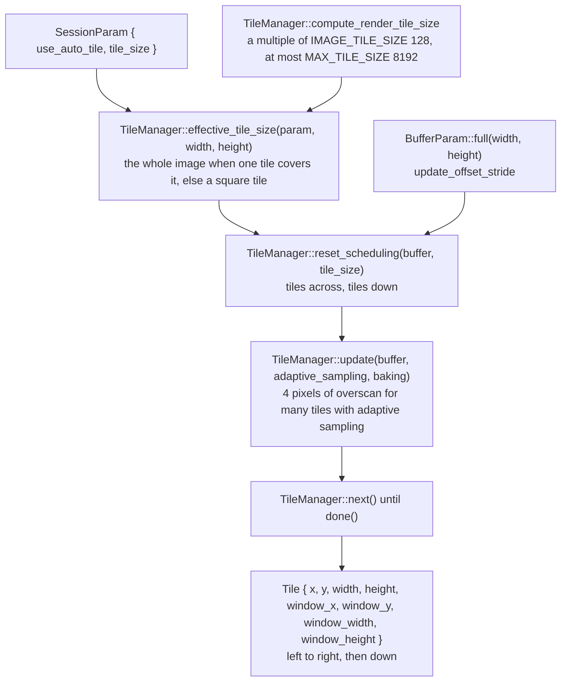
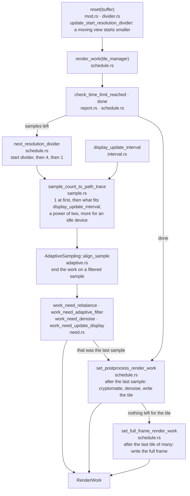
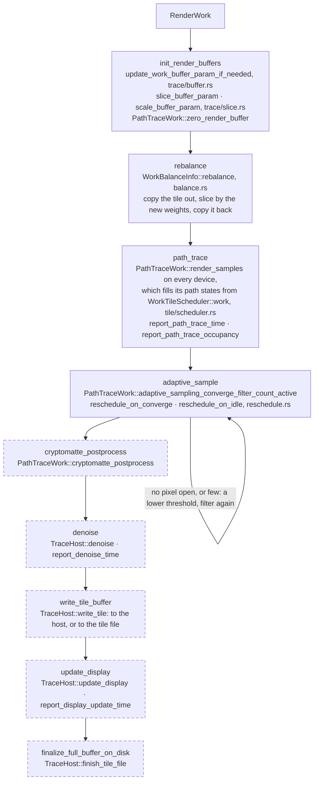
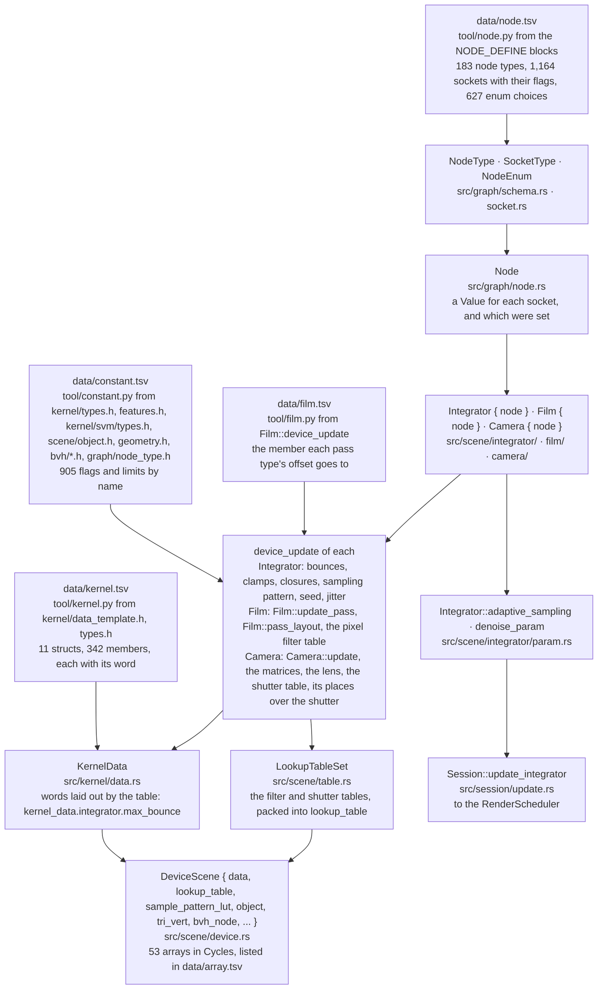
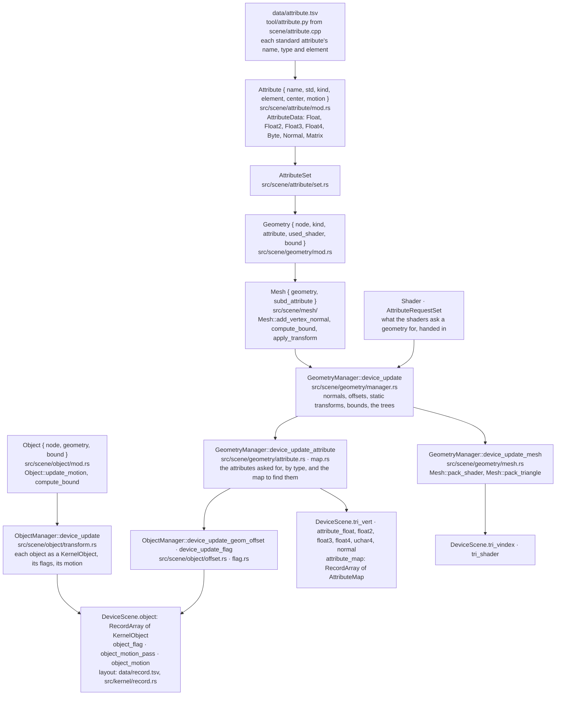
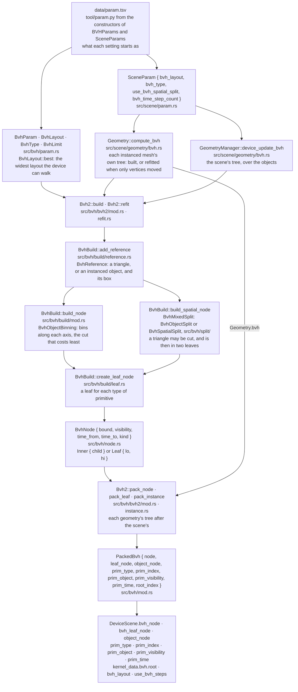
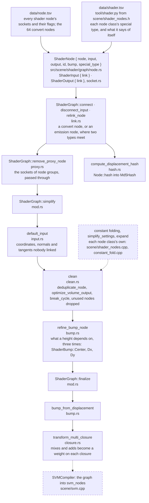
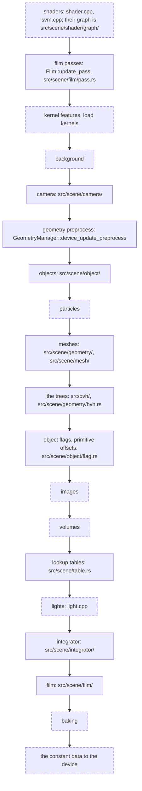
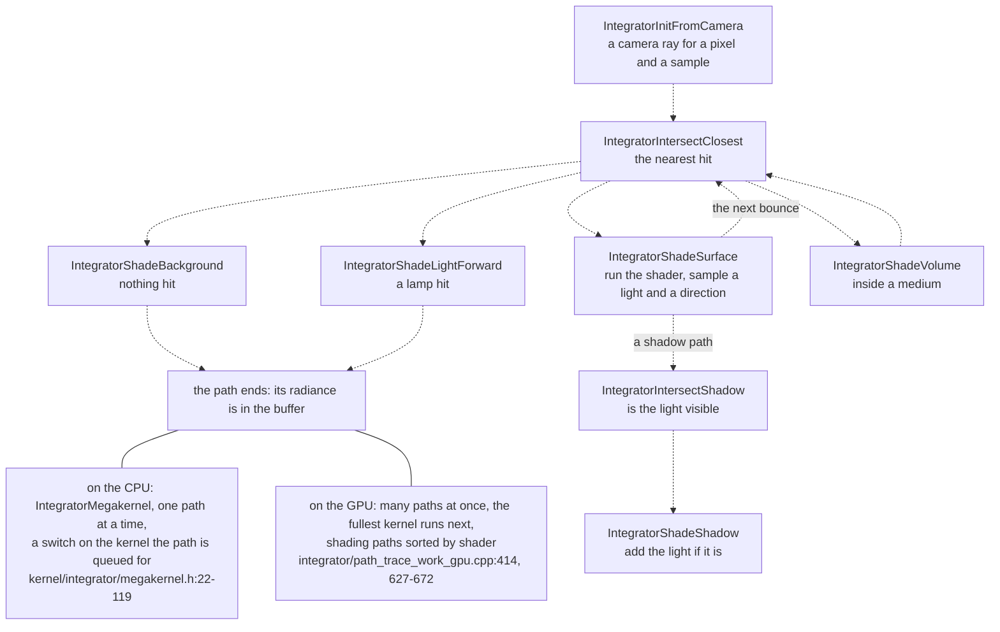

# cycles — flow

How a render runs in Cycles, top to bottom, with the Rust types of this
crate. A solid box is a type that exists in `src/` today and is tested
(the tests are in `src/tests`, in the same folders). A
dashed box is still Cycles' C++: it shows the Cycles name and where it is,
and is the next thing to port in that layer, or a trait whose body is not
ported.

## The whole render, from settings to pixels

`Session::next_work` is the part of Cycles' update before each round that
joins the scheduler, the tiles and the path tracer; a test renders a frame
of two tiles through it, tile by tile. `Session::run_main_render_loop`
(`src/session/run.rs`) still reaches what is below it through `RenderHost`,
because the rest of that update, the scene's, is not ported.

## Layer 1, session: a frame becomes tiles

## Layer 2, integrator: one round of work

### The scheduler decides the work

`RenderScheduler::render_work` (`src/integrator/scheduler/`) fills one
`RenderWork` in. Each box is a method and the file it is in.

### The path tracer carries it out

`PathTrace::render` (`src/integrator/trace/pipeline.rs`) takes the steps
below in this order, leaving out a step whose flag is off
(`integrator/path_trace.cpp:184-256`); `RenderWork::step_list` names the
same steps. A dashed box is reached through a trait: `PathTraceWork` for
what a device does, `TraceHost` for the denoiser, the display and the tile
file. Nothing implements those traits yet outside the tests.

An instant cancel (`PathTrace::request_cancel`) ends the round after path
tracing, adaptive sampling, cryptomatte or denoising, whichever is running.

## The scene: from sockets to what a kernel reads

Everything a scene holds is a `Node` whose settings are sockets. A manager
writes what the sockets say into the device scene: the constant data and
the flat arrays. The tables are generated from Cycles, never typed in.

### A mesh, and the objects that place it

A mesh keeps its triangles in sockets and everything that has a value for
each vertex, corner or face in attributes: its positions are the attribute
`P`, its normals the attribute `N`. An object places a geometry by its
transform. The two managers flatten them into the device's arrays.

### The tree a ray walks

A ray finds what it hits by walking a tree of boxes. Each instanced mesh
has a tree over its triangles; the scene has one over its objects, where
an instanced object is a single primitive that leads into its mesh's
tree. Only Cycles' own binary layout, `BVH2`, is ported.

### A shader's graph

A shader is a graph of nodes: textures and maths feed closures, and the
closures feed the output node's surface, volume and displacement. Before
it is compiled the graph is made simpler and is given what it left
unsaid. So far only the graph is ported, not what a node compiles to.

### The order a scene is written to the device

`Scene::device_update` (`scene/scene.cpp:176-411`) runs the managers in this
order, because each uses what the ones before it worked out. A solid box
is ported; a dashed one is still Cycles' C++.

## Layer 3, kernel: one path

Every name below is a variant of `DeviceKernel` (`src/kernel/mod.rs`). The
arrows are the usual routes between them and are dashed because the kernels
themselves are not ported: each one's body is still in
`kernel/integrator/*.h`, and the routes have not been read line by line.

## The types, and what each is ported from

| Rust type | File | Cycles | State |
|---|---|---|---|
| `SessionParam`, `ShadingSystem` | `src/session/param.rs` | `SessionParams`, `session/session.h:36-112` | ported, tested |
| `BufferParam` | `src/session/buffer/param.rs` | `BufferParams`, `session/buffers.h`, `buffers.cpp` | ported, tested |
| `BufferPass`, `PASS_UNUSED` | `src/session/buffer/pass.rs` | `BufferPass` and the pass half of `BufferParams`, `session/buffers.cpp` | ported, tested |
| `RenderBuffer` | `src/session/buffer/render.rs` | `RenderBuffers`, `render_buffers_host_copy_denoised` | ported, tested; copies to a device not yet |
| `PassType`, `PassMode`, `PassInfo`, `Pass` | `src/scene/pass.rs`, `data/pass.tsv` | `kernel/types.h` (`PassType`), `scene/pass.h`, `pass.cpp` | ported, tested; the table is generated by `tool/pass.py` |
| `Session`, `RenderHost`, `SessionEnd` | `src/session/run.rs` | `Session::run_main_render_loop`, `session/session.cpp:163-234` | the loop ported, tested; the thread, pause and status not yet |
| `Tile`, `TileManager` | `src/session/tile.rs` | `session/tile.h`, `tile.cpp`; `Session::get_effective_tile_size`, `session.cpp:499-523` | scheduling ported, tested; tile files on disk not yet |
| `RenderWork`, `WorkPathTrace`, `WorkAdaptive`, `WorkTile`, `WorkDisplay` | `src/integrator/work.rs` | `RenderWork`, `integrator/render_scheduler.h` | ported, tested |
| `RenderStep` | `src/integrator/work.rs` | the order of `PathTrace::render_pipeline`, `integrator/path_trace.cpp:184-256` | ported, tested |
| `RenderScheduler`, `SchedulerState`, `FirstRenderTime`, `TimeAverage`, `TaskTime` | `src/integrator/scheduler/` (11 files) | `RenderScheduler`, `integrator/render_scheduler.h`, `render_scheduler.cpp`, all 1,328 lines | ported, tested; Cycles' own 2 tests pass |
| `AdaptiveSampling` | `src/integrator/adaptive.rs` | `integrator/adaptive_sampling.h`, `.cpp` | ported; Cycles' own 3 tests pass |
| `TileSize` | `src/integrator/tile/size.rs` | `integrator/tile.h`, `.cpp` | ported; Cycles' own 2 tests pass |
| `WorkTileScheduler` | `src/integrator/tile/scheduler.rs` | `integrator/work_tile_scheduler.h`, `.cpp` | ported, tested; no device asks it for tiles yet |
| `KernelWorkTile` | `src/kernel/tile.rs` | `kernel/types.h:1688-1701` | ported |
| `WorkBalanceInfo` | `src/integrator/balance.rs` | `integrator/work_balancer.h`, `.cpp` | ported, tested |
| `PathTrace`, `TraceState` | `src/integrator/trace/mod.rs`, `pipeline.rs` | `PathTrace::render`, `render_pipeline` and its steps, `integrator/path_trace.cpp:162-256, 400-523, 606-692, 739-908` | the host loop ported, tested against a scripted device; the works run one after another, not in parallel |
| `PathTrace::reset`, `update_work_buffer_param_if_needed`, `copy_to_render_buffer` | `src/integrator/trace/buffer.rs` | `path_trace.cpp:121-143, 319-398, 1034-1050` | ported, tested |
| `slice_buffer_param`, `scale_buffer_param` | `src/integrator/trace/slice.rs` | `foreach_sliced_buffer_params`, `scale_buffer_params`, `path_trace.cpp:272-352` | ported, tested |
| `Session::next_work`, `Session::tile_param` | `src/session/update.rs` | `Session::run_update_for_next_iteration`, `update_buffers_for_params`, `session/session.cpp:311-430, 554-580` | the scheduler, tile and path tracer part ported, tested end to end on two tiles; the scene's part not |
| `PathTraceWork`, `RenderStatistic`, `TraceHost` | `src/integrator/trace/work.rs` | `PathTraceWork`, `integrator/path_trace_work.h`; the denoiser, display and tile file calls of `path_trace.cpp` | the traits ported; nothing implements them yet outside the tests |
| `DenoiseParam`, `DenoiserType`, `DenoiserPass`, `DenoiserPrefilter`, `DenoiserQuality` | `src/device/denoise.rs`, `data/denoise.tsv` | `device/denoise.h`, `denoise.cpp` | ported, tested; no denoiser yet |
| `Node`, `NodeType`, `SocketType`, `SocketKind`, `NodeEnum`, `Value` | `src/graph/`, `data/node.tsv` | `graph/node.h`, `node_type.h`, `node_enum.h`; every `NODE_DEFINE` of `scene/*.cpp` | ported, tested; all 119 node types, the 64 convert nodes and their sockets with their flags are read; links between nodes, transforms and arrays of nodes hold no value yet |
| `KernelData`, `Field`, `DataStruct` | `src/kernel/data.rs`, `data/kernel.tsv` | `KernelData`, `kernel/types.h:1367-1408`; `kernel/data_template.h` | ported as words laid out by the generated table, tested; the camera is in it, the light link sets not yet |
| `constant`, `flag` | `src/kernel/constant.rs`, `data/constant.tsv` | the enums and defines of `kernel/types.h`, `kernel/features.h`; the SVM's enums of `kernel/svm/types.h`; the managers' flags; the limits and node sizes of `bvh/*.h`; `SocketType::Flags` | generated, tested |
| `DeviceScene` | `src/scene/device.rs`, `data/array.tsv` | `scene/devicescene.h`, `kernel/data_arrays.h` | the constant data and 26 arrays of 53; the others come with their managers. An update writes an array whole: Cycles' tags for what to copy or reallocate are not ported |
| `RecordArray`, `RecordLayout`, `RecordField` | `src/kernel/record.rs`, `data/record.tsv` | `KernelObject`, `AttributeMap`, `kernel/types.h:819-825, 1412-1459` | an array of structs as words laid out by the generated table, tested |
| `Attribute`, `AttributeData`, `AttributeSet`, `AttributeRequest`, `AttributeRequestSet`, `AttributeDescriptor`, `AttributeStandard`, `AttributeElement`, `AttributeType`, `AttributePrimitive`, `KernelDataType` | `src/scene/attribute/` (5 files), `data/attribute.tsv`, `tool/attribute.py` | `scene/attribute.h`, `attribute.cpp`; the attribute enums of `kernel/types.h:730-816` | ported, tested. Not ported: voxel attributes, values shared with the host application |
| `Geometry`, `GeometryKind`, `Shader`, `AttributeIdMap` | `src/scene/geometry/mod.rs`, `shader.rs` | `Geometry`, `scene/geometry.h`, `geometry.cpp:35-222`, `geometry_attributes.cpp:24-87`; `ShaderManager::get_shader_id`, `get_attribute_id` | ported, tested; its own tree is in `bvh.rs`, below. What it reads of a shader is handed in |
| `Mesh`, `MeshSize`, `Triangle`, `SubdFace` | `src/scene/mesh/` (6 files) | `scene/mesh.h`, `mesh.cpp:180-640, 641-817, 873-928` | triangles, bounds, applied transforms, vertex normals, generated and undisplaced attributes, packing: ported, tested. Not ported: tessellation, displacement, tangents |
| `Object` | `src/scene/object/mod.rs` | `scene/object.h`, `object.cpp:75-303, 396-495` | ported, tested. Not ported: a volume's step size and nudge, an object's own attribute values |
| `ObjectManager`, `ObjectInput` | `src/scene/object/` (5 more files) | `ObjectManager`, `object.cpp:497-1313` | `device_update`, the transforms, motion vectors and motion blur, the flags, static transforms, the offsets, the Cryptomatte manifests: ported, tested, for meshes. Hair, points, volumes and the world's object wait for those kinds |
| `GeometryManager`, `GeometryInput`, `find_attribute` | `src/scene/geometry/` (4 more files) | `GeometryManager`, `geometry.cpp:224-427, 792-1277`, `geometry_mesh.cpp`, `geometry_attributes.cpp:89-731`; `kernel/geom/attribute.h:42-92` | offsets, the update's order, the attribute arrays and the attribute map, the triangle arrays: ported, tested. Not ported: tessellation, displacement, curves and points, OSL's map entries |
| `BvhParam`, `BvhLayout`, `BvhType`, `BvhLimit` | `src/bvh/param.rs`, `data/param.tsv`, `tool/param.py` | `bvh/params.h:17-180`, `BVHParams::best_bvh_layout` of `bvh.cpp:65-86`; the layouts `Geometry::need_build_bvh` names | ported, tested; the defaults and limits are generated. Not ported: `bvh_layout_name` |
| `BvhReference`, `BvhRange`, `BvhSpatialBin`, `BvhSpatialStorage` | `src/bvh/reference.rs` | `bvh/params.h:182-323` | ported, tested; the numbers Cycles hides in a box's fourth part are fields |
| `BvhNode`, `BvhNodeKind`, `BvhStat` | `src/bvh/node.rs` | `bvh/node.h`, `node.cpp:17-132` | ported, tested, with two children to a node. Not ported: aligned spaces, `print`, `dump_graph` |
| `BvhObjectBinning` | `src/bvh/binning.rs` | `bvh/binning.h`, `binning.cpp` | ported, tested |
| `bvh_reference_sort`, `bvh_reference_compare` | `src/bvh/sort.rs` | `bvh/sort.cpp` | the order ported, tested; the standard sort stands in for Cycles' threaded one |
| `BvhMixedSplit`, `BvhObjectSplit`, `BvhSpatialSplit` | `src/bvh/split/` (4 files) | `bvh/split.h`, `split.cpp` | ported, tested, for triangles and objects |
| `BvhBuild`, `PrimitiveBit` | `src/bvh/build/` (3 files) | `BVHBuild`, `bvh/build.h`, `build.cpp:57-137, 322-346, 378-568, 633-1200` | references, both builders and the leaves: ported, tested. On one thread; no progress or cancelling; `rotate`, which Cycles has switched off, is not ported |
| `Bvh2`, `PackedBvh`, `bvh::create` | `src/bvh/bvh2/` (3 files), `src/bvh/mod.rs` | `BVH2`, `bvh/bvh2.h`, `bvh2.cpp`; `PackedBVH`, `BVH::create` of `bvh/bvh.h`, `bvh.cpp:97-148` | packing, refitting and the instances' trees: ported, tested by walking the packed tree. Not ported: every layout but `BVH2`; curves, points and their unaligned nodes |
| `SceneParam` | `src/scene/param.rs`, `data/param.tsv` | `SceneParams`, `scene/scene.h` | ported, tested |
| `Geometry::compute_bvh`, `need_build_bvh`, `tag_update`; `GeometryManager::device_update_bvh` | `src/scene/geometry/bvh.rs` | `scene/geometry_bvh.cpp`; `geometry.cpp:164-172, 203-221` | ported, tested. The scene's tree is handed in until the scene itself is ported; the trees are built one after another; `tag_update` does not tag the lights |
| `Film`, `PassLayout`, `FilmPassInput`, `FilmPassChange`, `filter_table` | `src/scene/film/` (4 files), `data/film.tsv` | `scene/film.h`, `film.cpp`, all of it | ported, tested: the passes the film adds and their order, the offsets, the flags, the pixel filter, the kernel features |
| `LookupTableSet` | `src/scene/table.rs` | `LookupTables`, `scene/tables.h`, `tables.cpp` | ported, tested |
| `Camera`, `MotionType` | `src/scene/camera/` (3 files) | `scene/camera.h`, `camera.cpp:198-562, 606-610, 884-917` | the matrices, differentials, frustum, lens, panorama and stereo settings, motion vectors, a moving field of view, the shutter table, the camera's places over the shutter for motion blur (`camera_motion`), `update_interactive_motion`: ported, tested. Not ported: `device_update_volume`, the bounds and sizes for adaptive subdivision, an OSL camera |
| `Transform`, `ProjectionTransform`, `BoundBox2D`, `BoundBox` | `src/util/transform.rs`, `projection.rs`, `bound.rs` | `util/transform.h`, `projection.h`, `projection_inverse.h`, `boundbox.h` | what the camera, the objects, the meshes and the trees need of them, tested |
| `DecomposedTransform`, `motion_decompose`, `motion_array_interpolate`, `compose` | `src/util/motion.rs` | `util/transform.cpp:22-186`, `transform.h:467-660` | ported, tested |
| `PackedNormal` | `src/util/normal.rs` | `packed_normal`, `util/types_normal.h` | ported, tested |
| `ShaderGraph`, `ShaderNode`, `ShaderInput`, `ShaderOutput`, `InputId`, `OutputId`, `ShaderBump`, `ShaderNodeSpecialType` | `src/scene/shader/graph/` (11 files), `data/shader.tsv`, `tool/shader.py` | `scene/shader_graph.h`, `shader_graph.cpp:20-527, 599-1189`; `is_linear_operation` of nine node classes, `shader_nodes.cpp` | links and convert nodes, proxies, default inputs, deduplication, the volume check, cycles, unused nodes, bump samples, bump from displacement, closure weights, the displacement hash: ported, tested. Not ported: constant folding, `simplify_settings` and `expand` (the node classes' own), `get_num_closures`, `dump_graph`, the image nodes' `equals` |
| `Md5Hash` | `src/util/md5.rs` | `MD5Hash`, `util/md5.h` | written from RFC 1321, tested against its digests; `append_file` not |
| `Node::hash`, `copy_value`, `socket_list` | `src/graph/hash.rs`, `node.rs` | `Node::hash`, `Node::copy_value`, `graph/node.cpp` | ported, tested; a string is hashed as its text, where Cycles hashes its address |
| `murmur_hash3`, `hash_to_float` | `src/util/murmur.rs` | `util/murmurhash.cpp` | ported, tested against MurmurHash3's published values |
| `cdf_evaluate`, `cdf_invert`, `cdf_inverted` | `src/util/cdf.rs` | `util/math_cdf.h`, `math_cdf.cpp` | ported, tested |
| `Integrator`, `IntegratorInput`, `HaltonSequence`, `GuidingParam` | `src/scene/integrator/` (4 files) | `scene/integrator.h`, `integrator.cpp` | settings, `device_update`, `get_adaptive_sampling`, `get_denoise_params`, `get_guiding_params`, `get_kernel_features` ported, tested; the tabulated Sobol samples are not generated |
| `hash_uint`, `hash_uint2`, `hash_uint3` | `src/util/hash.rs` | `util/hash.h:80-166` | ported, tested against the same mix written apart in Python |
| `Clock`, `SystemClock`, `ManualClock` | `src/util/time.rs` | `time_dt`, `util/time.h` | a clock handed in, not a global one |
| `DeviceKernel` | `src/kernel/mod.rs` | `DeviceKernel`, `kernel/types.h:1744-1763` | names and numbers ported; no kernel body yet |
| - | - | tile files on disk, `session/tile.cpp` | left in layer 1 |
| - | - | the rest of `PathTrace`: reading and writing tiles and the full frame on disk, the output and display drivers, the denoiser, the reports (`path_trace.cpp`, about 700 lines); `PathTraceDisplay`, `PathTraceTile`, `PassAccessor`, `Denoiser`, path guiding; `PathTraceWorkCPU` and `PathTraceWorkGPU`, which come with the kernels | left in layer 2 |
| - | - | the other managers of `Scene::device_update`, in its order: the shaders (`Shader`, `ShaderManager`, the SVM compiler, what each of the 97 node classes compiles to and folds), background, hair and point clouds, images, volumes, lights, baking (`scene/*.cpp`) | left in the scene |
| - | - | `IntegratorState`, `kernel/integrator/state_template.h` | first in layer 3 |

Cycles' plural type names are singular here: `SessionParams` is
`SessionParam`, `BufferParams` is `BufferParam`, and fields such as
`samples` and `threads` are `sample_count` and `thread_count`.
