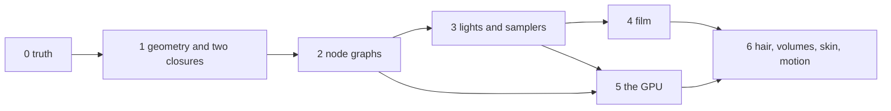

# cycles — plan

The folders to build and the gates each must pass. Gate 0 (the judge) and the
kernels of gate 1 are built; gate 1 passes 2 of the 6 scenes its scan counts as
its own, and the others fail for what later gates bring ("Where it stands").
Diagrams are in [ARCHITECTURE.md](ARCHITECTURE.md), requirements in
[SPECS.md](SPECS.md). The folders and the order are suggested, not decided.

## Steps, top to bottom

The port follows Cycles' own hierarchy, from the session down to the
kernels, and the crate's folders are Cycles' directories. The render as
these types run it is drawn in [FLOW.md](FLOW.md).

| Step | Layer | Cycles | In `src/` | State |
|---|---|---|---|---|
| 1 | session | `SessionParams`, `Tile`, `TileManager` scheduling | `session/param.rs`, `tile.rs` | done |
| 1 | integrator, the two types the flow needs | `RenderWork`, the order of `render_pipeline` | `integrator/work.rs` | done |
| 1 | kernel, names only | `DeviceKernel` | `kernel/mod.rs` | done |
| 2 | session | the `Session` loop, `BufferParams`, `BufferPass`, `RenderBuffers` | `session/run.rs`, `session/buffer/` | done |
| 2 | scene, what the buffer needs | `PassType`, `PassMode`, `PassInfo`, `Pass`; the pass table generated from Cycles | `scene/pass.rs`, `data/pass.tsv`, `tool/pass.py` | done |
| 2 | session, left over | tile files on disk; the session thread, pause and status | `session/` | - |
| 3 | integrator | `RenderScheduler` in full, `AdaptiveSampling`, `TileSize`, the work balancer; the host loop of `PathTrace` (`render_pipeline` and its steps) over the `PathTraceWork` trait | `integrator/scheduler/`, `adaptive.rs`, `tile.rs`, `balance.rs`, `integrator/trace/` | done |
| 3 | device, scene, util: what the scheduler needs | `DenoiseParams`, `Integrator::MAX_SAMPLES`, `time_dt` as a clock handed in | `device/denoise.rs`, `scene/integrator.rs`, `util/time.rs`, `data/denoise.tsv`, `data/report.tsv` | done |
| 3 | integrator and session, the join | `WorkTileScheduler`, `KernelWorkTile`; the big tile sliced between devices and scaled by the resolution divider; `PathTrace::reset`; the scheduler, tile and path tracer part of `Session::run_update_for_next_iteration` | `integrator/tile/`, `kernel/tile.rs`, `integrator/trace/slice.rs`, `buffer.rs`, `session/update.rs` | done |
| 3 | integrator, left over | what needs a thing not ported yet: `PassAccessor` (the film kernels), the output and display drivers with `PathTraceTile` and `PathTraceDisplay` (the pass accessor), the tile and full-frame files (an image writer), `Denoiser` (a denoiser), the device reports (a device), path guiding | `integrator/` | - |
| 4 | graph: what a scene is made of | `Node`, `NodeType`, `SocketType`, `NodeEnum`; every node type of Cycles generated from its `NODE_DEFINE` blocks | `graph/`, `data/node.tsv`, `tool/node.py` | done |
| 4 | kernel: what a scene is written into | `KernelData` laid out from `kernel/data_template.h`; the kernel's flags and limits; the list of device arrays | `kernel/data.rs`, `kernel/constant.rs`, `scene/device.rs`, `data/kernel.tsv`, `data/constant.tsv`, `data/array.tsv`, `tool/kernel.py`, `tool/constant.py` | done |
| 4 | scene, the first manager | `Integrator`: its sockets, `device_update`, and the settings the scheduler and the denoiser take from it | `scene/integrator/`, `session/update.rs` | done |
| 4 | scene, the film and the camera | `Film` in full: the passes it adds, their layout and flags, the pixel filter; `LookupTables`; `Camera`: its matrices, lens, motion vectors, shutter table and motion over the shutter; the transforms and the CDF tables they need | `scene/film/`, `scene/camera/`, `scene/table.rs`, `util/transform.rs`, `projection.rs`, `cdf.rs`, `data/film.tsv`, `tool/film.py` | done |
| 4 | scene, the objects and the meshes | `Attribute` and `AttributeSet`; `Geometry` and `Mesh`: triangles, normals, bounds, applied transforms; `Object` and `ObjectManager`: transforms, motion, flags; `GeometryManager`: the attribute arrays, the attribute map, the triangle arrays; the bounding box, motion decomposition, packed normals and MurmurHash3 they need | `scene/attribute/`, `scene/geometry/`, `scene/mesh/`, `scene/object/`, `kernel/record.rs`, `util/bound.rs`, `motion.rs`, `normal.rs`, `murmur.rs`, `vector.rs`, `data/attribute.tsv`, `data/record.tsv`, `tool/attribute.py` | done |
| 4 | bvh: the tree a ray walks | `BVHParams`, `BVHReference`, `BVHNode`; `BVHBuild` with object binning and spatial splits; `BVH2` packed, refitted, and with each instanced geometry's tree after the scene's; `SceneParams`; `Geometry::compute_bvh` and `GeometryManager::device_update_bvh` | `bvh/`, `scene/geometry/bvh.rs`, `scene/param.rs`, `util/param.rs`, `data/param.tsv`, `tool/param.py` | done |
| 4 | scene, the shader graph | `ShaderGraph`, `ShaderNode` and their sockets: links with convert nodes, proxies, default inputs, the clean-up, bump samples, bump from displacement, closure weights, the displacement hash; each node class's traits generated; MD5 | `scene/shader/graph/`, `graph/hash.rs`, `util/md5.rs`, `data/shader.tsv`, `tool/shader.py` | done |
| 4 | scene, left over | curves and points in the tree, with their unaligned nodes; tessellation, displacement and tangents of a mesh; hair, point clouds and volumes; the other managers, in the order of `Scene::device_update`: background, the rest of the shaders (`Shader` and its manager, the SVM compiler, what each node class compiles to and folds), lights, images, baking; the camera's volume test; the tabulated Sobol table | `scene/`, `bvh/` | - |
| 5a | device | `DeviceType`, `DeviceInfo`, the `Device` trait, `DeviceQueue`, `DeviceVector<T>`, `KernelArgument`, `CpuDevice` and its kernel table (every kernel named; one with no body is a typed `NotPorted` error) | `device/`, `device/cpu/`, `device/README.md` | done |
| 5a | integrator | `PathTraceWorkCPU`: the CPU work over the CPU device, one megakernel enqueue for the slice's pixels | `integrator/trace/cpu.rs` | done |
| 5a | truth, gate 0 | `oiiotool --diff` as Blender runs it, the category allowances, the verdict and diff images, the session renderer | `truth/` | done |
| 5a | blender, the join | `blender/` as phiphx's `SceneModel` into a `Scene`: camera, meshes (triangles, normals, UVs), objects, world colour, a diffuse or emission surface for each material; `Scene` | `blender/`, `scene/scene.rs` | done |
| 5 | kernel, the camera's ray | `KernelGlobal` as what a ray reads; `Ray`; `camera_sample` for the perspective and the orthographic camera with the lens, the pixel filter, the shutter, a moving camera; the disk and polygon samples, the lookup table read, compact differentials | `kernel/global.rs`, `ray.rs`, `kernel/camera/`, `kernel/sample/`, `kernel/util/` | done |
| 5 | kernel, the tree walked | `scene_intersect` by Cycles' own tree: the inner nodes, the leaves, instances pushed and popped, a triangle hit; what a ray starts from skipped, visibility | `kernel/bvh/`, `kernel/geom/`, `kernel/intersection.rs`, `util/intersect.rs` | done |
| 5 | kernel, to a first image | the path state (`state_template.h` as a record layout); `init_from_camera` with Sobol-Burley and tabulated Sobol; `intersect_closest`; `shade_background` and `shade_surface` with a diffuse and an emission closure, the SVM nodes they need; the film written; the CPU megakernel; `PathTraceWorkCPU` running it; a scene from phiphx; an image file | `kernel/integrator/`, `kernel/sample/`, `kernel/closure/`, `kernel/svm/`, `kernel/film/`, `kernel/device/`, `examples/gate1.rs` | done |
| 5 | kernel, the rest | the kernels one by one after that: the SVM and the closures, lights and shadows, volumes, subsurface; the panorama and stereo cameras | `kernel/` | - |
| 6 | kernel on the GPU | the WGSL twin of each kernel, the wavefront loop | `kernel/`, `wgsl/` | - |

The tests are in `src/tests`, apart from the code and in the same folders,
as Blender keeps its unit tests in a `tests` folder beside the code. A file
name is one word: related files share a folder (`session/buffer/`).

Where the folder table below names a folder Cycles does not have (`truth`,
`data`, `svm`, `path`, `wave`), read it as the Cycles directory that holds
that work: `data` is `scene/`, `svm`, `closure`, `path`, `light`, `sample`
and `film` are under `kernel/`, and `wave` is `integrator/`.

## The folder tree (suggested)

Names are singular; no file passes 250 lines; a table Cycles keeps in a
header becomes a data file generated from that header, never typed in.

| Path | Holds | Ported from (`intern/cycles`) | Stands on |
|---|---|---|---|
| `src/truth/` | find a test scene and its reference, render, compare by Blender's rule | `tests/python/cycles_render_tests.py`, `modules/render_report.py:138-145` | - |
| `src/data/` | the kernel arrays: object, triangle, attribute, light, shader | `kernel/data_arrays.h`, `kernel/types.h:1367-1665`, `scene/scene.cpp:176-405` | phiphx `SceneModel` |
| `src/svm/compile/` | a node graph to words | `scene/svm.cpp:845-1174`, `scene/shader_nodes.cpp` | phiphx `blend/shade` graph |
| `src/svm/run/` | the interpreter: one file a family of nodes | `kernel/svm/svm.h:102-117`, `kernel/svm/*.h` | - |
| `src/closure/` | the BSDFs, BSSRDFs and phase functions | `kernel/closure/` | - |
| `src/path/state.rs` | one path's state, defined once | `kernel/integrator/state_template.h`, `shadow_state_template.h` | - |
| `src/path/<kernel>.rs` | the kernels: init, intersect closest, intersect shadow, shade surface, shade light, shade background, and on | `kernel/integrator/*.h`, enum `kernel/types.h:1744-1778` | phiray `bvh` |
| `src/path/mega.rs` | the CPU loop: a switch on the queued kernel | `kernel/integrator/megakernel.h:22-119` | rayon |
| `src/light/` | the light tree, the fallback distribution, MIS | `scene/light_tree.cpp`, `kernel/light/tree.h:125-743`, `kernel/sample/mis.h:26` | - |
| `src/sample/` | Sobol-Burley, tabulated Sobol | `kernel/sample/` | - |
| `src/film/` | passes, AOVs, light groups, the adaptive check | `kernel/film/`, `scene/pass.cpp` | phiray `adapt.wgsl` |
| `src/wave/` | the wavefront loop, queues, sort by shader, compaction | `integrator/path_trace_work_gpu.cpp:348-692` | phiray `gpu`, `kernel`, `bvh/radix.rs` |
| `wgsl/` | the WGSL twin of each kernel, closure and node | the same headers | phiray `gpu` |
| `data/` | node kinds, closure ids, the Sobol table: generated | `kernel/svm/node_types_template.h`, `kernel/svm/types.h:464-529`, `kernel/types.h:1730` | - |
| `reference/` | where the source and the tests are | - | - |

## Gates

A gate is passed when the named test categories render within Blender's
tolerance: a pixel fails past 0.016, and a render fails when more than 1 per
cent of pixels do (`render_report.py:287-288`), with the per-category
allowances Blender itself sets (`cycles_render_tests.py:337-357`).

| Gate | On | What must work | New in it |
|---|---|---|---|
| 0 | - | the harness: a scene in, a verdict out, against an image Blender made | `truth` |
| 1 | CPU | camera, triangles, instances, a diffuse and an emission closure, background | `data`, `path`, `mega` |
| 2 | CPU | node graphs: the node kinds the test scenes use most, first; the Principled lobes | `svm`, `closure` |
| 3 | CPU | lamps, next-event estimation, MIS, the light tree; the samplers | `light`, `sample` |
| 4 | CPU | passes, AOVs, adaptive sampling, shadow catcher | `film` |
| 5 | GPU | the same scenes on wgpu: state in arrays, queues, the WGSL twins, sort, compact | `wave`, `wgsl` |
| 6 | both | curves and hair, points, motion blur, subsurface, volumes with null scattering, caustics | more of `path`, `closure` |

Gate 2 starts with a census: which of the 94 node kinds and which closures
each of the 791 test scenes uses, so the order of porting follows what the
scenes need. phiphx's parity plan was driven the same way.

## How each reference is used

| Reference | Used for |
|---|---|
| Cycles source | the specification: every kernel, node and closure is ported from its file, and says which |
| Blender's 791 test scenes and 768 reference images | the judge, from gate 0 on |
| Cycles' CPU path (`path_trace_work_cpu.cpp:69-180`) | the shape of the Rust reference: one path, one switch |
| Cycles' GPU path and its Metal backend | the shape of the wavefront loop; kernel data baked into specialised pipelines (`device/metal/device_impl.mm:429`) |
| phiray | the GPU layer, the trees, the radix sort, the adaptive check, a megakernel to compare images with |
| phiphx | the scene and the node graphs; its fold of a graph to one material stays phiray's path |
| Meta's renderers (`phiray/reference`) | HVVR and DRTK for keeping visibility as a buffer; mvp for rebuilding the top tree on the GPU; volumetric_primitives for media without marching, as a second option beside null scattering |
| Apple's Metal headers | the acceleration-structure and counter vocabulary phiray's plan already maps |

## Not ported

OSL (16,349 lines; only CPU and OptiX run it), path guiding (OpenPGL, CPU
only), the OIDN and OptiX denoisers (outside libraries: phiray's filter
stands in), `blender/` beyond the join (phiphx reads the file; `blender/` here is only the sync), `device/` beyond the contract and the CPU device (wgpu is phiray's), Embree and
the vendor trees, hydra, the standalone app.

## Two engines, one dropdown

phiray and `cycles` are two different engines. They share what comes before
the light (the scene from phiphx, the GPU layer, the trees) and nothing
after it: each has its own kernels, its own materials and its own image.

| | phiray | `cycles` |
|---|---|---|
| Goal | fast and interactive, its own look | match Blender's Cycles image for image |
| Materials | a node graph folded to one fixed material | the node graph itself, compiled and run for every hit |
| Path | one kernel traces a whole path | many small kernels, paths sorted by shader |
| Judged by | its own tests | Blender's reference images |

Phiber's Engine dropdown already lists both names
(`phiber/src/scene/render_engine.rs`). Today choosing "Cycles" there still
runs phiray, because no other engine exists. Once `cycles` passes a gate,
choosing "Cycles" runs `cycles` for the scenes that gate covers, and
choosing "Phiray" runs phiray as before. The dropdown is the only thing
they have in common in the app: each engine registers itself the same way
(a `Readout` role in the phiecs plan) so the app has one switch to flip,
not two code paths to maintain.

## Where it stands
Every source file carries the copyright lines of the Blender file it ports
(copied from that file: Blender Foundation, and Sony Imageworks, NVIDIA or
Intel where Cycles credits them); a test carries its code file's. The five
files that port nothing keep the licence line alone: `truth/error.rs`,
`truth/display.rs` (written after OCIO's documented behaviour, not after
Blender's GPL `colormanagement.cc`), its test, and the two examples.

As of 12 November 2026, after the two copies of the crate were merged
(`MERGE.md`):
| | Done, tested | Not done |
|---|---|---|
| session | the session loop, buffers, passes, tiles | tile files on disk, the session thread |
| integrator | the scheduler, adaptive sampling, tile sizes, the work balancer, the path tracer's host loop, `PathTraceWorkCPU` | the pass accessor, the output and display drivers, the denoiser, path guiding, `PathTraceWorkGPU` |
| graph | every node type and socket of Cycles | - |
| scene | integrator, film, camera with motion, attributes, meshes, objects, the shader graph; a shader's SVM for a diffuse or an emission surface and the world's colour | the SVM compiler for every node class; lights, images, hair, points, volumes, baking |
| bvh | the BVH2 build, spatial splits, instances, refit | curves and points, unaligned nodes |
| device | the contract, the CPU device and its kernel table | the wgpu device |
| kernel | the camera's ray (perspective and orthographic, lens, pixel filter, shutter, a moving camera); the tree walked into instances; the path state; Sobol-Burley and tabulated Sobol; `init_from_camera`, `intersect_closest`, `shade_background`, `shade_surface` with a diffuse and an emission closure; the film's combined pass; the CPU megakernel | the SVM's other nodes and closures, lights and shadows, volumes, subsurface; motion triangles; panorama cameras |
| truth, blender | gate 0: Blender's comparison rule and verdict; the join of a `.blend` through phiphx, with Blender's view transforms | node graphs in the join; see the gaps below |
### Gate 1, measured
`cargo run -p cycles --release --example gate1 -- scan` reads 763 of Blender's
test scenes; 6 hold nothing but gate 1 (a diffuse or an emission surface,
the world's colour, no lamp, no texture). Those six and the three first
scenes, `-- run` on the CPU at each scene's own sample count, judged by
Blender's rule (`render_report.py`, the category's allowance):
| Scene | Verdict | Failed pixels | Max error | Samples | Seconds | Why it does not match |
|---|---|---|---|---|---|---|
| `bsdf/diffuse` | fail | 99.976% | 0.3511 | 25 | 0.48 | its lamp (gate 3); its material is not a lone diffuse node (gate 2) |
| `shader/emission` | fail | 52.014% | 0.3196 | 25 | 0.32 | its lamp (gate 3), a checker texture (gate 2); the emitters themselves match |
| `camera/camera_ortho` | fail | 93.890% | 0.5753 | 16 | 0.18 | its lamp (gate 3), a checker texture (gate 2), the Filmic view |
| `light/multiple_mesh_lights` | **pass** | 0.037% | 0.0338 | 128 | 1.74 | - |
| `shader/material_output_selection` | **pass** | 0.000% | 0.0019 | 25 | 0.13 | - |
| `light/instanced_mesh_lights` | fail | 91.882% | 1.0000 | 64 | 0.58 | the emitters are instanced; phiphx gives the join the instancer's own 4 m plane (strength 100), not the instances |
| `light/mesh_light_small` | fail | 100.000% | 1.0000 | 64 | 0.53 | the AgX view with a look; a small emitter found by the BSDF alone (no next-event estimation, gate 3) is noise at 64 samples. At 4096 its lit middle reaches Blender's mean, the unlit floor does not (the view) |
| `light_linking/light_link_mesh_tree` | fail | 100.000% | 1.0000 | 25 | 0.79 | light linking (gate 3), the AgX view |
| `render_layer/background_scene` | fail | 100.000% | 0.3828 | 25 | 0.21 | the lamp is in the background scene, which the join does not read; Blender's image is `bsdf/diffuse`'s within 5/255 |
The camera rays of four failing scenes, traced at three pixels each, hit
what Blender shows; no mistake of the camera, the samplers, the filter, the closures
or the join of what phiphx reads was found. Two things the scan counts as gate
1 are not: a mesh whose emission Cycles samples as a light (it needs the
light tree's next-event estimation to be quiet at Blender's sample count)
and a lamp or an instance that phiphx does not hand over. Blender's `AgX`
and `Filmic` views are OCIO chains (`release/datafiles/colormanagement/
config.ocio`: E-Gamut, a log2 allocation, a tetrahedral 3D LUT, the looks'
grading) that `truth::display` draws with the Standard curve and marks as
approximated; they are to be read from that file, as `truth` reads the test
scenes, before a scene in those views can pass.
### Gate 2 starts with
The census the gates section names, and the node graphs and Principled
lobes the first scenes need:
1. The census: done (`examples/census.rs`, `CENSUS.md`, generated). Of 763
   scenes, 633 have a lamp, so gate 3 holds back more scenes than any node
   does; of the 130 without one, 28 need nothing beyond gate 1. The kinds
   that complete the most lamp-free scenes, in order: node groups, image
   textures, the anisotropic (glossy) BSDF, attributes, sky and environment
   textures, the Principled BSDF with its emission and metal lobes. The
   order of porting follows that table.
2. `blender/`: the node graph handed to `ShaderGraph` whole instead of a lone
   diffuse or emission, and the SVM compiler (`scene/svm.cpp:845-1174`) for
   what the graphs hold: the texture coordinate, mapping and checker nodes
   that `shader/emission` and `camera/camera_ortho` use first.
3. The Principled BSDF's lobes in `kernel/closure/` (`bsdf_principled`
   setup in `kernel/svm/closure.h`; the microfacet GGX, the sheen, the
   coat), so `bsdf/` scenes can be judged once their lamps arrive (gate 3).
4. The join's gaps: `hide_render`, instancers, the background scene, a mesh
   shared by two objects with different slot links, the camera phiphx names
   wrongly in `bsdf/diffuse`; most need phiphx to read more of the file.
