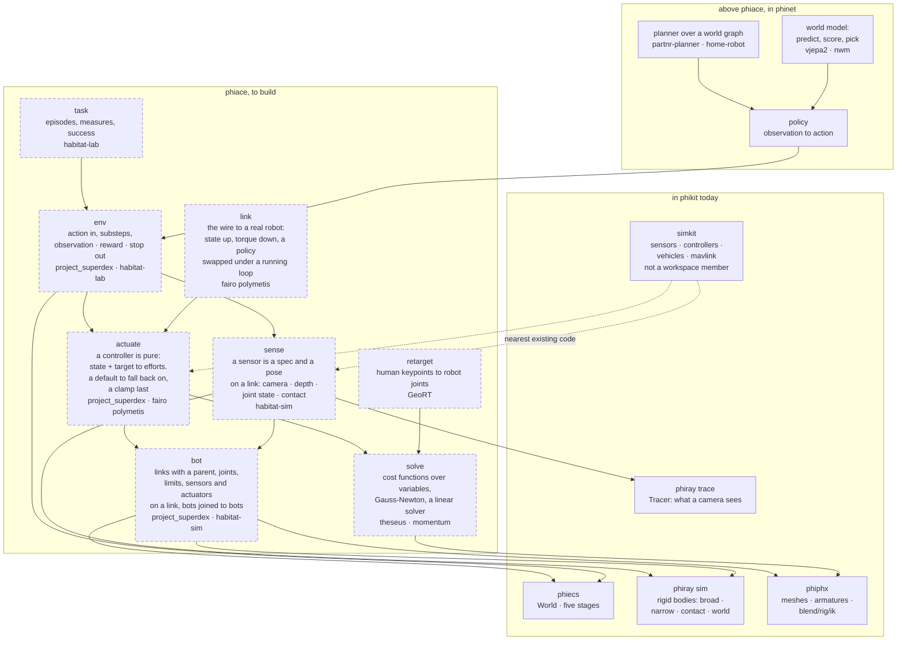

# phiace — architecture

Nothing in phiace is implemented: `src/lib.rs` is a doc comment. Every
phiace box below is to build, named with the reference it is read from
(`reference/<repo>`; `fairo` is still under `ext/`). Solid boxes are the
crates it will stand on.

## The modules and what they stand on

## Pages, one subject each

- [tick](docs/tick.md): one control step on the five stages, and the two rates
- [layers](docs/layers.md): the robotics stack as the references divide it, and what crosses each boundary

Folders and order of work: [PLAN.md](PLAN.md) ·
What each part must do: [SPECS.md](SPECS.md) ·
The references: [reference/README.md](reference/README.md) ·
The world it stands on: [phiecs](../phicore/phiecs/ARCHITECTURE.md) ·
What is left to do: [TODO.md](TODO.md)
