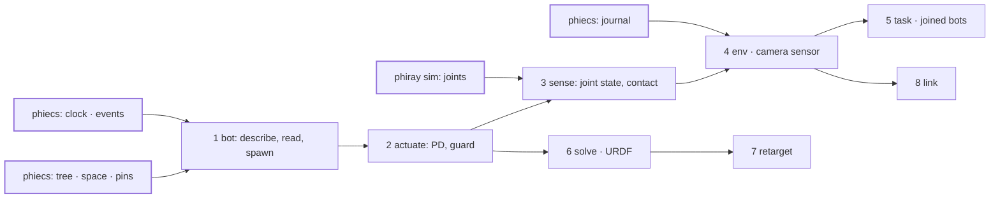
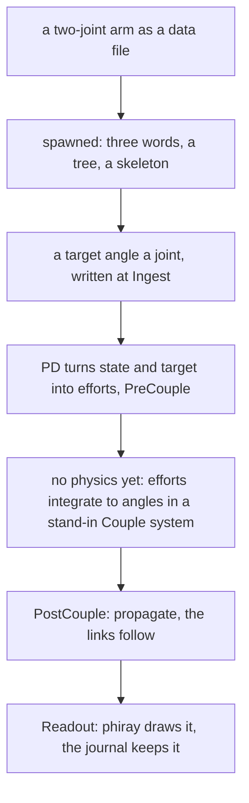

# phiace — plan

The folder tree to build and the order to build it in. Nothing is
implemented today: `src/lib.rs` is a doc comment. What each part must do
is in [SPECS.md](SPECS.md); the diagrams are in
[ARCHITECTURE.md](ARCHITECTURE.md). Line counts are estimates.

## The folder tree (suggested)

| Path | Holds | Read from | Lines | Order |
|---|---|---|---|---|
| `src/lib.rs` | modules, prelude | - | exists | - |
| `src/bot/desc.rs` | `Bot`, `Link`, `Joint`, `Limit`: the description as data | project_superdex, habitat-sim | ~150 | 1 |
| `src/bot/read.rs` | a bot from a data file; URDF in | project_superdex | ~200 | 1, 6 |
| `src/bot/spawn.rs` | a bot into a `World`: a word a link, the tree, the skeleton | - | ~150 | 1 |
| `src/bot/join.rs` | a bot made of bots, by pins | project_superdex | ~80 | 5 |
| `src/actuate/mod.rs` | `Controller`: state and target in, efforts out | project_superdex | ~60 | 2 |
| `src/actuate/pd.rs` | the joint PD controller | habitat-sim | ~80 | 2 |
| `src/actuate/guard.rs` | the default to fall back on, the clamp | fairo polymetis | ~80 | 2 |
| `src/sense/mod.rs` | `Sensor`, `Spec`, `Observation` | habitat-sim | ~90 | 3 |
| `src/sense/joint.rs`, `contact.rs` | joint state, contact from the physics bridge | project_superdex | ~120 | 3 |
| `src/sense/camera.rs` | colour, depth and normal from a tracer view | habitat-sim | ~120 | 4 |
| `src/env/mod.rs` | `Env`: step, reset, the two rates | project_superdex, habitat-lab | ~150 | 4 |
| `src/env/space.rs` | action and observation spaces | project_superdex | ~80 | 4 |
| `src/task/mod.rs` | `Measure`, episodes, success | habitat-lab | ~120 | 5 |
| `src/solve/` | objective, cost functions, Gauss-Newton | theseus, momentum | ~400 in 4 files | 6 |
| `src/retarget/mod.rs` | human keypoints to joint targets | GeoRT | ~120 | 7 |
| `src/link/` | state up, command down, a policy swapped while it runs | fairo polymetis | ~300 in 3 files | 8 |
| `data/bots/` | bot descriptions: data, not code | - | - | 1 |
| `docs/` | one diagram page a subject | exists | - | - |
| `reference/` | 13 Meta repositories and the index; `fairo` still under `ext/` | exists | - | - |

`sense/camera.rs` is the only file that needs phiray. Suggested: put it
behind a feature so a headless phiace builds on phiecs alone.

## What must exist underneath first

| Needs | From | Why |
|---|---|---|
| `Clock`, `Events` | phiecs, order 1 | the two rates, contact events |
| `Tree`, `Pose`, `WorldMatrix`, `Pin`, `Attached` | phiecs, order 2 | links, and sensors that ride on them |
| `Skeleton`, `JointPose` | phiecs, order 9 | a bot's joints as one vector |
| `Journal` | phiecs, order 3 | reset to a tick, the log of past states |
| joints between bodies | `phiray::sim` | it holds rigid bodies and contact; `sim/` was not read line by line, so whether any joint exists is not verified |
| the physics bridge | phiber `scene/sim/ecs.rs`, or here | bodies by word |

## Order of work

## The first thing that moves

