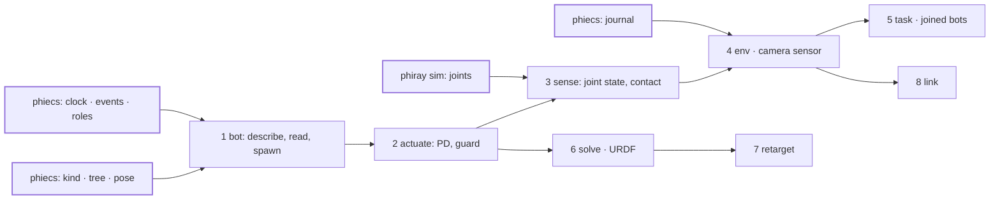
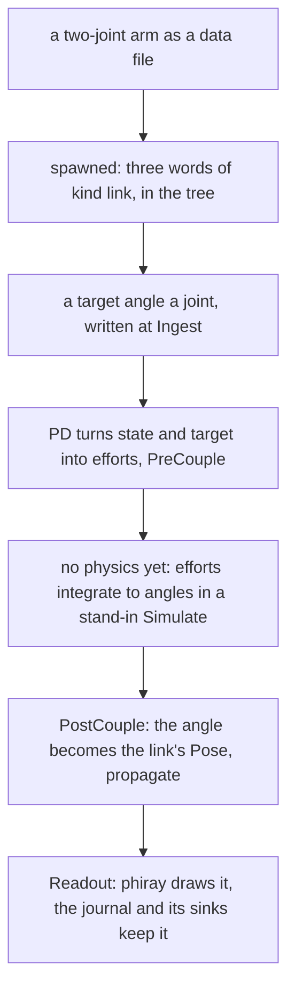

# phiace — plan

The folder tree to build and the order to build it in. Only the first slice of order 1 is built (see below). What each part must do
is in [SPECS.md](SPECS.md); the diagrams are in
[ARCHITECTURE.md](ARCHITECTURE.md). Line counts are estimates.

phiace follows phiecs's shape: three main folders, `entity`, `comp` and
`system`, with each unit (bot, actuate, sense, env) a subfolder under the
one it belongs to. It adds no concept phiecs or phiphx already has: a link
is a word with a `Pose` in the `Tree`, a mount point is a pin (a named
child word), and a joint's motion goes through the general animation path.

## The folder tree (suggested)
Built so far, in a smaller shape than the tree below: `entity/bot/desc.rs` (`Bot`, `Link`, `Joint`, built in code, not read from a file), `entity/bot/spawn.rs` (`spawn`), `comp/joint.rs` (`Hinge { axis }`, `Limit`, `Angle`, `Target`) and `system/actuate/hinge.rs` (`drive`, a stand-in Simulate that moves an angle toward its target; `hinge`, the angle into the link's `Pose`). `tests/arm.rs` runs a two-joint arm on phiecs's `Tree`, `Pose` and `propagate`.

| Path | Holds | Read from | Lines | Order |
|---|---|---|---|---|
| `src/lib.rs` | the three modules, the `Plugin` that registers them | - | exists | - |
| **`src/entity/`** | **what a robot is made of** | | | |
| `entity/bot/desc.rs` | `Bot`, `Link`, `Joint`: the description as data | project_superdex, habitat-sim | ~150 | 1 |
| `entity/bot/read.rs` | a bot from a data file; URDF in | project_superdex | ~200 | 1, 6 |
| `entity/bot/spawn.rs` | a bot into a `World`: a word a link, parents into the tree, kinds declared | - | ~150 | 1 |
| `entity/bot/join.rs` | a bot made of bots, joined at pins | project_superdex | ~80 | 5 |
| **`src/comp/`** | **what phiace binds to those words** | | | |
| `comp/joint.rs` | `Hinge { kind, axis }`, `Limit`, `Target`, `Effort` | project_superdex | ~100 | 1 |
| `comp/sensor.rs` | `Sensor { spec }`, `Observation` | habitat-sim | ~90 | 3 |
| `comp/task.rs` | `Measure`, `Episode` | habitat-lab | ~80 | 5 |
| **`src/system/`** | **logic, each a role on a kind** | | | |
| `system/actuate/pd.rs` | Animate on `bot`: state and target to efforts | habitat-sim | ~80 | 2 |
| `system/actuate/guard.rs` | the default to fall back on, the clamp last | fairo polymetis | ~80 | 2 |
| `system/actuate/hinge.rs` | a joint's angle into its link's `Pose`, by its axis | - | ~60 | 1 |
| `system/sense/state.rs`, `contact.rs` | Readout on `sensor`: joint state, contact | project_superdex | ~120 | 3 |
| `system/sense/camera.rs` | Readout on `sensor`: colour, depth, normal from a tracer view | habitat-sim | ~120 | 4 |
| `system/env/step.rs`, `space.rs` | `Env`: step, reset, the two rates; action and observation spaces | project_superdex, habitat-lab | ~230 | 4 |
| `system/solve/` | objective, cost functions, Gauss-Newton | theseus, momentum | ~400 in 4 files | 6 |
| `system/retarget.rs` | human keypoints to joint targets | GeoRT | ~120 | 7 |
| `system/link/` | Intake and Readout: state up, command down, a policy swapped while it runs | fairo polymetis | ~300 in 3 files | 8 |
| `data/bot/`, `data/kind.txt` | bot descriptions and the kinds phiace declares: data, not code | - | - | 1 |
| `docs/` | one diagram page a subject | exists | - | - |
| `reference/` | 13 Meta repositories and the index; `fairo` still under `ext/` | exists | - | - |

`system/sense/camera.rs` is the only file that needs phiray. Suggested: put
it behind a feature so a headless phiace builds on phiecs alone.

## What must exist underneath first

| Needs | From | Why |
|---|---|---|
| `Clock`, `EventQueue`, roles, `Plugin` | phiecs, orders 1 and 6 | the two rates, contact events, plugging in by kind |
| `Kind`, `Tree`, `Pose`, `WorldMatrix` | phiecs, orders 2 and 4 | links, pins, and sensors that ride on them |
| `Bind`, `Playing`, `ChannelSet` | phiecs, order 9 | a joint's target reaches its angle by the one animation path |
| `Journal` and its sinks | phiecs, order 3 | reset to a tick, the log of past states |
| joints between bodies | `phiray::sim` | it holds rigid bodies and contact; `sim/` was not read line by line, so whether any joint exists is not verified |
| the Simulate role over the simulation | the scene glue | bodies by word |

## Order of work

## The first thing that moves

