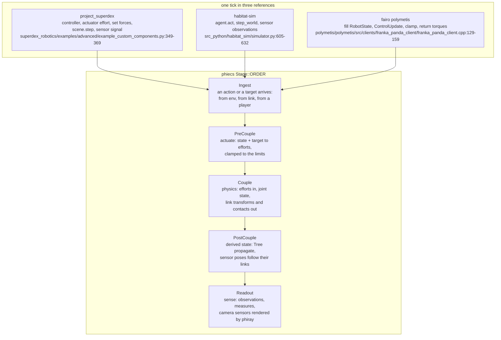
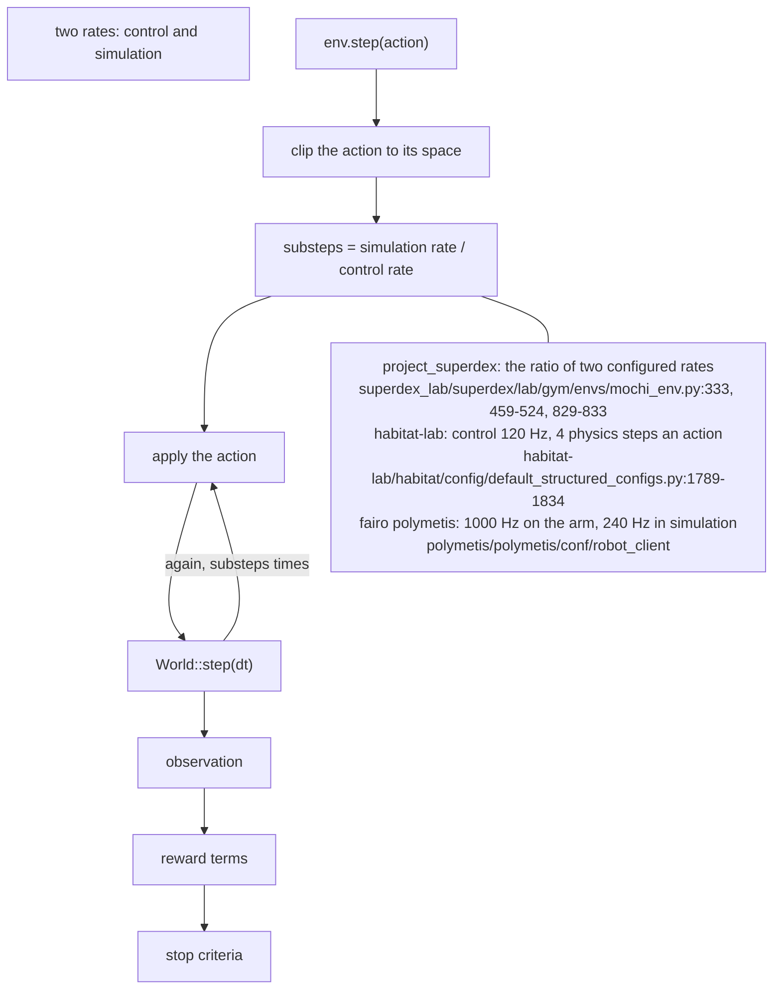
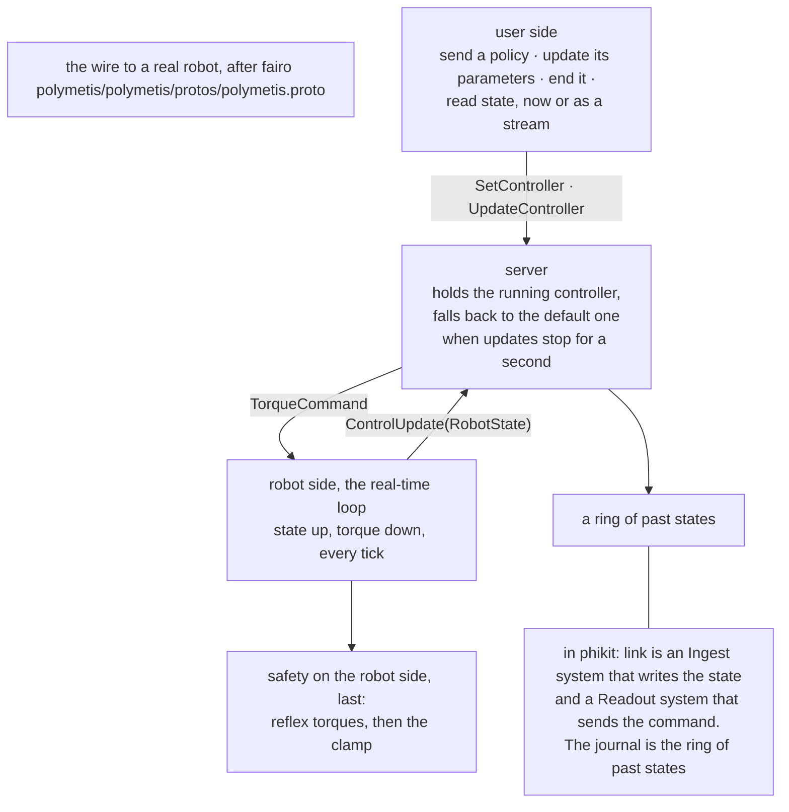

# tick

Built so far: `drive` (Couple) and `hinge` (PostCouple), then phiecs `propagate`; the rest is to build. The three loops on the left are read from the
references; that they share one order is our reading, not a claim any of
them makes.

