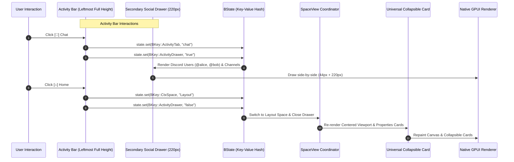

# BUI Data, Activity Bar & Event Flow Specification

## 1. The Declarative Core Philosophy

In BUI, all UI construction follows a **pure, one-way declarative pipeline**:



---

## 2. Activity Bar Flow & Drawer Behavior

The **Activity Bar** acts as the primary global navigator on the far left.

### 2.1 State Keys for Activity Bar

| Key | Format | Description |
|---|---|---|
| `BKey::ActivityTab` | `"home" \| "chat" \| "spaces" \| "stream" \| "settings" \| "profile"` | Active selected primary icon |
| `BKey::ActivityDrawer` | `"true" \| "false"` | Whether the secondary 220px drawer is open |
| `BKey::ActivityExpanded`| `"true" \| "false"` | Whether the 44px primary strip is expanded to show "PHIBER" |

### 2.2 Click Handling Rules

1. **Clicking `Home` (`"home"`)**:
   - `state.set(&BKey::CtxSpace, "Layout")`
   - `state.set(&BKey::ActivityTab, "home")`
   - `state.set(&BKey::ActivityDrawer, "false")` $\rightarrow$ Drawer closes automatically.
2. **Clicking `Chat` (`"chat"`)**:
   - `state.set(&BKey::ActivityTab, "chat")`
   - `state.set(&BKey::ActivityDrawer, "true")` $\rightarrow$ Opens Discord-style Direct Messages & collaborative channels.
3. **Clicking `Spaces` (`"spaces"`)**:
   - `state.set(&BKey::ActivityTab, "spaces")`
   - `state.set(&BKey::ActivityDrawer, "true")` $\rightarrow$ Opens full list of workspace spaces in secondary palette.
4. **Clicking `Spark` (`"stream"`)**:
   - Toggles live collaborative 3D viewport stream / generative prompt feed.
5. **Clicking `Settings` (`"settings"`)**:
   - `state.set(&BKey::Modal, "Settings")` $\rightarrow$ Opens the Zed-inspired Theme & Social Settings modal.

---

## 3. Collapsible Card Event Flow

Every Part inside an editor pane wraps its content in a **Card** with reactive collapsible behavior:

```rust
let is_collapsed = state.get(&BKey::CardCollapsed("properties".to_string())) == Some("true");

let card = BView::card()
    .with_shade(CardShade::Panel)
    .with_collapsible(true)
    .with_collapsed(is_collapsed)
    .with_header("Properties")
    .with_icon("sliders")
    .with_tool(BView::button().with_icon("refresh_cw"))
    .with_collapse_action(BAction::Toggle(BKey::CardCollapsed("properties".to_string())))
    .with_body(
        if is_collapsed {
            BView::empty()
        } else {
            BView::list()
                .with_item(BView::prop_row("Render Engine", "Eevee"))
                .with_item(BView::prop_row("Sampling", "128"))
        }
    )
    .with_footer(
        if is_collapsed {
            BView::empty()
        } else {
            BView::label("Device: GPU Compute")
        }
    );
```

---

## 4. Theme Settings & Social Community Event Flow

1. **User Opens Settings**: Clicks `[⚙]` in Activity Bar bottom pane.
2. **Modal Renders (`bui/modal.rs`)**:
   - Left Sidebar: `Themes`, `Marketplace`, `Social Profiles`, `Keybindings`, `Keymap`, `AI Stream`.
   - Main Content: Grid of Theme Cards with live color swatches, creator badges, star counters, and instant preview buttons.
3. **User Selects Theme**: Clicks `Tokyo Night`.
4. **Action Dispatch**: `BAction::Set(BKey::Theme, "TokyoNight")`.
5. **Instant Re-Theme**: `BPalette::for_theme(theme)` updates color tokens across all Cards, headers, and the Activity Bar.
