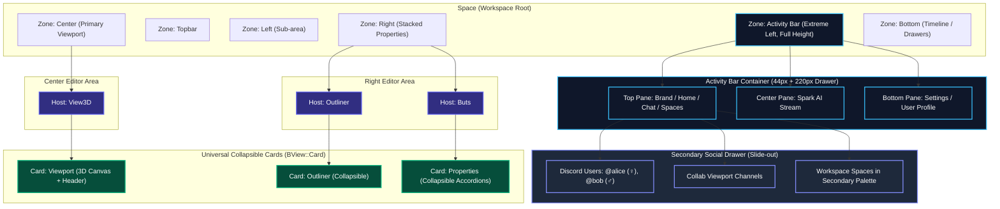
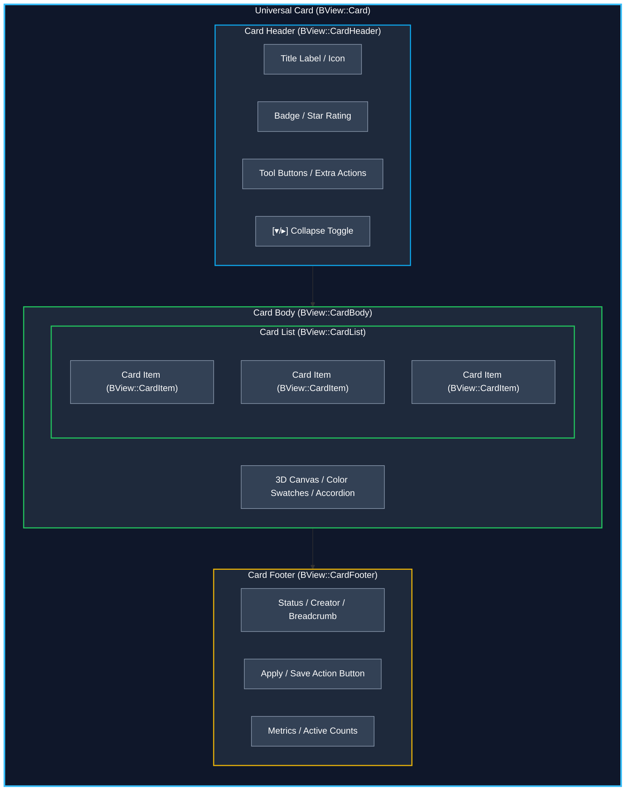
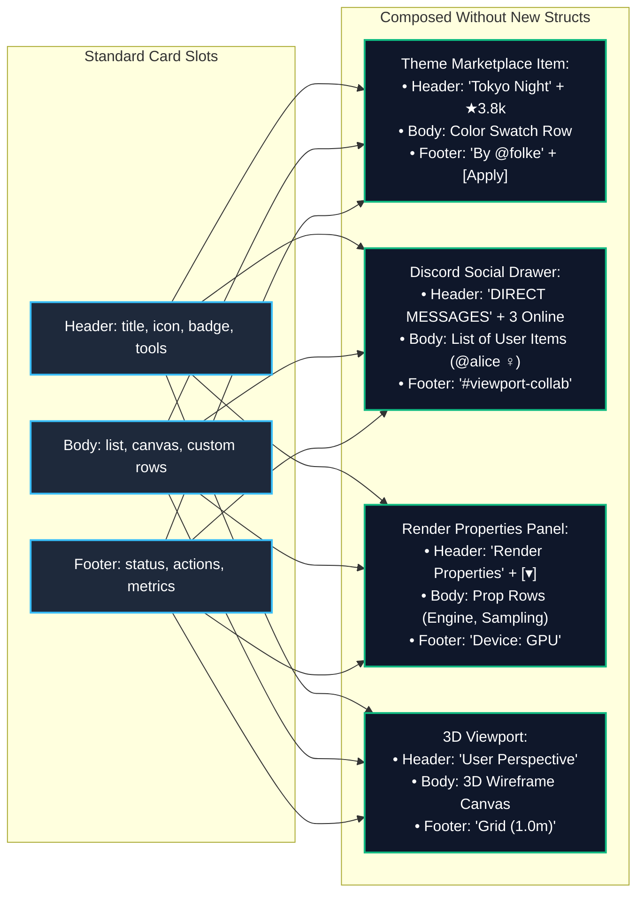
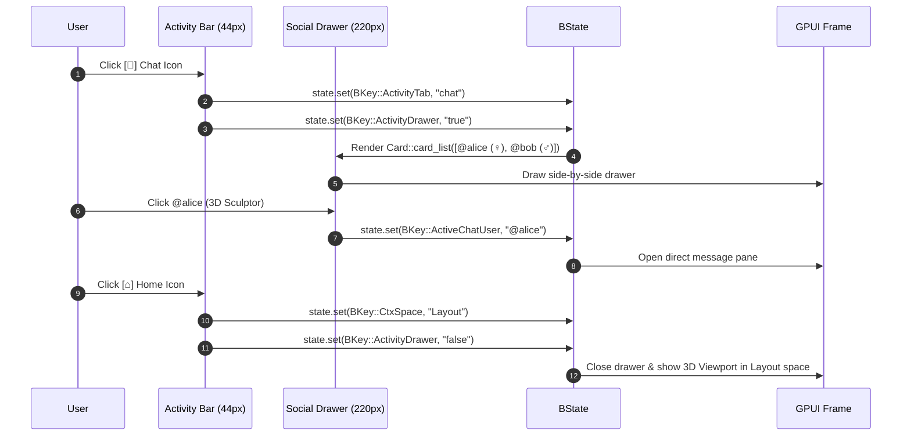

# BUI Architectural Diagrams, Activity Bar & Universal Card Hierarchy

This document visualizes the complete declarative BUI architecture, featuring the **Universal Card Abstraction** (`Card`, `Header`, `Body`, `Footer`, `List`, `Item`), the **Full-Height Activity Bar**, and **Zero-Bespoke-Terms Component Assembly**.

---

## 1. Full Layout Hierarchy with Activity Bar

---

## 2. Universal Card Slot Assembly: Zero Bespoke Structs

Every visual component is assembled from the same 6 standard primitive slots:

---

## 3. All UI Features Reusing the Exact Same Card Slots

---

## 4. Activity Bar 3-Pane Structure & Drawer Flow

