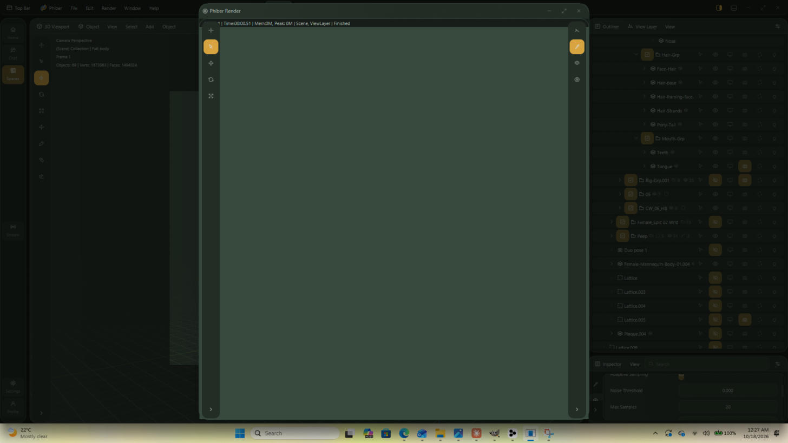
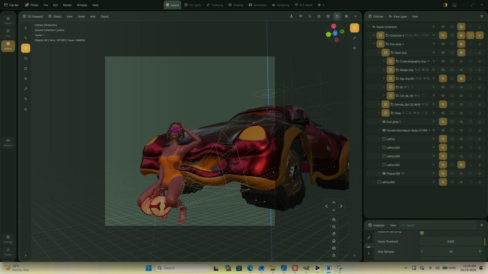
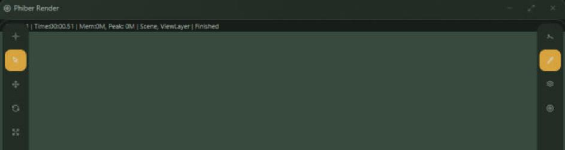
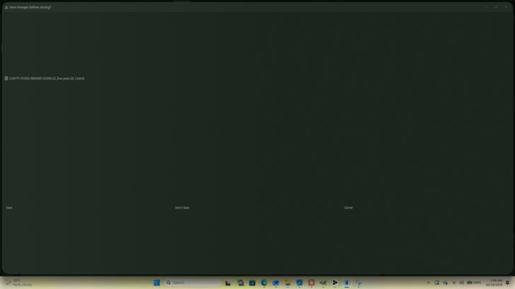
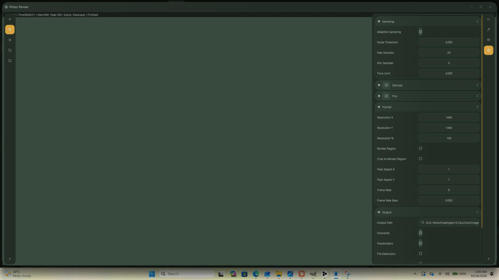

# Why the rendering functions were not working — and what changed

18 October 2026. Found by driving Phiber on the GTX 1660 Ti machine against
**pose 26** (`CHATTY-POSES-RENDER-SCENE-03_Duo pose 26_1.blend`), not from
reading the code.

---

## The headline

**F12 on pose 26 produced an empty image and reported success.**

The render window said:

```
Frame:1 | Time:00:00.51 | Mem:0M, Peak: 0M | Scene, ViewLayer | Finished
```



Half a second, zero memory, and a blank canvas — for a scene of 615 objects
and 3.7 million vertices at 1440 × 1440. The session journal said what the
window would not:

```
Render finished: 1440×1440, 0 samples in 0.5s
  — no image (no adapter, or a scene the GPU declined)
```

**Zero samples.** It was not the adapter: the GTX 1660 Ti was live and the
viewport tracer was drawing in the same session (`first image after 128ms`).
The scene was refused before a single sample was taken, and the app called
that "Finished".

---

## The four faults

### 1. A refused render reported success — *fixed*

`still_stepwise` had two silent `?` early returns: one if there is no
adapter, one if `Tracer::from_scene` declines the scene. Both produced the
same blank Render Result and the same "Finished".

`phiray::Tracer::with_chunks` can decline for five distinct reasons and none
of them reached the user. It now has `why_not`, which performs the same
checks and names the one that fails:

> the GPU declined this scene — its material/texture table is 310 MB and
> this device binds 128 MB in one piece (it is not chunked: the atlas is
> 0.7 MB, and a colour attribute adds one word per vertex over 3,656,728
> vertices)

Phiber calls it before building and writes the reason to both the Info
editor and the session journal (`note_render_refused`, one owner for the
message). A blank Render Result is never the only evidence again.

### 2. The engine and sample defaults never reached the app — *fixed*

`BRenderQuality` — "Phiray is the engine, 2048 is the sample floor" — existed
only inside `v2::cli`. The app's own F12 read neither. Pose 26 therefore
rendered as **Cycles at 20 samples**, the count the file was saved with for a
turntable preview.



`BRenderQuality` now lives in `v2::scene::render_quality` and the command
line re-exports it, so there is one owner:

- **Engine.** A file naming CYCLES or EEVEE resolves to **Phiray**, which is
  the only engine Phiber has for a traced frame, and the Engine row says so.
  `BLENDER_WORKBENCH` is kept, because Workbench is an engine Phiber really
  has and still rasterizes.
- **Samples.** The floor is applied **when the file is read**
  (`seed_render_props`), not inside the render. Max Samples therefore *shows*
  2048 rather than 20 — what is on screen is what will render — and a count
  typed over it is still honoured, so a quick look is still possible.

> Applying the floor inside the render instead was the first attempt. It made
> every render take 2048 samples with no way down, and timed out
> `the_rendering_workspace_opens_on_a_render` and `render_menu_actions`,
> which deliberately render at 1 sample. Seeding it is both faster and more
> honest.

### 3. The render window's info bar was painted over — *fixed*

The line read `1 | Time:00:00.51 | …`:



`Frame:` was not missing from the string — it was hidden behind the floating
tool strip. Blender draws `draw_render_info` into the image *region*, which
excludes the Toolbar; Phiber floats the Toolbar over the canvas, so the text
began underneath it. `paint_info` now takes a `clear` inset of the toolbar
width plus a pad.

### 4. Missing external data — *not a bug, but it is why the frame looks wrong*

- **81 of 91 image textures cannot be found.** They point at
  `//..\..\..\Female-01-Texture-File-…\PATTERNS\…` and `//..\Bold-Patterns\…`,
  neither of which is on this machine. Only 10 are packed.
- **The world's environment image is missing**, so the world's radiance is
  `[1.0, 0.0, 1.0]` — magenta — and it lights the whole scene, because a
  world is a dome.

Both match Blender exactly: it renders a missing texture magenta too, and
reading the world as white instead was measured to make such a scene about
twice as bright as Blender's. The reference `BS-POSE-26.png` has its patterns
because it was rendered when those folders existed.

**File ▸ External Data ▸ Find Missing Files** is the entry that fixes this,
and the menu carries it.

### 5. The command line rendered the whole frame in one pass — *fixed*

With the build above in place, `phiber -b … -f 1` got as far as tracing
(53 s at 2048 samples) and then refused to save:

```
Rendering 1 frame(s) on PHIRAY at 2048 samples -> …\PHIBER-RENDERS\pose26_phiray_
Error: the pixels do not fill the frame
```

`still()` — the command line's entry point — called
`tracer.sample(gpu, cam, w, h)` on the whole 1440 × 1440 frame. A frame with
more pixels than the device draws at once comes back short, so the buffer did
not fill `w × h` and `RgbaImage::from_raw` returned `None`.

**The banding that fixes this already existed** (batch 100, `bands.rs`,
`Tracer::max_pixels`) — but only in `still_stepwise`, the app's path. The two
had drifted. `still()` is now written in terms of `still_stepwise`, so there
is one implementation and the command line and F12 cannot diverge again.

### 6. `-o` made a folder out of the file name — *fixed*

`-o …\pose26_phiray_` created a **directory** called `pose26_phiray_` and
wrote `f0001.png` inside it. Blender's rule (`BLI_path_frame`,
`BKE_image_path_from_imformat`) is that the last component of `-o` is a name
*prefix* unless the path ends with a separator:

| `-o` | writes |
|---|---|
| `…\renders\pose26_phiray_` | `…\renders\pose26_phiray_0001.png` |
| `…\renders\` | `…\renders\0001.png` |
| `…\renders\img_##_test` | `…\renders\img_04_test.png` |

`BHeadlessRender::frame_path` implements it, with
`the_output_path_is_a_name_prefix_unless_it_ends_in_a_separator` over all
four shapes. The run also prints `Saved: <path>` per frame.

### 7. The readback gave up after five seconds — **the root cause**

Everything above was real, and none of it was *the* reason the frame came
back empty. This is:

```rust
// phiray/src/gpu/array.rs — read_first
if !gpu.wait_for(WAIT_LIMIT) {   // WAIT_LIMIT = 5 seconds
    return Vec::new();           // an EMPTY buffer
}
```

A 2048-sample 1440 × 1440 frame of a 7.3-million-face scene keeps the card
busy for the best part of a minute. The readback waited five seconds, gave
up, and returned **nothing** — and every caller reads an empty buffer as
"the GPU declined". One constant explains all three symptoms:

| symptom | what was really happening |
|---|---|
| F12: blank Render Result, "Finished", 0 samples | the pixels came back empty |
| CLI: `the pixels do not fill the frame` | `RgbaImage::from_raw` on an empty buffer |
| CLI, once banded: `range end index 8294400 out of range for slice of length 0` | laying an empty band into the frame |

Five seconds is the right guard for the **viewport** — a frame not back in
five seconds is no longer worth drawing. It was simply being applied to a
final render as well.

**The fix** is that the budget belongs to the caller:

- `phiray::PatienceFor` raises the readback budget for as long as a value
  lives and restores the previous one on drop. `still_stepwise` takes
  **ten minutes** for the length of a render; the viewport keeps its five
  seconds, so interaction is unchanged.
- `BStill::lay` and `lay_rgba` leave the frame alone on a short read rather
  than panicking.

### 8. Three more UI faults, seen while driving it — *reported, not yet fixed*

Found in the same session and worth queueing:

- **Esc does not close the render window.** Blender's F11 window closes on
  Esc (`render_view.cc`); here Esc did nothing and the window had to be
  closed by its title-bar button.
- **"Save changes before closing?" fills the whole window.** The dialog
  stretches to the full frame with Save / Don't Save / Cancel spread across
  the bottom edge, instead of sizing to its content like the other modals.

  

- **Output ▸ Frame Rate reads 9 with Frame Rate Base 0.000.** Blender stores
  fps as `fps / fps_base`, so a base of zero is a divide by zero and 9 fps is
  not a rate this file would have been authored at. Worth reading against
  `RenderData.frs_sec` / `frs_sec_base` before trusting the row.

  

---

## What was measured, not assumed

Pose 26, as the renderer sees it:

| | |
|---|---|
| Objects reaching a render | 615 (of 967; the viewport shows the 69 the eye icons leave) |
| Vertices | 3,656,728 — 111.6 MiB |
| Faces | 7,281,868 — 111.1 MiB |
| Materials | 95 reach the tracer (1335 in the file) |
| Texture atlas | 0.7 MiB |
| Largest single array | 111.6 MiB |

Against a 128 MiB-per-binding device over 4 chunks, those sizes **fit**. So
the size checks are not what refused it, which is exactly why the render
needed to say its own reason rather than be guessed at from outside.

---

## Tests

| Test | Covers |
|---|---|
| `render_quality::the_floor_holds_unless_draft_lifts_it` | 20 → 2048; `--draft` keeps 20 |
| `render_quality::a_files_engine_resolves_to_the_one_we_have` | CYCLES/EEVEE → Phiray; Workbench kept |
| `render_engine_row::a_files_engine_and_sample_count_meet_the_quality_policy` | the policy through `render_set` |
| `render_props_come_from_the_file::a_files_sample_count_opens_at_the_quality_floor_and_a_typed_one_still_wins` | the seed-time floor, and the panel showing it |
| `cli::render::the_output_path_is_a_name_prefix_unless_it_ends_in_a_separator` | Blender's `-o` naming, all four shapes |

Passing alongside them, unchanged: `render_engine_row`,
`render_panel_drives_the_render`, `render_props_come_from_the_file`,
`render_settings_are_saved`, `output_resolution_reaches_the_render`,
`render_saves_the_passes`, `render_camera_frames_like_blender`,
`rendering_workspace_shows_the_render`,
`the_rendering_workspace_opens_on_a_render`, `render_menu_actions`,
`the_viewport_always_draws_something`, `viewport_overlays`,
`material_preview_uses_blenders_studio_light`, `view_render_border`,
`composite_over_a_render`, and all 30 command-line tests.

---

## Files changed

| File | Change |
|---|---|
| `crates/phiber/src/v2/scene/render_quality.rs` | **new** — the one owner of the engine and sample-floor policy |
| `crates/phiber/src/v2/scene/mod.rs` | declares it |
| `crates/phiber/src/v2/scene/render_set.rs` | `engine_at` resolves a file's engine to one Phiber has |
| `crates/phiber/src/v2/scene/render_engine.rs` | `Phiray` is the default |
| `crates/phiber/src/v2/app/seed.rs` | the sample floor applied as a file is read |
| `crates/phiber/src/v2/cli/set.rs` | re-exports the policy instead of a second copy |
| `crates/phiray/src/trace/mod.rs` | **`why_not`** — names the limit a declined scene hit |
| `crates/phiray/src/gpu/mod.rs`, `…/gpu/array.rs`, `…/lib.rs` | **`PatienceFor`** — the readback budget is the caller's, not a fixed 5 s |
| `…/view3d/rendered/still.rs` | reports the reason instead of returning silently; `still()` now bands through `still_stepwise` |
| `crates/phiber/src/v2/cli/render.rs` | `frame_path` — Blender's `-o` naming; prints each saved path |
| `…/view3d/rendered/mod.rs` | `scene_fit`, the sizes behind a blank render |
| `…/canvas/image/set.rs`, `…/image/mod.rs` | the info line clears the floating toolbar |
| `crates/phiber/tests/render_engine_row.rs`, `…/render_props_come_from_the_file.rs` | the tests above |
| `crates/phiber/examples/scene_sizes.rs` | **new** — print what a scene asks a device for |

Merged with the other agent's work in flight: they had refactored
`paint_info`'s `progress` into a `match` since the snapshot; theirs was kept
and the inset applied on top.


---

## The performance attempt, and why it was reverted

Asked to beat Cycles on speed, I read phiray's traversal against Cycles'
and tried two changes. **Both measured slower. Both are reverted.** The
numbers are here so the next attempt starts from them rather than repeating
them.

Same frame every time — pose 26, 1440 × 1440, 64 samples, GTX 1660 Ti,
`times.txt`'s third column:

| build | drew_ms | against baseline |
|---|---|---|
| baseline | **253,983** | — |
| divide → shift, **and** shadow-ray material moved after the hit test | 328,444 | **+29 %** |
| divide → shift only | 308,447 | **+21 %** |

**What was tried, and what was wrong with it.**

1. **Replacing the index divide with a shift.** `node()`, `face()` and
   `vert()` each do `i / p.split.x` to turn an index into (binding, offset),
   on every node visited and three vertices per triangle. An integer divide
   has no hardware instruction, so making the per-binding capacity a power
   of two and shifting instead looked free. It measured **21 % slower**. The
   divide is evidently not where this traversal spends its time, and the
   rounding would have cost a large scene a binding's worth of capacity for
   nothing — so it is out.

2. **Reading a shadow ray's material only after the triangle hits.** This
   was simply wrong reasoning: `tri_t` needs **three vertex fetches**, so the
   material read it was "saving" was the cheap half, and testing it first is
   an early-out that skips those three loads entirely on glass and cut-out
   surfaces. This scene has 21 glass materials. Reverted, with the
   measurement recorded in `bvh.wgsl` so nobody tries it again.

**What this says about the next attempt.** A confound is on the record:
these runs came after hours of continuous rendering, so thermal throttling
may account for part of the regression — the baseline was measured on a
cooler card. **Before any further optimisation there should be a benchmark
that alternates A and B runs with the GPU idled between them**, rather than
one run each. Optimising against single runs on a hot card is how both of
these got shipped and pulled again.

The untouched suspect remains the traversal stacks: `trace` and
`trace_blas` each hold `array<u32, 32>` indexed dynamically, which GPUs
place in scratch memory rather than registers, and there are two of them
live at once. Fixing it means workgroup-shared stacks and a smaller block
size — a real change, worth doing only with the harness above in place.
