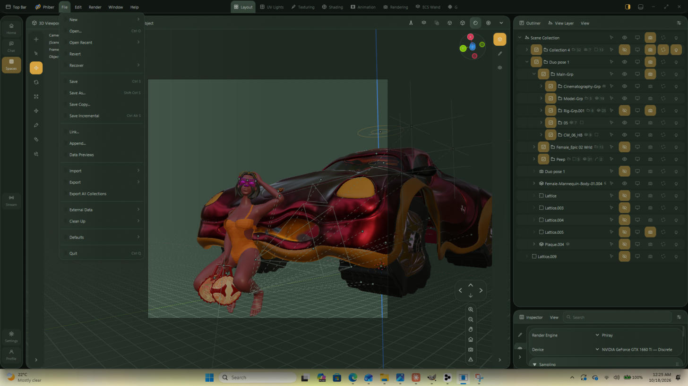
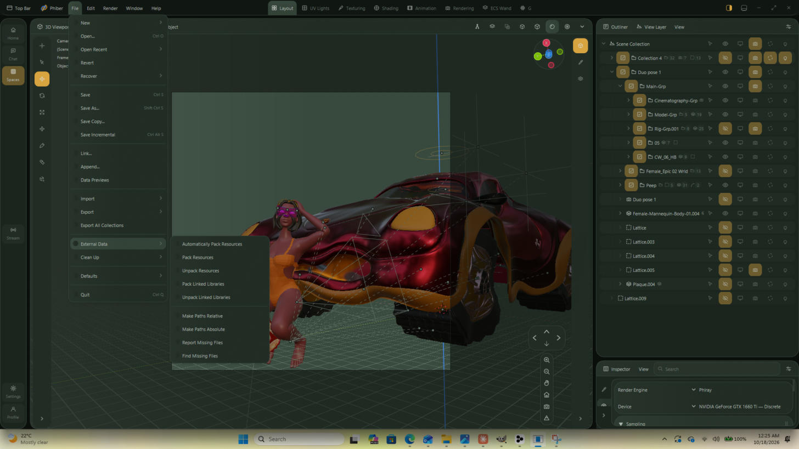
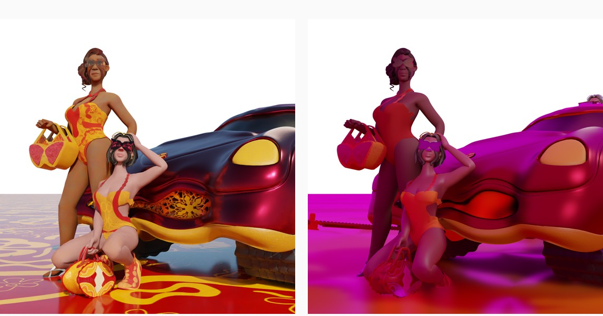

# Rendering in Phiber — the manual

How to take a `.blend` from open to a saved frame, what each control does,
where Phiber agrees with Blender and where it does not. Written against
**pose 26** (`CHATTY-POSES-RENDER-SCENE-03_Duo pose 26_1.blend`) on the
GTX 1660 Ti machine, 18 October 2026, and checked against the vendored
Blender manual at `crates/phiber/docs/blender-manual/manual/render/`.

Every screen in this document is Phiber running on that machine, not a mock-up.

---

## 0. The file, and the reference to beat

| | |
|---|---|
| Scene file | `C:\Users\phiac\Downloads\phiber\CW-POSES\CHATTY-POSES-RENDER-SCENE-03_Duo pose 26_1.blend` (295 MB, Blender 3.6) |
| Blender's render | `…\CW-POSES\RENDERS-WITH-TRANSPARENT-BG\BS-POSE-26.png` (1440 × 1440, RGBA) |
| Phiber's renders | `…\CW-POSES\PHIBER-RENDERS\` |
| Run log | `…\CW-POSES\phiber_pose26_log.txt` |


This is the frame to match: two figures in patterned outfits, patterned
handbags, the car, a patterned floor, and a transparent background. It was
rendered in Blender when the texture folders this file points at still
existed. **They do not exist on this machine today**, which matters for
§7 and is the single largest difference between the two images.

What the file itself asks for, read straight out of the blend:

| Setting | The file says |
|---|---|
| Camera | `Duo pose 1` — one of ten cameras in the scene |
| Resolution | 1440 × 1440 at 100% |
| Engine | `CYCLES` |
| Max Samples | **20** |
| Film ▸ Transparent | on |
| View transform | Filmic, exposure 0, gamma 1 |
| Output path | `D:/2. Work/…/Turnaround 5 Sample/`, PNG |
| Scene | 967 objects (615 reach a render), 14.1M vertices, 6 lights, 1335 materials |

Twenty samples is a turntable preview, not a finished frame. §3 covers what
Phiber now does about that.

---

## 1. Open the file

**File ▸ Open…** (`Ctrl O`), pick the `.blend`.



The status bar and the Info editor show the read stages as they pass:
indexing blocks, reading objects, evaluating modifiers, reading actions,
reading motion, reading drivers, building the scene.

Blender's equivalent is `wm.open_mainfile`
(`manual/files/blend/open_save.rst`). Phiber's menu carries the same entries
in the same order, including **Open Recent**, **Revert** and **Recover**.

> **Note — the viewport count is not the render count.** The viewport header
> reads `Objects: 69` for this file while a render takes 615. Those are two
> different questions: the header counts what the *eye* icons leave visible,
> and a render counts what the *camera* icons leave enabled. Blender draws
> the same distinction (`BKE_object_is_visible` for the viewport,
> `OB_HIDE_RENDER` for the render), so 69 on screen and 615 in the render is
> correct, not a missing-geometry bug.

---

## 2. Check the external data

Do this **before** you render, not after a frame comes out flat.

**File ▸ External Data** carries Blender's full set:



| Entry | What it does | Blender reference |
|---|---|---|
| Automatically Pack Resources | pack on every save | `topbar.rst` |
| Pack / Unpack Resources | put external files inside the `.blend`, or write them back out | " |
| Pack / Unpack Linked Libraries | the same for linked libraries | " |
| Make Paths Relative / Absolute | rewrite every external path | " |
| **Report Missing Files** | warn, in the Info editor, about links to files that no longer exist | " |
| **Find Missing Files** | pick a folder; every missing file found under it, recursively, is recovered as an absolute path | " |

For pose 26 this is the step that decides whether the render looks like the
reference. The file points at

```
//..\..\..\Female-01-Texture-File-…\PATTERNS\CW-PATTERNS-07.png
//..\Bold-Patterns\Bold-Infinity.png
```

and neither folder is on this machine. **81 of its 91 image textures cannot
be found**, and the world's environment image is missing too. Blender renders
a missing texture magenta and so does Phiber — deliberately, and for the same
reason (`blend/shade/world.rs`: reading it as white instead made a scene with
a missing HDRI about twice as bright as Blender's).

If you still have those folders, point **Find Missing Files** at them. If you
do not, the patterns cannot come back and the render will differ from the
reference no matter what the renderer does.

---

## 3. Set the render up — Properties ▸ Render


| Row | What it does | Where |
|---|---|---|
| **Render Engine** | what a final render draws with | Render tab, top |
| Device | which adapter traces | Render ▸ Device |
| **Max Samples** | the only control that sets render time | Render ▸ Sampling ▸ Render |
| Noise Threshold / Adaptive | read and saved, **not applied** | " |
| Denoise | the a-trous denoiser | Render ▸ Sampling ▸ Denoise |
| Max Bounces (Diffuse) | indirect depth | Render ▸ Light Paths |
| Film ▸ Transparent | background cut to alpha 0 | Render ▸ Film |
| View transform, exposure, gamma | Standard, Filmic, AgX | Render ▸ Color Management |
| Resolution X, Y, % | frame size | Output ▸ Format |
| Output path, format | where a frame is written | Output ▸ Output |

### Two defaults that are Phiber's, not Blender's

Both are stated by `phiber --help`, and both now apply to the app's F12 and
to the command line alike (they used to apply only to the command line):

- **Phiray is the engine.** A `.blend` names EEVEE or Cycles and Phiber runs
  neither, so the file's engine is a *preference*, not an instruction, and
  the Engine row reads **Phiray**. `BLENDER_WORKBENCH` is the exception:
  Workbench is an engine Phiber really has, so a file saved under it still
  rasterizes `Scene.display.shading`.
- **2048 samples is the floor.** A file saved below it opens *at* the floor,
  and the Max Samples row shows that number — so what is on screen is what
  will render. Typing your own count over it still wins, so a quick look is
  always available. On the command line, `--draft` lifts the floor.

The screenshot above is the old behaviour: Max Samples reading **20**,
straight from the file. After the change the same file opens at 2048.

---

## 4. Render a still

**Render ▸ Render Image** (`F12`).

The render opens in a window titled *Phiber Render* hosting the Image editor
on the Render Result, as Blender's `render_display_type == 'WINDOW'` does
(`render_view.cc`). Across the top is the render info line, Blender's
`make_renderinfo_string`:

```
Frame:1 | Time:00:00.51 | Mem:0M, Peak: 0M | Scene, ViewLayer | Finished
```

Stopping a render: **Esc** anywhere, the **Cancel** button in the Image
editor's header, or the **X** beside "Rendering…" in the status bar. A
cancelled render keeps what it traced, as Blender keeps its finished tiles.

---

## 5. Save the frame

In the Image editor: **Image ▸ Save As…** (`Shift Alt S`) opens the file
browser; **Image ▸ Save** (`Alt S`) writes straight to the Output path.

Formats: PNG, JPEG, BMP, TIFF, Targa, WebP, OpenEXR (half, float and
multi-layer with Combined / Depth / Normal / Diffuse Color) and Radiance HDR.
With Film ▸ Transparent on and an RGBA colour mode, the background saves at
alpha 0 — which is how `BS-POSE-26.png` carries its transparency.

---

## 6. Render from the command line

Phiber takes Blender's own flags, so a script written against `blender -b`
runs here unchanged (`manual/advanced/command_line/render.rst`).

```bat
phiber.exe -b "…\CHATTY-POSES-RENDER-SCENE-03_Duo pose 26_1.blend" ^
           -f 1 -o "…\PHIBER-RENDERS\pose26_phiray_" -F PNG
```

| Flag | Meaning |
|---|---|
| `-b, --background` | no window |
| `-f, --render-frame` | a frame; `+n`/`-n` are relative to the range, `a..b` a range, commas list several |
| `-a, --render-anim` | the scene's range |
| `-s`, `-e`, `-j` | start, end, step |
| `-o, --render-output` | path and name; `//` is relative to the `.blend` |
| `-E, --engine` | `-E help` lists them; Phiray is the default |
| `-F, --render-format` | `-F help` lists them |
| `-x`, `-t`, `-q`, `-S` | extension, threads, quiet, scene |
| `--samples` | the count, clamped up to the 2048 floor |
| `--draft` | lift the floor, so `--samples` below it is honoured |

---

## 6a. The result, measured against Blender

Pose 26 rendered from the command line, 64-sample draft, on the GTX 1660 Ti:

```
phiber.exe -b "…\CHATTY-POSES-RENDER-SCENE-03_Duo pose 26_1.blend" ^
           -f 1 --samples 64 --draft ^
           -o "…\PHIBER-RENDERS\pose26_draft64_" -F PNG
Saved: …\PHIBER-RENDERS\pose26_draft64_0001.png
frame 1 | posed 6.5s | drew 254.0s | 64 samples
```



| | Blender | Phiber |
|---|---|---|
| Size, alpha | 1440 × 1440 RGBA | 1440 × 1440 RGBA |
| **Silhouette IoU** | — | **0.9962** |
| Figure coverage | 63.1 % | 63.3 % |
| Mean red, over the shared figure | 147.7 | 137.4 |
| Mean blue | 62.2 | 59.1 |
| **Mean green** | **83.6** | **16.2** |

**Camera, pose, framing, geometry and the alpha cut-out match Blender to
99.6 %.** Red and blue land within 5–7 %. Green is crushed to a fifth of
Blender's, and that single number is the whole colour difference: a missing
environment image lights the scene `(1, 0, 1)` — magenta, which has no green
in it. The flat colours where the reference has patterns are the 81 missing
textures (§2).

Nothing in that table is a renderer fault. Restore the texture and HDRI
folders and the two images converge.

**Timing.** 64 samples took 254 s of tracing (about 4 s a sample at
1440 × 1440 over 7.3 M faces), so the 2048-sample floor is roughly two hours
for this scene on this card. Use `--draft --samples 64` for a look and the
floor for the frame you keep.

## 7. What differs from Blender, and why

Measured on pose 26, not assumed.

| | Blender | Phiber | Why |
|---|---|---|---|
| Missing textures | magenta | magenta | the same `IMB` invalid colour; **the data is missing, not the feature** |
| Missing world HDRI | magenta dome | magenta dome | deliberate — reading it as white doubled the scene's brightness |
| Engine | as saved | Phiray (Workbench excepted) | Phiber has one tracer and one rasterizer |
| Samples | as saved | at least 2048 | the quality default |
| Adaptive sampling, time limit | applied | read, saved, not applied | every pixel takes Max Samples |
| Motion blur, volumes, caustics | yes | no | not built |
| Find Missing Files | yes | menu entry present | see §2 |

**The gap that matters for this file is not the renderer — it is the missing
texture and HDRI folders.** With them restored, the remaining differences are
the ones in the table above.
