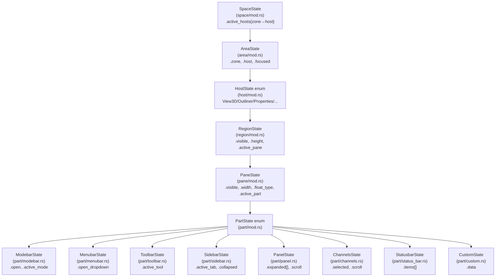

# Layout Space - State Structure (Hierarchy-Based)

> **Blender references:**
> - `DNA_space_types.h` - `SpaceLink` (per-space runtime data), `View3D` struct
> - `BKE_screen.h` - `ARegion` struct with `regionflag`, `do_draw`, `vsmask`
> - `DNA_screen_types.h` - `ScrArea` with `butspacetype`, `butspacetype_subtype`
> - Blender Manual: [`interface/window_system/regions.rst`](../../blender-manual/manual/interface/window_system/regions.rst) - region visibility, sizing

---

## State File Layout

Each hierarchy level has four files:
- **`mod.rs`** - struct definition, trait impl, enum dispatch
- **`def.rs`** - constants, defaults, min/max bounds
- **`ctx.rs`** - context sync (`sync_from_context` / `sync_to_context`)
- **`use.rs`** - set methods (get/set, not effects)

```
crates/phiber/src/state/
  mod.rs                        - re-exports

  context.rs                    - BContext (hierarchical: SpaceCtx → ZoneCtx → AreaCtx → HostCtx → RegionCtx → PaneCtx)

  space/                        - LEVEL 1: SPACE
    mod.rs                      - SpaceState (active host per zone, region visibility map)
    def.rs                      - default hosts, default region visibility
    ctx.rs                      - space-level context sync
    use.rs                      - space-level set methods (set_host, set_visible)

  zone/                         - LEVEL 2: ZONE
    mod.rs                      - ZoneState (which areas are visible per zone)
    def.rs                      - default zone layout per space type
    ctx.rs                      - zone-level context sync
    use.rs                      - zone-level set methods (set_zone_visible)

  area/                         - LEVEL 3: AREA
    mod.rs                      - AreaState (zone, active host, focused flag)
    def.rs                      - default area state per zone
    ctx.rs                      - area-level context sync
    use.rs                      - area-level set methods (set_focus, set_host)

  host/                         - LEVEL 4: HOST
    mod.rs                      - HostState enum, BHostState trait, RailState, ModebarState
    def.rs                      - default host state constants (zoom, rail widths, etc.)
    ctx.rs                      - host-level context sync (mode, tool, selection)
    use.rs                      - host-level set methods (set_zoom, set_shading, set_mode, set_rail)
    view3d.rs                   - View3DState
    outliner.rs                 - OutlinerState
    properties.rs               - PropertiesState
    timeline.rs                 - TimelineState
    file_browser.rs             - FileBrowserState
    image_editor.rs             - ImageEditorState
    info.rs                     - InfoState
    sequencer.rs                - SequencerState
    text_editor.rs              - TextEditorState
    dope_sheet.rs               - DopeSheetState
    nla.rs                      - NlaState
    node_editor.rs              - NodeEditorState
    logic_editor.rs             - LogicEditorState
    console.rs                  - ConsoleState
    uv_editor.rs                - UvEditorState
    compositor.rs               - CompositorState
    shader_editor.rs            - ShaderEditorState
    geo_nodes.rs                - GeoNodesState
    clip_editor.rs              - ClipEditorState
    drivers.rs                  - DriversState
    asset_browser.rs            - AssetBrowserState
    spreadsheet.rs              - SpreadsheetState
    graph_editor.rs             - GraphEditorState
    prefs.rs                    - PrefsState
    topbar.rs                   - TopbarState
    statusbar.rs                - StatusbarState
    empty.rs                    - EmptyState

  region/                       - LEVEL 5: REGION
    mod.rs                      - RegionState (visible, height, active pane)
    def.rs                      - default region heights (Header=32, Center=flex, Footer=28)
    ctx.rs                      - region-level context sync
    use.rs                      - region-level set methods (set_visible, set_pane)

  pane/                         - LEVEL 6: PANE
    mod.rs                      - PaneState (visible, width, active part)
    def.rs                      - default pane widths (toolbar=44, sidebar=300, etc.)
    ctx.rs                      - pane-level context sync
    use.rs                      - pane-level set methods (set_visible, set_width, set_float_type)

  part/                         - LEVEL 7: PART
    mod.rs                      - PartState enum, BPartState trait
    def.rs                      - default part state constants
    ctx.rs                      - part-level context sync
    use.rs                      - part-level set methods (set_open, set_mode, set_tool, set_tab, set_scroll)
    modebar.rs                  - ModebarState { open: bool, active_mode: BMode }
    menubar.rs                  - MenubarState { open_dropdown: Option<usize> }
    toolbar.rs                  - ToolbarState { active_tool: Option<String> }
    sidebar.rs                  - SidebarState { active_tab: usize, collapsed: bool }
    panel.rs                    - PanelState { expanded: Vec<String>, scroll: f32 }
    channels.rs                 - ChannelsState { selected: Option<String>, scroll: f32 }
    status_bar.rs               - StatusbarState { items: Vec<StatusItem> }
    tool_props.rs               - ToolPropsState { active_tool: Option<String> }
    preview.rs                  - PreviewState { zoom: f32 }
    asset_shelf.rs              - AssetShelfState { active_category: usize, scroll: f32 }
    adjust_last_op.rs           - AdjustLastOpState { visible: bool }
    custom.rs                   - CustomState (host-specific, delegated)

  modals/                       - modal state (settings, help, profile)
    mod.rs                      - ModalState enum
    def.rs                      - default modal state
    ctx.rs                      - modal context sync
    use.rs                      - modal set methods (set_open, set_close, set_tab)
```

---

## Level 1: Space - `state/space/mod.rs`

```rust
//! SpaceState - tracks which host is active per zone.
//! Region/pane visibility has moved to RegionState and PaneState.
//! Ref: DNA_screen_types.h - bScreen

use std::collections::HashMap;
use buikit::{BHostType, BSpaceType, BZoneType};

#[derive(Clone, Debug)]
pub struct SpaceState {
    pub space_type: BSpaceType,
    pub active_hosts: HashMap<BZoneType, BHostType>,
}

impl SpaceState {
    pub fn new(space_type: BSpaceType) -> Self {
        let mut active_hosts = HashMap::new();
        for &(zone, BHost) in space_type.default_hosts() {
            active_hosts.insert(zone, BHost);
        }
        Self { space_type, active_hosts }
    }

    pub fn active_host(&self, zone: BZoneType) -> Option<BHostType> {
        self.active_hosts.get(&zone).copied()
    }
}
```

### `state/space/def.rs`

```rust
//! Default host assignments per zone for each space type.
//! Ref: store/spaces/layout/def.rs - LAYOUT_DEFAULT_HOSTS

use buikit::{BHostType, BSpaceType, BZoneType};

pub static DEFAULT_HOSTS_LAYOUT: &[(BZoneType, BHostType)] = &[
    (BZoneType::Top,    BHostType::Topbar),
    (BZoneType::Left,   BHostType::Outliner),
    (BZoneType::Center, BHostType::View3D),
    (BZoneType::Right,  BHostType::Properties),
    (BZoneType::Bottom, BHostType::Timeline),
];
```

### `state/space/ctx.rs`

```rust
//! Space-level context sync.
//! Syncs SpaceState with BContext.space (SpaceCtx).

use crate::state::context::BContext;
use super::SpaceState;

impl SpaceState {
    pub fn sync_from_context(&mut self, ctx: &BContext) {
        if let Some(host) = ctx.host_type_for_zone(ctx.space.active_area) {
            self.active_hosts.insert(ctx.space.active_area, BHost);
        }
    }

    pub fn sync_to_context(&self, ctx: &mut BContext) {
        ctx.space.space_type = self.space_type;
    }
}
```

### `state/space/use.rs`

```rust
//! Space-level set methods - mutations on SpaceState.
//! These are NOT effects. They are pure state mutations.
//! The caller (keymap/action dispatcher) invokes these, then calls cx.notify().

use buikit::{BHostType, BZoneType};
use super::SpaceState;

impl SpaceState {
    /// Set: switch the host in a zone.
    pub fn set_host(&mut self, zone: BZoneType, BHost: BHostType) {
        self.active_hosts.insert(zone, BHost);
    }
}
```

---

## Level 2: BArea - `state/area/mod.rs`

```rust
//! AreaState - tracks which zone is focused and its active host.
//! Ref: DNA_screen_types.h - ScrArea

use buikit::{BHostType, BZoneType};

#[derive(Clone, Debug)]
pub struct AreaState {
    pub zone: BZoneType,
    pub host: BHostType,
    pub focused: bool,
}

impl AreaState {
    pub fn new(zone: BZoneType, BHost: BHostType) -> Self {
        Self { zone, BHost, focused: false }
    }
}
```

### `state/area/def.rs`

```rust
//! Default area state per zone.

use buikit::{BHostType, BZoneType};
use super::AreaState;

pub fn default_areas_for_layout() -> Vec<AreaState> {
    vec![
        AreaState::new(BZoneType::Top,    BHostType::Topbar),
        AreaState::new(BZoneType::Left,   BHostType::Outliner),
        AreaState::new(BZoneType::Center, BHostType::View3D),
        AreaState::new(BZoneType::Right,  BHostType::Properties),
        AreaState::new(BZoneType::Bottom, BHostType::Timeline),
    ]
}
```

### `state/area/ctx.rs`

```rust
//! BArea-level context sync.

use crate::state::context::BContext;
use super::AreaState;

impl AreaState {
    pub fn sync_from_context(&mut self, ctx: &BContext) {
        self.zone = ctx.area.zone;
        self.host = ctx.area.host;
        self.focused = ctx.space.active_area == self.zone;
    }

    pub fn sync_to_context(&self, ctx: &mut BContext) {
        ctx.area.zone = self.zone;
        ctx.area.host = self.host;
    }
}
```

### `state/area/use.rs`

```rust
//! BArea-level set methods.

use buikit::{BHostType, BZoneType};
use super::AreaState;

impl AreaState {
    /// Set: focus this area.
    pub fn set_focus(&mut self) {
        self.focused = true;
    }

    /// Set: unfocus this area.
    pub fn set_unfocus(&mut self) {
        self.focused = false;
    }

    /// Set: switch host in this area.
    pub fn set_host(&mut self, BHost: BHostType) {
        self.host = host;
    }
}
```

---

## Level 3: Host - `state/host/mod.rs`

```rust
//! HostState enum - one variant per BHostType.
//! NO region visibility here - that lives in RegionState.
//! NO mode bar state here - that lives in PartState::Modebar.
//! The host only carries host-specific runtime data.
//! Ref: BKE_screen.h - SpaceType

pub mod view3d;
pub mod outliner;
pub mod properties;
pub mod timeline;
// ... all other host state files ...

use buikit::BHostType;

/// Discriminated union of all host states - matches BHostType 1:1.
#[derive(Clone, Debug)]
pub enum HostState {
    View3D(view3d::View3DState),
    Outliner(outliner::OutlinerState),
    Properties(properties::PropertiesState),
    Timeline(timeline::TimelineState),
    // ... all other variants ...
    Empty(empty::EmptyState),
}

impl HostState {
    pub fn for_host(host: BHostType) -> Self {
        match host {
            BHostType::View3D => Self::View3D(view3d::View3DState::default()),
            BHostType::Outliner => Self::Outliner(outliner::OutlinerState::default()),
            BHostType::Properties => Self::Properties(properties::PropertiesState::default()),
            BHostType::Timeline => Self::Timeline(timeline::TimelineState::default()),
            // ... all other arms ...
            BHostType::Empty => Self::Empty(empty::EmptyState::default()),
        }
    }
}
```

### `state/host/def.rs`

```rust
//! Default constants for host state.
//! Min/max bounds, default values.

pub const DEFAULT_ZOOM: f32 = 1.0;
pub const MIN_ZOOM: f32 = 0.1;
pub const MAX_ZOOM: f32 = 10.0;

pub const DEFAULT_RAIL_WIDTH: f32 = 40.0;
pub const MIN_RAIL_WIDTH: f32 = 20.0;
pub const MAX_RAIL_WIDTH: f32 = 400.0;
```

### `state/host/ctx.rs`

```rust
//! Host-level context sync.
//! Syncs host state with BContext.host (HostCtx).
//! Ref: BKE_context.h - CTX_data_mode, CTX_data_tool

use crate::state::context::{BContext, BMode};
use super::HostState;

impl HostState {
    pub fn sync_from_context(&mut self, ctx: &BContext) {
        match self {
            Self::View3D(s) => {
                s.mode = ctx.host.mode;
                s.active_tool = ctx.host.active_tool.clone();
            }
            Self::Outliner(s) => {
                s.active_object = ctx.host.active_object.clone();
            }
            // ... other hosts ...
            _ => {}
        }
    }

    pub fn sync_to_context(&self, ctx: &mut BContext) {
        match self {
            Self::View3D(s) => {
                ctx.host.mode = s.mode;
                ctx.host.active_tool = s.active_tool.clone();
            }
            // ... other hosts ...
            _ => {}
        }
    }
}
```

### `state/host/use.rs`

```rust
//! Host-level set methods - mutations on host state.
//! These are NOT effects. They are pure state mutations.
//! The caller invokes these, then calls cx.notify() to trigger re-render.

use super::HostState;
use crate::state::context::BMode;

impl HostState {
    /// Set: zoom in.
    pub fn set_zoom_in(&mut self) {
        if let Self::View3D(s) = self {
            s.zoom = (s.zoom * 1.2).min(10.0);
        }
    }

    /// Set: zoom out.
    pub fn set_zoom_out(&mut self) {
        if let Self::View3D(s) = self {
            s.zoom = (s.zoom / 1.2).max(0.1);
        }
    }

    /// Set: reset zoom.
    pub fn set_zoom_reset(&mut self) {
        if let Self::View3D(s) = self {
            s.zoom = 1.0;
        }
    }

    /// Set: cycle shading mode.
    pub fn set_shading(&mut self) {
        if let Self::View3D(s) = self {
            s.shading_mode = match s.shading_mode {
                View3DShading::Wireframe => View3DShading::Solid,
                View3DShading::Solid => View3DShading::Material,
                View3DShading::Material => View3DShading::Rendered,
                View3DShading::Rendered => View3DShading::Wireframe,
            };
        }
    }

    /// Set: mode.
    pub fn set_mode(&mut self, mode: BMode) {
        if let Self::View3D(s) = self {
            s.mode = mode;
        }
    }

    /// Set: active tool.
    pub fn set_tool(&mut self, tool: &str) {
        if let Self::View3D(s) = self {
            s.active_tool = Some(tool.to_string());
        }
    }

    /// Set: toggle overlay.
    pub fn set_overlay(&mut self) {
        if let Self::View3D(s) = self {
            s.show_overlay = !s.show_overlay;
        }
    }

    /// Set: toggle gizmo.
    pub fn set_gizmo(&mut self) {
        if let Self::View3D(s) = self {
            s.show_gizmo = !s.show_gizmo;
        }
    }

    /// Set: rail width.
    pub fn set_rail(&mut self, side: RailSide, width: f32) {
        if let Self::View3D(s) = self {
            let w = width.clamp(MIN_RAIL_WIDTH, MAX_RAIL_WIDTH);
            s.rails.set_width(side, w);
        }
    }
}
```

### `state/host/view3d.rs` - Cleaned up

```rust
//! View3D host state - NO region visibility fields.
//! Region visibility lives in RegionState.
//! Mode bar state lives in PartState::Modebar.
//! Ref: DNA_view3d_types.h - View3D struct

use crate::state::context::BMode;
use super::RailState;

#[derive(Clone, Copy, Debug, PartialEq, Eq)]
pub enum View3DShading {
    Wireframe,
    Solid,
    Material,
    Rendered,
}

#[derive(Clone, Debug)]
pub struct View3DState {
    // ── Host-specific runtime data only ──
    pub mode: BMode,
    pub zoom: f32,
    pub show_overlay: bool,
    pub show_gizmo: bool,
    pub show_stats: bool,
    pub shading_mode: View3DShading,
    pub active_tool: Option<String>,
    pub rails: RailState,
}

impl Default for View3DState {
    fn default() -> Self {
        Self {
            mode: BMode::Object,
            zoom: 1.0,
            show_overlay: true,
            show_gizmo: true,
            show_stats: false,
            shading_mode: View3DShading::Solid,
            active_tool: Some("Select Box".to_string()),
            rails: RailState::default(),
        }
    }
}
```

---

## Level 5: Region - `state/region/mod.rs`

```rust
//! RegionState - visibility and height per (host, region).
//! Only 3 region types: Header, Center, Footer.
//! Ref: DNA_screen_types.h - ARegion

use std::collections::HashMap;
use buikit::{BHostType, BRegionType};

#[derive(Clone, Debug)]
pub struct RegionState {
    pub region_type: BRegionType,
    pub visible: bool,
    pub height: f32,      // fixed for Header/Footer, ignored for Center (flex)
    pub active_pane: super::pane::PaneKey,  // which pane has focus
}

/// Key: (host_type, region_type) → RegionState
pub type RegionStateMap = HashMap<(BHostType, BRegionType), RegionState>;
```

### `state/region/def.rs`

```rust
//! Default region state constants.

pub const HEADER_HEIGHT: f32 = 32.0;
pub const FOOTER_HEIGHT: f32 = 28.0;
// Center region uses flex-1, no fixed height

pub fn default_regions_for_host(host: BHostType) -> Vec<(BRegionType, RegionState)> {
    // Most hosts have Header + Center
    vec![
        (BRegionType::Header, RegionState {
            region_type: BRegionType::Header,
            visible: true,
            height: HEADER_HEIGHT,
            active_pane: default_active_pane(BRegionType::Header),
        }),
        (BRegionType::Center, RegionState {
            region_type: BRegionType::Center,
            visible: true,
            height: 0.0,  // flex
            active_pane: default_active_pane(BRegionType::Center),
        }),
    ]
}
```

### `state/region/ctx.rs`

```rust
//! Region-level context sync.

use crate::state::context::BContext;
use super::RegionState;

impl RegionState {
    pub fn sync_from_context(&mut self, ctx: &BContext) {
        self.active_pane = ctx.region.active_pane;
    }

    pub fn sync_to_context(&self, ctx: &mut BContext) {
        ctx.region.region_type = self.region_type;
        ctx.region.active_pane = self.active_pane;
    }
}
```

### `state/region/use.rs`

```rust
//! Region-level set methods.

use super::RegionState;

impl RegionState {
    /// Set: toggle region visibility.
    pub fn set_visible_toggle(&mut self) {
        self.visible = !self.visible;
    }

    /// Set: region visibility.
    pub fn set_visible(&mut self, visible: bool) {
        self.visible = visible;
    }

    /// Set: active pane within this region.
    pub fn set_pane(&mut self, pane: super::pane::PaneKey) {
        self.active_pane = pane;
    }
}
```

---

## Level 6: Pane - `state/pane/mod.rs`

```rust
//! PaneState - visibility, width, and active part per pane.
//! Ref: Blender DNA_screen_types.h - AZone (conceptual)

use buikit::{BPaneType, BDockType, BPartType};

#[derive(Clone, Copy, Debug, PartialEq, Eq, Hash)]
pub struct PaneKey {
    pub pane_type: BPaneType,
}

#[derive(Clone, Debug)]
pub struct PaneState {
    pub pane_type: BPaneType,
    pub float_type: BDockType,
    pub visible: bool,
    pub width: f32,           // runtime width (can be resized)
    pub active_part: BPartType,  // which part has focus
}
```

### `state/pane/def.rs`

```rust
//! Default pane widths per host/region/pane.
//! These are initial values - runtime width is in PaneState.

pub const DEFAULT_TOOLBAR_WIDTH: f32 = 44.0;
pub const DEFAULT_SIDEBAR_WIDTH: f32 = 300.0;
pub const MIN_PANE_WIDTH: f32 = 20.0;
pub const MAX_PANE_WIDTH: f32 = 600.0;
```

### `state/pane/ctx.rs`

```rust
//! Pane-level context sync.

use crate::state::context::BContext;
use super::PaneState;

impl PaneState {
    pub fn sync_from_context(&mut self, ctx: &BContext) {
        self.active_part = ctx.pane.active_part;
    }

    pub fn sync_to_context(&self, ctx: &mut BContext) {
        ctx.pane.pane_type = self.pane_type;
        ctx.pane.active_part = self.active_part;
    }
}
```

### `state/pane/use.rs`

```rust
//! Pane-level set methods.

use buikit::BDockType;
use super::{PaneState, MIN_PANE_WIDTH, MAX_PANE_WIDTH};

impl PaneState {
    /// Set: toggle pane visibility.
    pub fn set_visible_toggle(&mut self) {
        self.visible = !self.visible;
    }

    /// Set: pane width.
    pub fn set_width(&mut self, width: f32) {
        self.width = width.clamp(MIN_PANE_WIDTH, MAX_PANE_WIDTH);
    }

    /// Set: float type (docking mode).
    pub fn set_float_type(&mut self, float: BDockType) {
        self.float_type = float;
    }

    /// Set: active part within this pane.
    pub fn set_part(&mut self, part: BPartType) {
        self.active_part = part;
    }
}
```

---

## Level 7: Part - `state/part/mod.rs`

```rust
//! PartState - one variant per BPartType.
//! Each part has its own state file with mod.rs/def.rs/ctx.rs/use.rs.
//! Ref: Blender ARegionType.draw callbacks

use buikit::BPartType;

pub mod modebar;
pub mod menubar;
pub mod toolbar;
pub mod sidebar;
pub mod panel;
pub mod channels;
pub mod status_bar;
pub mod tool_props;
pub mod preview;
pub mod asset_shelf;
pub mod adjust_last_op;
pub mod custom;

#[derive(Clone, Debug)]
pub enum PartState {
    Modebar(modebar::ModebarState),
    Menubar(menubar::MenubarState),
    Toolbar(toolbar::ToolbarState),
    Sidebar(sidebar::SidebarState),
    Panel(panel::PanelState),
    Channels(channels::ChannelsState),
    Statusbar(status_bar::StatusbarState),
    ToolProps(tool_props::ToolPropsState),
    Preview(preview::PreviewState),
    AssetShelf(asset_shelf::AssetShelfState),
    AdjustLastOp(adjust_last_op::AdjustLastOpState),
    Custom(custom::CustomState),
}

impl PartState {
    pub fn for_part(part: BPartType) -> Self {
        match part {
            BPartType::Modebar       => Self::Modebar(modebar::ModebarState::default()),
            BPartType::Menubar       => Self::Menubar(menubar::MenubarState::default()),
            BPartType::Toolbar       => Self::Toolbar(toolbar::ToolbarState::default()),
            BPartType::Sidebar       => Self::Sidebar(sidebar::SidebarState::default()),
            BPartType::Panel         => Self::Panel(panel::PanelState::default()),
            BPartType::Channels      => Self::Channels(channels::ChannelsState::default()),
            BPartType::Statusbar     => Self::Statusbar(status_bar::StatusbarState::default()),
            BPartType::ToolProps     => Self::ToolProps(tool_props::ToolPropsState::default()),
            BPartType::Preview       => Self::Preview(preview::PreviewState::default()),
            BPartType::AssetShelf    => Self::AssetShelf(asset_shelf::AssetShelfState::default()),
            BPartType::AdjustLastOp  => Self::AdjustLastOp(adjust_last_op::AdjustLastOpState::default()),
            BPartType::Custom        => Self::Custom(custom::CustomState::default()),
        }
    }
}
```

### `state/part/def.rs`

```rust
//! Default part state constants.

pub const DEFAULT_SIDEBAR_TAB: usize = 0;
pub const DEFAULT_PREVIEW_ZOOM: f32 = 1.0;
pub const DEFAULT_PANEL_SCROLL: f32 = 0.0;
```

### `state/part/ctx.rs`

```rust
//! Part-level context sync.

use crate::state::context::BContext;
use super::PartState;

impl PartState {
    pub fn sync_from_context(&mut self, ctx: &BContext) {
        match self {
            Self::Modebar(s) => s.sync_from_context(ctx),
            Self::Toolbar(s) => s.sync_from_context(ctx),
            _ => {}
        }
    }

    pub fn sync_to_context(&self, ctx: &mut BContext) {
        match self {
            Self::Modebar(s) => s.sync_to_context(ctx),
            Self::Toolbar(s) => s.sync_to_context(ctx),
            _ => {}
        }
    }
}
```

### `state/part/use.rs`

```rust
//! Part-level set methods - dispatches to individual part state set methods.

use super::PartState;

impl PartState {
    pub fn sync_from_context(&mut self, ctx: &BContext) {
        // Delegates to each variant's ctx.rs impl
        match self {
            Self::Modebar(s) => s.sync_from_context(ctx),
            Self::Toolbar(s) => s.sync_from_context(ctx),
            _ => {}
        }
    }
}
```

---

## Part State: `state/part/modebar.rs` - Modebar with open/closed

```rust
//! ModebarState - the mode selector bar with open/closed state.
//! When closed, only the current mode icon is shown.
//! When open, the full mode dropdown is visible.
//! Ref: Blender space_view3d/space_view3d_header.c - mode selector

use crate::state::context::{BContext, BMode};

#[derive(Clone, Debug)]
pub struct ModebarState {
    /// Is the mode dropdown expanded?
    pub open: bool,
    /// Currently active mode.
    pub active_mode: BMode,
}

impl Default for ModebarState {
    fn default() -> Self {
        Self {
            open: false,
            active_mode: BMode::Object,
        }
    }
}

// ── ctx.rs ──

impl ModebarState {
    pub fn sync_from_context(&mut self, ctx: &BContext) {
        self.active_mode = ctx.host.mode;
    }

    pub fn sync_to_context(&self, ctx: &mut BContext) {
        ctx.host.mode = self.active_mode;
    }
}

// ── use.rs (set methods) ──

impl ModebarState {
    /// Set: open the mode dropdown.
    pub fn set_open(&mut self) {
        self.open = true;
    }

    /// Set: close the mode dropdown.
    pub fn set_close(&mut self) {
        self.open = false;
    }

    /// Set: toggle open/closed.
    pub fn set_open_toggle(&mut self) {
        self.open = !self.open;
    }

    /// Set: select a mode (also closes the dropdown).
    pub fn set_mode(&mut self, mode: BMode) {
        self.active_mode = mode;
        self.open = false;
    }
}
```

---

## Part State: `state/part/menubar.rs`

```rust
//! MenubarState - tracks which dropdown is open.
//! Ref: Blender header region menu strip

#[derive(Clone, Debug)]
pub struct MenubarState {
    pub open_dropdown: Option<usize>,
}

impl Default for MenubarState {
    fn default() -> Self {
        Self { open_dropdown: None }
    }
}

impl MenubarState {
    // ── use.rs (set methods) ──

    pub fn set_dropdown(&mut self, idx: usize) {
        self.open_dropdown = Some(idx);
    }

    pub fn set_dropdown_close(&mut self) {
        self.open_dropdown = None;
    }

    pub fn set_dropdown_toggle(&mut self, idx: usize) {
        if self.open_dropdown == Some(idx) {
            self.open_dropdown = None;
        } else {
            self.open_dropdown = Some(idx);
        }
    }
}
```

---

## Part State: `state/part/toolbar.rs`

```rust
//! ToolbarState - active tool selection.
//! Ref: Blender space_view3d/space_view3d_tools.c

use crate::state::context::BContext;

#[derive(Clone, Debug)]
pub struct ToolbarState {
    pub active_tool: Option<String>,
}

impl Default for ToolbarState {
    fn default() -> Self {
        Self { active_tool: Some("Select Box".to_string()) }
    }
}

impl ToolbarState {
    // ── ctx.rs ──

    pub fn sync_from_context(&mut self, ctx: &BContext) {
        self.active_tool = ctx.host.active_tool.clone();
    }

    pub fn sync_to_context(&self, ctx: &mut BContext) {
        ctx.host.active_tool = self.active_tool.clone();
    }

    // ── use.rs (set methods) ──

    pub fn set_tool(&mut self, tool: &str) {
        self.active_tool = Some(tool.to_string());
    }
}
```

---

## Part State: `state/part/sidebar.rs`

```rust
//! SidebarState - N-panel tab selection and collapse state.
//! Ref: Blender DNA_view3d_types.h - View3D.flag (V3D_HIDE_SIDEBAR)

#[derive(Clone, Debug)]
pub struct SidebarState {
    pub active_tab: usize,
    pub collapsed: bool,
}

impl Default for SidebarState {
    fn default() -> Self {
        Self { active_tab: 0, collapsed: false }
    }
}

impl SidebarState {
    // ── use.rs (set methods) ──

    pub fn set_tab(&mut self, idx: usize) {
        self.active_tab = idx;
    }

    pub fn set_collapse_toggle(&mut self) {
        self.collapsed = !self.collapsed;
    }

    pub fn set_expand(&mut self) {
        self.collapsed = false;
    }

    pub fn set_collapse(&mut self) {
        self.collapsed = true;
    }
}
```

---

## Part State: `state/part/panel.rs`

```rust
//! PanelState - collapsible property panels.
//! Ref: Blender BKE_screen.h - ARegionType.panel_category

#[derive(Clone, Debug)]
pub struct PanelState {
    pub expanded: Vec<String>,  // expanded panel IDs
    pub scroll: f32,
}

impl Default for PanelState {
    fn default() -> Self {
        Self { expanded: Vec::new(), scroll: 0.0 }
    }
}

impl PanelState {
    // ── use.rs (set methods) ──

    pub fn set_panel_toggle(&mut self, id: &str) {
        if self.expanded.iter().any(|p| p == id) {
            self.expanded.retain(|p| p != id);
        } else {
            self.expanded.push(id.to_string());
        }
    }

    pub fn set_panel_expand(&mut self, id: &str) {
        if !self.expanded.iter().any(|p| p == id) {
            self.expanded.push(id.to_string());
        }
    }

    pub fn set_panel_collapse(&mut self, id: &str) {
        self.expanded.retain(|p| p != id);
    }

    pub fn set_scroll(&mut self, delta: f32) {
        self.scroll = (self.scroll + delta).max(0.0);
    }

    pub fn is_expanded(&self, id: &str) -> bool {
        self.expanded.iter().any(|p| p == id)
    }
}
```

---

## Part State: `state/part/channels.rs`

```rust
//! ChannelsState - animation channel list selection and scroll.
//! Ref: Blender space_action/space_action.c

#[derive(Clone, Debug)]
pub struct ChannelsState {
    pub selected: Option<String>,
    pub scroll: f32,
}

impl Default for ChannelsState {
    fn default() -> Self {
        Self { selected: None, scroll: 0.0 }
    }
}

impl ChannelsState {
    pub fn set_channel(&mut self, name: &str) {
        self.selected = Some(name.to_string());
    }

    pub fn set_channel_clear(&mut self) {
        self.selected = None;
    }

    pub fn set_scroll(&mut self, delta: f32) {
        self.scroll = (self.scroll + delta).max(0.0);
    }
}
```

---

## Part State: `state/part/status_bar.rs`

```rust
//! StatusbarState - footer status items.
//! Ref: Blender space_info/space_info.c - statusbar

#[derive(Clone, Debug)]
pub struct StatusbarState {
    pub items: Vec<StatusItem>,
}

#[derive(Clone, Debug)]
pub struct StatusItem {
    pub label: String,
    pub icon: Option<String>,
}

impl Default for StatusbarState {
    fn default() -> Self {
        Self {
            items: vec![
                StatusItem { label: "Ready".to_string(), icon: None },
            ],
        }
    }
}
```

---

## Part State: `state/part/custom.rs`

```rust
//! CustomState - host-specific part state, delegated to host effect.
//! The host effect can store arbitrary state here.
//! Ref: Blender ARegionType.draw callback for main region

#[derive(Clone, Debug, Default)]
pub struct CustomState {
    // Host-specific data stored as opaque blob
    pub data: Option<String>,
}
```

---

## State Hierarchy Diagram (Mermaid)



---

## Layout Space - State Tree at Startup

```
SpaceState {
    space_type: Layout,
    active_hosts: {
        Top    → Topbar,
        Left   → Outliner,
        Center → View3D,
        Right  → Properties,
        Bottom → Timeline,
    },
    areas: [
        AreaState { zone: Top,    host: Topbar,     focused: false },
        AreaState { zone: Left,   host: Outliner,   focused: false },
        AreaState { zone: Center, BHost: View3D,     focused: true  },
        AreaState { zone: Right,  host: Properties, focused: false },
        AreaState { zone: Bottom, BHost: Timeline,   focused: false },
    ],
    hosts: {
        View3D → View3DState {
            mode: Object,
            zoom: 1.0,
            shading: Solid,
            rails: { left: 40, right: 40 },
            // NO region visibility fields - those are in RegionState
        },
    },
    regions: {
        (View3D, Header) → RegionState { visible: true, height: 32, active_pane: Center },
        (View3D, Center) → RegionState { visible: true, height: 0,  active_pane: Center },
    },
    panes: {
        (View3D, Header, Left)   → PaneState { visible: true, width: 0,   float: Relative, active_part: Modebar },
        (View3D, Header, Center) → PaneState { visible: true, width: 0,   float: Relative, active_part: Menubar },
        (View3D, Center, Left)   → PaneState { visible: true, width: 44,  float: AbsLeft,  active_part: Toolbar },
        (View3D, Center, Center) → PaneState { visible: true, width: 0,   float: Relative, active_part: Custom },
        (View3D, Center, Right)  → PaneState { visible: true, width: 300, float: AbsRight, active_part: Sidebar },
    },
    parts: {
        (View3D, Header, Left, Modebar) → ModebarState { open: false, active_mode: Object },
        (View3D, Header, Center, Menubar) → MenubarState { open_dropdown: None },
        (View3D, Center, Left, Toolbar) → ToolbarState { active_tool: "Select Box" },
        (View3D, Center, Right, Sidebar) → SidebarState { active_tab: 0, collapsed: false },
        (View3D, Center, Right, Panel) → PanelState { expanded: ["Transform"], scroll: 0.0 },
    },
}
```

---

## File Structure Summary (for later use)

```
crates/phiber/src/state/
  mod.rs
  context.rs

  space/
    mod.rs    def.rs    ctx.rs    use.rs

  area/
    mod.rs    def.rs    ctx.rs    use.rs

  host/
    mod.rs    def.rs    ctx.rs    use.rs
    view3d.rs    outliner.rs    properties.rs    timeline.rs
    file_browser.rs    image_editor.rs    info.rs    sequencer.rs
    text_editor.rs    dope_sheet.rs    nla.rs    node_editor.rs
    logic_editor.rs    console.rs    uv_editor.rs    compositor.rs
    shader_editor.rs    geo_nodes.rs    clip_editor.rs    drivers.rs
    asset_browser.rs    spreadsheet.rs    graph_editor.rs
    prefs.rs    topbar.rs    statusbar.rs    empty.rs

  region/
    mod.rs    def.rs    ctx.rs    use.rs

  pane/
    mod.rs    def.rs    ctx.rs    use.rs

  part/
    mod.rs    def.rs    ctx.rs    use.rs
    modebar.rs       menubar.rs       toolbar.rs       sidebar.rs
    panel.rs         channels.rs      status_bar.rs    tool_props.rs
    preview.rs       asset_shelf.rs   adjust_last_op.rs    custom.rs

  modals/
    mod.rs    def.rs    ctx.rs    use.rs
```
