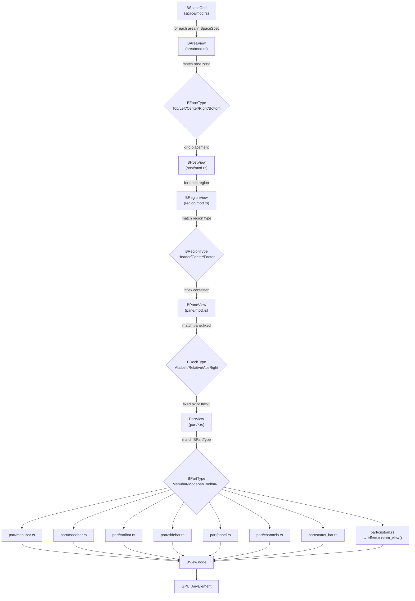
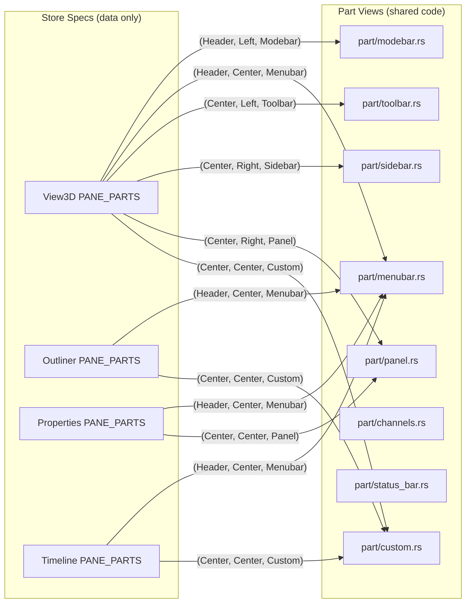

# Layout Space - Views (Hierarchy-Based)

> **Blender references:**
> - `BKE_screen.h` - `ARegionType.draw` callback (region rendering)
> - `space_view3d/space_view3d.c` - `view3d_main_region_draw()` (window region)
> - `space_view3d/space_view3d_header.c` - `view3d_header_region_draw()` (header)
> - Blender Manual: [`interface/window_system/regions.rst`](../../blender-manual/manual/interface/window_system/regions.rst)

---

## buikit Folder Structure

The `buikit/src/` folder mirrors the UI hierarchy exactly. Each level is a
folder. Parts are individual view files - one per `BPartType` variant. A part
view is reusable: any host that needs a `Toolbar` part uses the same
`part/toolbar.rs` view. The host only provides the data (menu items, tabs,
etc.) via store specs.

```
buikit/src/
  lib.rs                  - re-exports
  theme/                  - BTheme, colors, spacing
  tokens.rs               - design tokens
  icon.rs                 - icon registry
  modal.rs                - modal/popup overlay
  registry.rs             - BHostRegistry (host effect dispatch)
  state.rs                - BAreaState trait, RailState
  structure.rs            - BSpaceType, BHostType, BZoneType, BRegionType,
                            BPaneType, BDockType, BPartType, PaneSpec, PartSpec

  space/                  - LEVEL 1: SPACE
    mod.rs                - BSpaceGrid (grid of areas, reads SpaceSpec)
    grid.rs               - grid layout logic (fractions, rows, columns)

  area/                   - LEVEL 2: AREA
    mod.rs                - BAreaView (positions host in grid zone)
    zone.rs               - BZoneType → grid placement (Top/Left/Center/Right/Bottom)

  host/                   - LEVEL 3: HOST
    mod.rs                - BHostView (walks regions, delegates to part views)
    effect.rs             - BHostEffect trait (host_type, regions, custom_view)

  region/                 - LEVEL 4: REGION
    mod.rs                - BRegionView (container: hflex for all 3 types)
    header.rs             - Header region container (hflex, fixed height)
    center.rs             - Center region container (hflex, flex-1 fill)
    footer.rs             - Footer region container (hflex, fixed height)

  pane/                   - LEVEL 5: PANE
    mod.rs                - BPaneView (sizing: AbsLeft/AbsRight/Relative)
    sizing.rs             - BDockType → width/flex logic

  part/                   - LEVEL 6: PART (one file per BPartType)
    mod.rs                - re-exports, PartView trait
    menubar.rs            - BPartType::Menubar   → menu strip (File, Edit, View...)
    modebar.rs            - BPartType::Modebar   → mode tabs (Object, Edit, Sculpt...) with open/closed state
    toolbar.rs            - BPartType::Toolbar   → tool rail (select, move, rotate...)
    sidebar.rs            - BPartType::Sidebar   → N-panel tab strip (Item, Tool, View)
    panel.rs              - BPartType::Panel     → collapsible property panels
    channels.rs           - BPartType::Channels  → animation channel list
    status_bar.rs         - BPartType::Statusbar → footer status items
    tool_props.rs         - BPartType::ToolProps → tool settings strip
    preview.rs            - BPartType::Preview   → preview panel
    asset_shelf.rs        - BPartType::AssetShelf → asset browser strip
    adjust_last_op.rs     - BPartType::AdjustLastOp → redo panel
    custom.rs             - BPartType::Custom    → delegates to host effect

  views/                  - BView PRIMITIVES (not hierarchy levels)
    mod.rs                - BView enum, BViewNode, render dispatch
    types.rs              - BView enum variants (Row, Column, Grid, Label, Button...)
    render.rs             - BView → GPUI AnyElement conversion
    structural.rs         - Row (hflex), Column (vflex), Grid implementations
    controls.rs           - Button, Label, TextField, Slider primitives
    icon_rail.rs          - icon rendering helpers

  phiqui/                 - Phi-specific composite widgets (reusable across hosts)
    ...existing files...
```

### Key principle

Each folder is a hierarchy level. Each part file is a **reusable view** -
`part/toolbar.rs` renders a toolbar for ANY host that has a `Toolbar` part
in its store spec. The host doesn't implement its own toolbar rendering.
It just says "I have a Toolbar part in my Left pane" via static specs.

---

## Render Walk (Mermaid)



---

## Part Reuse (Mermaid)

A single part view serves all hosts. The host only provides data via store
specs - the view code is shared.



---

## Level 1: Space - `space/mod.rs`

```rust
//! BSpaceGrid - renders the workspace grid of areas.
//! Reads SpaceSpec to know which areas exist and their fractions.
//! Ref: Blender DNA_screen_types.h - bScreen

use gpui::{vflex, AnyElement, App, IntoElement, ParentElement, Styled};
use crate::area::BAreaView;
use crate::structure::{BSpaceType, BZoneType};
use crate::theme::BTheme;

pub struct BSpaceGrid {
    space_type: BSpaceType,
    theme: BTheme,
}

impl BSpaceGrid {
    pub fn new(space_type: BSpaceType, theme: BTheme) -> Self {
        Self { space_type, theme }
    }

    pub fn render(&self, cx: &App) -> AnyElement {
        let spec = store::spaces::space_spec(self.space_type);
        let mut grid = vflex().size_full();

        for area in spec.areas {
            let view = BAreaView::new(area, self.theme.clone());
            grid = grid.child(view.render(cx));
        }

        grid.into_any_element()
    }
}
```

---

## Level 2: BArea - `area/mod.rs`

```rust
//! BAreaView - places a host in the grid based on zone type.
//! Reads BArea to know which zone and which host.
//! Ref: Blender DNA_screen_types.h - ScrArea

use gpui::{vflex, hflex, AnyElement, App, IntoElement, ParentElement, Styled, px};
use crate::host::BHostView;
use crate::structure::{BZoneType, BHostType};
use crate::theme::BTheme;

pub struct BAreaView {
    zone: BZoneType,
    host: BHostType,
    fraction: f32,
    theme: BTheme,
}

impl BAreaView {
    pub fn new(assignment: BArea, theme: BTheme) -> Self {
        Self {
            zone: assignment.zone,
            host: assignment.default_host,
            fraction: assignment.fraction,
            theme,
        }
    }

    pub fn render(&self, cx: &App) -> AnyElement {
        // Zone determines grid placement (full-width strip vs column)
        let container = match self.zone {
            BZoneType::Top | BZoneType::Bottom => {
                hflex().w_full().h(px(self.fraction * 100.0))
            }
            BZoneType::Left | BZoneType::Right | BZoneType::Center => {
                vflex().flex_1()
            }
            BZoneType::Full => vflex().size_full(),
        };

        let host_view = BHostView::new(self.host, self.theme.clone());
        container.child(host_view.render(cx)).into_any_element()
    }
}
```

---

## Level 3: Host - `host/mod.rs`

```rust
//! BHostView - renders a host by walking its regions.
//! Reads HostSpec to know which regions exist and their panes.
//! Ref: Blender BKE_screen.h - SpaceType

use gpui::{vflex, AnyElement, App, IntoElement, ParentElement, Styled};
use crate::region::BRegionView;
use crate::structure::{BHostType, BRegionType};
use crate::theme::BTheme;

pub struct BHostView {
    host_type: BHostType,
    theme: BTheme,
}

impl BHostView {
    pub fn new(host_type: BHostType, theme: BTheme) -> Self {
        Self { host_type, theme }
    }

    pub fn render(&self, cx: &App) -> AnyElement {
        let spec = store::hosts::host_spec(self.host_type);
        let mut col = vflex().size_full();

        for region in spec.regions {
            let view = BRegionView::new(self.host_type, region, self.theme.clone());
            if let Some(elem) = view.render(cx) {
                col = col.child(elem);
            }
        }

        col.into_any_element()
    }
}
```

---

## Level 4: Region - `region/mod.rs`

```rust
//! BRegionView - container for panes within a region.
//! Only 3 region types. All use hflex. The difference is height:
//!   Header → fixed height (e.g. 32px)
//!   Center → flex-1 (fills remaining space)
//!   Footer → fixed height (e.g. 28px)
//! Ref: Blender DNA_screen_types.h - ARegion

use gpui::{hflex, AnyElement, App, IntoElement, ParentElement, Styled, px};
use crate::pane::BPaneView;
use crate::structure::{BHostType, BRegionType, BPaneType, BDockType, PaneSpec};
use crate::theme::BTheme;

pub struct BRegionView {
    host_type: BHostType,
    region: BRegionType,
    theme: BTheme,
}

impl BRegionView {
    pub fn new(host_type: BHostType, region: BRegionType, theme: BTheme) -> Self {
        Self { host_type, region, theme }
    }

    pub fn render(&self, cx: &App) -> Option<AnyElement> {
        let spec = store::hosts::host_spec(self.host_type);
        let panes = spec.region_panes(self.region)?;

        // All regions are hflex. Height differs by type.
        let container = match self.region {
            BRegionType::Header => hflex().w_full().h(px(32.0)),
            BRegionType::Center => hflex().size_full().flex_1(),
            BRegionType::Footer => hflex().w_full().h(px(28.0)),
        };

        let mut row = container;
        for pane_spec in panes {
            let view = BPaneView::new(self.host_type, self.region, pane_spec, self.theme.clone());
            if let Some(elem) = view.render(cx) {
                row = row.child(elem);
            }
        }

        Some(row.into_any_element())
    }
}
```

---

## Level 5: Pane - `pane/mod.rs`

```rust
//! BPaneView - sizing wrapper for parts within a region.
//! BDockType determines whether the pane is fixed-width or flex-fills.
//! The pane itself is a dumb layout slot - it just sizes itself and
//! stacks its child parts vertically (vflex).
//! Ref: Blender DNA_screen_types.h - AZone (conceptual)

use gpui::{vflex, AnyElement, App, IntoElement, ParentElement, Styled, px};
use crate::part::PartView;
use crate::structure::{
    BHostType, BRegionType, BPaneType, BDockType, BPartType, PaneSpec,
};
use crate::theme::BTheme;

pub struct BPaneView {
    host_type: BHostType,
    region: BRegionType,
    pane_spec: PaneSpec,
    theme: BTheme,
}

impl BPaneView {
    pub fn new(host_type: BHostType, region: BRegionType, pane_spec: PaneSpec, theme: BTheme) -> Self {
        Self { host_type, region, pane_spec, theme }
    }

    pub fn render(&self, cx: &App) -> Option<AnyElement> {
        let spec = store::hosts::host_spec(self.host_type);
        let parts = spec.pane_parts(self.region, self.pane_spec.pane_type);
        if parts.is_empty() { return None; }

        // Apply sizing based on BDockType
        let sized = match self.pane_spec.fixed {
            BDockType::AbsLeft | BDockType::AbsRight => {
                vflex().w(px(self.pane_spec.width))
            }
            BDockType::Relative => {
                vflex().flex_1()
            }
        };

        // Stack parts vertically within the pane
        let mut col = sized;
        for (part_type, items) in parts {
            let view = PartView::new(self.host_type, self.region, self.pane_spec.pane_type, part_type, items, self.theme.clone());
            col = col.child(view.render(cx));
        }

        Some(col.into_any_element())
    }
}
```

---

## Level 6: Part - `part/mod.rs` + individual files

```rust
//! PartView - dispatches to the correct part view based on BPartType.
//! Each BPartType has its own file in part/*.rs.
//! A part view is reusable across all hosts - it only needs MenuItemSpec data.
//! Ref: Blender BKE_screen.h - ARegionType.draw callbacks

use gpui::{AnyElement, App};
use crate::structure::{BHostType, BRegionType, BPaneType, BPartType};
use crate::theme::BTheme;
use crate::store::MenuItemSpec;

pub struct PartView {
    host_type: BHostType,
    region: BRegionType,
    pane: BPaneType,
    part_type: BPartType,
    items: &'static [MenuItemSpec],
    theme: BTheme,
}

impl PartView {
    pub fn new(
        host_type: BHostType,
        region: BRegionType,
        pane: BPaneType,
        part_type: BPartType,
        items: &'static [MenuItemSpec],
        theme: BTheme,
    ) -> Self {
        Self { host_type, region, pane, part_type, items, theme }
    }

    pub fn render(&self, cx: &App) -> AnyElement {
        match self.part_type {
            BPartType::Menubar       => super::menubar::render(self.items, &self.theme, cx),
            BPartType::Modebar       => super::modebar::render(self.items, &self.theme, cx),
            BPartType::Toolbar       => super::toolbar::render(self.items, &self.theme, cx),
            BPartType::Sidebar       => super::sidebar::render(self.items, &self.theme, cx),
            BPartType::Panel         => super::panel::render(self.items, &self.theme, cx),
            BPartType::Channels      => super::channels::render(self.items, &self.theme, cx),
            BPartType::Statusbar     => super::status_bar::render(self.items, &self.theme, cx),
            BPartType::ToolProps     => super::tool_props::render(self.items, &self.theme, cx),
            BPartType::Preview       => super::preview::render(self.items, &self.theme, cx),
            BPartType::AssetShelf    => super::asset_shelf::render(self.items, &self.theme, cx),
            BPartType::AdjustLastOp  => super::adjust_last_op::render(self.items, &self.theme, cx),
            BPartType::Custom        => super::custom::render(self.host_type, self.region, self.pane, cx),
        }
    }
}
```

### Example part view: `part/toolbar.rs`

```rust
//! Toolbar part - vertical tool rail with icon buttons.
//! Reusable by any host that has a Toolbar part in its store spec.
//! Ref: Blender space_view3d/space_view3d_tools.c

use gpui::{vflex, AnyElement, App, IntoElement, ParentElement, Styled, px};
use crate::theme::BTheme;
use crate::store::MenuItemSpec;
use crate::views::controls::IconButton;

pub fn render(items: &[MenuItemSpec], theme: &BTheme, _cx: &App) -> AnyElement {
    let mut col = vflex()
        .w(px(44.0))
        .h_full()
        .bg(theme.panel_bg)
        .border_r_1()
        .border_color(theme.border);

    for item in items {
        col = col.child(
            IconButton::new(item.id, item.icon, item.label.as_deref())
                .tooltip(item.tooltip)
        );
    }

    col.into_any_element()
}
```

### Example part view: `part/menubar.rs`

```rust
//! Menubar part - horizontal menu strip (File, Edit, View, etc.).
//! Reusable by any host that has a Menubar part in its store spec.
//! Ref: Blender space_view3d/space_view3d_header.c

use gpui::{hflex, AnyElement, App, IntoElement, ParentElement, Styled, px};
use crate::theme::BTheme;
use crate::store::MenuItemSpec;
use crate::views::controls::MenuButton;

pub fn render(items: &[MenuItemSpec], theme: &BTheme, _cx: &App) -> AnyElement {
    let mut row = hflex()
        .h_full()
        .items_center()
        .px(px(8.0))
        .bg(theme.header_bg);

    for item in items {
        row = row.child(
            MenuButton::new(item.id, &item.label)
                .dropdown_items(item.children)
        );
    }

    row.into_any_element()
}
```

### Example part view: `part/custom.rs`

```rust
//! Custom part - delegates to the host effect's custom_view().
//! This is the only part that is host-specific (viewport, outliner tree, etc.).
//! Ref: Blender ARegionType.draw callback for the main region

use gpui::{AnyElement, App, IntoElement};
use crate::structure::{BHostType, BRegionType, BPaneType};
use crate::registry::BHostRegistry;

pub fn render(
    host_type: BHostType,
    region: BRegionType,
    pane: BPaneType,
    cx: &App,
) -> AnyElement {
    let effect = BHostRegistry::get(host_type);
    effect
        .custom_view(region, pane, cx)
        .map(|bview| bview.into_any_element())
        .unwrap_or(vflex().into_any_element())
}
```

---

## Layout Space - Full View Tree

```
BSpaceGrid (Layout)
│
├─ Zone: Top
│  └─ BArea: { zone: Top, BHost: Topbar, fraction: 1.0 }
│       └─ Host: Topbar
│            └─ Header region (hflex, 32px)
│                 └─ Center pane (Relative) → Menubar part → part/menubar.rs
│
├─ Zone: Left
│  └─ BArea: { zone: Left, default_host: Outliner, fraction: 0.18 }
│       └─ Host: Outliner
│            ├─ Header region (hflex, 32px)
│            │    └─ Center pane (Relative) → Menubar part → part/menubar.rs
│            └─ Center region (hflex, flex-1)
│                 └─ Center pane (Relative) → Custom part → part/custom.rs → effect.custom_view()
│
├─ Zone: Center
│  └─ BArea: { zone: Center, default_host: View3D, fraction: 0.64 }
│       └─ Host: View3D
│            ├─ Header region (hflex, 32px)
│            │    ├─ Left pane (Relative) → Modebar part → part/modebar.rs
│            │    └─ Center pane (Relative) → Menubar part → part/menubar.rs
│            │
│            └─ Center region (hflex, flex-1 - 3 panes)
│                 ├─ Left pane (AbsLeft, 44px)   → Toolbar part → part/toolbar.rs
│                 ├─ Center pane (Relative)        → Custom part → part/custom.rs → effect.custom_view()
│                 └─ Right pane (AbsRight, 300px) → Sidebar part → part/sidebar.rs
│                 │                                    → Panel part → part/panel.rs
│                 │
│                 └─ (Center area also has Bottom sub-area: Timeline host, fraction: 0.28)
│
├─ Zone: Right
│  └─ BArea: { zone: Right, default_host: Properties, fraction: 0.18 }
│       └─ Host: Properties (switchable to Outliner, AssetBrowser, Spreadsheet)
│            ├─ Header region (hflex, 32px)
│            │    └─ Center pane (Relative) → Menubar part → part/menubar.rs
│            └─ Center region (hflex, flex-1)
│                 └─ Center pane (Relative) → Panel part → part/panel.rs
│
└─ Zone: Bottom
   └─ BArea: { zone: Bottom, default_host: Timeline, fraction: 0.28 }
        └─ Host: Timeline (switchable to DopeSheet, GraphEditor, Nla, Sequencer)
             ├─ Header region (hflex, 32px)
             │    └─ Center pane (Relative) → Menubar part → part/menubar.rs
             └─ Center region (hflex, flex-1)
                  └─ Center pane (Relative) → Custom part → part/custom.rs → effect.custom_view()
```

---

## BHostEffect Trait - `host/effect.rs`

The host effect only provides **custom rendering** for the viewport/main
content area. Everything else is rendered by the generic hierarchy walk
using store specs.

```rust
/// BHostEffect - provides custom rendering for host-specific content.
/// Ref: Blender's SpaceType struct with function pointers.
pub trait BHostEffect: Send + Sync {
    /// Which host type this effect serves.
    fn host_type(&self) -> BHostType;

    /// Custom BView for a (region, pane) that can't be rendered generically.
    /// Only (Center, Center) typically needs this - viewport, outliner tree,
    /// timeline ruler, node graph, etc.
    fn custom_view(
        &self,
        _region: BRegionType,
        _pane: BPaneType,
        _cx: &App,
    ) -> Option<BView> {
        None
    }
}
```

**Key difference from current code:** The effect no longer implements
`regions()`, `header()`, `region()`, `pane_specs()`, or `part_specs()`.
All of those are read from store specs by the generic view walk. The
effect only implements `custom_view()` for the one pane that needs
host-specific rendering.

---

## Region Container Types

| Region  | Container | Height     | Direction  |
|---------|-----------|------------|------------|
| Header  | hflex     | fixed 32px | horizontal |
| Center  | hflex     | flex-1     | horizontal |
| Footer  | hflex     | fixed 28px | horizontal |

Only 3 arms. One match, covers all hosts.

---

## Pane Sizing

| BDockType  | Width       | Behavior                    |
|-------------|-------------|-----------------------------|
| AbsLeft     | fixed px    | Docked left, doesn't shrink |
| Relative    | flex-1      | Fills remaining space       |
| AbsRight    | fixed px    | Docked right, doesn't shrink|

Only 2 arms (AbsLeft + AbsRight share the same logic). One match.

---

## Part View Dispatch

The part dispatch is a single match on `BPartType` (12 variants). Each arm
calls a function in `part/<name>.rs`. No host-specific logic in the dispatch -
the host only provides data via store specs.

```rust
match self.part_type {
    BPartType::Menubar      => menubar::render(items, theme, cx),
    BPartType::Modebar      => modebar::render(items, theme, cx),
    BPartType::Toolbar      => toolbar::render(items, theme, cx),
    BPartType::Sidebar      => sidebar::render(items, theme, cx),
    BPartType::Panel        => panel::render(items, theme, cx),
    BPartType::Channels     => channels::render(items, theme, cx),
    BPartType::Statusbar    => status_bar::render(items, theme, cx),
    BPartType::ToolProps    => tool_props::render(items, theme, cx),
    BPartType::Preview      => preview::render(items, theme, cx),
    BPartType::AssetShelf   => asset_shelf::render(items, theme, cx),
    BPartType::AdjustLastOp => adjust_last_op::render(items, theme, cx),
    BPartType::Custom       => custom::render(host_type, region, pane, cx),
}
```

Adding a new `BPartType` variant = add a new file in `part/` + one match arm.
Adding a new host = add store specs only, no view code.
