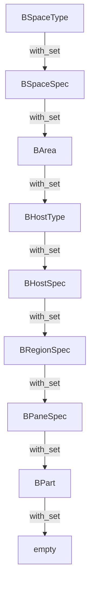

# Space / Host Hierarchy

This document describes the top-down flow from a `BSpaceType` to its `BPart` leaves using the `with_set` accessors added in the spec refactor.

## Flow



Each arrow is a call to the parent type/spec's `with_set()` method. The return type is a `&'static [Child]` slice, so the tree can be walked with simple nested `for` loops.

## Example traversal

The `print_hierarchy()` function in `crates/phiber/src/main.rs` prints the `BSpaceType::Layout` tree:

```rust
fn print_hierarchy() {
    let space = crate::store::BSpaceType::Layout.with_set();
    println!("Space: {}", space.idx.label());

    for area in space.with_set() {
        println!("  Area: {:?}", area.idx);

        for &host in area.with_set() {
            let host_spec = host.with_set();
            println!("    Host: {} ({})", host_spec.label(), host_spec.icon());

            for region in host_spec.with_set() {
                println!("      Region: {}", region.idx.label());

                for pane in region.with_set() {
                    println!("        Pane: {}", pane.idx.label());

                    for part in pane.with_set() {
                        println!("          Part: {}", part.idx.label());
                    }
                }
            }
        }
    }
}
```

## Current `Layout` output

```text
Space: Layout
  Area: Top
    Host: Top Bar (topbar)
      Region: Header
      Region: Center
  Area: Left
    Host: Outliner (outliner)
      Region: Header
      Region: Center
    Host: File Browser (file)
      Region: Header
      Region: Center
    Host: Asset Browser (asset)
      Region: Header
      Region: Center
    Host: Info (info)
      Region: Header
      Region: Center
  Area: Center
    Host: 3D Viewport (view3d)
      Region: Header
      Region: Center
      Region: Center
      Region: Center
    Host: Outliner (outliner)
      Region: Header
      Region: Center
    Host: Properties (properties)
      Region: Header
      Region: Center
    Host: File Browser (file)
      Region: Header
      Region: Center
    Host: Image Editor (image)
      Region: Header
      Region: Center
      Region: Center
      Region: Center
    Host: Info (info)
      Region: Header
      Region: Center
    Host: Video Sequencer (seq)
      Region: Header
      Region: Center
      Region: Center
      Region: Center
      Region: Center
    Host: Text Editor (text)
      Region: Header
      Region: Center
      Region: Center
      Region: Footer
    Host: Dope Sheet (action)
      Region: Header
      Region: Center
      Region: Center
      Region: Center
    Host: Non-Linear Animation (nla)
      Region: Header
      Region: Center
      Region: Center
      Region: Center
    Host: Timeline (time)
      Region: Header
      Region: Center
      Region: Center
    Host: Node Editor (node)
      Region: Header
      Region: Center
      Region: Center
    Host: Logic Editor (logic)
      Region: Header
      Region: Center
    Host: Python Console (console)
      Region: Header
      Region: Center
      Region: Center
    Host: UV Editor (uv)
      Region: Header
      Region: Center
      Region: Center
      Region: Center
    Host: Compositor (compositor)
      Region: Header
      Region: Center
      Region: Center
    Host: Shader Editor (shader)
      Region: Header
      Region: Center
      Region: Center
    Host: Geometry Nodes (geonode)
      Region: Header
      Region: Center
      Region: Center
    Host: Clip Editor (clip)
      Region: Header
      Region: Center
      Region: Center
      Region: Center
    Host: Drivers (drivers)
      Region: Header
      Region: Center
      Region: Center
      Region: Center
    Host: Asset Browser (asset)
      Region: Header
      Region: Center
    Host: Spreadsheet (spreadsheet)
      Region: Header
      Region: Center
    Host: Graph Editor (ipo)
      Region: Header
      Region: Center
      Region: Center
      Region: Center
    Host: Preferences (prefs)
      Region: Header
      Region: Center
  Area: Right
    Host: Properties (properties)
      Region: Header
      Region: Center
    Host: Outliner (outliner)
      Region: Header
      Region: Center
    Host: Asset Browser (asset)
      Region: Header
      Region: Center
    Host: Spreadsheet (spreadsheet)
      Region: Header
      Region: Center
  Area: Bottom
    Host: Timeline (time)
      Region: Header
      Region: Center
      Region: Center
    Host: Dope Sheet (action)
      Region: Header
      Region: Center
      Region: Center
      Region: Center
    Host: Non-Linear Animation (nla)
      Region: Header
      Region: Center
      Region: Center
      Region: Center
    Host: Video Sequencer (seq)
      Region: Header
      Region: Center
      Region: Center
      Region: Center
      Region: Center
```

## Notes

- `Pane` and `Part` levels are currently empty in the output because host `REGIONS` arrays are built with `panes: &[]` and pane `parts` arrays are not yet populated.
- Once `BRegionSpec` panes and `BPaneSpec` parts are wired, the same `print_hierarchy()` loop will print the full `Space -> Area -> Host -> Region -> Pane -> Part` tree without code changes.
