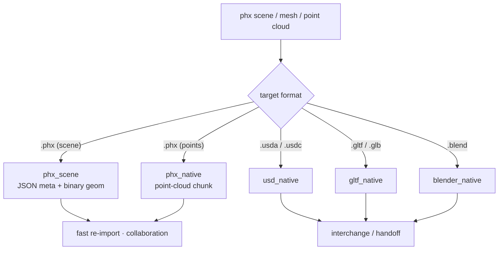
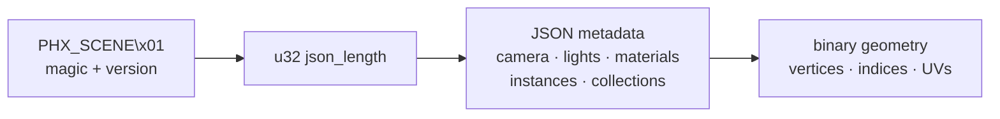
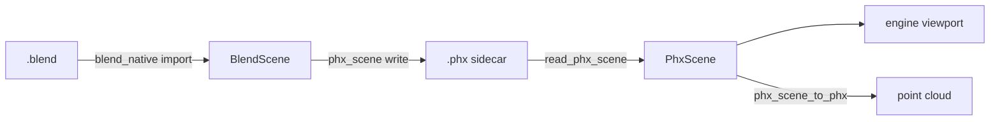

Writers that take phx geometry back out to disk. Like the importers, every
exporter is dependency-free — it emits the target format byte-for-byte without
Blender, OpenUSD, or a glTF SDK. The `.phx` writers are the centre of gravity:
they are the portable, fast-to-reload, collaboration-friendly format the rest
of the toolchain round-trips through.

## Overview

Where the importers narrow many formats down to phx types, the exporters fan
back out. A parsed scene can be persisted as a compact `.phx` (for fast
re-import and sharing), or transcoded to an interchange format (`.usda/.usdc`,
`.gltf/.glb`, `.blend`) for handoff to other tools.

Two `.phx` flavours exist:

* **`phx_native`** — a point-cloud chunk format (geometry only). Lightweight,
  used where just the silhouette/points matter.
* **`phx_scene`** — the richer scene format: a magic header + JSON metadata
  (camera, lights, materials, instances, collection hierarchy) followed by
  binary geometry. This is what a `.blend` import emits as its sidecar.

### Export fan-out

### `.phx` scene layout

### Round-trip with importers

## How is this module organized?

    exporters/
    ├── phx_scene.rs / phx_scene/    # rich scene format (meta + geometry) — the sidecar
    ├── phx_native.rs / phx_native/  # point-cloud chunk format
    ├── usd_native.rs / usd_native/  # USDA / USDC writer (mesh + point cloud)
    ├── gltf_native.rs / gltf_native/# glTF 2.0 writer (base64 buffers, mesh, points)
    ├── blender_native.rs / blender_native/ # .blend writer
    └── blender.rs                   # legacy Blender wrapper types

## Format summary

| Output | Module | Contents | Primary use |
|--------|--------|----------|-------------|
| `.phx` (scene) | `phx_scene` | camera, lights, materials, instances, hierarchy, geometry | fast re-import, collaboration sidecar |
| `.phx` (points) | `phx_native` | point-cloud chunk | lightweight geometry |
| `.usda` / `.usdc` | `usd_native` | mesh + point cloud | USD interchange |
| `.gltf` / `.glb` | `gltf_native` | mesh + point cloud, base64/embedded buffers | web/glTF interchange |
| `.blend` | `blender_native` | Blender scene | Blender round-trip |

## Key entry points

* `write_phx_scene` / `read_phx_scene` — round-trip the rich scene format.
* `export_phx_scene_to_bytes` / `import_phx_scene_from_bytes` — in-memory variants.
* `phx_scene_to_phx` — downconvert a scene to a plain point cloud.
* `export_mesh_usda` / `export_usdc` — USD writers.
* `export_mesh_gltf` / `export_point_cloud_glb` — glTF writers.

## Notes

* Each source file is kept ≤ 200 lines (project convention).
* `phx_scene` is the format the `.blend` importer writes as a freshness-gated
  sidecar (see `../importers/blend_native`), enabling instant re-import and
  on-the-fly collaboration.
