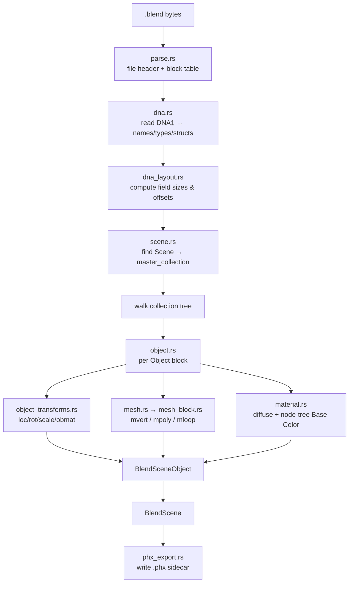
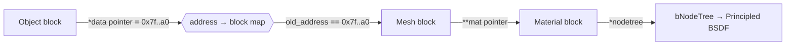

A dependency-free reader for Blender `.blend` files. It parses the binary SDNA
format directly — no Blender installation, no Python — and converts a scene
into the engine's `BlendScene` (collection tree + per-object geometry,
transforms, and materials).

## Overview

A `.blend` file is not a document format; it is a snapshot of Blender's
in-memory C structs written verbatim to disk. To read one back you need the
schema those structs were written with, and Blender helpfully embeds it: a
special `DNA1` block (the **SDNA**, "Structure DNA") describes every struct's
name, its fields, and their types. Parsing therefore happens in two passes:

1. **Block + DNA parse** — read the file header (pointer size + endianness),
   then every data block (a `BHEAD` header followed by its payload), and
   finally the `DNA1` block that defines every struct's field layout.
2. **Scene extraction** — using the DNA layout, walk the `Scene` →
   `master_collection` hierarchy, resolve each `Object`'s transform, mesh
   (`Object.*data → Mesh`), and material (`Object`/`Mesh` `**mat → Material`,
   including the Principled BSDF *Base Color* read out of the shader node tree).

Pointers in the dump are the original runtime memory addresses. The importer
resolves a link by matching a struct field's stored pointer value against each
block's saved `old_address`, effectively rebuilding the in-memory graph. Field
byte offsets are computed from the DNA at runtime rather than hard-coded, which
keeps the reader tolerant across Blender versions whose struct layouts differ.

Every successful import also writes a portable [`.phx`](../../exporters/phx_scene.rs)
sidecar next to the source blend (see `phx_export`) so the scene re-imports
instantly and can be shared for collaboration.

### Two-pass parse



### Pointer resolution

A field that holds a pointer is dereferenced by address lookup, not by file
offset — this is how the flat block list is turned back into a graph:



### Material resolution order

Base color is sought in priority order so the most authored value wins:

```mermaid
flowchart LR
    A[Object.**mat] -->|found| Z[Material]
    A -->|none| B[Object.*data → Mesh.**mat]
    B --> Z
    Z --> C{nodetree present?}
    C -->|yes| D[Principled BSDF<br/>"Base Color" socket RGBA]
    C -->|no| E[Material.r/g/b/a<br/>roughness · metallic]
```

## Key entry points

* `import_blend_native(path) -> BlendScene` — the public entry; parses the file
  and emits the `.phx` sidecar.
* `BlendScene { collections, objects }` — the result: a recursive
  `BlendCollection` tree (with per-collection `object_indices`) plus a flat list
  of `BlendSceneObject` (vertices, faces, `matrix_world`, `base_color`,
  `roughness`, `metallic`).

## How is this module organized?

    blend_native.rs                 # module root: re-exports + import_blend_native + tests
    blend_native/
    ├── types.rs                    # structs (BlendHeader/Block/Dna*, BlendScene/Collection/Object) + constants
    ├── parse.rs                    # file header + data-block reader
    ├── dna.rs                      # SDNA schema parser (names/types/structs)
    ├── dna_layout.rs               # field sizes, byte offsets, pointer reads
    ├── readers.rs                  # little-endian primitive readers (f32/u16/i32/u64)
    ├── scene.rs                    # Scene + recursive collection-hierarchy extraction
    ├── object.rs                   # Object block → BlendSceneObject assembly
    ├── object_meta.rs              # modifiers + instance-collection detection
    ├── object_transforms.rs        # loc/rot/scale/obmat + object-type decode
    ├── mesh.rs                     # Object → its Mesh block; vertex/face dispatch
    ├── mesh_block.rs               # decode mvert / mpoly / mloop arrays
    ├── material.rs                 # first Material → diffuse + Principled node-tree Base Color
    └── phx_export.rs               # BlendScene → .phx sidecar writer (collaboration)

## Why the split?

The reader began life as one 1490-line file. It was broken into the modules
above so each concern is independently readable and every file stays ≤ 200
lines (project convention). The seams follow the parse phases: raw bytes
(`parse`/`readers`), schema (`dna`/`dna_layout`), and semantic extraction
(`scene`/`object`/`mesh`/`material`). The `phx_export` seam keeps the
collaboration sidecar logic out of the hot parse path.

## Known limitations

* **Per-object mesh resolution** follows each `Object`'s own `*data` pointer to
  its dedicated `Mesh` block, so distinct objects report distinct vertex
  counts (an earlier bug collapsed them all into one shared block).
* **Image-texture colour is not yet resolved.** Only flat/material colour and
  the Principled *Base Color* constant are read; UV-mapped image textures still
  render as their fallback colour. See `reality_composer_pro/tasks.md` Phase B
  (J4) for the planned UV + image-extraction + GPU-sampling path.
* **Modifiers are detected, not evaluated** — geometry is read as stored, so a
  non-applied subdivision or mirror modifier is not expanded.

## Notes

* Each source file is kept ≤ 200 lines (project convention).
* The `.phx` sidecar is freshness-gated: it is only rewritten when the source
  `.blend` is newer, so repeated imports skip the export cost.
