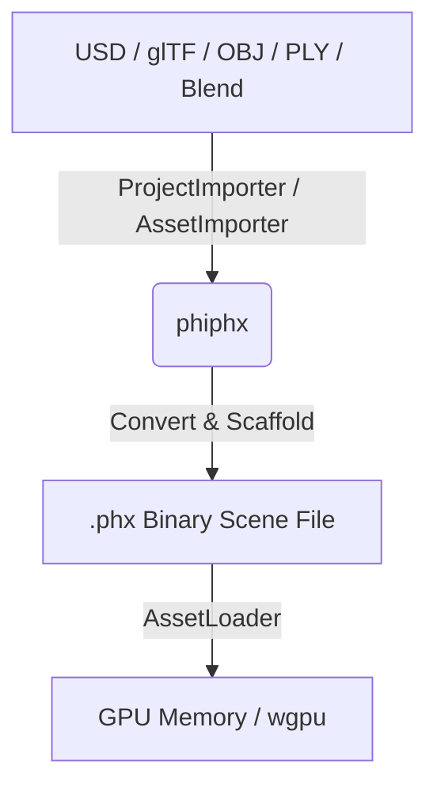

# Asset Conversion & Loading Pipeline Flow

This document details the unified workflow for importing, converting, and rendering 3D assets in the PHX workspace.

## Overview

The asset pipeline is divided into two distinct responsibilities to isolate complex parsing from the rendering engine:

1. **PHI Point Cloud eXtension (`phiphx` Crate)**: Handles the "heavy lifting" of asset import. It parses multi-format inputs (USD, glTF, OBJ, PLY, Blend) and generates a unified, optimized `.phx` binary format.
2. **AppKit GPU Renderer (`apple` Crate)**: Serves as a single, lightweight bridge that loads only `.phx` and programmatic buffers directly into GPU memory (`wgpu`).

## Step-by-Step Flow

### 1. Unified Import Dispatch
All raw assets are passed to `AssetImporter::import` which maps the extension to the corresponding `FileFormat` enum variant:
* **Blend**: Parsed by `BlendImporter` using the native SDNA binary parser.
* **glTF / GLB**: Parsed by `GltfImporter`.
* **USD / USDA / USDC / USDZ**: Parsed by `UsdImporter`.
* **PLY**: Parsed by `PlyImporter`.
* **PHX**: Parsed directly by `PhxImporter`.

### 2. Sidecar & Scaffolding
* High-level formats are converted to `.phx` scenes.
* Textures and hierarchy data are laid out in a scaffolding directory, yielding an `AssetImportResult`.

### 3. GPU Loading Bridge
* The GPU layer (`AssetLoader::load_mesh`) receives the `.phx` path.
* It parses the `.phx` binary scene data, extracts positions, normals, colors, and UVs, and creates a unified `MeshBuffer` on the GPU.
