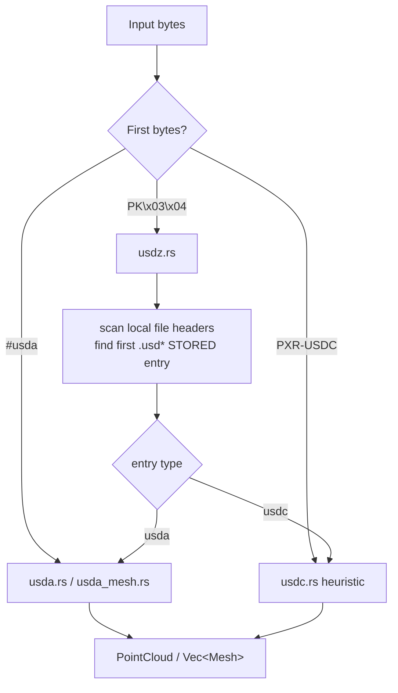
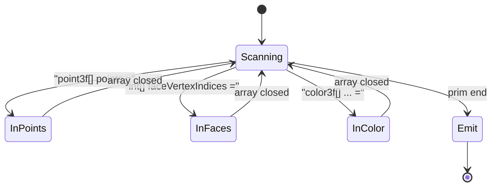
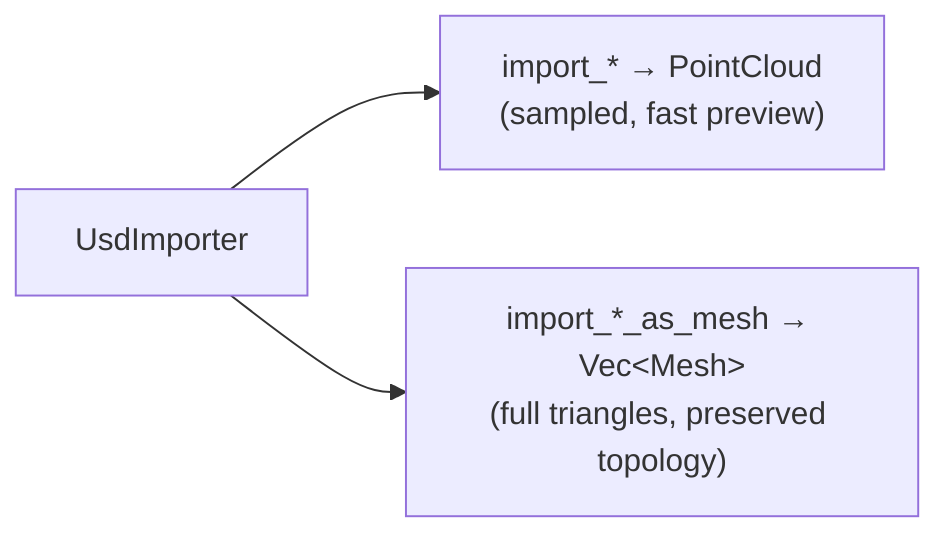

Converts Universal Scene Description files into point clouds or full meshes
without the OpenUSD C++ library. Handles ASCII (`.usda`), the zip container
(`.usdz`), and a heuristic reader for the binary crate format (`.usdc`).

## Overview

USD ships in three skins that share one logical scene model. `.usda` is a
human-readable text format; `.usdc` is the compact binary "crate" format with a
B-tree of typed fields; `.usdz` is an uncompressed zip wrapping one or more of
the former. Implementing the full OpenUSD stack is a large native dependency,
so this importer instead sniffs the input and dispatches to the lightest reader
that can recover usable geometry.

`UsdImporter` dispatches by signature:

* `#usda` → ASCII parser (a line-oriented state machine that accumulates
  `point3f[] points`, `int[] faceVertexIndices`, and friends).
* `PXR-USDC` → binary crate heuristic. Rather than decode the full crate
  B-tree, it scans for the largest contiguous run of valid `f32` triples — a
  recognisable silhouette of the mesh without a complete parser.
* `PK\x03\x04` → USDZ. The spec mandates an *uncompressed* (STORED),
  64-byte-aligned zip, so the first `.usd*` entry is located by scanning local
  file headers, and its payload is handed to the USDA/USDC path.

Two output shapes are supported: a sampled `PointCloud` (`import_*`) for quick
previews, and full triangle `Mesh`es that preserve topology
(`import_*_as_mesh`).

### Detection & dispatch

### USDA state machine

The ASCII reader walks tokens, flips attribute flags, and accumulates arrays
until a prim closes:

## Output shapes

## How is this module organized?

    usd.rs                  # module root: UsdImporter detection + dispatch + sample USDA
    usd/
    ├── importer.rs         # UsdImporter struct + public entry points (file/bytes, cloud/mesh)
    ├── parse.rs            # low-level array parsers (vec3 / color / int arrays)
    ├── usda.rs             # USDA → point cloud
    ├── usda_mesh.rs        # USDA → Vec<Mesh> (preserves triangles)
    ├── usda_parse.rs       # shared USDA state-machine helpers (attr flags, accumulate, faces)
    ├── usdc.rs             # USDC binary heuristic (cloud + mesh)
    ├── usdz.rs             # USDZ STORED-zip extraction → USDA/USDC dispatch
    └── tests.rs            # detection + sample-parse smoke tests

## Fidelity by format

| Format | Reader | Geometry fidelity | Notes |
|--------|--------|-------------------|-------|
| `.usda` | `usda` / `usda_mesh` | full | authoritative text parse |
| `.usdc` | `usdc` | approximate | heuristic f32-run scan, no crate B-tree |
| `.usdz` | `usdz` | depends on inner entry | STORED zip only; routes to usda/usdc |

## Known limitations

* **USDC is heuristic, not a full crate decoder** — geometry is approximate and
  per-prim metadata (names, materials) is not recovered. A real crate B-tree
  decoder is future work.
* **`.usdz` handles STORED entries only**, per the USDZ spec which forbids
  compression for alignment reasons. Deflated archives are out of scope until a
  zip/inflate dependency is acceptable.
* **No material/shader graph** — USD `Material`/`Shader` prims are skipped; only
  geometry is reconstructed.

## Notes

* Each source file is kept ≤ 200 lines (project convention).
* Detection is signature-first, so a `.usd` file with any of the three payloads
  routes correctly regardless of its extension.
