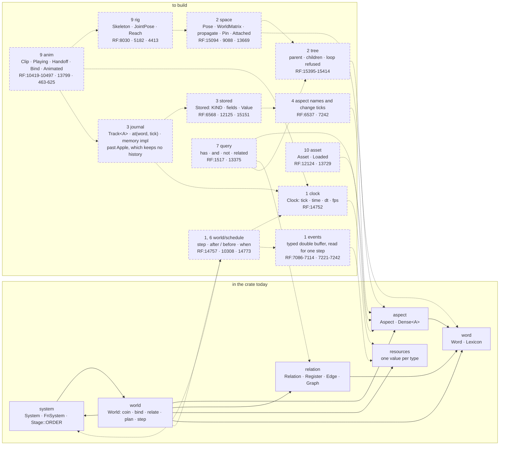
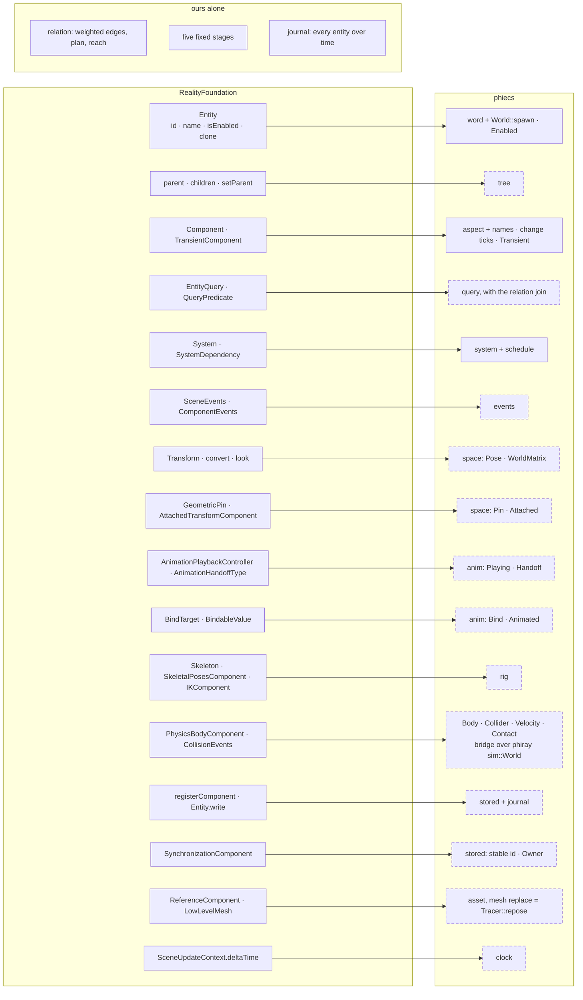

# phiecs — architecture

Solid boxes are in the crate today. Dashed boxes are to build; the number is
their place in the order of work, and `RF:n` is the line of Apple's
RealityFoundation interface the box answers.

## The modules and what they use

## Apple's contract, and where each part lands

## Pages, one subject each

- [step](docs/step.md): one tick, the five stages, ordering inside a stage
- [space](docs/space.md): tree, pose, world matrix, pins
- [time](docs/time.md): clock, journal, saving, a Blender frame as a tick
- [character](docs/character.md): skeleton, joint pose, playing, handoff, reach
- [bridges](docs/bridges.md): what stands on the world and what it hands to

Folders and order of work: [PLAN.md](PLAN.md) ·
What each part must do: [SPECS.md](SPECS.md) ·
The contract row by row: [docs/APPLE.md](docs/APPLE.md) ·
Where the interfaces are on disk: [reference/README.md](reference/README.md) ·
What is left to do: [TODO.md](TODO.md)
