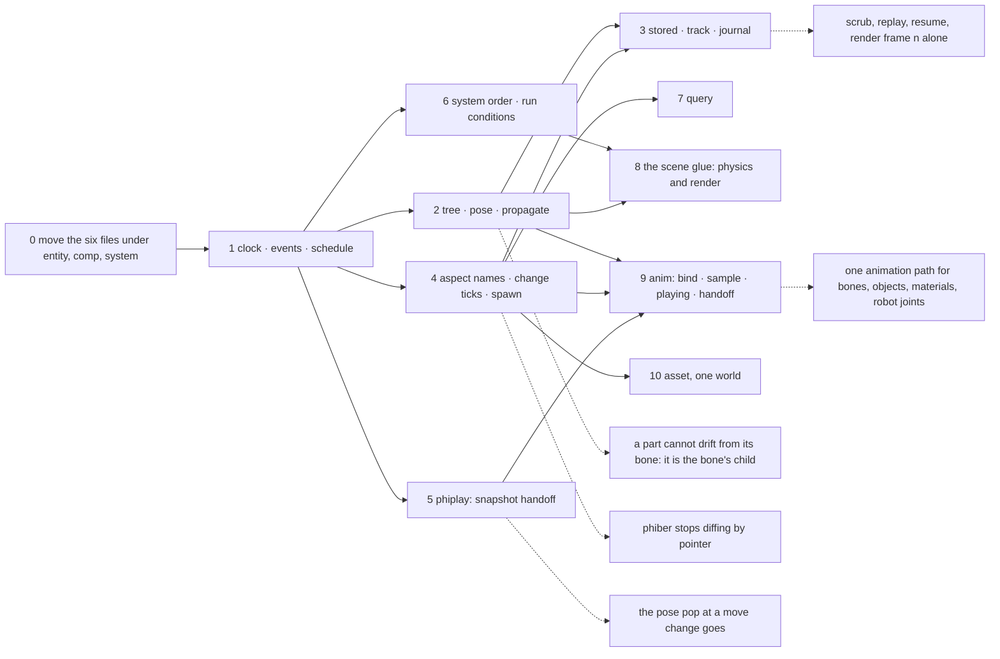
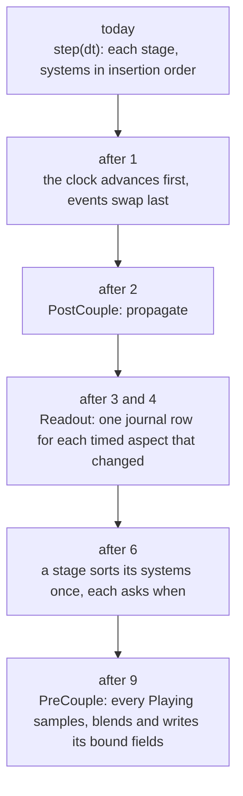

# phiecs — plan

The folder tree, today and suggested, and the order to build it in. What
each part must do is in [SPECS.md](SPECS.md); the diagrams are in
[ARCHITECTURE.md](ARCHITECTURE.md). Line counts for new files are estimates.

Two rules shape the tree:

- **Three main folders: `entity`, `comp`, `system`.** Everything else is a
  subfolder of one of them, so a logical unit (space, anim, time) has its
  data under `comp/` and its logic under `system/`, by the same name.
- **phiecs holds only what is general.** A bone, a robot link, a scene
  object, a sensor and a pin are all words with a `Pose` in one `Tree`.
  There is no skeleton type here: the rig is phiphx's asset, and phiecs
  animates any field of any aspect by one path.

## The folder tree

| Path | Holds | State | Lines | Order |
|---|---|---|---|---|
| `src/lib.rs` | the three modules; a prelude that keeps today's paths | done: re-exports every old path; the prelude grew | 36 | - |
| **`src/entity/`** | **what a thing is and how things are linked** | | | |
| `entity/word.rs` | `Word`, `Lexicon` | done: moved from `src/word.rs` | 83 | - |
| `entity/kind.rs` | `Kind`: the type of an entity, declared from a list passed in | done: `Kind`, `KindList`, `KindOf`; `declare_kinds`, `kind`, `kind_of` | 85 | 4 |
| `entity/spawn.rs` | `coin`, `spawn(kind)`, `forget`, `Enabled` | done: `spawn`, `spawn_named`, `Name`, `Enabled`; `coin` and `forget` stay in `world/mod.rs` (`forget` emits `WillRemove`) | 149 | 4 |
| `entity/tree.rs` | `Tree`: parent, children, loop refused; `set_parent` | done: from phinet `node/tree.rs`, plus `set_parent`, `clear_parent`, `pin`, `world_of`, `DidReparent` | 178 | 2 |
| `entity/relation.rs` | `Relation`, `Register`, `Edge`, `Graph` | done: moved from `src/relation.rs` | 173 | - |
| `entity/plan.rs` | `plan`, `reach` over relations | done: moved from `world/plan.rs` | 69 | - |
| `entity/query.rs` | `Query`: `has`, `and`, `not`, `related` | new | ~150 | 7 |
| `entity/world/mod.rs` | `World`: the container; bind, read | done: moved from `world/mod.rs`; holds `tree`, the `Clock` and `EventQueue` resources | 156 | - |
| `entity/world/relate.rs` | `declare`, `relate`, `calls_for` | done: moved from `world/relate.rs` | 44 | - |
| **`src/comp/`** | **data bound to a thing** | | | |
| `comp/aspect.rs` | `Aspect`, `Dense<A>`; then names, change ticks, `Transient` | done: `Aspect::name`, `TRANSIENT`, a changed tick a slot; `world/change.rs` has `aspect_list`, `changed`, `changed_since`; `DidChange` in `system/event.rs` | 103 | 4 |
| `comp/resources.rs` | one value per type | done: moved from `src/resources.rs` | 32 | - |
| `comp/stored.rs` | `Stored`, `Value`, stable id, `Owner` | done: `Stored`, `Value`, `Fields`, `stable_id`, `Owner`; `stored/md5.rs` by hand; `stored/entry.rs` the registry; `comp/space/save.rs` stores `Pose` and `WorldMatrix` | ~120 | 3 |
| `comp/space/pose.rs` | `Pose`, `WorldMatrix`, the 4x4 arithmetic | done | 187 | 2 |
| `comp/time/clock.rs` | `Clock { tick, time, dt, fps }` | done | 65 | 1 |
| `comp/time/track.rs` | `Track<A>`: sparse ticks and values | done: `Track<A>` | ~85 | 3 |
| `comp/time/journal.rs` | the `Journal` trait, the in-memory journal | done: `Journal`, `MemoryJournal`, `Row` | ~100 | 3 |
| `comp/anim/bind.rs` | `Bind { word, aspect, field }`, `Animated<T> { base, live }` | new | ~70 | 9 |
| `comp/anim/sample.rs` | the `Sample` trait: values at a time, written into bound fields | new | ~50 | 9 |
| `comp/anim/playing.rs` | `Playing`, `Handoff`, the blend rule a field kind | new; the snapshot half exists in phiplay `play/handoff.rs` (step 5) | ~120 | 9 |
| `comp/anim/channel.rs` | `ChannelSet`: a flat run of numbers with a layout, for what is not a transform | new | ~60 | 9 |
| `comp/asset.rs` | `Asset { kind, key }`, `Loaded` | new | ~80 | 10 |
| **`src/system/`** | **logic, run in stage order** | | | |
| `system/stage.rs` | `Stage`, `System`, `FnSystem`; then `after`, `before`, `when` | done: moved from `src/system.rs`; grows at 6 | 99 to ~150 | 6 |
| `system/schedule.rs` | `add_system`, `step`, the sort inside a stage | done for 1: `add_system`, `step` from `world/mod.rs`; the sort and `when` wait for 6 | 87 | 1, 6 |
| `system/layer.rs` | the layered traits: `PerKind`, the roles `Intake`, `Animate`, `Simulate`, `Constrain`, `Readout`, and `Plugin` | new | ~140 | 6 |
| `system/event.rs` | `EventQueue`: typed double buffer | done: `EventQueue`, `DidAdd`, `WillRemove` | 135 | 1 |
| `system/sink.rs` | `Sink`: where rows and events go: memory here, the session file and the database outside | done: `Sink`, `MemorySink` | ~50 | 3 |
| `system/space/propagate.rs` | PostCouple: world matrix from the tree, parents first | done: `propagate` | 82 | 2 |
| `system/time/record.rs` | Readout: one journal row for each timed aspect that changed; `at`, `seek`, `dump`, `load` | done: `Recorder`, `record`, `World::at`; `seek.rs` and `dump.rs` beside it | ~90 | 3 |
| `system/anim/advance.rs` | PreCouple: advance time, sample, blend, write the bound fields | new | ~110 | 9 |
| `system/anim/handoff.rs` | the snapshot of bound fields a new source blends from | new | ~80 | 9 |
| `docs/`, `reference/` | pages and the index of Apple's interfaces | exists | - | - |

The crate keeps no dependencies, so it reads no files: tables are read by
the app crate and passed in. Moving the six existing files changes no
public path: `lib.rs` re-exports them where they are today.

## What is not here, and where it is

| Concept | Owner | How phiecs meets it |
|---|---|---|
| a rig: rest pose, weights, bone names | phiphx | bones are words in the `Tree`; the word holds an `Asset` handle |
| a clip and how its curves evaluate | phiphx `blend/anim` | it implements `Sample` |
| the pose solve: constraints, IK | phiphx `blend/rig` | one PostCouple system, registered by the scene glue |
| drawing, skinning on the GPU | phiray | a Readout system reads change ticks |
| bodies and contact | phiray `sim` | a Couple system owns the simulation |
| a pin | nobody: it is a word | a named child of a bone, with an offset `Pose` |
| the record on disk | philog, the session file | a `Sink`, attached at start |
| the stored world | phiora: `kinds`, `items`, `links`, `log` | a `Sink`; kinds declared once for both ([docs/connect.md](docs/connect.md)) |
| data files | the lexfile format of `phistd` | the app reads them and passes the lists in |

The glue that turns a phiphx scene into words and drives phiray from the
world is one shared crate (suggested in [the root plan](../../../PLAN.md)),
not a bridge in every app.

## Order of work

## How a step grows

