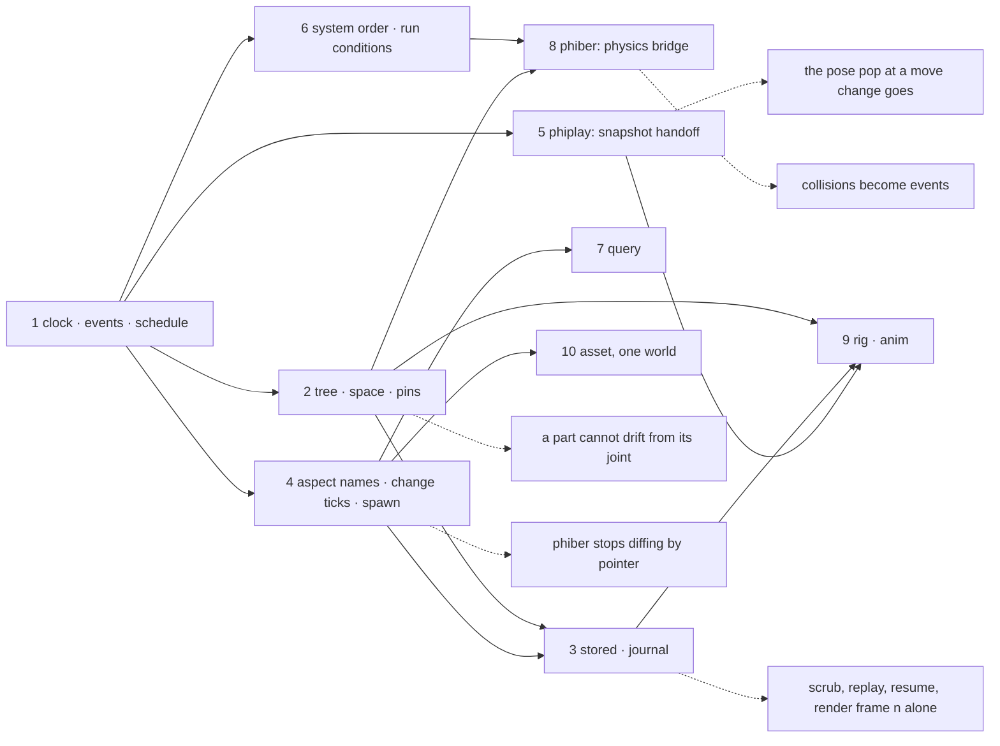
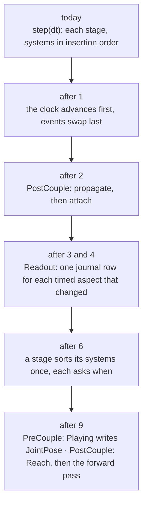

# phiecs — plan

The folder tree, today and suggested, and the order to build it in. What
each part must do is in [SPECS.md](SPECS.md); the diagrams are in
[ARCHITECTURE.md](ARCHITECTURE.md). Line counts for new files are estimates.

## The folder tree

| Path | Holds | State | Lines | Order |
|---|---|---|---|---|
| `src/lib.rs` | modules, prelude | exists | 31 | - |
| `src/word.rs` | `Word`, `Lexicon` | exists | 83 | - |
| `src/relation.rs` | `Relation`, `Register`, `Edge`, `Graph` | exists | 173 | - |
| `src/resources.rs` | one value per type | exists | 32 | - |
| `src/aspect.rs` | `Aspect`, `Dense<A>`; then names, change ticks, `Transient` | exists, grows | 73 to ~140 | 4 |
| `src/system.rs` | `System`, `FnSystem`, `Stage`; then `after`, `before`, `when` | exists, grows | 99 to ~150 | 6 |
| `src/world/mod.rs` | `World`: binding, reading | exists | 156 | - |
| `src/world/relate.rs` | `declare`, `relate`, `calls_for` | exists | 44 | - |
| `src/world/plan.rs` | `plan`, `reach` | exists | 69 | - |
| `src/world/schedule.rs` | `add_system`, `step`, the sort inside a stage | new, moved out of `mod.rs` | ~110 | 1, 6 |
| `src/world/spawn.rs` | `coin`, `spawn(kind)`, `forget`, `Enabled` | new, moved out of `mod.rs` | ~90 | 4 |
| `src/clock.rs` | `Clock { tick, time, dt, fps }` | new | ~50 | 1 |
| `src/events.rs` | `Events`: typed double buffer | new | ~120 | 1 |
| `src/tree.rs` | `Tree`: parent, children, loop refused | new, from phinet `node/tree.rs` | 95 | 2 |
| `src/space/pose.rs` | `Pose`, `WorldMatrix`, the 4x4 arithmetic | new | ~90 | 2 |
| `src/space/propagate.rs` | the PostCouple system, `set_parent` | new | ~90 | 2 |
| `src/space/pin.rs` | `Pin`, `Attached` | new | ~70 | 2 |
| `src/stored.rs` | `Stored`, `Value`, stable id, `Owner` | new | ~70 | 3 |
| `src/journal/mod.rs` | `Journal` trait, `World::at`, `seek`, `dump`, `load` | new | ~110 | 3 |
| `src/journal/memory.rs` | the in-memory journal | new | ~90 | 3 |
| `src/journal/track.rs` | `Track<A>`: sparse ticks and values | new | ~90 | 3 |
| `src/query.rs` | `Query`: `has`, `and`, `not`, `related` | new | ~150 | 7 |
| `src/rig/skeleton.rs` | `Skeleton`, its check, the name index | new | ~110 | 9 |
| `src/rig/pose.rs` | `Rig`, `Identity`, `JointPose`, the forward pass | new | ~90 | 9 |
| `src/rig/reach.rs` | `Reach` | new | ~40 | 9 |
| `src/anim/clip.rs` | `Clip`: the header only | new | ~50 | 9 |
| `src/anim/playing.rs` | `Playing`, `Handoff`, the joint blend | new | ~110 | 9 |
| `src/anim/bind.rs` | `Bind`, `Animated<T>` | new | ~60 | 9 |
| `src/asset.rs` | `Asset`, `Loaded` | new | ~80 | 10 |
| `docs/` | `APPLE.md` and one diagram page a subject | exists | - | - |
| `reference/README.md` | where Apple's interfaces are on disk | exists | - | - |

The crate keeps no dependencies, so it reads no files: tables such as pin
names and blend lengths are read by the app crate and passed in.

## Outside the crate

| Path | Holds | State | Order |
|---|---|---|---|
| `phiplay/src/play/handoff.rs` | snapshot handoff, replacing the one `was` slot | new, ~80 | 5 |
| `phiber/src/scene/sim/ecs.rs` | `Body`, `Collider`, `Velocity`, `Contact` over `phiray::sim::World` | new, ~180 | 8 |
| `phiber/.../rendered/place.rs` | reads change ticks in place of the pointer diff | changes | 4 |
| a journal on a database | `Journal` over phiora's table `items(kind, id, slug, doc)` | new, ~200, in the app | 3 |
| the phiecs repo in phinet | a feature gate so phikit takes the core with no phinet path | changes | before 3 |

## Order of work

## How a step grows

