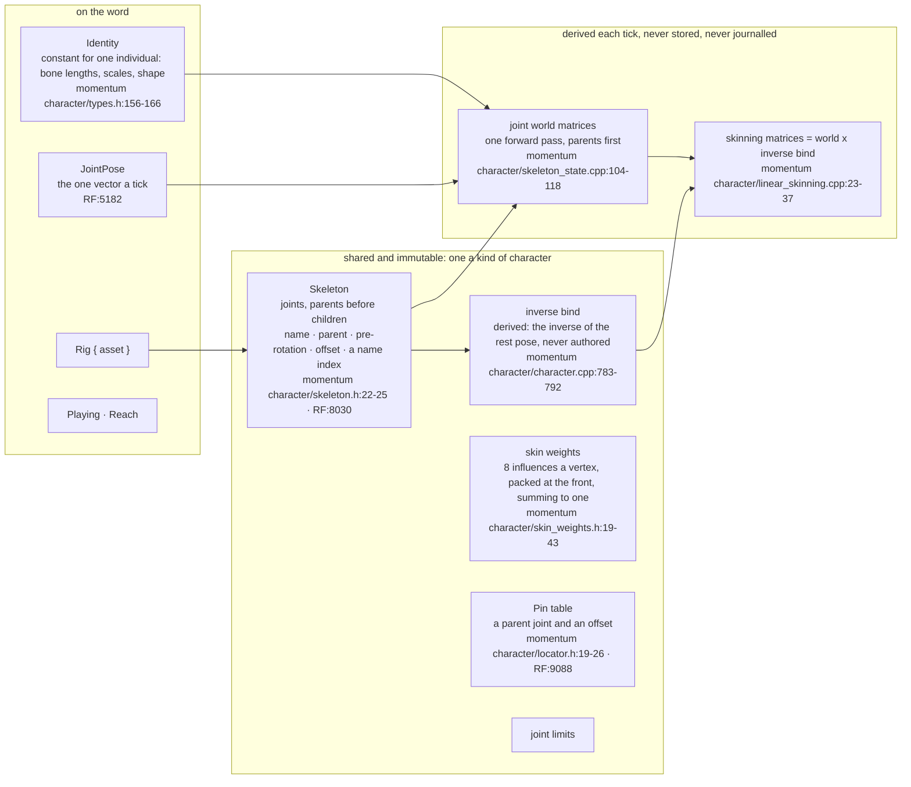
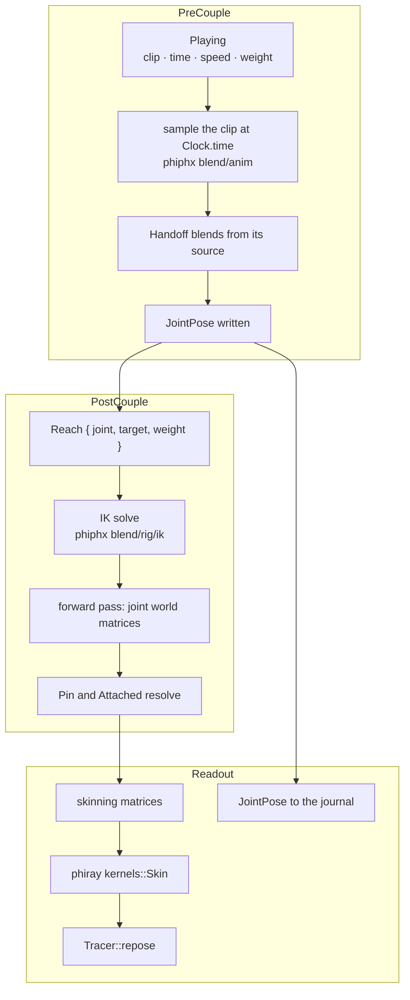
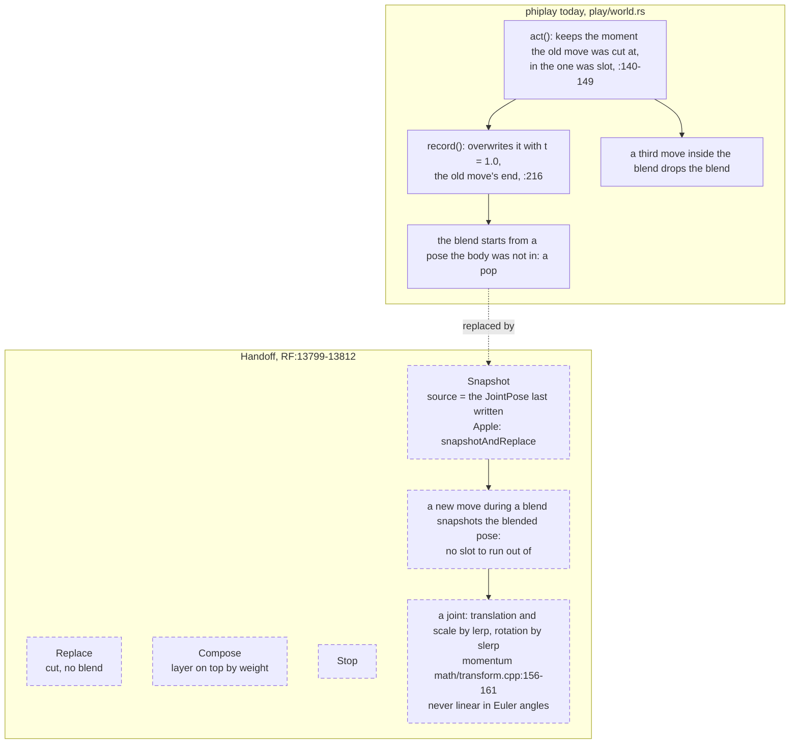
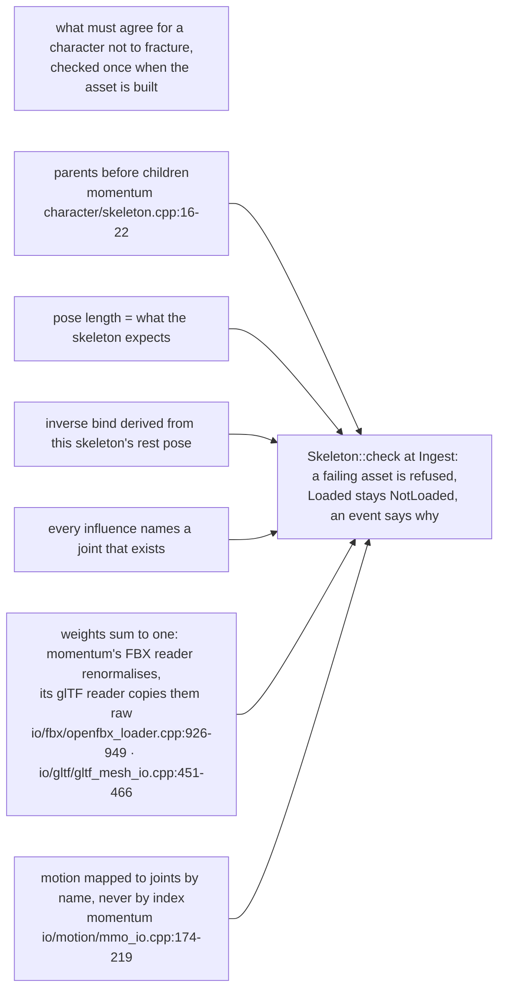

# character

Every box is to build unless it names a file. The split between asset and
state is momentum's (`phiphx/reference/momentum`): its `Character` is shared
and const, a pose is one vector a frame, and everything else is recomputed.

