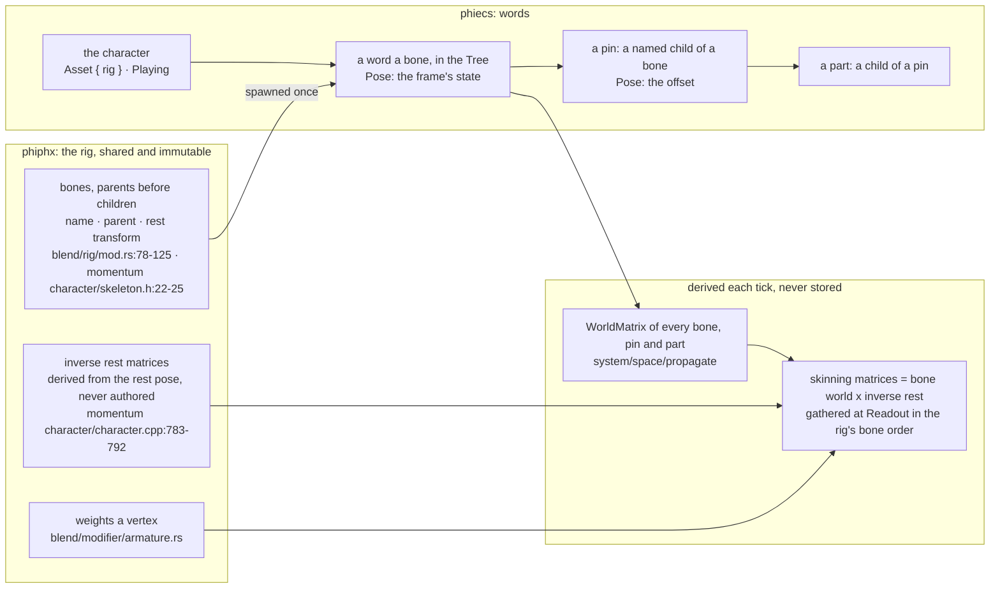
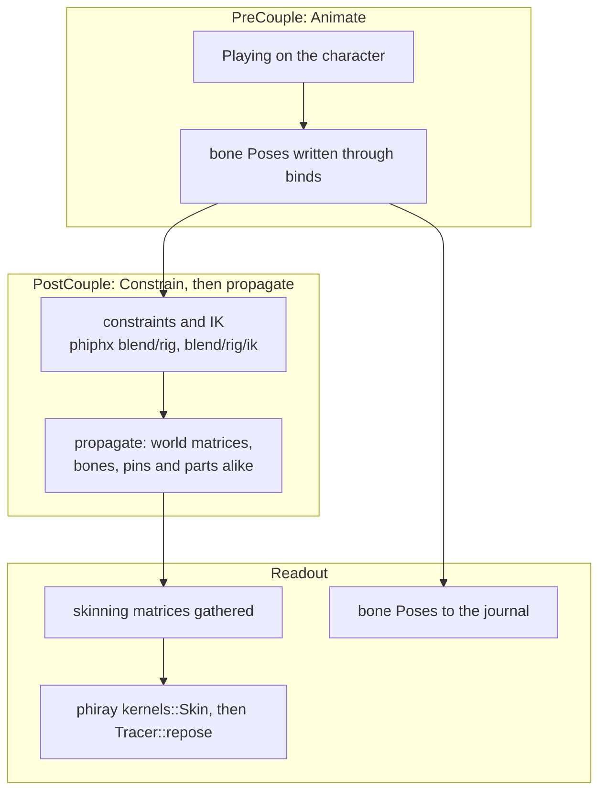
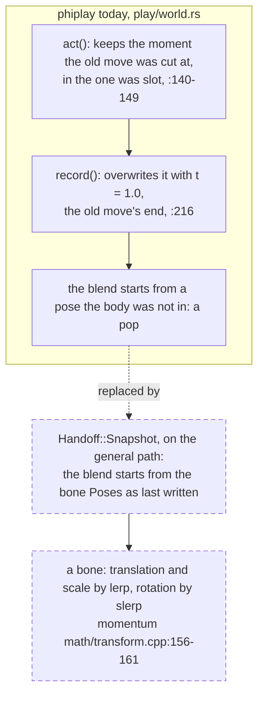
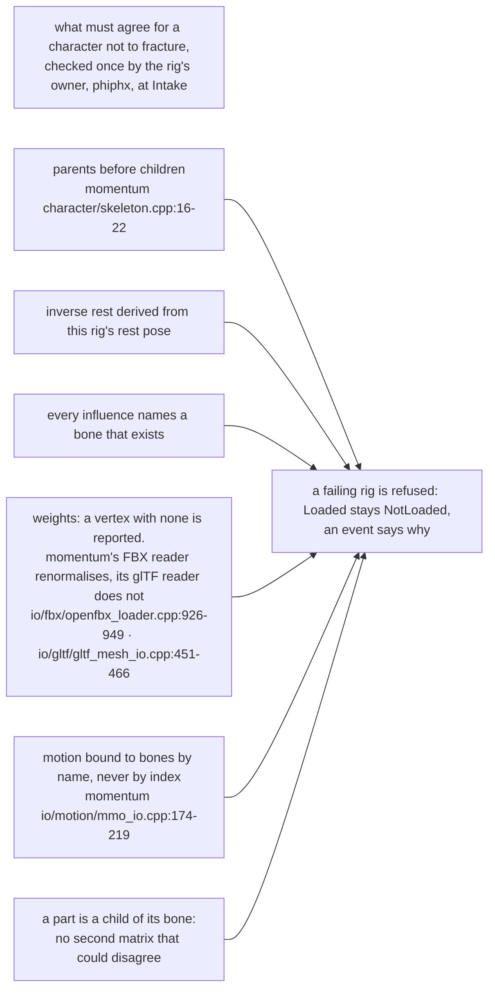

# character

A character is not a special case here: its bones are words in the tree and
it moves by the path in [anim](anim.md). Every box is to build unless it
names a file. The split between what is shared and what is a frame's state
is momentum's (`phiphx/reference/momentum`): its `Character` is shared and
const, a pose is one vector a frame, everything else is recomputed.

