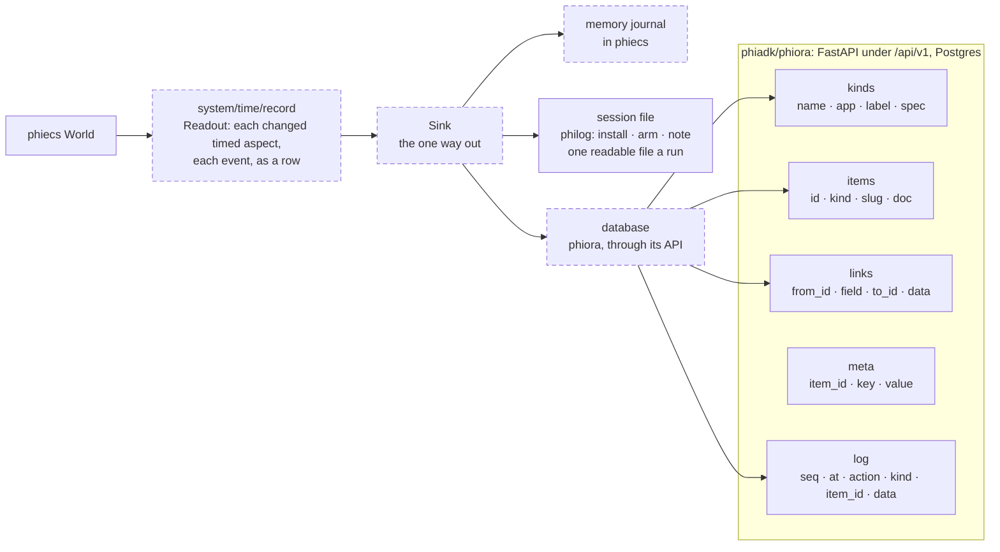
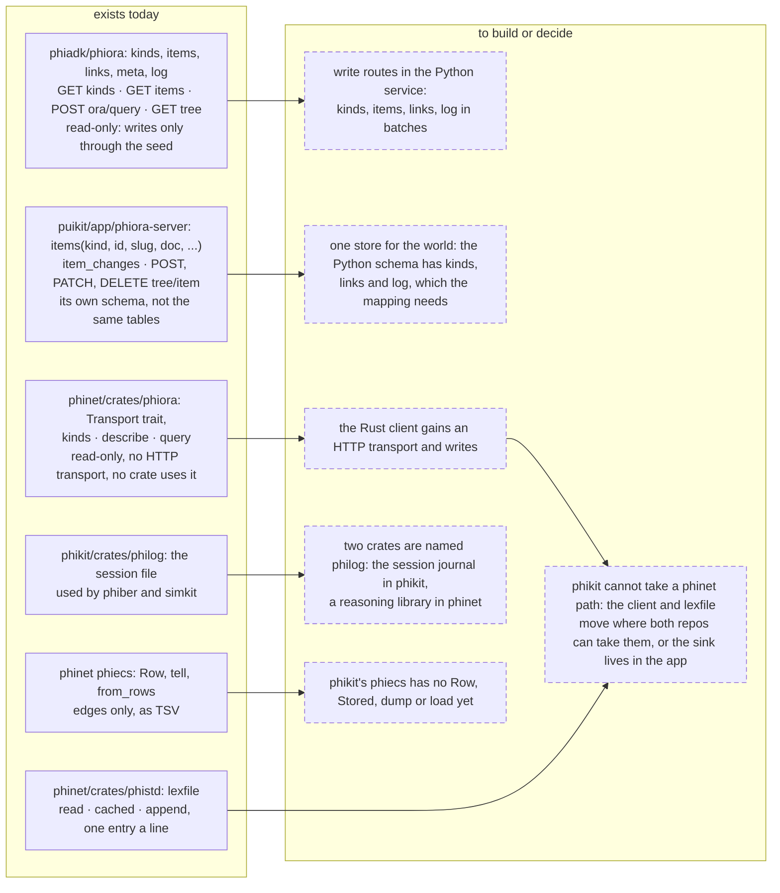
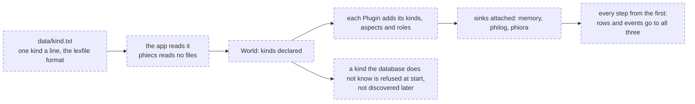

# connect

How the world reaches the database, the session journal and data files,
planned from what exists (read 2026-11-10, nothing run). Solid boxes are
in the code today; dashed boxes are to build.

## What maps to what

The right-hand columns are tables that exist today in the Python service
(`phiadk/phiora/alembic/versions/0001_core.py:15-109`).

| In the world | In phiora | Rule |
|---|---|---|
| `Kind` | a row of `kinds`: `name`, `app = phikit`, `spec` | declared once, in one data file; the same list goes to `World` at start and to the database. `spec` lists the aspects a kind carries and their fields |
| a `Word` | a row of `items`: `id`, `kind`, `slug`, `doc` | `id = md5(kind:name)`, the rule already in `src/services/ids.py:9`; `slug` is the spelling |
| a word's stored aspects | `items.doc`, one object an aspect: `{ aspect name: { field: value } }` | only aspects that are `Stored` and not `Transient` |
| the `Tree` | `links`: `field = parent` | one row a child |
| a relation edge | `links`: `field` = the relation's name, `data` = the weight | the name, never the channel number: the two phiecs number relations differently |
| a journal row: an aspect's value at a tick | `log`: `action = set`, `kind`, `item_id`, `data = { tick, aspect, fields }` | appended, never rewritten |
| an event | `log`: `action` = the event's name | same |
| the clock | `meta` on the world's own item: `tick`, `time`, `fps` | - |
| an `Asset { kind, key }` | the `id` of another item, held in `doc` as a field ending `Id` | the reference convention phiora already rebuilds `links` from (`src/services/seed.py:208-227`) |

## What exists, and what is missing

## From the first commit

