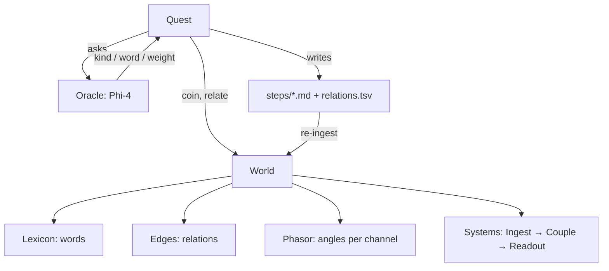

# phiecs

An entity-component-system for language. Apple's RealityKit shape — entities in
a world, components hung on them, systems run over both — with one
substitution: the entity is a **word**, and what it carries is not a position
in space but a phase on the relation circle.

> In Phient's world a word (w) is nothing but what it relates to, under what
> conditions (c). The Phical paradigm, X ⇒ Y, drives and composes Phient's
> Phasor Language Models: Phinet, Phiano, PhiTon. Phical stores no point: a
> word is 32–64 relations, each a complex phasor on a closed circle with a
> count; meaning is a side effect of pairs of words moving under a condition.



## Key types

| file | types |
|---|---|
| `word/` | `Word`, `Lexicon` — the entity and the interner that issues it |
| `aspect.rs` | `Aspect` — the component trait (explicit impl, so its hooks are real) |
| `store/` | `Dense<A>` — id-indexed storage, O(1) where Apple's is O(n) |
| `relation/` | `Relation`, `Relations`, `Edge`, `Edges` — the kind of an edge, which RealityKit has no name for |
| `phasor.rs` | `Phasor` — what `Transform` is to RealityKit: 64 channels of angle, amplitude and evidence |
| `condition/` | `Condition`, `Conditions` — GameplayKit's state machine, keyed on interned words |
| `world/` | `World`, `WordBuilder` — `coin` / `forget` / `relate` / `calls_for` / `step` |
| `query/` | `with`, `with2`, `Related` — the join along an edge kind |
| `system/` | `System`, `Stage`, `FnSystem` — Ingest → PreCouple → Couple → PostCouple → Readout |
| `quest/` | `Quest`, `Oracle`, `Spawned`, `Scripted`, `Synthetic`, `Template`, `Step`, `parse_tsv` — learning by asking, and reading a quest back |

## Usage

```rust
use phiecs::prelude::*;

let mut world = World::new();
let cat = world.coin("cat").bind(Phasor::seeded("cat")).word();
let mat = world.coin_bare("mat");
let on = world.declare("on").unwrap();
world.relate(cat, on, mat);
assert_eq!(world.calls_for(cat, on).first().map(|(w, _)| *w), Some(mat));
```

A quest against a local Phi-4:

```bash
cargo run --release --example quest -- cat 3 64 ollama run phi4
cargo run --release --example quest -- cat 2 16     # no model: scripted dry run
cargo run --release --example quest -- w0 12 600 synthetic 256   # a hidden structure with a known answer
```

The synthetic oracle is what the bridge to phiano is measured on: its
`relations.tsv` goes through `phiano/bin/quest_ingest`, which turns each row
into the document `about kind other`, lets the kinds become marker channels,
and ranks the true `other` on the kind's channel — 97% hit@5 over 293 words
with attraction-only, dithered coupling (phiano docs/83). `Quest::from_tsv`
reads any written table back into a world.

## Status

- [x] Word / Lexicon, dense aspect storage, world, `forget` that actually forgets
- [x] Relations as first-class edge kinds, bounded at 64 channels
- [x] Phasor coupling: two words move toward each other on one channel, counted
- [x] Staged systems, queries including the relation join
- [x] Quest: recursive oracle walk, strict-format templates, transcript files
- [x] Bridge to phiano: `relations.tsv` → `bin/quest_ingest` → marker channels, measured (phiano docs/83)
- [ ] `phiano-facet`: read a `.chroma` lexicon in directly (the TSV is the bridge today)
- [ ] Condition-conditioned readings (`CONDITIONS` template is written, not yet walked)
- [ ] ECS Wand: the phiber workspace edits this graph as nodes
