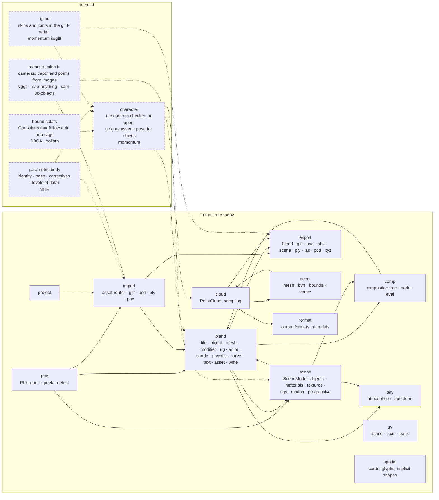
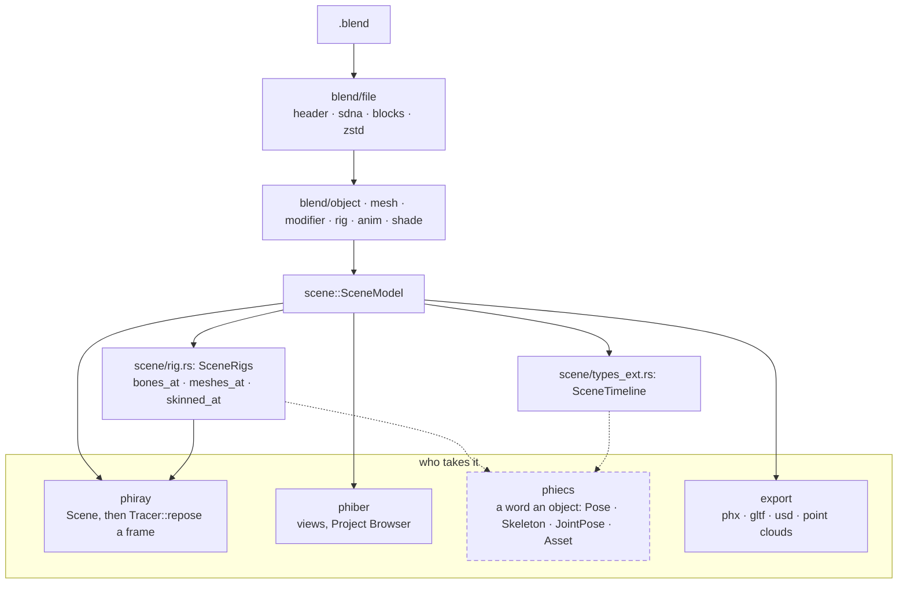

# phiphx — architecture

Solid boxes are in the crate today. Dashed boxes are to build, each named
with the reference it is read from (`reference/<repo>`). Blender stays the
specification for everything a `.blend` shows; the references add what a
`.blend` does not hold.

## The modules and what they use

## A file to a frame, and where it is handed on

## Pages, one subject each

- [character](docs/character.md): Blender's rig beside momentum's, the contract, what drives each reference's deformation

Folder notes: [scene](src/scene/README.md) · [blend](src/blend/README.md) ·
[import](src/import/README.md) · [export](src/export/README.md) ·
[cloud](src/cloud/README.md) · [geom](src/geom/README.md) ·
[format](src/format/README.md) · [spatial](src/spatial/README.md)

Folders and order of work for the new lanes: [PLAN.md](PLAN.md) ·
What each part must do: [SPECS.md](SPECS.md) ·
The references: [reference/README.md](reference/README.md) ·
Blender parity, what is left to do: [TODO.md](TODO.md)
