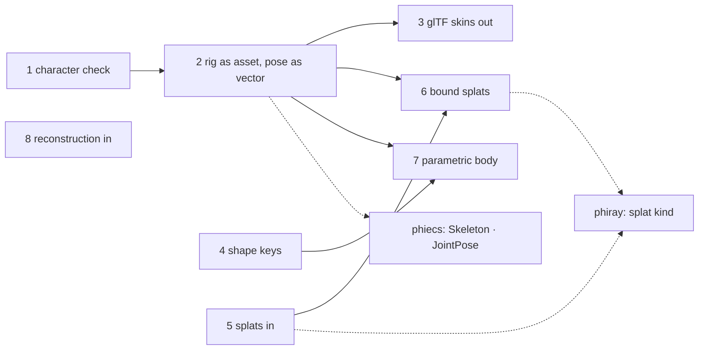
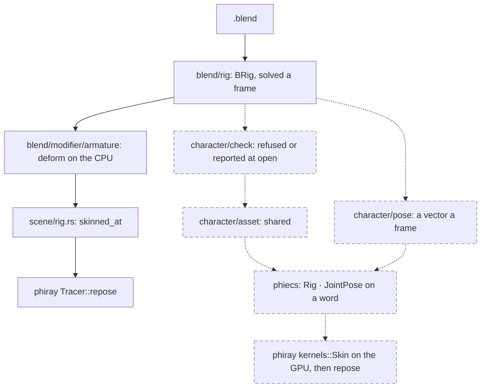

# phiphx — plan

The folder tree, today and suggested, and the order to build the new lanes
in. Blender parity has its own plan, [TODO.md](TODO.md), and nothing here
replaces it: this page covers only what the references add. What each part
must do is in [SPECS.md](SPECS.md); the diagrams are in
[ARCHITECTURE.md](ARCHITECTURE.md).

## The folder tree today

Counts are `.rs` files, subfolders included.

| Path | Holds | Files |
|---|---|---|
| `src/phx.rs` | `Phx`: open, peek, detect | 1 |
| `src/blend/file/` | header, SDNA, blocks, Zstd | 15 |
| `src/blend/object/`, `mesh/`, `curve/`, `text/` | what a file holds | 20, 15, 10, 17 |
| `src/blend/modifier/` | the modifier stack, armature deform, cloth caches | 62 at the top level |
| `src/blend/rig/` | `BRig`, the pose solve, constraints, IK | 37 |
| `src/blend/anim/` | f-curves, NLA, drivers, playback | 20 at the top level |
| `src/blend/shade/`, `physics/`, `write/` | materials, bodies, writing a `.blend` | 28, 7, 16 |
| `src/scene/` | `SceneModel`: what every view draws | 32 |
| `src/import/`, `src/export/` | other readers; writers | 22, 37 |
| `src/comp/`, `sky/`, `uv/` | compositor, atmosphere, unwrapping | 6, 3, 5 |
| `src/cloud/`, `geom/`, `format/`, `spatial/` | point clouds, geometry, formats, spatial cards | 5, 6, 2, 11 |
| `reference/` | 38 Meta repositories and the index | - |

## The folders to add (suggested)

| Path | Holds | Read from | Order |
|---|---|---|---|
| `src/scene/character/check.rs` | the consistency check on a rig and the meshes it deforms, reported at open | momentum | 1 |
| `src/scene/character/asset.rs` | a rig as an asset: rest skeleton, inverse rest matrices, weights, pins | momentum, RealityFoundation `Skeleton` | 2 |
| `src/scene/character/pose.rs` | a frame's pose as one vector, by joint name | momentum | 2 |
| `src/export/gltf/skin.rs` | skins, joints and inverse bind matrices in the glTF writer | momentum `io/gltf` | 3 |
| `src/blend/mesh/keys.rs` | shape keys: none is read today | Blender; actionmesh for the use | 4 |
| `src/splat/read.rs` | Gaussian splats from a PLY: position, scale, rotation, opacity, harmonics | vkraygs (in phiray's references) | 5 |
| `src/splat/bind.rs` | a splat bound to the triangle or cage cell it follows | D3GA, goliath | 6 |
| `src/import/mhr/` | the parametric body: identity, pose, correctives, levels of detail | MHR; needs its released rig files | 7 |
| `src/import/recon.rs` | cameras, depth and points from an outside reconstruction, into `cloud` | vggt, map-anything, sam-3d-objects | 8 |

## Order of work

## Where a character goes, today and after

Suggested, not decided: the CPU deform stays the reference path, because it
is the one checked against Blender; the GPU path is accepted only where it
matches it.
