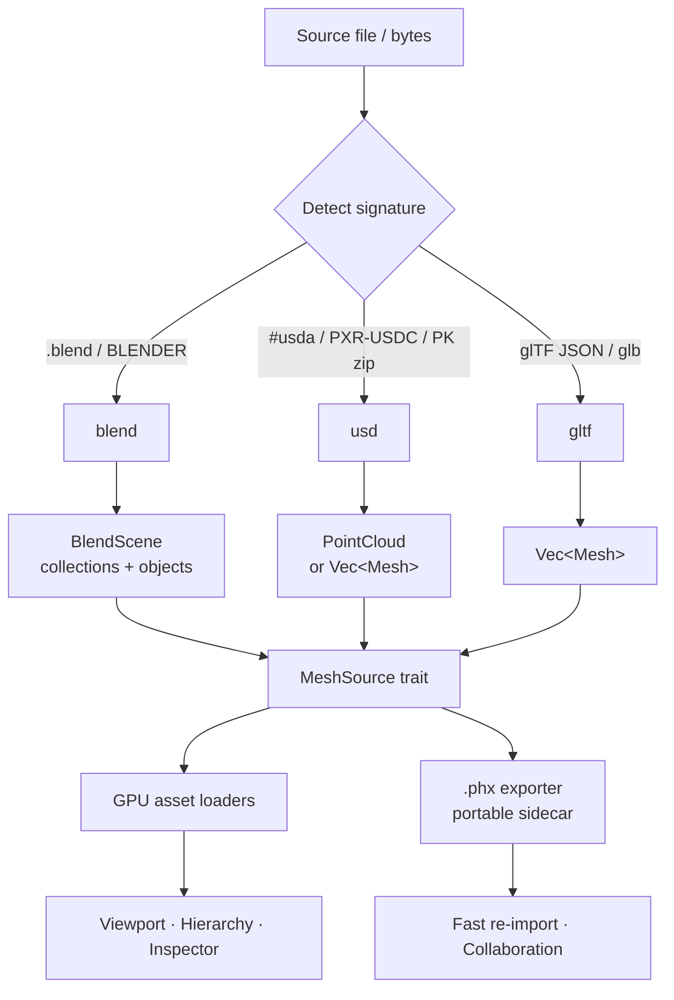
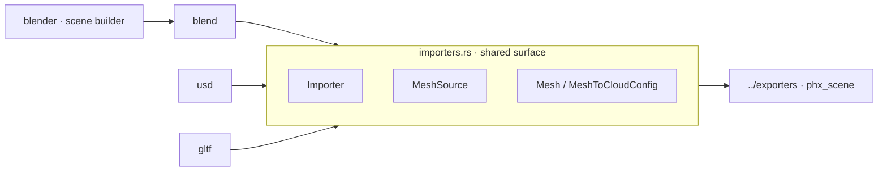

Readers that bring external 3D scenes into phx. Each importer is
dependency-free (no Blender, no OpenUSD, no glTF SDK) and converts a source
file into phx geometry — point clouds, `Mesh`es, or the richer `BlendScene`.
The goal is a single, uniform ingestion layer so that anything dropped into the
editor's Project Browser — regardless of where it came from — surfaces as the
same in-engine types, ready for the hierarchy, the viewport, and the inspector.

## Overview

A 3D asset arrives in one of several wire formats, each with its own quirks: a
`.blend` is a raw memory dump of Blender's runtime structs; a `.usd*` is a
scene graph that may be ASCII, binary, or zipped; a `.gltf`/`.glb` is a
JSON-plus-binary transmission format. Rather than leak those quirks upward,
every importer narrows its format down to the same handful of phx types so the
rest of the engine never has to care about provenance.

All importers share the small trait surface in `importers.rs`:

* `Importer` — `can_import` / `import_bytes` / `import_file`. Detection is by
  content signature first (magic bytes), extension second, so a mislabelled
  file still routes correctly.
* `MeshSource` — uniform read access to a parsed object's name, vertices,
  indices, and world matrix. This is the seam the GPU asset loaders read from.
* `Mesh` / `MeshToCloudConfig` — the common mesh type and the point-sampling
  config used when a caller wants a `PointCloud` preview instead of full
  topology.

### Ingestion pipeline

### Where each importer sits

## How is this module organized?

    importer.rs             # module root: AssetImporter dispatch, shared result types
    importer/
    ├── blend.rs + blend/   # native Blender .blend reader (SDNA) → BlendScene     [see blend/README.md]
    ├── usd.rs + usd/       # USDA / USDC / USDZ importer                          [see usd/README.md]
    ├── gltf.rs + gltf/     # glTF 2.0 importer (feature `gltf-import`)
    ├── phx.rs              # .phx scene importer
    ├── ply.rs              # Stanford PLY
    ├── asset.rs            # AssetImporter: extension/magic → importer, progress callback
    ├── format.rs           # FileFormat detection
    └── project.rs          # project scaffolding (feature `appkit`)

Phiber opens `.blend` files through `services::scene::load_blend_scene_with_progress`
(real progress + cancel, no side effects). The asset pipeline goes through
`AssetImporter` → `BlendImporter::import`, which is the only path that writes a
`.phx` sidecar.

## Output formats

| Input            | Importer            | Primary output           | Topology | Materials |
|------------------|---------------------|--------------------------|----------|-----------|
| `.blend`         | `blend`             | `BlendScene` → `SceneModel` (+ `.phx` on asset import only) | full, world matrices, collections, view layer | viewport colour + Principled base colour, per-face slots |
| `.usda/.usdc/.usdz` | `usd`            | `PointCloud` / `Vec<Mesh>`| full (usda) / approx (usdc) | — |
| `.gltf/.glb`     | `gltf`              | `Vec<Mesh>`              | full     | per-primitive |

## Design notes

* **Dependency-free by policy.** Each format is parsed from first principles so
  the crate builds anywhere without native toolchains. The trade-off is that
  some readers (notably USDC) are heuristic rather than exhaustive.
* **Signature-first detection.** `can_import` inspects magic bytes before
  trusting the extension, so renamed files still route to the right reader.
* **One result, many sources.** Whatever the input, callers consume the parsed
  object through `MeshSource`, which keeps the GPU side format-agnostic.
* **Portable sidecars (asset import only).** `AssetImporter` imports also emit a
  `.phx` (see `../exporter/scene`) for sharing / collaboration. Opening a file
  in Phiber never writes beside it (Blender parity) — the hash-indexed reader
  made the sidecar unnecessary for speed.

See `../exporters/` for the matching writers (notably `phx_scene` — the
portable `.phx` format used for fast re-import and collaboration).
