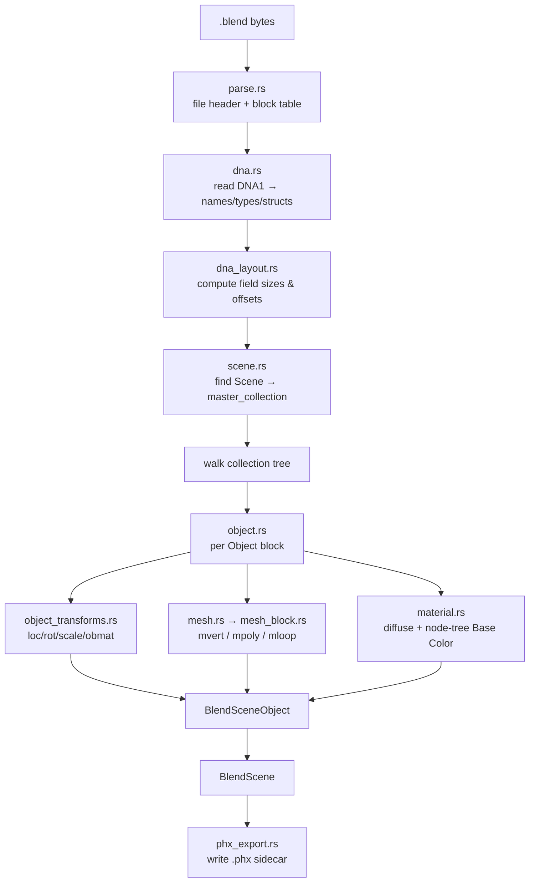
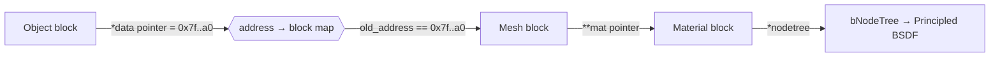

A dependency-free reader for Blender `.blend` files. It parses the binary SDNA
format directly — no Blender installation, no Python — and converts a scene
into the engine's `BlendScene` (collection tree + per-object geometry,
transforms, and materials).

## Overview

A `.blend` file is not a document format; it is a snapshot of Blender's
in-memory C structs written verbatim to disk. To read one back you need the
schema those structs were written with, and Blender helpfully embeds it: a
special `DNA1` block (the **SDNA**, "Structure DNA") describes every struct's
name, its fields, and their types. Parsing therefore happens in two passes:

1. **Block + DNA parse** — read the file header (pointer size + endianness),
   then every data block (a `BHEAD` header followed by its payload), and
   finally the `DNA1` block that defines every struct's field layout.
2. **Scene extraction** — using the DNA layout, walk the `Scene` →
   `master_collection` hierarchy, resolve each `Object`'s transform, mesh
   (`Object.*data → Mesh`), and material (`Object`/`Mesh` `**mat → Material`,
   including the Principled BSDF *Base Color* read out of the shader node tree).

Pointers in the dump are the original runtime memory addresses. The importer
resolves a link by matching a struct field's stored pointer value against each
block's saved `old_address`, effectively rebuilding the in-memory graph. Field
byte offsets are computed from the DNA at runtime rather than hard-coded, which
keeps the reader tolerant across Blender versions whose struct layouts differ.

Every successful import also writes a portable [`.phx`](../../exporters/phx_scene.rs)
sidecar next to the source blend (see `phx_export`) so the scene re-imports
instantly and can be shared for collaboration.

### Two-pass parse



### Pointer resolution

A field that holds a pointer is dereferenced by address lookup, not by file
offset — this is how the flat block list is turned back into a graph:



### Material resolution order

Base color is sought in priority order so the most authored value wins:

```mermaid
flowchart LR
    A[Object.**mat] -->|found| Z[Material]
    A -->|none| B[Object.*data → Mesh.**mat]
    B --> Z
    Z --> C{nodetree present?}
    C -->|yes| D[Principled BSDF<br/>"Base Color" socket RGBA]
    C -->|no| E[Material.r/g/b/a<br/>roughness · metallic]
```

## Key entry points

* `services::scene::load_blend_scene_with_progress(path, &|fraction, stage| -> bool)`
  — what Phiber uses to open a file: real progress, cancel by returning
  `false`, no files written.
* `BlendImporter::import_blend_native(path) -> BlendScene` — plain read.
* `BlendImporter::import(path, progress)` — asset pipeline; also writes the
  `.phx` sidecar (`asset_import.rs`).
* `BlendFile::parse_bytes` / `extract_scene` — low-level; used by
  `examples/inspect_blend.rs` to dump header, scene properties and the view
  layer tree.

`BlendScene` carries `collections` (tree with `exclude` / `hide_viewport`),
`objects` (each with `matrix_world`, `matrix_local`, parent address,
`face_materials`, material slots with `viewport_color` + `base_color`),
`active_object`, `selected`, `hidden`, and `props` (frame range, fps,
resolution, engine, world colour, view layer name).

## How is this module organized?

Every file mirrors a `blenloader` / DNA seam and stays ≤ 200 lines.

    blend.rs                 # module root: BlendImporter, open-with-progress
    blend/
    ├── header.rs            # BLENDER header, legacy 12-byte + v1 17-byte   (blo_core_blend_header.cc)
    ├── bhead.rs             # BHead4 / SmallBHead8 / LargeBHead8            (BLO_core_bhead.hh)
    ├── parse.rs             # zstd/gzip sniff, block loop, OldNewMap index (+ repeated addresses), progress
    ├── scope.rs             # per-ID pointer resolution for repeated addresses (Blender's datamap) (#48)
    ├── dna.rs, dna_layout.rs, readers.rs   # SDNA schema, field offsets, primitive reads
    ├── types.rs, scene_types.rs            # file-level / scene-level result types
    ├── scene.rs             # FileGlobal.curscene → scene assembly
    ├── collection.rs        # master_collection → children / gobject walk
    ├── view_layer.rs        # ViewLayer bases (selected/hidden/active) + LayerCollection flags
    ├── scene_props.rs       # Scene.r frame range / fps / resolution / engine, World colour
    ├── world.rs             # parent-chain world matrices, layer-flag application
    ├── names.rs             # ID.name decoding
    ├── object.rs, object_dna.rs, object_meta.rs   # OB block → BlendSceneObject, modifiers, instancing
    ├── object_transforms.rs # loc/rot/quat/axis-angle/size (+deltas), parentinv, parent  (DNA-driven)
    ├── object_type.rs       # OB_* → type name (5.2 table)
    ├── object_data.rs       # Camera / Light (Lamp in ≤3.x) / empty display data
    ├── rotation.rs          # eulO_to_mat3 / quat / axis-angle, BKE_object_to_mat4, solve_parenting
    ├── mesh.rs              # Object.*data → ME block; verts, faces, UVs, normals, material_index
    ├── mesh_offsets.rs      # Mesh field offsets (4.x/5.x + legacy)
    ├── mesh_block.rs        # attribute-layout extraction + build_faces
    ├── mesh_positions.rs, mesh_faces.rs, customdata_float.rs   # position / .corner_vert / int + float3 layers
    ├── mesh_legacy.rs, mesh_uv.rs, mesh_normals.rs             # mvert/mpoly/mloop, UVs, split normals
    ├── attr_storage.rs      # Blender 5.x Mesh.attribute_storage: array + single-value attributes (#47)
    ├── mesh_shading.rs      # named face attributes: sharp_face, material_index (+ legacy CD_MPOLY)
    ├── material.rs, material_slots.rs, node_tree.rs            # slots, viewport colour, Principled Base Color, Image path
    ├── ui_state.rs          # Load UI: active workspace, largest 3D view (RegionView3D, shading) (#28)
    ├── modifier/            # viewport modifier stack: KINDS table → BModifier (#16)
    │   ├── armature.rs      #   vertex-group skinning from saved pose matrices
    │   ├── subsurf.rs       #   Catmull-Clark / Simple, limit surface, weights carried
    │   ├── mirror.rs        #   X/Y/Z mirror, merge, .L/.R group flip
    │   └── topology.rs      #   flat edge / CSR adjacency
    ├── vgroups.rs           # CD_MDEFORMVERT / Mesh.dvert weights
    ├── image.rs             # image keys + packed image bytes (#26)
    ├── quick.rs             # REND + TEST header-only peek for file-browser previews (#9)
    ├── asset_import.rs, phx_export.rs                          # asset pipeline + .phx sidecar
    └── *_tests.rs           # parse, rotation, types, upstream-file tests

## Status (2026-09-16)

Verified against Blender's own `tests/files` (incl. the 5.x
`modeling/operators.blend`) and two production files in
`crates/phiphx/tests/fixtures`. 74 unit tests plus phiber integration tests on the fixtures.

* **Blender 5.x files open** (v1 header + LargeBHead8).
* **O(1) pointer resolution** — LAND-TYPE-15-01 (178 MB, 756k verts) opens in 0.38 s release.
* **World matrices** follow `BKE_object_to_mat4` + parent chain (the 4.x+ DNA has no `obmat`).
* **View layer**: active scene/view layer from `FileGlobal`, selection, hidden objects, excluded / hidden collections.
* **Materials**: per-face `material_index`, Solid-mode `Material.r/g/b`, Principled Base Color.
* **Scene props**: frame range, fps, resolution, engine, world colour.
* **Cameras / lights / empties**: type and display data for the viewport overlay.
* **Smooth flags**: `sharp_face` or legacy `ME_SMOOTH`; triangulation per Blender (`services/scene/polyfill.rs`).
* **CustomData** layer counts come from DNA (`typemap[]` sits before `totlayer`).

## Known limitations

* **Modifiers are detected, not evaluated** — subdivision / mirror / array show as their cage.
* **Image textures** — only the Image Texture path is read; pixels (packed or on disk) are not loaded.
* **Parenting** — only `PAROBJECT`; bone / vertex parents use the parent object's matrix. Constraints and drivers are ignored.
* **Linked libraries** (`ID_LI`) are not followed.
* **`.phx` export** (asset pipeline) still fan-triangulates.

Full gap table and priorities: `crates/phiber/docs/blend-read-parity.md`.

## Ground truth

`tests/blender_truth.rs` compares per-mesh digests with `tests/truth/mesh_digest.txt`, which Blender 5.0.1 produced (`tests/truth/blender_mesh_digest.py`). It covers 1,276 meshes from Blender 3.4–5.2 files, and any change to the mesh readers must keep it green. `file_tests.rs` checks that every DNA struct's field sizes add up to its declared size. `crates/phiber/tests/viewport_vs_blender.rs` compares whole saved views (modifiers, Load UI, camera) against Blender renders in `tests/truth/views/`.
