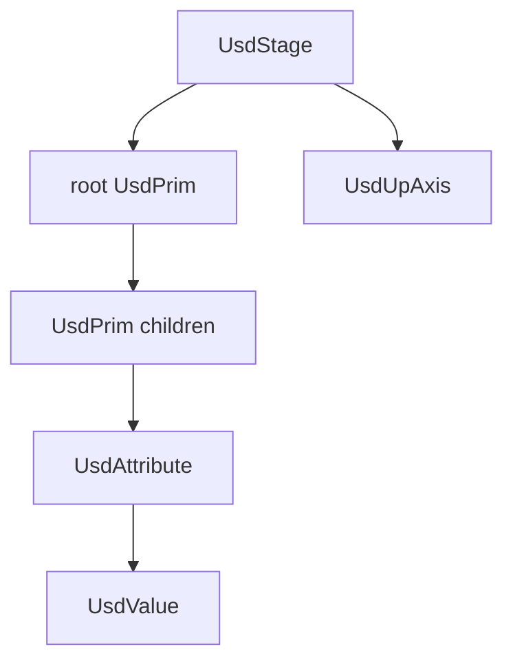

# usdkit

Mirrors Apple's **USDKit** framework — the Universal Scene Description object
model (stages, prims, attributes) for authoring and reading `.usd`, `.usda`,
`.usdc`, and `.usdz`. Gated behind the `macos-usdkit` feature.

## Files (each file is a logical module)

- `mod.rs` — framework root; `pub mod` + glob re-exports, `USDKitVersion`.
- `stage.rs` — `UsdStage`, `UsdUpAxis`, traversal + path lookup + mesh query.
- `prim.rs` — `UsdPrim`: path, type, attributes, children, mesh predicate.
- `attribute.rs` — `UsdAttribute`, `UsdValue` (scalar + array value types).

## Reference

`Interfaces/MacOSX/USDKit/Headers/*.h` (placeholder in the reference dump;
modeled on the OpenUSD `Stage` / `Prim` / `Attribute` object model that the
existing `reality-foundation/scene_usd` mesh visitor consumes).
