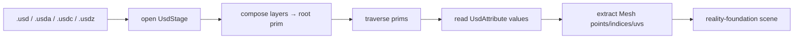

# usdkit — data flow

## Lifecycle

1. **Open** — a `UsdStage` is created/loaded; stage metadata (`up_axis`,
   `meters_per_unit`, `default_prim`) is read.
2. **Compose** — sublayers/references resolve into the root `UsdPrim` tree.
3. **Traverse** — `stage.traverse()` yields prims depth-first; `meshes()` filters
   to geometry.
4. **Read** — per-prim `attribute("points" | "faceVertexIndices" | "primvars:st")`
   feeds geometry extraction.
5. **Hand off** — extracted meshes flow into `reality-foundation`'s scene loader.

## Notes

- The pseudo-root `/` is excluded from `traverse()`.
- `is_mesh()` is true for `Mesh`-typed prims or any prim authoring `points`.
