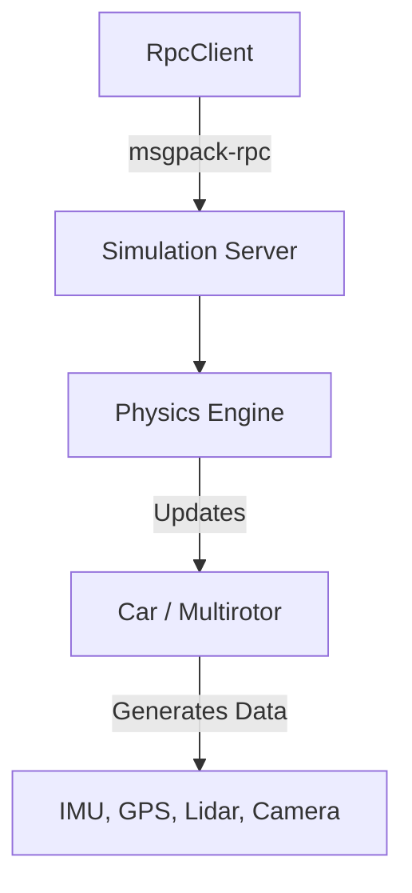

# SimKit Architecture & Data Flows

## 1. Simulation Control Flow

## 2. Sensor Telemetry Flow
1. **Tick Event**: Clock advances simulation time.
2. **Kinematics Update**: Physics world calculates new position/rotation.
3. **Sensor Polling**: 
   - `ImuSensor` reads ground truth kinematics.
   - `CameraSensor` captures viewport buffers.
4. **RPC Response**: `RpcClient::get_imu_data` retrieves serialized state.

## 3. Modularization Flow (Upcoming)
The transition to <200 line modules will split logic into:
- `api/client/mod.rs` (Core Client)
- `api/client/sensors.rs` (Sensor RPCs)
- `api/client/vehicles.rs` (Vehicle RPCs)
- `api/client/camera.rs` (Image/Vision RPCs)
