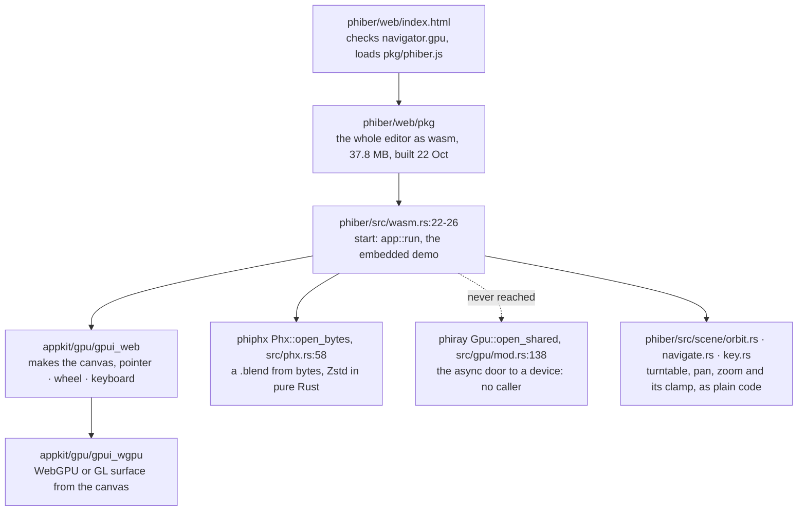
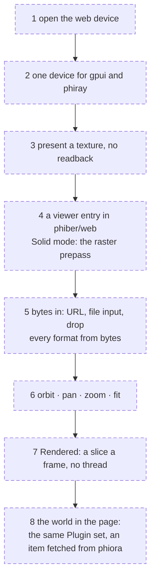
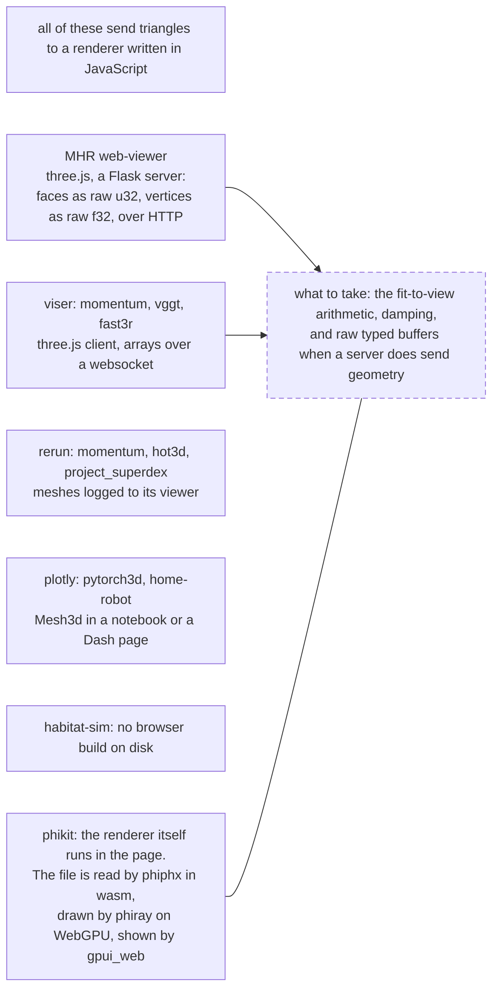
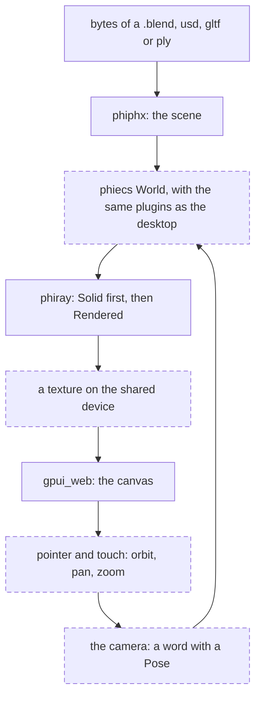

# web

An object on a web page that a visitor can turn, pan and zoom, the way a
USD model opens on Apple. Planned from what exists (read 2026-11-10,
nothing built or run). Solid boxes are in the code today; dashed boxes are
to build. Paths are under `crates/`.

## What exists

Whether that page runs in a browser today is not verified: no log of a run
is on disk.

## What stops an object appearing

| # | Blocker | Where | To build |
|---|---|---|---|
| 1 | phiray's web device is never opened: the async door has no caller, and the wasm `shared()` only reads | phiray `src/gpu/mod.rs:127-138` | open it during `web_init`, before the first view |
| 2 | No pixels come back: on wasm `wait_for` returns false, so `read_range` and `Tracer::pixels` are empty | phiray `src/gpu/mod.rs:318-322`, `gpu/array.rs:174-181`, `trace/mod.rs:985` | do not read back at all: see 3 |
| 3 | phiray has no surface, and cannot adopt the device gpui already holds | phiray `src/gpu/mod.rs:82-95, 241`, `gpu/raster.rs:53-83` | a constructor that takes a device and queue; the traced image handed to gpui as a texture. One device, no copy: the same change the desktop's present path needs |
| 4 | The traced viewport starts a worker thread | phiber `src/view/draw/canvas/view3d/rendered/worker.rs:45-56` | on the web, run one slice a frame from the page's frame callback |
| 5 | A page cannot be given a file: only `embedded:` opens, there is no picker, drops carry no path | phiber `src/app/load.rs:91-94`; `appkit/gpu/gpui_web/src/platform.rs:234-240`, `events.rs:347` | bytes in: a URL fetched, a file input, a drop |
| 6 | USD, glTF and PLY meshes are read from paths; the byte readers are private | phiphx `src/import/gltf/full.rs:24-25`, `usd/importer.rs:93-94`, `ply.rs:12-16`, `usd/usdz.rs:71` | `open_bytes` for every format `Phx::open` reads |
| 7 | The only wasm target is the whole editor | phiber `src/wasm.rs:22-26` | a viewer entry: one object, one view, no panels |

Also open, not blockers: rayon is unconditional in phiray and phiphx (its
serial fallback on wasm is not verified); Material Preview's kernel took
248 s to compile natively, so the viewer starts in Solid.

## The viewer, in order

## Moving it around: the interaction to match

Apple's is written down in SceneKit and RealityFoundation
(`gemphi/phi/apple-source/ruskit/Interfaces/MacOSX/`); Quick Look's own
headers are not on disk.

| Behaviour | Apple | phiber today | To build |
|---|---|---|---|
| drag orbits, scroll or alt-drag pans, pinch or alt-scroll dollies | `SceneKit/Headers/SCNView.h:92-102` | `scene/orbit.rs:18-43`, `scene/navigate.rs:59-174` | touch: one finger orbits, two pan and pinch |
| turntable about a target, world up fixed | `SCNCameraController.h:17-27, 47-55` | turntable | - |
| frame the object on load | `frameNodes:` `SCNCameraController.h:92` | - | distance = largest side / (2 tan(fov / 2)) x 1.18, near and far from it, as MHR's viewer does (`phiphx/reference/MHR/web-viewer/static/app.js:648-678`) |
| inertia, off by default | `SCNCameraController.h:59-63`, friction 0.05 | - | optional; MHR damps at 0.07 (`app.js:100-103`) |
| angle limits | `SCNCameraController.h:75-85` | zoom clamp `scene/key.rs:102-127` | vertical limit |
| which controls a view allows | `CameraControls { none, tilt, pan, orbit, dolly }`, RealityFoundation interface `:11624-11637` | - | one setting on the viewer |
| which files open | `MDLAsset.canImportFileExtension:` `ModelIO/Headers/MDLAsset.h:140` | `Phx::detect` | from bytes: blocker 6 |

## How the references put 3D on a page

## One viewer, not a second renderer

